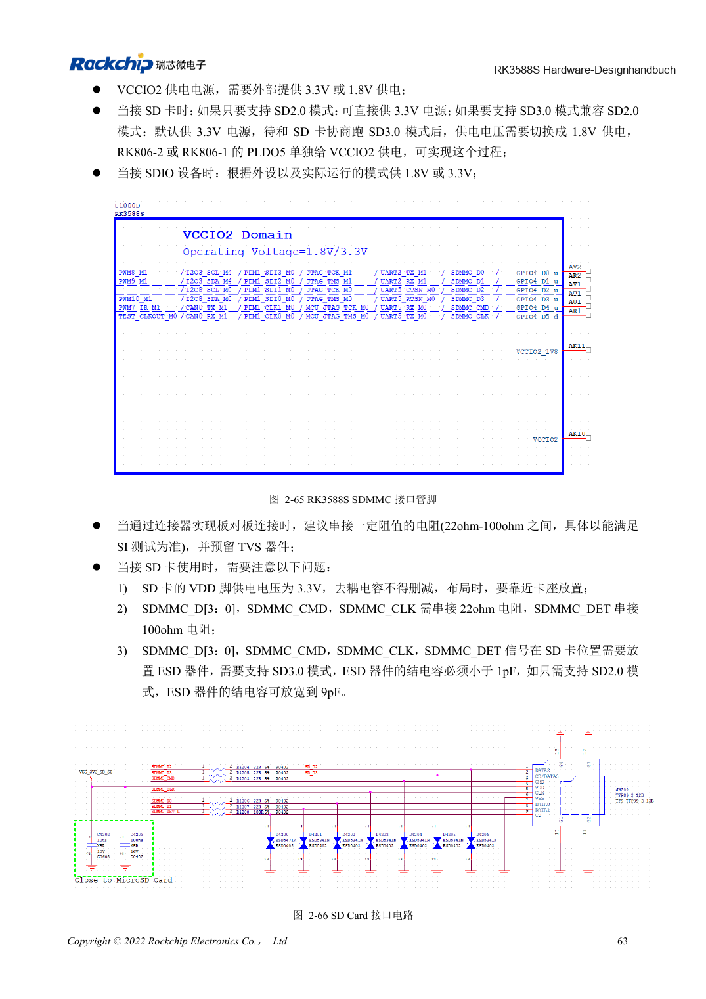

<!-- rk3588s-hardware-v12-20261109 -->

# RK3588S-SDMMC und SDIO-WLAN: Pegelwechsel und Schutz

Grundlage ist der chinesische RK3588S Hardware Design Guide V1.2 (2023-12-14) zur Schaltungs- und PCB-Prüfung. CM7S-Träger folgen den Modulschnittstellen; Sige7S dient der Software-/Peripherieerprobung. SoC-Funktionen sind keine Boardanschlussliste. SDK/BSP, Kernel, Revision, Firmware und Multiplexing prüfen. Werte sind Quellenreferenzen, keine ArmSoM-Messungen.

**RK3588S Hardware Design Guide V1.2 (2023-12-14), CN** · §2.3.1; §3.4.13–3.4.14; §3.4.19

## Kartenversorgung und IO unterscheiden

SD-VDD beträgt 3.3V. VCCIO2 nach SD3.0-Aushandlung auf 1.8V umzuschalten bedeutet nicht, die Karte mit 1.8V zu versorgen. SDMMC/JTAG-Auswahl hängt von SDMMC_DET ab. Referenz: 22Ω an Daten/CMD/CLK, 100Ω an DET sowie Abblockung und ESD am Sockel.

## WLAN braucht Takt- und HF-Prüfung

Modul-IO, UART/PCM-Richtung und 32.768kHz-Amplitude prüfen; π-Anpassung der Antenne vorsehen. Quarzlast zum Modul wählen; die Anleitung nennt 10ppm bei Raumtemperatur. SD3.0-ESD-Kapazität muss <1pF sein. Verbindung, Durchsatz, Schlaf/Aufwachen und Versorgungszyklen testen.

## Entwurfsparameter und Prüftabelle

| Punkt | Quellenreferenz |
| --- | --- |
| SD-Karten-VDD | 3.3V |
| SD3.0-ESD-Kapazität | <1pF |
| ESD nur für SD2.0 | ≤9pF |
| Data/CMD/CLK; DET | 22Ω; 100Ω |
| PCB-Impedanz/Länge | 50Ω ±10% / <4in |
| Takt-Daten-Differenz | <120mil |

## Quellenabbildungen

Für diese Reihe liegt kein entsprechendes englisches Designhandbuch vor. Alle vier Fassungen nutzen chinesische Originalausschnitte mit lokalisierten Beschriftungen. Bilder lassen sich in voller Auflösung öffnen; Text und Parametertabellen bleiben kopierbar. Seitenangaben beziehen sich auf physische PDF-Seiten.

Chinesisches Original · PDF 78 · 2-66

## Entwicklung mit ArmSoM

CM7S eignet sich für eigene Träger: zunächst integrierte Versorgung, DDR und Bootschaltungen bestimmen, dann außerhalb der Modulstecker planen. Sige7S dient als Ausgangspunkt für Software-/Peripherieerprobung. Bei beiden Produkten herausgeführte Interfaces, Pins, Pegel, Images und Kühlung revisionsbezogen prüfen. Ein Chipreferenzplan ist kein Produktanschlussplan.

- [ArmSoM CM7S](https://www.armsom.org/cm7s) · [CM7S Docs](https://docs.armsom.org/armsom-cm7s)
- [ArmSoM Sige7S](https://www.armsom.org/sige7s) · [Sige7S Docs](https://docs.armsom.org/armsom-sige7s)

## Weiterlesen

- [RK3588S-Hardwaredesign: 30 Themen](/de/articles/rk3588s-hardware-design-series/)
- [RK3588S-FSPI-Flash: Boot, Versorgung und Anpassung](/de/articles/rk3588s-fspi-boot-hardware/)
- [RK3588S-USB und Type-C: Controller, PHYs und Recovery](/de/articles/rk3588s-usb-typec-hardware-design/)
