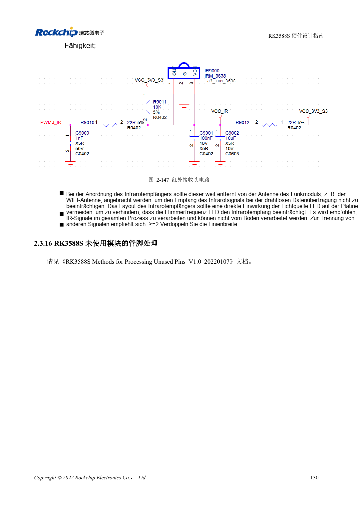

<!-- rk3588s-hardware-v12-20261109 -->

# RK3588S-UART, SPI, CAN, I2C und PWM zuordnen

Grundlage ist der chinesische RK3588S Hardware Design Guide V1.2 (2023-12-14) zur Schaltungs- und PCB-Prüfung. CM7S-Träger folgen den Modulschnittstellen; Sige7S dient der Software-/Peripherieerprobung. SoC-Funktionen sind keine Boardanschlussliste. SDK/BSP, Kernel, Revision, Firmware und Multiplexing prüfen. Werte sind Quellenreferenzen, keine ArmSoM-Messungen.

**RK3588S Hardware Design Guide V1.2 (2023-12-14), CN** · §2.3.11–2.3.15

## Muxgruppen nicht mischen

M0/M1/M2 bei UART, SPI, CAN und I2C sind Alternativen, keine zusätzlichen Controller. Eine vollständige unterstützte Gruppe und ihre Versorgung prüfen. SPI2 ist standardmäßig für den PMIC vorgesehen. CAN braucht einen externen Transceiver; SoC-TX/RX sind keine differenziellen Busleitungen.

## Peripherieprotokolle validieren

Die I2C-Pull-up-Referenz beträgt 2.2kΩ; der Wert hängt von Buslast und Pegel ab. HDMI DDC ist dediziert. V1.2 nennt CAN2.0B mit 1Mbps, keine CAN-FD-Zusage. UART-Baudrate/Flusssteuerung, SPI-Modus/Chip-Select, I2C-Flanken und CAN-Transceiverpegel sowie Schlaf und Reset prüfen und dokumentieren.

## Entwurfsparameter und Prüftabelle

| Punkt | Quellenreferenz |
| --- | --- |
| UART / allgemeines SPI | 10 / 5 Controller |
| CAN-Quellenumfang | 3 Controller; CAN2.0B; 1Mbps |
| I2C-Referenz | Bis 400Kbit/s; 2.2kΩ Pull-up |
| PWM-Anzahl der Quelle | 4 Controller ×4 Kanäle |

## Quellenabbildungen

Für diese Reihe liegt kein entsprechendes englisches Designhandbuch vor. Alle vier Fassungen nutzen chinesische Originalausschnitte mit lokalisierten Beschriftungen. Bilder lassen sich in voller Auflösung öffnen; Text und Parametertabellen bleiben kopierbar. Seitenangaben beziehen sich auf physische PDF-Seiten.

Chinesisches Original · PDF 145 · 2-147

## Entwicklung mit ArmSoM

CM7S eignet sich für eigene Träger: zunächst integrierte Versorgung, DDR und Bootschaltungen bestimmen, dann außerhalb der Modulstecker planen. Sige7S dient als Ausgangspunkt für Software-/Peripherieerprobung. Bei beiden Produkten herausgeführte Interfaces, Pins, Pegel, Images und Kühlung revisionsbezogen prüfen. Ein Chipreferenzplan ist kein Produktanschlussplan.

- [ArmSoM CM7S](https://www.armsom.org/cm7s) · [CM7S Docs](https://docs.armsom.org/armsom-cm7s)
- [ArmSoM Sige7S](https://www.armsom.org/sige7s) · [Sige7S Docs](https://docs.armsom.org/armsom-sige7s)

## Weiterlesen

- [RK3588S-Hardwaredesign: 30 Themen](/de/articles/rk3588s-hardware-design-series/)
- [RK3588S-GPIO und SARADC: Domänen und Tasten](/de/articles/rk3588s-gpio-saradc-hardware/)
- [RK3588S-Lagenaufbau und Fanout: HDI oder PTH](/de/articles/rk3588s-pcb-stackup-fanout/)
