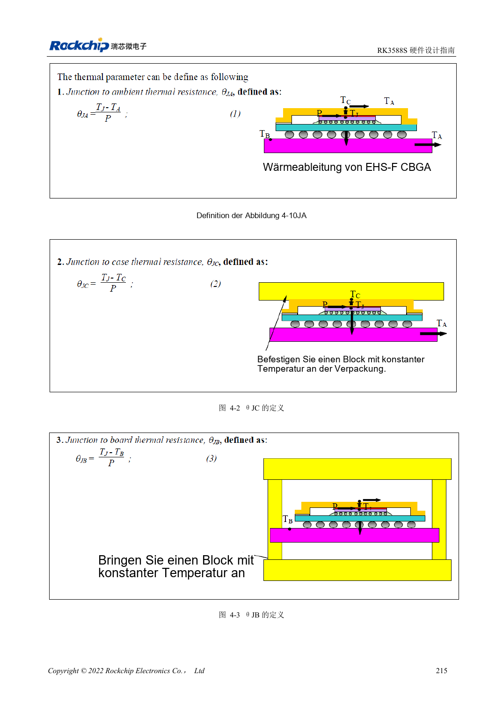

<!-- rk3588s-hardware-v12-20261109 -->

# RK3588S-Thermik: Referenzwärmewiderstand und Systemprüfung

Grundlage ist der chinesische RK3588S Hardware Design Guide V1.2 (2023-12-14) zur Schaltungs- und PCB-Prüfung. CM7S-Träger folgen den Modulschnittstellen; Sige7S dient der Software-/Peripherieerprobung. SoC-Funktionen sind keine Boardanschlussliste. SDK/BSP, Kernel, Revision, Firmware und Multiplexing prüfen. Werte sind Quellenreferenzen, keine ArmSoM-Messungen.

**RK3588S Hardware Design Guide V1.2 (2023-12-14), CN** · §4

## Simulation ist keine Modul-Temperaturerhöhung

Tabelle 4-1 stammt aus einem konkreten Gehäuse-/JEDEC-FEM-Modell: 200×140mm, 1.6mm, zehn Lagen, ohne Kühlkörper. Nicht direkt auf CM7S, CM7S-Träger oder Sige7S-Gehäuse übertragen. θJA, θJB und θJC haben unterschiedliche Bezugspunkte und sind nicht austauschbar.

## Wärmepfad und Schutz gemeinsam prüfen

Pfad zu Wärmeinterface, Kühler, Gehäuse und Umgebung, Anpressdruck und Isolation prüfen. 20–50mm zwischen RK3588S/RK806 sind eine Boardreferenz, kein Umbauauftrag für Module. Dauerlast, Takt, Temperatur und Anwendungslatenz mit realer BSP-Thermik testen; Schutzabschaltung belegt keine Leistung.

## Entwurfsparameter und Prüftabelle

| Punkt | Quellenreferenz |
| --- | --- |
| Quellen-θJA / θJB / θJC | 8.2 / 3.7 / 0.01 °C/W; Simulation |
| Quellen-PCB | 200×140mm; 1.6mm; 10 Lagen |
| Referenzabstand PMIC–SoC | RK3588S–RK806: 20–50mm |

## Quellenabbildungen

Für diese Reihe liegt kein entsprechendes englisches Designhandbuch vor. Alle vier Fassungen nutzen chinesische Originalausschnitte mit lokalisierten Beschriftungen. Bilder lassen sich in voller Auflösung öffnen; Text und Parametertabellen bleiben kopierbar. Seitenangaben beziehen sich auf physische PDF-Seiten.

Chinesisches Original · PDF 230 · 4-1

## Entwicklung mit ArmSoM

CM7S eignet sich für eigene Träger: zunächst integrierte Versorgung, DDR und Bootschaltungen bestimmen, dann außerhalb der Modulstecker planen. Sige7S dient als Ausgangspunkt für Software-/Peripherieerprobung. Bei beiden Produkten herausgeführte Interfaces, Pins, Pegel, Images und Kühlung revisionsbezogen prüfen. Ein Chipreferenzplan ist kein Produktanschlussplan.

- [ArmSoM CM7S](https://www.armsom.org/cm7s) · [CM7S Docs](https://docs.armsom.org/armsom-cm7s)
- [ArmSoM Sige7S](https://www.armsom.org/sige7s) · [Sige7S Docs](https://docs.armsom.org/armsom-sige7s)

## Weiterlesen

- [RK3588S-Hardwaredesign: 30 Themen](/de/articles/rk3588s-hardware-design-series/)
- [RK3588S-Power-PCB und PDN: Kupfer, Rückwege und Abblockung](/de/articles/rk3588s-power-pcb-pdn-design/)
- [RK3588S-ESD und EMI: Schnittstellenschutz und Rückwege](/de/articles/rk3588s-esd-emi-hardware-design/)
