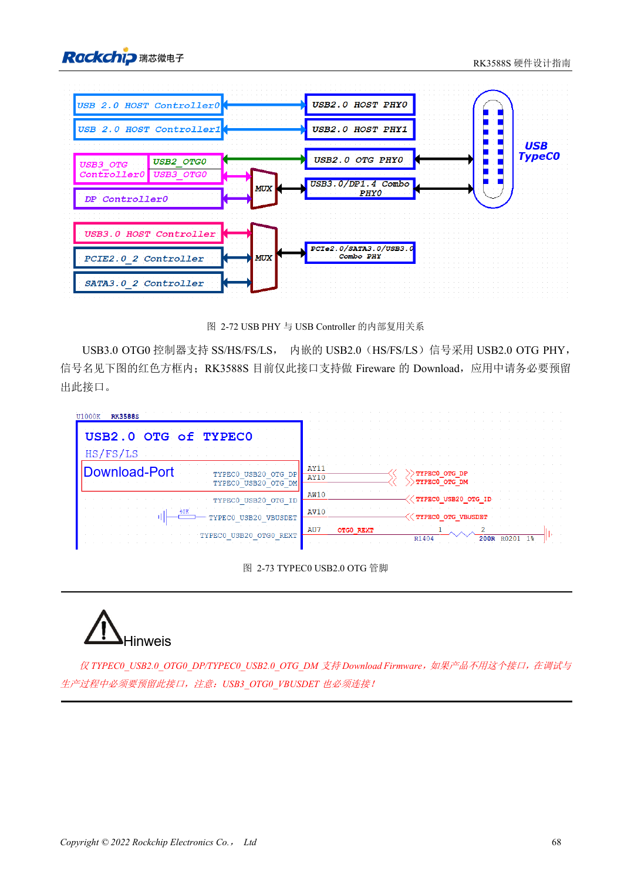
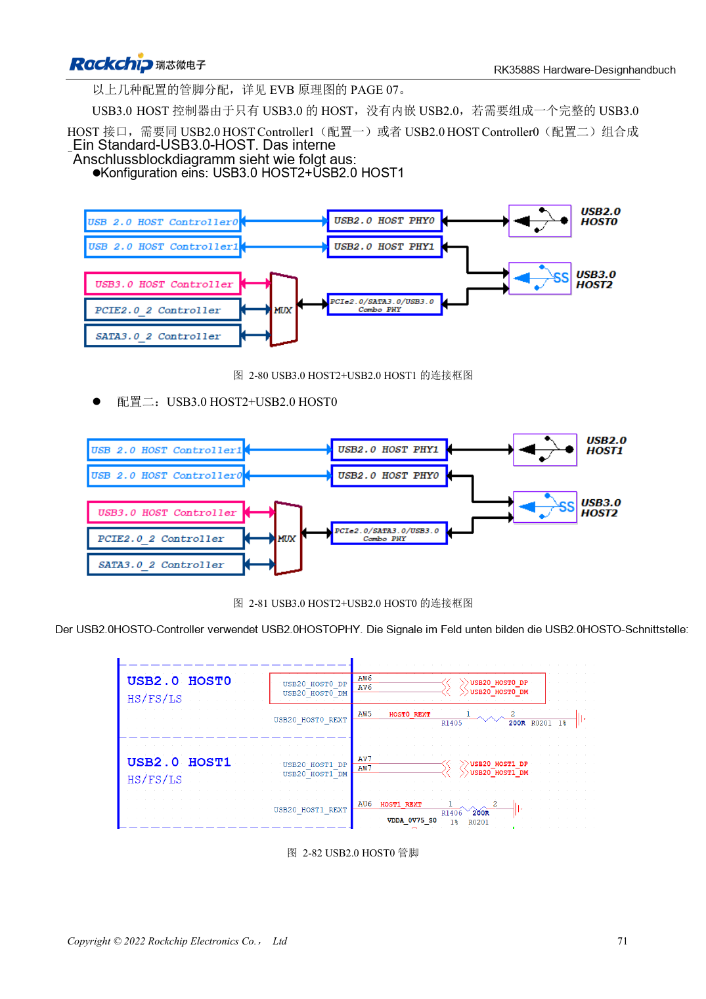

<!-- rk3588s-hardware-v12-20261109 -->

# RK3588S-USB und Type-C: Controller, PHYs und Recovery

Grundlage ist der chinesische RK3588S Hardware Design Guide V1.2 (2023-12-14) zur Schaltungs- und PCB-Prüfung. CM7S-Träger folgen den Modulschnittstellen; Sige7S dient der Software-/Peripherieerprobung. SoC-Funktionen sind keine Boardanschlussliste. SDK/BSP, Kernel, Revision, Firmware und Multiplexing prüfen. Werte sind Quellenreferenzen, keine ArmSoM-Messungen.

**RK3588S Hardware Design Guide V1.2 (2023-12-14), CN** · §2.3.4; §3.4.8–3.4.9

## Controller und Ports unterscheiden

RK3588S hat einen USB3-OTG-, einen USB3-HOST- und zwei USB2-HOST-Controller. Der separate USB3 HOST enthält kein USB2 und wird für einen vollständigen Port mit USB2 HOST kombiniert. USB2-OTG0-Download und VBUSDET erhalten. USB3/DP-Aufteilung, beide Steckrichtungen und externen CC-Controller gemeinsam prüfen.

## Versorgungsrollen und Kanal prüfen

USB3 HOST2 teilt Ressourcen mit SATA/PCIe; nicht alle drei gleichzeitig zählen. VBUS-Quelle/Senke, Rückspeisung, Stecker und Kabel prüfen. Erst USB2-Recovery, dann USB3-Erkennung, Dauertransfer, Hotplug und beide Type-C-Richtungen testen. Das Längenbudget umfasst Modul und Stecker.

## Zwei ESD-Kapazitätsgrenzen

Der Schaltungstext auf Seite 90 nennt ≤0.3pF, die PCB-Vorgabe auf Seite 221 ≤0.2pF. Beide Angaben dokumentieren und die strengere Grenze ≤0.2pF zur Bauteilprüfung verwenden; Pad-, Stecker- und Bauteilparasiten mitprüfen. Dies bestätigt keine bereits erfolgte Bauteilqualifikation.

## Entwurfsparameter und Prüftabelle

| Punkt | Quellenreferenz |
| --- | --- |
| USB2-Differenzimpedanz | 90Ω ±10%; Paardifferenz <20mil |
| USB3-Differenzimpedanz | 90Ω ±10%; Paardifferenz <6mil |
| USB3-Länge/Vias | <6in; empfohlen ≤2 |
| USB3-ESD-Kapazität | ≤0.2pF |

## Quellenabbildungen

Für diese Reihe liegt kein entsprechendes englisches Designhandbuch vor. Alle vier Fassungen nutzen chinesische Originalausschnitte mit lokalisierten Beschriftungen. Bilder lassen sich in voller Auflösung öffnen; Text und Parametertabellen bleiben kopierbar. Seitenangaben beziehen sich auf physische PDF-Seiten.

Chinesisches Original · PDF 83 · 2-72

Chinesisches Original · PDF 86 · 2-80

## Entwicklung mit ArmSoM

CM7S eignet sich für eigene Träger: zunächst integrierte Versorgung, DDR und Bootschaltungen bestimmen, dann außerhalb der Modulstecker planen. Sige7S dient als Ausgangspunkt für Software-/Peripherieerprobung. Bei beiden Produkten herausgeführte Interfaces, Pins, Pegel, Images und Kühlung revisionsbezogen prüfen. Ein Chipreferenzplan ist kein Produktanschlussplan.

- [ArmSoM CM7S](https://www.armsom.org/cm7s) · [CM7S Docs](https://docs.armsom.org/armsom-cm7s)
- [ArmSoM Sige7S](https://www.armsom.org/sige7s) · [Sige7S Docs](https://docs.armsom.org/armsom-sige7s)

## Weiterlesen

- [RK3588S-Hardwaredesign: 30 Themen](/de/articles/rk3588s-hardware-design-series/)
- [RK3588S-SDMMC und SDIO-WLAN: Pegelwechsel und Schutz](/de/articles/rk3588s-sdmmc-sdio-wifi-design/)
- [RK3588S-SATA: drei Controller und gemeinsame PHYs](/de/articles/rk3588s-sata-hardware-design/)
