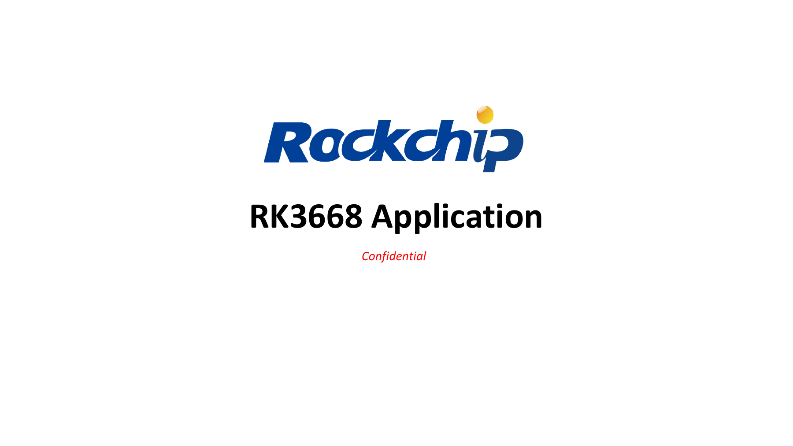
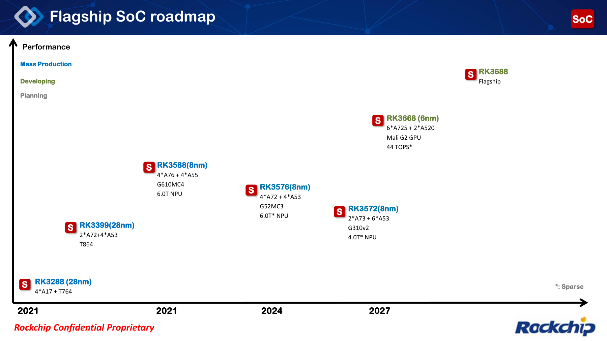
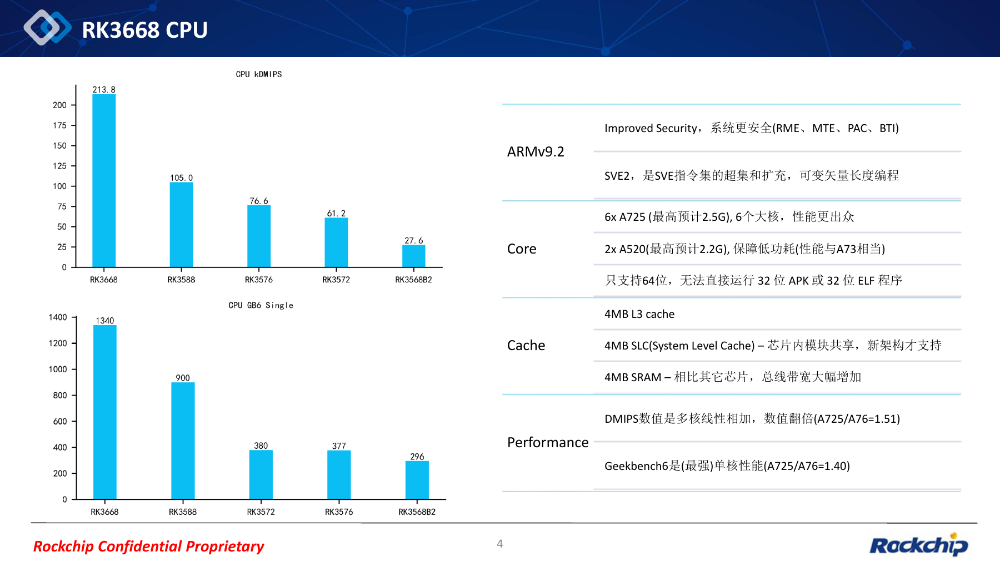
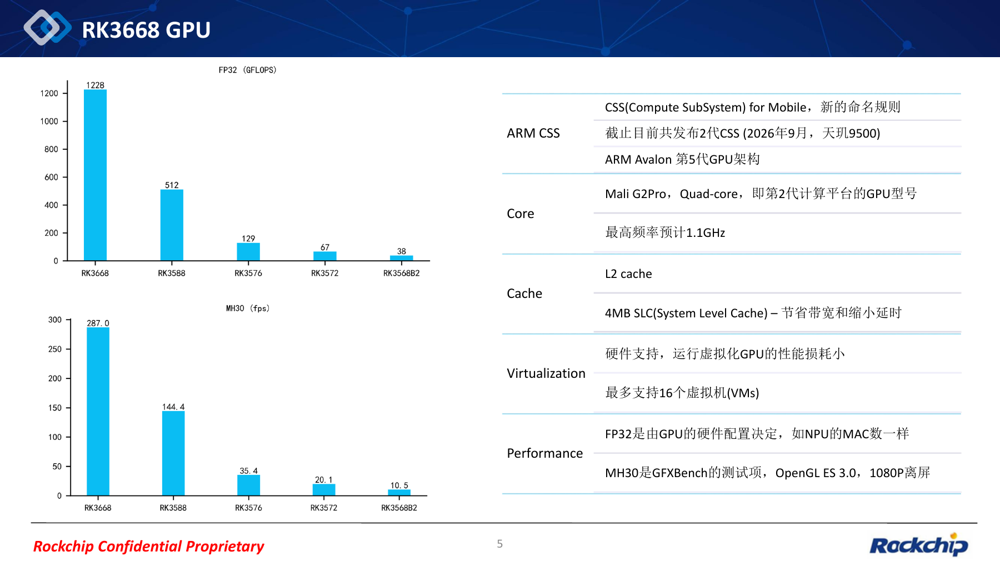
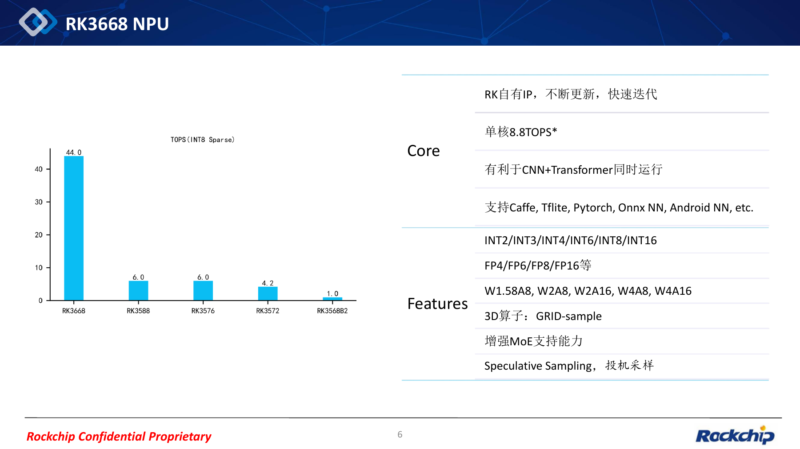
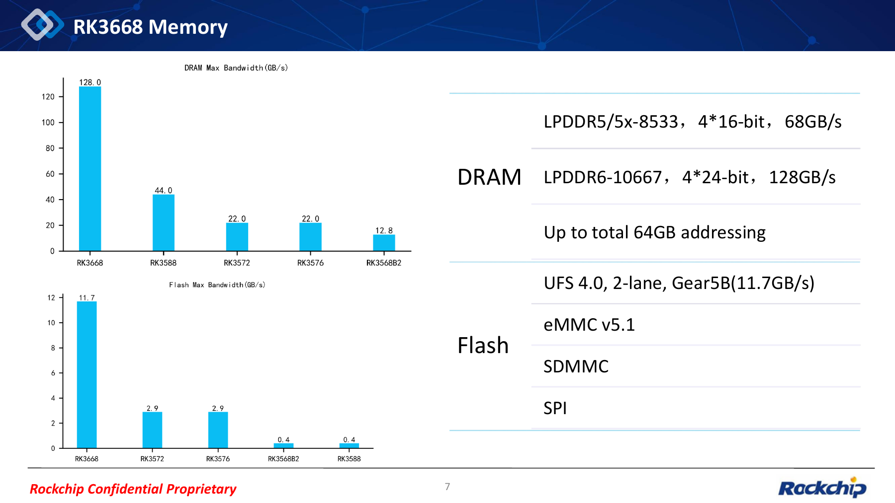
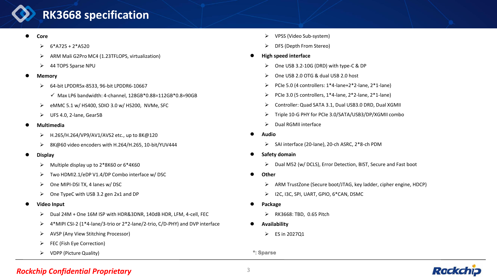
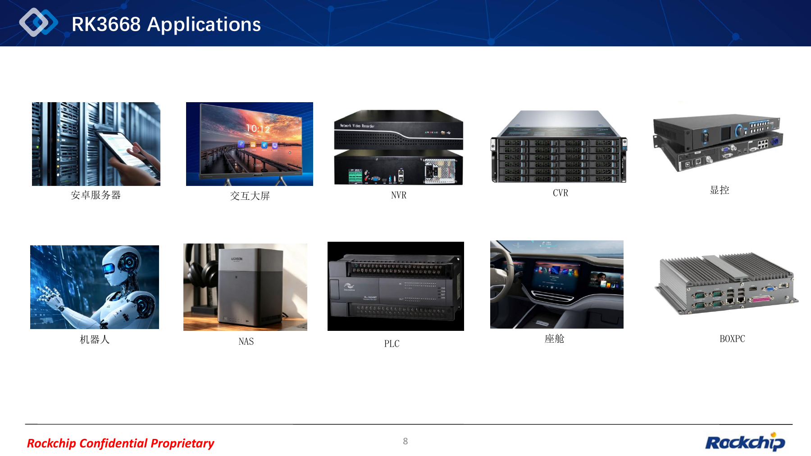

RK3668 verbindet allgemeine Rechenleistung, lokale KI, Video, Display und schnelle Erweiterung in einer geplanten Plattform. Die Unterlagen RK3668 Application zeigen Rockchips Richtung für einen neuen Flaggschiff-SoC und liefern Grundlagen für künftige ArmSoM-Hardware.

Grundlage ist das bereitgestellte **REL02-PDF mit dem Dateinamensdatum 2026-10-09 und 9 Seiten**. Jede Originalseite ist als vergrößerbares Bild enthalten; das unveränderte PDF steht unten zum Download. Die Vorlage mischt Chinesisch und Englisch. Alle vier Artikel verwenden dieselben Originalbilder mit lokalisierten Erläuterungen und Bildunterschriften. **Diagrammwerte stammen aus der Vorlage, nicht aus ArmSoM-Messungen. Erwartete Taktraten, Mustertermine und Schnittstellenplanung sind keine endgültigen Serienspezifikationen.**

*Original-PDF, Seite 1: Titelfolie: RK3668 Application.*

## 1. Roadmap: RK3668 und RK3688 getrennt betrachten

Seite 2 zeigt RK3668 als 6nm-Plattform mit 6× Cortex-A725 + 2× Cortex-A520, Mali-G2-GPU und 44 TOPS Sparse-NPU. RK3688 ist separat als spätere Flaggschiff-Planung aufgeführt. **RK3668-Daten dürfen nicht als RK3688-Spezifikationen ausgegeben werden.**

Seite 3 nennt **Q1 2027** für Engineering Samples (ES). Das ist ein Planungsmeilenstein, kein Termin für Serienfertigung oder ArmSoM-Produkte. Das Gehäuse bleibt TBD, der Pitch ist mit 0.65 angegeben; endgültige Abmessungen fehlen. Historische Kurzangaben der Roadmap sollten bei der Auswahl anhand der jeweiligen Modelldokumentation geprüft werden.

*Original-PDF, Seite 2: Roadmap der Flaggschiff-SoCs.*

## 2. CPU und GPU: Softwaremigration früh vorbereiten

Die Armv9.2-CPU besitzt sechs Cortex-A725 mit **voraussichtlich bis zu 2.5GHz** und zwei Cortex-A520 mit **voraussichtlich 2.2GHz**. Genannt sind SVE2, RME, MTE, PAC und BTI sowie 4MB L3, 4MB SLC und 4MB SRAM.

**Nur 64-Bit-Programme**: Laut Vorlage laufen 32-Bit-APKs und ELF-Programme nicht direkt. Android-Anwendungen, proprietäre Bibliotheken, Peripheriedienste und Algorithmen müssen auf verfügbare 64-Bit-Versionen geprüft werden. Aufgeführte Sicherheitsfunktionen bedeuten nicht, dass jedes SDK sie standardmäßig aktiviert.

Die GPU heißt Mali G2 Pro MC4, mit **voraussichtlich maximal 1.1GHz**. Hardwaregestützte Virtualisierung soll bis zu 16 VMs unterstützen. Diese Zahl garantiert keine Leistung pro Instanz; Treiber, Scheduling und gleichzeitige Lasten bleiben zu prüfen. FP32 und GFXBench MH30 messen unterschiedliche Eigenschaften.

|Kennzahl der Vorlage|RK3668|RK3588|
|---|---|---|
|CPU kDMIPS|213.8|105.0|
|Geekbench 6 single-core|1340|900|
|GPU FP32 (GFLOPS)|1228|512|
|GFXBench MH30 (fps)|287.0|144.4|

Die CPU-Grafik verwendet **kDMIPS**, nicht DMIPS ohne Tausenderfaktor. Laut Vorlage wird der Mehrkernwert linear addiert; GB6 ist ein Einzelkerntest. MH30 nutzt OpenGL ES 3.0 und 1080P offscreen. Vollständige Testbedingungen fehlen, daher sind die Zahlen keine Produktgarantie.

*Original-PDF, Seite 4: CPU-Architektur und Leistungsvergleiche.*

*Original-PDF, Seite 5: GPU, Leistung und Virtualisierung.*

## 3. NPU: 44 TOPS nur mit der Angabe INT8 Sparse

Seite 6 bezeichnet die Grafik ausdrücklich als **TOPS (INT8 Sparse)** und zeigt 44.0 für RK3668. Der Text nennt separat 8.8 TOPS pro Kern und gleichzeitige CNN-/Transformer-Lasten. Daraus wird hier keine interne Kernstruktur abgeleitet. Unterschiedliche Rechenkonventionen sind nicht direkt vergleichbar.

Integer-Formate: INT2/INT3/INT4/INT6/INT8/INT16. Gleitkomma: FP4/FP6/FP8/FP16. Kombinationen: W1.58A8, W2A8, W2A16, W4A8 und W4A16. Genannt sind außerdem 3D GRID-sample, erweiterte MoE-Unterstützung und Speculative Sampling. Als Software werden Caffe, TFLite, PyTorch, ONNX NN und Android NN aufgeführt.

Das eröffnet Evaluierungsrichtungen für Bild-/Sprachverarbeitung, Robotik und Edge-Inferenz. Unterstützung bestimmter Modelle, Quantisierungsgenauigkeit, Kontextlänge, tokens/s und Dauerleistungsaufnahme sind nicht belegt. Konvertierung, Operatoren, Speicherbedarf und Gesamtlatenz müssen mit SDK und Mustern geprüft werden.

*Original-PDF, Seite 6: NPU-Formate, Funktionen und Sparse-Leistung.*

## 4. Speicher: 128 GB/s ist eine Angabe der Vorlage

Seite 7 nennt LPDDR5/5X-8533 mit 4×16-bit und 68 GB/s, LPDDR6-10667 mit 4×24-bit und 128 GB/s sowie bis zu 64GB Adressierung. **Der Adressraum bedeutet nicht, dass jede Platine 64GB RAM erhält.**

Seite 3 nennt zusätzlich 64-bit LPDDR5x-8533, 96-bit LPDDR6-10667 und `128GB*0.88=112GB*0.8=90GB`. Diese Darstellung unterscheidet sich von der nominellen Bandbreite auf Seite 7; die Faktoren werden nicht vollständig erklärt. Keiner dieser Werte wird hier als gemessene Anwendungsbandbreite bezeichnet.

Aufgeführt sind UFS 4.0, zwei Lanes, Gear5B (11.7 GB/s), eMMC 5.1, SDMMC und SPI. In der Übersicht stehen zusätzlich NVMe, SFC, eMMC HS400 und „SDIO 3.0 w/ HS200“. Letztere Formulierung bleibt im Originalbild erhalten; die Moduszuordnung muss anhand endgültiger Schnittstellenunterlagen geklärt werden. UFS-Spitzenbandbreite ist kein dauerhafter Dateisystemdurchsatz.

*Original-PDF, Seite 7: Speicher und Bandbreite.*

## 5. Multimedia, Erweiterungen und Safety-Domain

Die umfangreiche Übersicht wird nach Designbereichen zusammengefasst. Der vollständige Wortlaut bleibt im Bild von Seite 3 lesbar.

|Bereich|Angaben der Vorlage|
|---|---|
|Decoding|H.265/H.264/VP9/AV1/AVS2 usw.; bis 8K@120|
|Encoding|H.264/H.265; bis 8K@60; 10-bit/YUV444|
|Display|Bis 2×8K60 oder 6×4K60; zwei HDMI2.1/eDP1.4/DP-Combos mit DSC; ein 4-lane MIPI-DSI TX mit DSC; Type-C + DP|
|Videoeingang|Zwei 24MP + ein 16MP ISP; HDR, 3DNR, 140dB HDR, LFM, 4-cell, FEC; 4×MIPI CSI-2, C/D-PHY und DVP|
|Bildmodule|AVSP-Panorama, FEC-Fischaugenkorrektur, VDPP-Bildqualität, VPSS-Videosubsystem, DFS-Stereotiefe|
|Erweiterungen|PCIe 5.0/3.0; 4×SATA3.1, zweimal USB3.0 DRD, zweimal XGMII, 3×10G Combo-PHY, zweimal RGMII|
|USB|1×USB3.2-10G DRD mit Type-C/DP; 1×USB2.0 OTG; 2×USB2.0 host|
|Audio|SAI (20-lane laut Vorlage), 20-ch ASRC, 2×8-ch PDM|
|Safety-Domain|Zwei M52 mit DCLS, Fehlererkennung, BIST, sicherer und schneller Start|
|Sicherheit und weitere I/O|Arm TrustZone, Secure boot/JTAG, Key Ladder, Cipher Engine, HDCP; I2C/I3C/SPI/UART/GPIO, 6×CAN, DSMC|

Bei PCIe 5.0 stehen „4 controllers“ und zugleich `1*4-lane+2*2-lane, 2*1-lane`; Gesamtzahl und Aufteilung sind daher unklar. PCIe 3.0 nennt fünf Controller mit 1×4, 2×2 und 2×1. **Lanes, Controller und Combo-PHYs dürfen nicht zu einer Zahl gleichzeitig nutzbarer Platinenanschlüsse addiert werden.** Benötigt werden Multiplexing-, Lane- und Parallelbetriebstabellen.

8K-Decoding, Encoding und mehrere Displays sind ebenfalls getrennte Maximalangaben. Gleichzeitiger Maximalbetrieb aller Formate, Ausgänge und KI-Lasten ist damit nicht belegt. Safety-Funktionen bestätigen keine bestimmte Zertifizierungsstufe.

*Original-PDF, Seite 3: RK3668-Spezifikationsübersicht.*

## 6. Zehn Anwendungsrichtungen praktisch einordnen

Seite 8 nennt Android-Server, interaktive Displays, NVR, CVR, Displaysteuerung, Roboter, NAS, PLC, Cockpits und BOX-PCs. Die folgende Einordnung ist eine technische Analyse, kein Nachweis ausgelieferter Lösungen:

| Anwendung | Zu bewertende Fähigkeiten | Prüfung vor Produktfreigabe |
| --- | --- | --- |
| Android-Server, BOX-PC | Mehrkern-CPU, GPU-Virtualisierung, Instanzen | 64-Bit-Abhängigkeiten, Ressourcen, Images und Dauerlast |
| Robotik | ISP, Stereotiefe, NPU, CAN | Sensorsynchronisation, Modellgenauigkeit, Regellatenz |
| NVR, CVR | Videoeingang, Codecs und KI | Gleichzeitige Kanäle, Bitraten, Speicher und Kühlung |
| Interaktive Displays, Displaysteuerung | Mehrere Ausgänge, Bild-/Videoverarbeitung | Auflösungskombinationen, Multiplexing, Latenz, Treiber |
| NAS | PCIe, SATA, Netzwerk und RAM | Verfügbare PHYs, Speicherkombinationen, Netzwerk und Versorgung |
| PLC, intelligentes Cockpit | Safety-Domain, CAN und Peripherie | Echtzeit, Fehlerbehandlung, Software und Zertifizierung |

Ausgangspunkt ist der Engpass der Anwendung. Beim NAS genügt die PCIe-Generation nicht: Netzwerk und SATA können Ressourcen teilen. Bei Robotern zählt neben TOPS die gesamte Latenz von der Erfassung bis zur Regelung.

*Original-PDF, Seite 8: Zehn Anwendungsrichtungen.*

## 7. Produktplanung bei ArmSoM

ArmSoM plant, RK3668 eng zu begleiten und entsprechende Produkte voranzutreiben, sobald Muster, SDK und Hardwarevalidierung die Produktreife ermöglichen. Modellnamen, Formfaktoren, RAM-Ausbau, herausgeführte Schnittstellen, Preise und Termine werden durch diese Unterlagen nicht bestätigt.

Schon heute lassen sich 64-Bit-Abhängigkeiten, Modelle/Operatoren, Kamera-/Display-/Speicheranforderungen sowie Leistungs- und Kühlungsbudgets sammeln. Produktinformationen folgen auf der [ArmSoM-Website](https://www.armsom.org/) und in der [Dokumentation](https://docs.armsom.org/). Der frühere [RK3668-Ausblick auf Chinesisch](/zh/articles/rockchip-rk3668-outlook/) liefert Hintergrund; dieser Beitrag ergänzt Originalseiten und PDF-Download.

## 8. Original-PDF herunterladen

<a href="/downloads/rk3668/RK3668-SoC-Application-REL02-20261009.pdf" download>RK3668 Application REL02 als Original-PDF herunterladen (9 Seiten, ca. 1.41 MB)</a>

Die Datei bleibt unverändert, einschließlich Layout, Diagrammen und ursprünglichen Kennzeichnungen. Auch die Screenshots bewahren die gemischtsprachige Vorlage und sind keine übersetzten Originalbilder. Der Artikel bietet Einordnung und Anwendungsanalyse; für ein Design werden weiterhin Datenblatt, Hardwareleitfaden und SDK benötigt.

*Original-PDF, Seite 9: Originale Abschlussfolie.*
