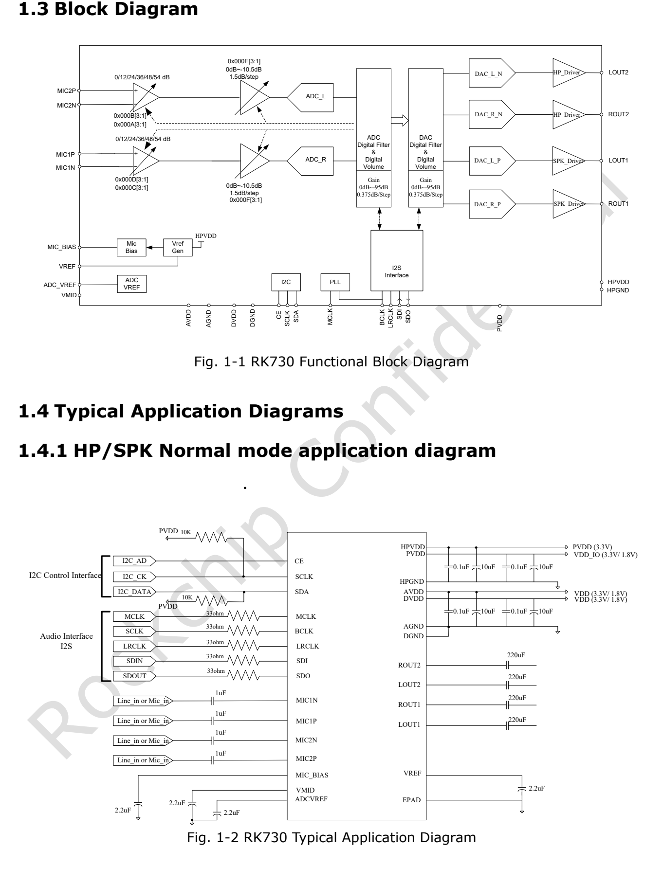

Dieser thematische Leitfaden erläutert das Quelldokument mit wichtigen Daten, Grenzen und Originalabbildungen. Er ist keine seitenweise Übersetzung und kein vollständiges Pin- oder Registerhandbuch. Herstellerbeispiele sind keine ArmSoM-Messungen. Vor der Anwendung sind Platinenrevision, Schaltplan, SDK/BSP, Kernel und Treiber zu prüfen; für diesen Artikel wurden keine neuen Hardwaretests durchgeführt.

**Hauptquelle：** `Rockchip RK730 Datasheet V1.0-20241118.pdf` · PDF 46 Seiten.

## Zuerst die Verbindung zwischen Codec und Platine klären

RK730 enthält zwei ADC- und zwei DAC-Kanäle, Mikrofonverstärkung und Kopfhörertreiber. Er ist eine Referenzoption für Audiosysteme der RK3506-Familie. Dieser Artikel belegt jedoch nicht, dass jede CM1- oder Forge1-Revision RK730 verwendet. Vor einer Erweiterung sind bestückter Codec, herausgeführtes SAI/I2S, Steuerbus, Pegel und BSP-Treiber zu bestimmen.

*RK730-Blockdiagramm und normale Ausgangsbeschaltung — Englische Originalabbildung. `Rockchip RK730 Datasheet V1.0-20241118.pdf`, PDF p. 9.*

## Daten als Signalkette verstehen

| Block | Parameter aus V1.0 | Technische Bedeutung |
| --- | --- | --- |
| ADC | 24-bit; 8–192kHz; SNR 100dB; typischer THD+N −95dB | Mikrofon, Versorgung und Layout beeinflussen das Systemrauschen |
| Mikrofonverstärkung | Bis +54dB; differenzieller/pseudodifferenzieller Eingang | Erst Amplitude, dann analoge und digitale Verstärkung abstimmen |
| DAC | 24-bit; 8–192kHz; SNR 98dB; THD+N −85dB | Keine Spezifikation für externen Verstärker und Lautsprecher |
| Kopfhörer | 50mW an 32Ω; 100mW an 16Ω | Lastbedingung zusammen mit der Leistung angeben |
| Differenzieller Ausgang | Bis 4.8Vpp bei 3.3V Versorgung | Andere Lastbeschaltung als ein massebezogener Ausgang |
| Steuerung / Daten | I2C bis 400kHz; I2S/PCM | I2C-Erreichbarkeit beweist keine korrekten Audiotakte |

Die Funktionsliste auf S. 8 nennt 100dB ADC-Dynamik, die Analogtabelle auf S. 14 dagegen 101dB mit anderer Detailangabe. Hier gilt die Funktionsliste; daraus wird kein gemeinsames Messergebnis konstruiert. Ältere RK3506-Präsentationswerte ersetzen dieses spätere Datasheet ebenfalls nicht.

## Vier Versorgungen und ihre Rückstrompfade

`PVDD` versorgt digitale I/O, `DVDD` den Digitalkern, `AVDD` die Analogschaltung und `HPVDD` den Kopfhörerausgang. Für die ersten drei nennt die Quelle 1.62–3.6V, typisch 1.8/3.3V; für HPVDD 3.0–3.6V, typisch 3.3V. Ähnliche Namen bedeuten keine Austauschbarkeit.

Die Referenz zeigt VREF, VMID, ADCVREF und MIC_BIAS. Entkopplung, Rückstrompfade, analoge Leiterbahnen und Lasten gemeinsam mit BOM und Treiberinitialisierung prüfen. Eine Anwendungsskizze ersetzt keine vollständige Designprüfung.

## Takt und Abtastrate gemeinsam konfigurieren

Die PLL nutzt üblicherweise `MCLK`, kann aber auch `BCLK` verwenden. S. 16 nennt die Familien 48k, 44.1k und 32k. SAI/I2S-Master/Slave-Modus, BCLK, LRCLK, gültige Bits und Slots des Hosts müssen zum Codec passen. Bei Stille zuerst Takte und Signalrouten, dann Mixerlautstärke prüfen.

Die Tabelle druckt `2.822MHz` als BCLK-Referenz und bezeichnet BCLK als Quelle für `24MHz`. Diese Angaben bleiben erhalten und werden nicht still auf übliche Audiotakte korrigiert. Vor Nutzung der Kombinationen sind aktuelle Chip-/BSP-Angaben zu prüfen.

## Nach erfolgreicher I2C-Kommunikation

CE Low/High wählt laut Quelle `0x16`/`0x17`. Die Adressdarstellung des Treibers prüfen, Werte nicht auf Verdacht verschieben. Danach Versorgung, Takte, ADC/DAC-Routen, Mute, Verstärkung und Ausgangsmodus kontrollieren. Ein ungeprüftes Register-Schreibskript wird hier nicht vorgegeben.

Mono-ADC-Replikation und Sidetone-Mischung sind möglich. Für Gegensprechanlagen Monitoring, Echo-Referenz und Lautsprecher-Rückführung ausdrücklich festlegen. Ein Mixer ist kein vollständiger AEC-Algorithmus.

*RK730-Referenzschaltung mit differenziellen Ausgängen — Englische Originalabbildung. `Rockchip RK730 Datasheet V1.0-20241118.pdf`, PDF p. 10.*

## Unklare Angaben zum Differenzialmodus

Auf S. 17 verbindet der Text die rechte Last zwischen `ROUT2` und `Rout2`, während das Bild ROUT1/ROUT2 enthält. S. 13 kennzeichnet den I2C-Taktpin als Ausgang `O`; zudem variieren SCL/SCLK. Diese Abweichungen sind dokumentiert. Vor dem Verdrahten offizielle Revision und Referenzschaltung prüfen, widersprüchlichen Text nicht wörtlich umsetzen.

## Prüfablauf für CM1 und Forge1

Zunächst feststellen, ob tatsächlich RK730 verbaut ist, und passende Audiotreiber sowie Device Tree beschaffen. Wiedergabe, Aufnahme, Vollduplex, Abtastratenwechsel und Suspend/Resume nacheinander prüfen. Unter gleichzeitiger Netzwerk-, Display- und Speicherlast Rauschen, Verzerrung, Knacken und verlorene Samples dokumentieren. Produktlinks helfen bei der Hostauswahl, belegen aber keine Codec-Kompatibilität.

## Produkte und Entwicklungsunterlagen

- **CM1** — [Produkt](https://www.armsom.org/cm1) · [Dokumentation](https://docs.armsom.org/armsom-cm1)
- **Forge1** — [Produkt](https://www.armsom.org/forge1) · [Dokumentation](https://docs.armsom.org/armsom-forge1)

<!-- datasheet-series-20261110 -->

## Datenblattserie und Original-PDF

- [RK730 Übersicht](/de/articles/rk730-audio-codec-design/)
- [RK730: QFN28-Gehäuse, Pinbelegung und Versorgung](/de/articles/rk730-package-power-pinout/)
- [RK730-Takte und Audiopfade: PLL, I2S, Sidetone und I2C](/de/articles/rk730-clocks-audio-i2c/)
- [RK730-Registerreferenz: 65 Adressen, Resetwerte und Steuergruppen](/de/articles/rk730-register-map-reference/)
- [RK730-Start und -Stopp: Versorgung, ADC-Aufnahme und DAC-Wiedergabe](/de/articles/rk730-power-adc-dac-sequences/)
- [Vollständiges Original-PDF herunterladen](/assets/datasheet-series-20261110/Rockchip-RK730-Datasheet-V1.0-20241118.pdf)

<!-- datasheet-related-20261110 -->
## Weitere Chipdatenblätter

Diese Links dienen der plattformübergreifenden Recherche; elektrische Bedingungen und Pins sind nicht austauschbar.

- [RK3506B](/de/articles/rk3506b-datasheet-v10/)
- [RK3576](/de/articles/rk3576-datasheet-v10/)
- [RK3588](/de/articles/rk3588-datasheet-v14/)
- [RK3528](/de/articles/rk3528-datasheet-v10/)
- [RK3568](/de/articles/rk3568-datasheet-v12/)
