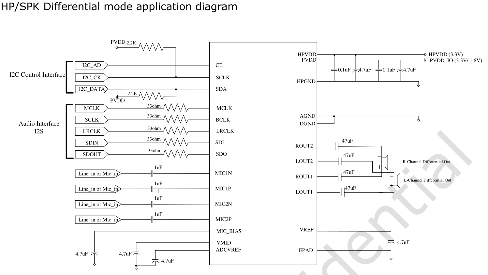

Nach RK730 Datasheet V1.2 aktualisiert. Die Werte sind Herstellerspezifikationen, keine ArmSoM-Hardwaremessungen. Chiprevision, Platinenanschlüsse, SDK/BSP und Treiber müssen zusammenpassen. Alle Abbildungen stammen aus dem bereitgestellten englischen Original.

*RK730-Audiocodec: Mikrofone, I2S-Takte und differenzielle Ausgänge*

## Zuerst die Verbindung zwischen Codec und Platine klären

RK730 enthält zwei ADC- und zwei DAC-Kanäle, Mikrofonverstärkung und Kopfhörertreiber. Er ist eine Referenzoption für Audiosysteme der RK3506-Familie. Dieser Artikel belegt jedoch nicht, dass jede CM1- oder Forge1-Revision RK730 verwendet. Vor einer Erweiterung sind bestückter Codec, herausgeführtes SAI/I2S, Steuerbus, Pegel und BSP-Treiber zu bestimmen.

## Daten als Signalkette verstehen

| Block | Parameter aus V1.0 | Technische Bedeutung |
| --- | --- | --- |
| ADC | 24-bit; 8–192kHz; SNR 100dB; typischer THD+N −95dB | Mikrofon, Versorgung und Layout beeinflussen das Systemrauschen |
| Mikrofonverstärkung | Bis +54dB; differenzieller/pseudodifferenzieller Eingang | Erst Amplitude, dann analoge und digitale Verstärkung abstimmen |
| DAC | 24-bit; 8–192kHz; SNR 98dB; THD+N −85dB | Keine Spezifikation für externen Verstärker und Lautsprecher |
| Kopfhörer | 50mW an 32Ω; 100mW an 16Ω | Lastbedingung zusammen mit der Leistung angeben |
| Differenzieller Ausgang | Bis 4.8Vpp bei 3.3V Versorgung | Andere Lastbeschaltung als ein massebezogener Ausgang |
| Steuerung / Daten | I2C bis 400kHz; I2S/PCM | I2C-Erreichbarkeit beweist keine korrekten Audiotakte |

Die Funktionsliste auf S. 8 nennt 100dB ADC-Dynamik, die Analogtabelle auf S. 14 dagegen 101dB mit anderer Detailangabe. Hier gilt die Funktionsliste; daraus wird kein gemeinsames Messergebnis konstruiert. Ältere RK3506-Präsentationswerte ersetzen dieses spätere Datasheet ebenfalls nicht.

## Externe Versorgung und NC-Pins in V1.2

In V1.2 versorgt `PVDD` die digitalen I/Os und erzeugt intern die Versorgung des Digitalkerns. `HPVDD` versorgt den Kopfhörerausgang und erzeugt die analoge Kernversorgung. Empfohlen sind 1.62–3.6 V für PVDD, typisch 1.8/3.3 V, und 3.0–3.6 V für HPVDD, typisch 3.3 V. **Pin 2 und Pin 17 sind jetzt NC und müssen ebenso wie Pin 9 offen bleiben.** Die DVDD-/AVDD-Beschaltung aus V1.0 darf nicht übernommen werden. VREF, VMID und ADCVREF sind gemäß Referenzschaltung zu entkoppeln und keine allgemeinen Versorgungsausgänge.

## Aktualisierte PLL-Auswahl und verbleibende Unklarheit

Tabelle 4-2 der V1.2 ordnet den 24-MHz-Eingang für `1001–1011` ausdrücklich **MCLK** zu; diese Seite wurde entsprechend korrigiert. `0110/0111/1000` verwenden BCLK mit 3.072/2.822/2.048 MHz. Auch die Beschreibungen von 0x6–0x8 in `CODEC_SYSPLL_3[7:4]` wurden geändert. Für `0111` steht weiterhin 2.822 MHz im neuen Dokument. Dieser Wert bleibt erhalten und ist mit Treiber und Taktmessung abzugleichen, statt 2.8224 MHz anzunehmen. `1111` ist keine gültige Auswahl. Die 48-kHz-Familie umfasst 12/24/48/96/192 kHz, die 44.1-kHz-Familie 11.025/22.05/44.1/88.2/176.4 kHz und die 32-kHz-Familie 8/16/32/64/128 kHz.

## Nach erfolgreicher I2C-Kommunikation

CE Low/High wählt laut Quelle `0x16`/`0x17`. Die Adressdarstellung des Treibers prüfen, Werte nicht auf Verdacht verschieben. Danach Versorgung, Takte, ADC/DAC-Routen, Mute, Verstärkung und Ausgangsmodus kontrollieren. Ein ungeprüftes Register-Schreibskript wird hier nicht vorgegeben.

Mono-ADC-Replikation und Sidetone-Mischung sind möglich. Für Gegensprechanlagen Monitoring, Echo-Referenz und Lautsprecher-Rückführung ausdrücklich festlegen. Ein Mixer ist kein vollständiger AEC-Algorithmus.

## Referenzschaltung und Revisionsprüfung

Dieses Update basiert auf RK730 Datasheet V1.2 (2025-08-08, 47 Seiten). Die Referenzschaltung ändert Pull-ups von 10 kΩ auf 2.2 kΩ, bestimmte 10-µF-Entkopplungskondensatoren auf 4.7 µF, Ausgangskopplung von 220 µF auf 47 µF und bestimmte Referenzkondensatoren von 2.2 µF auf 4.7 µF. Entscheidend ist die Zuordnung im neuen Schaltbild, kein pauschaler Bauteiltausch auf anderen Platinen. Der alte Absatz zum Differenzausgang mit doppeltem ROUT2 wurde entfernt. Pin 28 SCL ist weiterhin mit Richtung O bezeichnet und muss mit der tatsächlichen Steuerschnittstelle abgeglichen werden.

## Prüfablauf für CM1 und Forge1

Zunächst feststellen, ob tatsächlich RK730 verbaut ist, und passende Audiotreiber sowie Device Tree beschaffen. Wiedergabe, Aufnahme, Vollduplex, Abtastratenwechsel und Suspend/Resume nacheinander prüfen. Unter gleichzeitiger Netzwerk-, Display- und Speicherlast Rauschen, Verzerrung, Knacken und verlorene Samples dokumentieren. Produktlinks helfen bei der Hostauswahl, belegen aber keine Codec-Kompatibilität.

## Produkte und Entwicklungsunterlagen

- **CM1** — [Produkt](https://www.armsom.org/cm1) · [Dokumentation](https://docs.armsom.org/armsom-cm1)
- **Forge1** — [Produkt](https://www.armsom.org/armsom-forge1) · [Dokumentation](https://docs.armsom.org/armsom-forge1)

<!-- datasheet-series-20261110 -->

## Weitere RK730-Artikel

- [RK730 Übersicht](/de/articles/rk730-audio-codec-design/)
- [RK730: QFN28-Gehäuse, Pinbelegung und Versorgung](/de/articles/rk730-package-power-pinout/)
- [RK730-Takte und Audiopfade: PLL, I2S, Sidetone und I2C](/de/articles/rk730-clocks-audio-i2c/)
- [RK730-Registerreferenz: 65 Adressen, Resetwerte und Steuergruppen](/de/articles/rk730-register-map-reference/)
- [RK730-Start und -Stopp: Versorgung, ADC-Aufnahme und DAC-Wiedergabe](/de/articles/rk730-power-adc-dac-sequences/)

<!-- datasheet-related-20261110 -->
## Weitere Chipdatenblätter

Diese Links dienen der plattformübergreifenden Recherche; elektrische Bedingungen und Pins sind nicht austauschbar.

- [RK3506B](/de/articles/rk3506b-datasheet-v10/)
- [RK3576](/de/articles/rk3576-datasheet-v10/)
- [RK3588](/de/articles/rk3588-datasheet-v14/)
- [RK3528](/de/articles/rk3528-datasheet-v10/)
- [RK3568](/de/articles/rk3568-datasheet-v12/)
