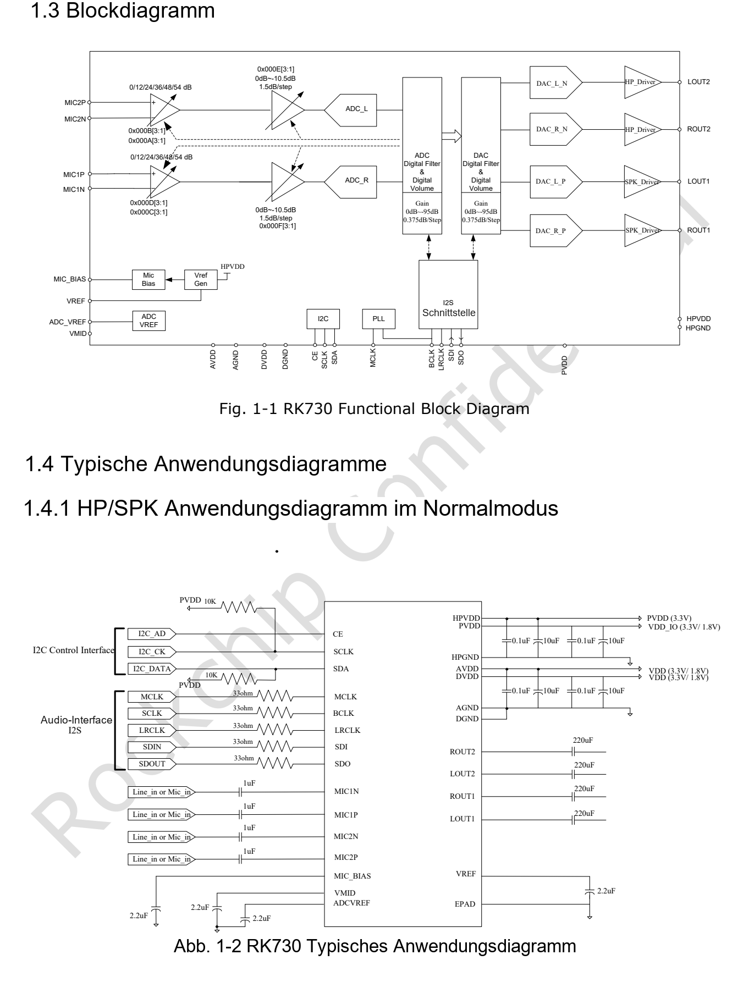
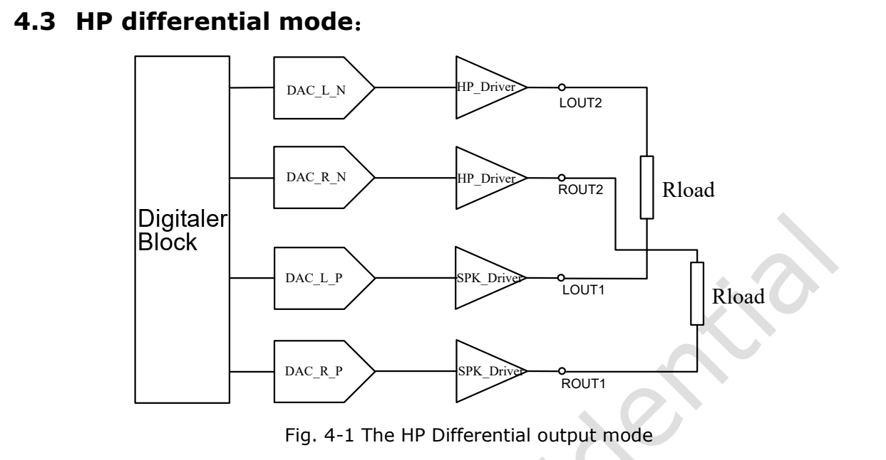
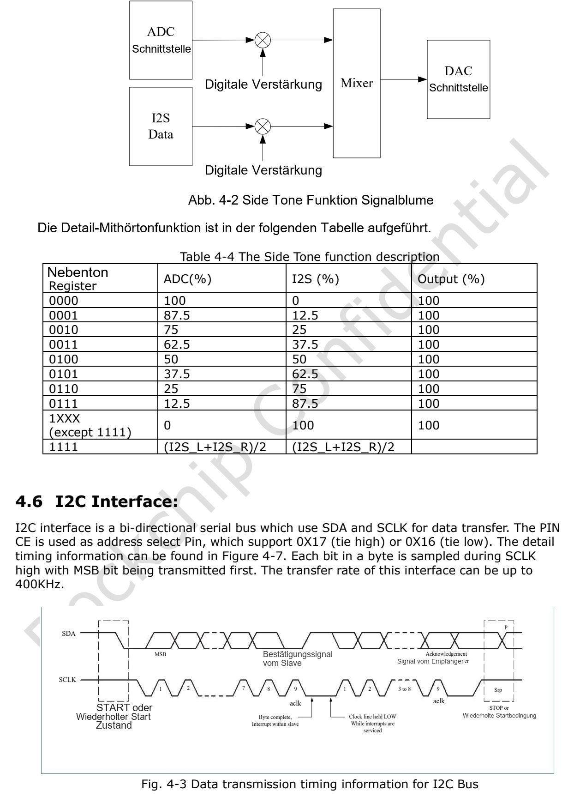

Dieser Artikel basiert auf der angegebenen Datenblattrevision. Die Werte sind Herstellerspezifikationen und keine ArmSoM-Messungen; neue Hardwaretests wurden nicht durchgeführt. Prüfen Sie Siliziumrevision, Schaltplan, SDK/BSP, Kernel und Treiber. Erläuterungen und editierbare Tabellen helfen beim Lesen; die vollständige Spezifikation und hier nicht vertiefte Bitdefinitionen stehen im Original-PDF.

**RK730 · Rockchip RK730 Datasheet V1.0-20241118.pdf · PDF 16–19.**

*Englische Originalabbildung, PDF S. 9.*

## Zuerst die Taktrollen festlegen

Legen Sie MCLK-, BCLK-, LRCLK-, SDI- und SDO-Richtungen vor der Codec-Konfiguration fest. Taktrollen, Abtastratenfamilie, Daten- und Slotbreite müssen übereinstimmen. Eine I2C-Antwort belegt keine korrekten Audiotakte. Bei Stille zuerst Versorgung und Takte prüfen, danach Mute, Kanalaktivierung und Analogpfad.

## PLL-Auswahltabelle

| 4-Bit-Auswahl | Referenz MHz | Abtastratenfamilie | Quelle |
|---|---|---|---|
| 0000 | 12.288 | 48 kHz | MCLK |
| 0001 | 12.288 | 44.1 kHz | MCLK |
| 0010 | 12.288 | 32 kHz | MCLK |
| 0011 | 12 | 48 kHz | MCLK |
| 0100 | 12 | 44.1 kHz | MCLK |
| 0101 | 12 | 32 kHz | MCLK |
| 0110 | 3.072 | 48 kHz | BCLK |
| 0111 | 2.822 | 44.1 kHz | BCLK |
| 1000 | 2.048 | 32 kHz | BCLK |
| 1001 | 24 | 48 kHz | BCLK |
| 1010 | 24 | 44.1 kHz | BCLK |
| 1011 | 24 | 32 kHz | BCLK |
| 1100 | 6.144 | 48 kHz | MCLK |
| 1101 | 11.2896 | 44.1 kHz | MCLK |
| 1110 | 8.192 | 32 kHz | MCLK |
| 1111 | — | — | — |

## Zwei PLL-Einträge unverändert lassen

0111 nennt 2,822 MHz und wird nicht auf 2,8224 MHz korrigiert. 1001–1011 nennen ausdrücklich BCLK mit 24 MHz, nicht MCLK. 1111 enthält keine gültige Auswahl. Eine Frequenzfamilie belegt keine beliebige Fs in jedem Modus; Treiber und gemessene Takte sind abzugleichen.

## ADC-Replikation und Sidetone-Mischung

| Merkmal | Spezifikation / Quellenhinweis |
|---|---|
| ADC 00 | L → L; R → R |
| ADC 01 | L → L/R |
| ADC 10 | R → L/R |
| ADC 11 | L ↔ R |
| Sidetone 0000 | ADC 100% / I2S 0% |
| Sidetone 0001 | ADC 87.5% / I2S 12.5% |
| Sidetone 0010 | ADC 75% / I2S 25% |
| Sidetone 0011 | ADC 62.5% / I2S 37.5% |
| Sidetone 0100 | ADC 50% / I2S 50% |
| Sidetone 0101 | ADC 37.5% / I2S 62.5% |
| Sidetone 0110 | ADC 25% / I2S 75% |
| Sidetone 0111 | ADC 12.5% / I2S 87.5% |
| Sidetone 1XXX (≠1111) | ADC 0% / I2S 100% |
| Sidetone 1111 | (I2S_L + I2S_R) / 2 |

## Differenzausgang und Originalzeichnung

Die Replikation betrifft nur den ADC-Pfad. Die Differenzzeichnung paart ROUT1/ROUT2 und LOUT1/LOUT2; im Text steht dagegen doppelt „ROUT2 and Rout2“. Danach darf nicht verdrahtet werden. Die Mischzeile 1111 ist mit Originalspalten und Treiber abzugleichen, nicht als zusätzlicher Analogpfad zu interpretieren.

*Englische Originalabbildung, PDF S. 17.*

## I2C-Adresswahl

Adressen sind 7 Bit breit, das R/W-Bit kommt separat hinzu. CE wählt die Busadresse, Registeroffsets sind eine andere Adressierungsebene. 0x16/0x17 sind keine Registerindizes. I2C ist auf 400 kbit/s begrenzt. I/O-Pegel und Pull-up-Domäne prüfen und manuellen Zugriff mit dem Kerneltreiber koordinieren.

| Merkmal | Spezifikation / Quellenhinweis |
|---|---|
| CE = 0 | 0x16 |
| CE = 1 | 0x17 |

## Weitere Originalabbildungen

*Englische Originalabbildung, PDF S. 18.*

## ArmSoM-Produkte und Einsatzgrenzen

CM1 und Forge1 dienen als Plattformreferenzen für Audioperipherie. Ein eingebauter RK730 oder geprüfte sofortige Treiberunterstützung werden hier nicht behauptet. Prüfen Sie zuerst die verfügbaren I2S-/I2C-Signale, Takte und Spannungspegel.

- [CM1](https://www.armsom.org/cm1) · [Docs](https://docs.armsom.org/armsom-cm1)
- [Forge1](https://www.armsom.org/forge1) · [Docs](https://docs.armsom.org/armsom-forge1)

## Datenblattserie und Original-PDF

- [RK730 Übersicht](/de/articles/rk730-audio-codec-design/)
- [RK730: QFN28-Gehäuse, Pinbelegung und Versorgung](/de/articles/rk730-package-power-pinout/)
- [RK730-Takte und Audiopfade: PLL, I2S, Sidetone und I2C](/de/articles/rk730-clocks-audio-i2c/)
- [RK730-Registerreferenz: 65 Adressen, Resetwerte und Steuergruppen](/de/articles/rk730-register-map-reference/)
- [RK730-Start und -Stopp: Versorgung, ADC-Aufnahme und DAC-Wiedergabe](/de/articles/rk730-power-adc-dac-sequences/)
- [Vollständiges Original-PDF herunterladen](/assets/datasheet-series-20261110/Rockchip-RK730-Datasheet-V1.0-20241118.pdf)
