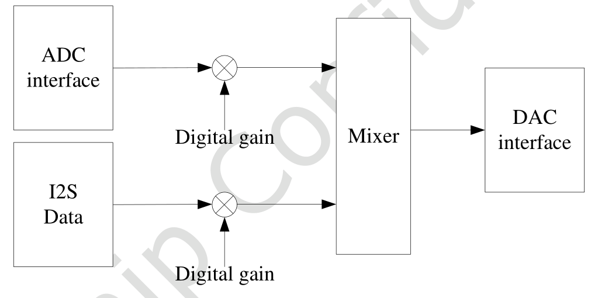
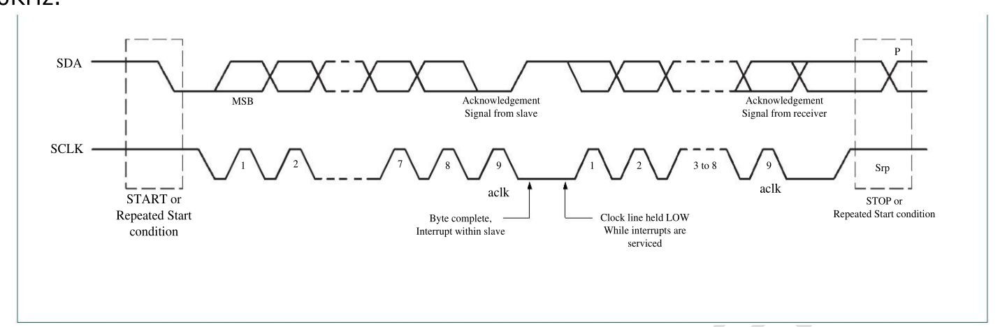
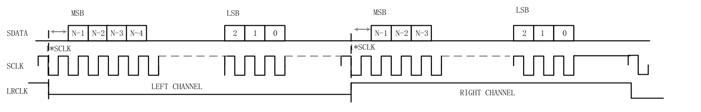
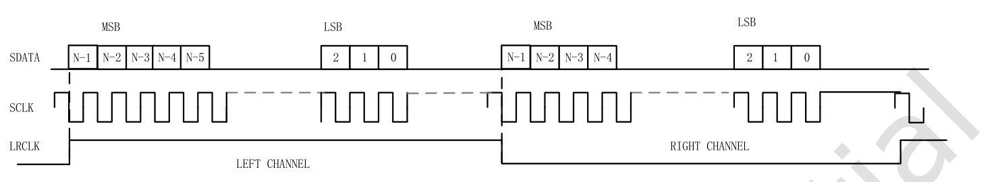
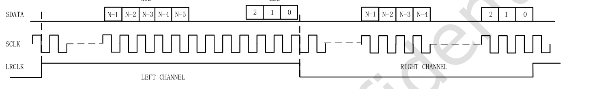
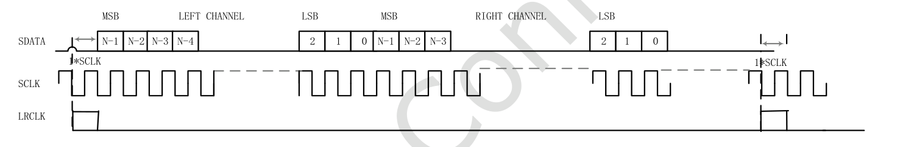
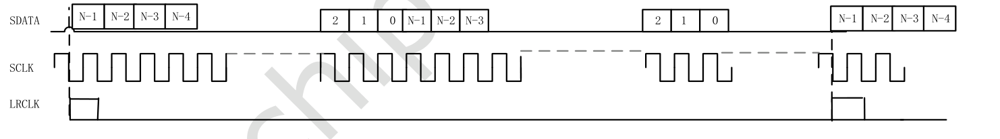

Nach RK730 Datasheet V1.2 aktualisiert. Die Werte sind Herstellerspezifikationen, keine ArmSoM-Hardwaremessungen. Chiprevision, Platinenanschlüsse, SDK/BSP und Treiber müssen zusammenpassen. Alle Abbildungen stammen aus dem bereitgestellten englischen Original.

*RK730-Takte und Audiopfade: PLL, I2S, Sidetone und I2C*

## Zuerst die Taktrollen festlegen

Legen Sie MCLK-, BCLK-, LRCLK-, SDI- und SDO-Richtungen vor der Codec-Konfiguration fest. Taktrollen, Abtastratenfamilie, Daten- und Slotbreite müssen übereinstimmen. Eine I2C-Antwort belegt keine korrekten Audiotakte. Bei Stille zuerst Versorgung und Takte prüfen, danach Mute, Kanalaktivierung und Analogpfad.

## PLL-Auswahltabelle

| 4-Bit-Auswahl | Referenz MHz | Abtastratenfamilie | Quelle |
|---|---|---|---|
| 0000 | 12.288 | 48 kHz | MCLK |
| 0001 | 12.288 | 44.1 kHz | MCLK |
| 0010 | 12.288 | 32 kHz | MCLK |
| 0011 | 12 | 48 kHz | MCLK |
| 0100 | 12 | 44.1 kHz | MCLK |
| 0101 | 12 | 32 kHz | MCLK |
| 0110 | 3.072 | 48 kHz | BCLK |
| 0111 | 2.822 | 44.1 kHz | BCLK |
| 1000 | 2.048 | 32 kHz | BCLK |
| 1001 | 24 | 48 kHz | MCLK |
| 1010 | 24 | 44.1 kHz | MCLK |
| 1011 | 24 | 32 kHz | MCLK |
| 1100 | 6.144 | 48 kHz | MCLK |
| 1101 | 11.2896 | 44.1 kHz | MCLK |
| 1110 | 8.192 | 32 kHz | MCLK |
| 1111 | — | — | — |

## Aktualisierte PLL-Auswahl und verbleibende Unklarheit

Tabelle 4-2 der V1.2 ordnet den 24-MHz-Eingang für `1001–1011` ausdrücklich **MCLK** zu; diese Seite wurde entsprechend korrigiert. `0110/0111/1000` verwenden BCLK mit 3.072/2.822/2.048 MHz. Auch die Beschreibungen von 0x6–0x8 in `CODEC_SYSPLL_3[7:4]` wurden geändert. Für `0111` steht weiterhin 2.822 MHz im neuen Dokument. Dieser Wert bleibt erhalten und ist mit Treiber und Taktmessung abzugleichen, statt 2.8224 MHz anzunehmen. `1111` ist keine gültige Auswahl. Die 48-kHz-Familie umfasst 12/24/48/96/192 kHz, die 44.1-kHz-Familie 11.025/22.05/44.1/88.2/176.4 kHz und die 32-kHz-Familie 8/16/32/64/128 kHz.

## ADC-Replikation und Sidetone-Mischung

| Merkmal | Spezifikation / Quellenhinweis |
|---|---|
| ADC 00 | L → L; R → R |
| ADC 01 | L → L/R |
| ADC 10 | R → L/R |
| ADC 11 | L ↔ R |
| Sidetone 0000 | ADC 100% / I2S 0% |
| Sidetone 0001 | ADC 87.5% / I2S 12.5% |
| Sidetone 0010 | ADC 75% / I2S 25% |
| Sidetone 0011 | ADC 62.5% / I2S 37.5% |
| Sidetone 0100 | ADC 50% / I2S 50% |
| Sidetone 0101 | ADC 37.5% / I2S 62.5% |
| Sidetone 0110 | ADC 25% / I2S 75% |
| Sidetone 0111 | ADC 12.5% / I2S 87.5% |
| Sidetone 1XXX (≠1111) | ADC 0% / I2S 100% |
| Sidetone 1111 | (I2S_L + I2S_R) / 2 |

## Sidetone-Signalpfad

*Digitale Mischung aus ADC und I2S*

## I2C-Adresswahl

Adressen sind 7 Bit breit, das R/W-Bit kommt separat hinzu. CE wählt die Busadresse, Registeroffsets sind eine andere Adressierungsebene. 0x16/0x17 sind keine Registerindizes. I2C ist auf 400 kbit/s begrenzt. I/O-Pegel und Pull-up-Domäne prüfen und manuellen Zugriff mit dem Kerneltreiber koordinieren.

| Merkmal | Spezifikation / Quellenhinweis |
|---|---|
| CE = 0 | 0x16 |
| CE = 1 | 0x17 |

*I2C-Datenübertragung*

## SPI und fünf Zeitdiagramme für digitales Audio

V1.2 ergänzt einen SPI-Slave-Controller: SPI_CSn aktiv low wählt die Schnittstelle, der Host erzeugt SPI_CLK, und SPI_DIN wird an der steigenden Flanke abgetastet. Ein Schreibvorgang umfasst drei 8-Bit-Wörter: 7-Bit-Chipadresse mit R/W-Bit, Registeradresse und Registerdaten. Eine vollständige Zuordnung der SPI-Signale zur 28-Pin-Tabelle fehlt. Die Verdrahtung darf daher nicht aus Signalnamen abgeleitet werden; zuerst Chiprevision und Referenzschaltung prüfen. Audioformate sind I2S, linksbündig, rechtsbündig sowie DSP/PCM mit A/B-Timing. Die Diagramme dienen zur Prüfung von Rahmenflanke, Verzögerung des ersten Bits zu LRCLK und gültiger Datenbreite.

*SPI*

*I2S*

*Linksbündig*

*Rechtsbündig*

*DSP/PCM A*

*DSP/PCM B*

## ArmSoM-Produkte und Einsatzgrenzen

CM1 und Forge1 dienen als Plattformreferenzen für Audioperipherie. Ein eingebauter RK730 oder geprüfte sofortige Treiberunterstützung werden hier nicht behauptet. Prüfen Sie zuerst die verfügbaren I2S-/I2C-Signale, Takte und Spannungspegel.

- [CM1](https://www.armsom.org/cm1) · [Docs](https://docs.armsom.org/armsom-cm1)
- [Forge1](https://www.armsom.org/armsom-forge1) · [Docs](https://docs.armsom.org/armsom-forge1)

## Weitere RK730-Artikel

- [RK730 Übersicht](/de/articles/rk730-audio-codec-design/)
- [RK730: QFN28-Gehäuse, Pinbelegung und Versorgung](/de/articles/rk730-package-power-pinout/)
- [RK730-Takte und Audiopfade: PLL, I2S, Sidetone und I2C](/de/articles/rk730-clocks-audio-i2c/)
- [RK730-Registerreferenz: 65 Adressen, Resetwerte und Steuergruppen](/de/articles/rk730-register-map-reference/)
- [RK730-Start und -Stopp: Versorgung, ADC-Aufnahme und DAC-Wiedergabe](/de/articles/rk730-power-adc-dac-sequences/)
