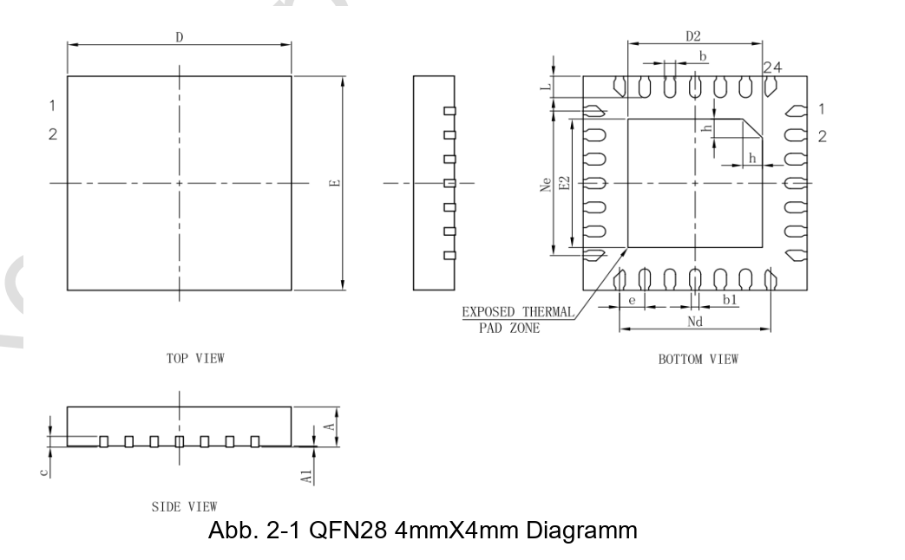
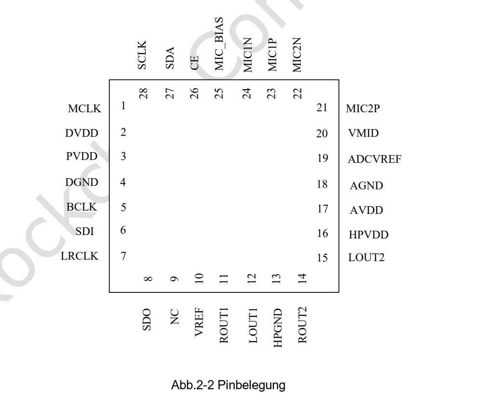

Dieser Artikel basiert auf der angegebenen Datenblattrevision. Die Werte sind Herstellerspezifikationen und keine ArmSoM-Messungen; neue Hardwaretests wurden nicht durchgeführt. Prüfen Sie Siliziumrevision, Schaltplan, SDK/BSP, Kernel und Treiber. Erläuterungen und editierbare Tabellen helfen beim Lesen; die vollständige Spezifikation und hier nicht vertiefte Bitdefinitionen stehen im Original-PDF.

**RK730 · Rockchip RK730 Datasheet V1.0-20241118.pdf · PDF 7–15.**

*Englische Originalabbildung, PDF S. 11.*

## Audiofunktionen und Einsatzbereich

RK730 ist ein externer Audiocodec mit zwei ADCs, zwei DACs und Kopfhörerausgängen. Die Integration hängt von I2S/I2C, Versorgung, Takten und Treibern ab, nicht nur vom SoC. Leistung, Dynamikumfang und Verzerrung gelten unter unterschiedlichen Prüfbedingungen, nicht an einem gemeinsamen Betriebspunkt.

| Merkmal | Spezifikation / Quellenhinweis |
|---|---|
| ADC / DAC | 2 / 2 · 24 bit · 8–192 kHz |
| Ausgangsleistung | 50 mW / 32 Ω; 100 mW / 16 Ω |
| Differenzausgang | 4.8 Vpp at 3.3 V supply |
| Mikrofonverstärkung | ≤54 dB |

## Gehäusemaße (mm)

| Symbol | Min / Typ / Max oder Quellenwert |
|---|---|
| Package | QFN28 · 4 × 4 mm · 0.45 mm pitch |
| A | 0.70 / 0.75 / 0.80 |
| A1 | 0 / 0.02 / 0.05 |
| b | 0.15 / 0.20 / 0.25 |
| b1 | 0.14 REF |
| c | 0.18 / 0.20 / 0.25 |
| D / E | 3.90 / 4.00 / 4.10 |
| D2 / E2 | 2.30 / 2.40 / 2.50 |
| e | 0.45 BSC |
| Ne / Nd | 2.70 BSC |
| L | 0.35 / 0.40 / 0.45 |
| h | 0.30 / 0.35 / 0.40 |

## Vollständige Pintabelle

| Nummer | Name | Richtung laut Quelle | Funktion |
|---|---|---|---|
| 1 | MCLK | I | Mastertakteingang |
| 2 | DVDD | Supply | Digitalversorgung |
| 3 | PVDD | Supply | Digitale I/O-Versorgung |
| 4 | DGND | Supply | Digitalmasse |
| 5 | BCLK | I/O | Bittakt |
| 6 | SDI | I | Audiodateneingang |
| 7 | LRCLK | I/O | Links-/Rechts-Takt |
| 8 | SDO | O | Audiodatenausgang |
| 9 | NC |  | Nicht verbunden |
| 10 | VREF | O | Referenzspannung |
| 11 | ROUT1 | O | Rechter Ausgang 1 |
| 12 | LOUT1 | O | Linker Ausgang 1 |
| 13 | HPGND | Supply | Kopfhörermasse |
| 14 | ROUT2 | O | Rechter Ausgang 2 |
| 15 | LOUT2 | O | Linker Ausgang 2 |
| 16 | HPVDD | Supply | Kopfhörerversorgung |
| 17 | AVDD | Supply | Analogversorgung |
| 18 | AGND | Supply | Analogmasse |
| 19 | ADCVREF | O | ADC-Referenz |
| 20 | VMID | O | Mittelpunktreferenz |
| 21 | MIC2P | I | Mikrofon 2 positiv |
| 22 | MIC2N | I | Mikrofon 2 negativ |
| 23 | MIC1P | I | Mikrofon 1 positiv |
| 24 | MIC1N | I | Mikrofon 1 negativ |
| 25 | MIC_BIAS | O | Mikrofonvorspannung |
| 26 | CE | I | I2C-Adresswahl |
| 27 | SDA | I/O | I2C-Daten |
| 28 | SCL | O | I2C-Takt; Quelle nennt O, prüfen |
| EPAD | EPAD | Supply | Exposed Pad an Masse |

## Versorgung und Temperatur

PVDD versorgt digitale I/O, DVDD den Digitalkern; ähnliche Namen rechtfertigen keine identischen Annahmen. HPVDD ist mit 3,3 V empfohlen, die anderen drei Rails mit 1,8/3,3 V. Referenzpins sind nach Herstellerschaltung zu behandeln, nicht als allgemeine Peripherieversorgung.

| Merkmal | Spezifikation / Quellenhinweis |
|---|---|
| PVDD / DVDD / AVDD | Min 1.62 V · Typ 1.8 / 3.3 V · Max 3.6 V |
| HPVDD | Min 3.0 V · Typ 3.3 V · Max 3.6 V |
| Absoluter Versorgungs-/Eingangsbereich | −0.3…3.6 V |
| Betriebstemperatur laut Quelltabelle | −40…85 °C |
| Lagertemperatur | −65…150 °C |

## Audioprüfbedingungen und Quellenabweichungen

ADC-Dynamikumfang: 100 dB in der Funktionsliste, 101 dB A-bewertet in der elektrischen Tabelle. Deren Bedingungen bleiben getrennt erhalten. Pin 28 heißt SCL mit Richtung O, wird aber als I2C-Takt beschrieben; Richtung anhand aktueller Unterlagen und Schaltung prüfen. Dies sind Herstellerdaten, keine CM1-/Forge1-Messungen.

| Merkmal | Spezifikation / Quellenhinweis |
|---|---|
| ADC | Full scale 1 Vrms; SNR 100 dB; dynamic range 101 dB A-weighted; THD −95 dB typ; input 20 kΩ |
| ADC filter | Passband 0.4917 Fs; stopband 0.5479 Fs; ripple 0.05 dB; attenuation 100 dB |
| DAC normal | 1 Vrms; SNR 98 dB; dynamic range 100 dB; THD −85 dB |
| DAC differential | 2 Vrms; SNR 98 dB; dynamic range 103 dB; THD −88 dB |

## Weitere Originalabbildungen

*Englische Originalabbildung, PDF S. 12.*

## ArmSoM-Produkte und Einsatzgrenzen

CM1 und Forge1 dienen als Plattformreferenzen für Audioperipherie. Ein eingebauter RK730 oder geprüfte sofortige Treiberunterstützung werden hier nicht behauptet. Prüfen Sie zuerst die verfügbaren I2S-/I2C-Signale, Takte und Spannungspegel.

- [CM1](https://www.armsom.org/cm1) · [Docs](https://docs.armsom.org/armsom-cm1)
- [Forge1](https://www.armsom.org/forge1) · [Docs](https://docs.armsom.org/armsom-forge1)

## Datenblattserie und Original-PDF

- [RK730 Übersicht](/de/articles/rk730-audio-codec-design/)
- [RK730: QFN28-Gehäuse, Pinbelegung und Versorgung](/de/articles/rk730-package-power-pinout/)
- [RK730-Takte und Audiopfade: PLL, I2S, Sidetone und I2C](/de/articles/rk730-clocks-audio-i2c/)
- [RK730-Registerreferenz: 65 Adressen, Resetwerte und Steuergruppen](/de/articles/rk730-register-map-reference/)
- [RK730-Start und -Stopp: Versorgung, ADC-Aufnahme und DAC-Wiedergabe](/de/articles/rk730-power-adc-dac-sequences/)
- [Vollständiges Original-PDF herunterladen](/assets/datasheet-series-20261110/Rockchip-RK730-Datasheet-V1.0-20241118.pdf)
