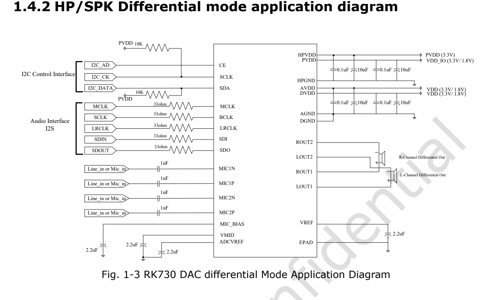

Dieser Artikel basiert auf der angegebenen Datenblattrevision. Die Werte sind Herstellerspezifikationen und keine ArmSoM-Messungen; neue Hardwaretests wurden nicht durchgeführt. Prüfen Sie Siliziumrevision, Schaltplan, SDK/BSP, Kernel und Treiber. Erläuterungen und editierbare Tabellen helfen beim Lesen; die vollständige Spezifikation und hier nicht vertiefte Bitdefinitionen stehen im Original-PDF.

**RK730 · Rockchip RK730 Datasheet V1.0-20241118.pdf · PDF 20–43.**

*Englische Originalabbildung, PDF S. 10.*

## Busadresse, Registeroffset und Bitfeld

CE wählt die I2C-Adresse 0x16/0x17; 0x0000 usw. sind Registeroffsets. B bedeutet 8-Bit-Daten; vier Hexziffern im Offset bedeuten keine 16-Bit-Daten. Resetwerte sind keine fertig initialisierten Betriebswerte. Zugriffsattribute im Bitfeldkapitel prüfen und Adresslücken nicht als beschreibbar annehmen.

## Vollständige Registerübersicht

| Register | Offset | Breite | Resetwert |
|---|---|---|---|
| `CODEC_HK_TOP_0` | `0x0000` | `B` | `0x08` |
| `CODEC_HK_TOP_1` | `0x0001` | `B` | `0xC0` |
| `CODEC_HK_TOP_2` | `0x0002` | `B` | `0x00` |
| `CODEC_HK_TRIM` | `0x0003` | `B` | `0x00` |
| `CODEC_ADC_0` | `0x0004` | `B` | `0x03` |
| `CODEC_ADC_1` | `0x0005` | `B` | `0x42` |
| `CODEC_ADC_2` | `0x0006` | `B` | `0x02` |
| `CODEC_ADC_3` | `0x0007` | `B` | `0x05` |
| `CODEC_DAC_0` | `0x0008` | `B` | `0x07` |
| `CODEC_DAC_1` | `0x0009` | `B` | `0x70` |
| `CODEC_MIC_BOOST_0` | `0x000a` | `B` | `0x01` |
| `CODEC_MIC_BOOST_1` | `0x000b` | `B` | `0x01` |
| `CODEC_MIC_BOOST_2` | `0x000c` | `B` | `0x01` |
| `CODEC_MIC_BOOST_3` | `0x000d` | `B` | `0x01` |
| `CODEC_ADC_PGA_BLOCK_0` | `0x000e` | `B` | `0x01` |
| `CODEC_ADC_PGA_BLOCK_1` | `0x000f` | `B` | `0x01` |
| `CODEC_SYSPLL_0` | `0x0010` | `B` | `0xff` |
| `CODEC_SYSPLL_3` | `0x0013` | `B` | `0x04` |
| `CODEC_LDO` | `0x001f` | `B` | `0x11` |
| `CODEC_MIC_BIAS` | `0x0020` | `B` | `0x09` |
| `CODEC_HP_0` | `0x0021` | `B` | `0xAC` |
| `CODEC_HP_1` | `0x0022` | `B` | `0x80` |
| `CODEC_HP_2` | `0x0023` | `B` | `0x00` |
| `CODEC_SPK_0` | `0x0024` | `B` | `0xAC` |
| `CODEC_SPK_1` | `0x0025` | `B` | `0x80` |
| `CODEC_DTOP_DIGEN_CLKE` | `0x0040` | `B` | `0x00` |
| `CODEC_DTOP_SRT` | `0x0041` | `B` | `0x00` |
| `CODEC_DADC_SEL` | `0x0042` | `B` | `0x00` |
| `CODEC_DDAC_SEL` | `0x0043` | `B` | `0x88` |
| `CODEC_DTOP_VUCTL` | `0x0044` | `B` | `0x03` |
| `CODEC_DTOP_VUCTIME` | `0x0045` | `B` | `0xFF` |
| `CODEC_DADC_VOLL` | `0x0046` | `B` | `0x00` |
| `CODEC_DADC_VOLR` | `0x0047` | `B` | `0x00` |
| `CODEC_DDAC_VOLL` | `0x0048` | `B` | `0x00` |
| `CODEC_DDAC_VOLR` | `0x0049` | `B` | `0x00` |
| `CODEC_DADC_RVOLL` | `0x004a` | `B` | `0xFF` |
| `CODEC_DADC_RVOLR` | `0x004b` | `B` | `0xFF` |
| `CODEC_DDAC_RVOLL` | `0x004c` | `B` | `0xFF` |
| `CODEC_DDAC_RVOLR` | `0x004d` | `B` | `0xFF` |
| `CODEC_DADC_FILTER` | `0x004e` | `B` | `0x1E` |
| `CODEC_DDAC_FILTER` | `0x004f` | `B` | `0xF4` |
| `CODEC_DDAC_PREL` | `0x0050` | `B` | `0x00` |
| `CODEC_DDAC_PRER` | `0x0051` | `B` | `0x00` |
| `CODEC_DDAC_POSTL` | `0x0052` | `B` | `0x1F` |
| `CODEC_DDAC_POSTR` | `0x0053` | `B` | `0x1F` |
| `CODEC_DDAC_DRC0` | `0x005e` | `B` | `0x9A` |
| `CODEC_DDAC_DRC1` | `0x005f` | `B` | `0xCC` |
| `CODEC_DDAC_DRC2` | `0x0060` | `B` | `0x1F` |
| `CODEC_DDAC_DRC3` | `0x0061` | `B` | `0xCC` |
| `CODEC_DDAC_DRC4` | `0x0062` | `B` | `0x0E` |
| `CODEC_DDAC_DRC5` | `0x0063` | `B` | `0x08` |
| `CODEC_DDAC_DRC6` | `0x0064` | `B` | `0x06` |
| `CODEC_DDAC_DRC7` | `0x0065` | `B` | `0x02` |
| `CODEC_DDAC_DRC8` | `0x0066` | `B` | `0x05` |
| `CODEC_DDAC_DRC9` | `0x0067` | `B` | `0x01` |
| `CODEC_READ1` | `0x0068` | `B` | `0x00` |
| `CODEC_DI2S_CKM` | `0x0069` | `B` | `0x01` |
| `CODEC_DI2S_OFFSET` | `0x006a` | `B` | `0x00` |
| `CODEC_DI2S_RSD` | `0x006b` | `B` | `0x00` |
| `CODEC_DI2S_RXCR1` | `0x006c` | `B` | `0x00` |
| `CODEC_DI2S_RXCR2` | `0x006d` | `B` | `0x17` |
| `CODEC_DI2S_RXCMD_TSD` | `0x006e` | `B` | `0x00` |
| `CODEC_DI2S_TXCR1` | `0x006f` | `B` | `0x00` |
| `CODEC_DI2S_TXCR2` | `0x0070` | `B` | `0x17` |
| `CODEC_DI2S_TXCR3_TXCMD` | `0x0071` | `B` | `0x00` |

## Treiber nach Steuergruppen zuordnen

| Merkmal | Spezifikation / Quellenhinweis |
|---|---|
| HK_TOP / 0x0000–0x0003 | Referenzen, Oszillator, Bias und Analogsteuerung |
| ADC / 0x0004–0x0007 | Analoge ADC-Versorgung und Steuerung |
| DAC / 0x0008–0x0009 | Analoge DAC-Versorgung und Steuerung |
| MIC / PGA / 0x000a–0x000f | Mikrofonverstärkung und Vorverstärker |
| 0x0010 / 0x0013 / 0x001f | System-PLL, PLL-Steuerung, Bias; nicht zusammenhängend |
| 0x0020–0x0025 | Analoge Kopfhörerausgangssteuerung |
| 0x0040–0x0053 | Digitale ADC/DAC, Rate, Lautstärke und Filter |
| 0x005e–0x0071 | AGC, Mischung und I2S; nur Adressen der Übersicht verwenden |

## Beispiel: HK_TOP_0 ist kein einzelner Byte-Schalter

| Merkmal | Spezifikation / Quellenhinweis |
|---|---|
| 0x0000[7] / [6] | VREF-/OSC-Teststeuerung |
| 0x0000[5:4] | VAG: 0x0=1.6 V; 0x1=1.52 V; 0x2=1.7 V; 0x3=1.8 V |
| 0x0000[3] | Oszillatorfreigabe; Reset 1 |
| 0x0000[2] | Halbstrom-Modussteuerung |
| 0x0000[1:0] | DAC chop: 0 / 200 / 400 / 800 kHz |
| 0x0001[7] / [6] | VAG-/DAC-Puffer-Power-down; Reset 1 |

## Die Referenz richtig verwenden

Prüfen Sie Zugriffsattribute und aktualisieren Sie Zielbits maskiert über den Treiber, ohne andere Bits zu ändern. Resetwerte von S. 20–21 ersetzen nicht die Bitdefinitionen von S. 21–43. Mikrofonverstärkung ist nicht linear in dB codiert; auch PLL, Filter und AGC erfordern die Definitionen. Vergleichen Sie Register nach Power-Reset, Initialisierung und Start/Stopp. Ein ungeprüftes Komplett-Schreibskript wird nicht bereitgestellt.

## ArmSoM-Produkte und Einsatzgrenzen

CM1 und Forge1 dienen als Plattformreferenzen für Audioperipherie. Ein eingebauter RK730 oder geprüfte sofortige Treiberunterstützung werden hier nicht behauptet. Prüfen Sie zuerst die verfügbaren I2S-/I2C-Signale, Takte und Spannungspegel.

- [CM1](https://www.armsom.org/cm1) · [Docs](https://docs.armsom.org/armsom-cm1)
- [Forge1](https://www.armsom.org/forge1) · [Docs](https://docs.armsom.org/armsom-forge1)

## Datenblattserie und Original-PDF

- [RK730 Übersicht](/de/articles/rk730-audio-codec-design/)
- [RK730: QFN28-Gehäuse, Pinbelegung und Versorgung](/de/articles/rk730-package-power-pinout/)
- [RK730-Takte und Audiopfade: PLL, I2S, Sidetone und I2C](/de/articles/rk730-clocks-audio-i2c/)
- [RK730-Registerreferenz: 65 Adressen, Resetwerte und Steuergruppen](/de/articles/rk730-register-map-reference/)
- [RK730-Start und -Stopp: Versorgung, ADC-Aufnahme und DAC-Wiedergabe](/de/articles/rk730-power-adc-dac-sequences/)
- [Vollständiges Original-PDF herunterladen](/assets/datasheet-series-20261110/Rockchip-RK730-Datasheet-V1.0-20241118.pdf)
