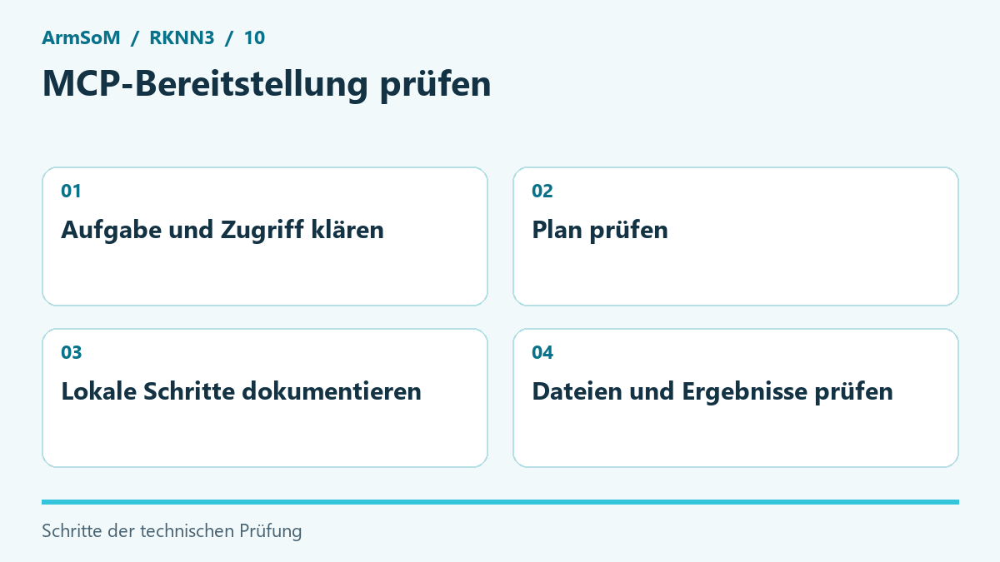

Natürliche Sprache erleichtert die Werkzeugnutzung. Eine technische Übergabe benötigt weiterhin einen nachvollziehbaren Plan, Eingaben und Abnahmekriterien. RKNN3 MCP unterstützt den Ablauf; „Deployment erfolgreich“ allein ist kein ausreichender Nachweis.

> Dieser eigenständige Fachartikel erläutert offizielle Dokumentation und gibt Umsetzungsempfehlungen. Der Ablauf wurde nicht auf ArmSoM-Hardware geprüft. Zielchip, SDK, Runtime, Treiber und Firmware müssen vor der Bereitstellung zusammenpassen.

[](/assets/rknn3-v120/rknn3-v010-mcp-deployment-de.svg)

*Originale Ablaufgrafik von ArmSoM: Arbeitsschritte, keine Hardware-Messergebnisse. Anklicken öffnet die Vektorfassung.*

## Dienst und ausführende Instanz trennen

Das Handbuch V0.1.0 ordnet Wissen, Planung, Parameterprüfung und Aufgabenstatus dem MCP Server zu. Modellverarbeitung und Boardoperationen führt der Client-Agent lokal oder auf einem Arbeitsserver aus. Laut Handbuch liest der MCP Server nicht direkt Clientdateien und startet dort keine Programme.

Prüfen Sie zusätzlich, was die Agent-Werkzeuge tatsächlich senden, lesen und ausführen. Eine serverseitige Grenze beweist nicht, dass im gesamten Ablauf keinerlei Daten übertragen werden.

## Einen konkreten Auftrag formulieren

Diese redaktionelle Anforderungsvorlage führt keine Befehle aus:

```text
Target chip and board revision:
SDK, Runtime and firmware versions:
Model path and checksum:
Input shapes and preprocessing:
Required output and quality threshold:
Allowed directories and device access:
Actions requiring human approval:
Evidence required for completion:
```

Klare Ziele und Grenzen machen ungeeignete Modelle, fehlende Abhängigkeiten und unnötige Zugriffe früher sichtbar.

## Prüfbare Zwischenstände definieren

| Phase | Prüfgegenstand |
| --- | --- |
| Analyse | Modell, Plattform und Umgebung |
| Planung | Geplante Änderungen und Dateien |
| Ausführung | Befehle, Logs, Rückgabewerte, Ergebnisse |
| Verifikation | Genauigkeit, Gerät und offene Punkte |
| Übergabe | Pfade, Versionen und Wiederaufnahme |

Ein abgeschlossener Werkzeugaufruf ist kein abgeschlossenes Projekt. Dateierzeugung, Konvertierung, Geräteausführung und Anwendungsabnahme sind unterschiedliche Ergebnisse.

## Zugriff vor dem Verbinden verstehen

Dokumentiert ist `https://rknn-mcp.rock-chips.com/mcp` mit Streamable HTTP. Für diesen Artikel wurde der Dienst nicht verbunden, kein Agent eingerichtet, kein Modell hochgeladen und kein Gerätezugriff freigegeben.

Bereiten Sie passende Werkzeuge vor und beginnen Sie mit einer begrenzten Modellanalyse. Boardzugangsdaten werden erst benötigt, wenn die Aufgabe tatsächlich Gerätevalidierung umfasst.

## Wiederaufnahme auf Nachweise stützen

Sichern Sie die letzte erfolgreiche Phase, Dateiprüfsummen, Umgebung und offene Probleme. Prüfen Sie diese Angaben vor dem Fortsetzen, statt alte Ergebnisse ungeprüft wiederzuverwenden. Bei ArmSoM entscheiden reproduzierbares Geräteverhalten und Anwendungskriterien über die Abnahme, nicht das Erreichen des letzten Automatisierungsschritts.

## Ein Projekt mit ArmSoM planen

Kommt eine ArmSoM-Platine als Anwendungshost infrage, beginnen Sie mit den Produktinformationen zu [Sige7](https://www.armsom.org/sige7), [Sige5](https://www.armsom.org/sige5) und [CM5](https://www.armsom.org/cm5). Prüfen Sie Schnittstellen, Stromversorgung, Systemabbild und Treiber für die tatsächliche Platinen- und Trägerrevision. Dies sind Hinweise zur Hostauswahl, keine Zusage zur sofortigen Kompatibilität mit RK182X-Modulen. Die integrierten NPUs von RK3588 / RK3576 verwenden den passenden RKNN-Toolkit2-Stack; ein solcher Host macht seine interne NPU nicht RKNN3-kompatibel.

Weitere Informationen zu Schnittstellen und Modulen: [RK182X M.2](/de/articles/rk182x-m2-module-guide/) · [RK182X SO-DIMM](/de/articles/rk182x-sodimm-module-datasheet/) · [RK3572 Datasheet V1.0](/de/articles/rk3572-datasheet-v10/)

## Offizielle Dokumentation und Version

Grundlage ist der feste Stand `141883c8e11b0` des offiziellen Repositorys, geprüft am 2026-11-14. Vollständige Schnittstellen, Parameter und Einschränkungen stehen im Original. Der Artikel ersetzt das Handbuch nicht und gibt die PDF nicht vollständig wieder.

- <a href="https://github.com/airockchip/rknn3-toolkit/blob/141883c8e11b05ef4cca4a69d8a7572c4d855191/doc/EN/09_RKNN3_MCP_QuickStart_V0.1.0.pdf">Offizielle englische PDF (V0.1.0)</a>
- <a href="https://github.com/airockchip/rknn3-toolkit/blob/141883c8e11b05ef4cca4a69d8a7572c4d855191/doc/CN/09_RKNN3_MCP_%E5%BF%AB%E9%80%9F%E5%85%A5%E9%97%A8_V0.1.0.pdf">Offizielle chinesische PDF (V0.1.0)</a>
- [Alle offiziellen Dokumente](https://github.com/airockchip/rknn3-toolkit/tree/main/doc)

## Lesereihenfolge

- [Serienübersicht](/de/articles/rknn3-v120-platform-guide/)
- Vorheriger Artikel: [MoE nach RKNN3 exportieren: Experten vor dem Gesamtmodell prüfen](/de/articles/rknn3-v120-moe-export/)
