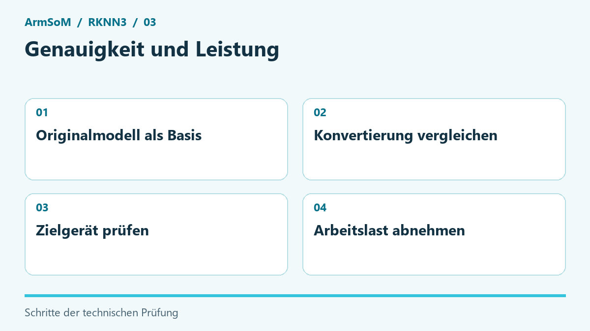

Eine erfolgreiche Konvertierung belegt zunächst nur erzeugte Dateien. Korrekte Antworten, geeignete Latenzen und stabiler Dauerbetrieb sind damit nicht nachgewiesen. Legen Sie vor der Optimierung Abnahmekriterien fest, damit ein schnellerer Lauf keinen Genauigkeitsverlust oder Speicheranstieg verdeckt.

> Dieser eigenständige Fachartikel erläutert offizielle Dokumentation und gibt Umsetzungsempfehlungen. Der Ablauf wurde nicht auf ArmSoM-Hardware geprüft. Zielchip, SDK, Runtime, Treiber und Firmware müssen vor der Bereitstellung zusammenpassen.

[](/assets/rknn3-v120/rknn3-v120-accuracy-performance-de.svg)

*Originale Ablaufgrafik von ArmSoM: Arbeitsschritte, keine Hardware-Messergebnisse. Anklicken öffnet die Vektorfassung.*

## Eine verlässliche Referenz sichern

Das Entwicklerhandbuch behandelt Konvertierung, Quantisierung, Bewertung und Deployment sowie KV Cache, LoRA und PagedAttention. Für einen belastbaren Vergleich werden Originalmodell und Vorverarbeitung festgehalten und konvertierte Modelle mit demselben Datensatz geprüft.

Bei Bildverarbeitung gehören Originalbild und vorbereiteter Tensor zum Nachweis. Bei Sprache sind Text, Template, Tokenizerkonfiguration und Generierungsbedingungen nötig. Ein Dateiname allein dokumentiert keine Farbfolge, Skalierung oder Promptänderung.

## Getrennte Kriterien festlegen

| Dimension | Aussagekräftiger Nachweis | Nicht ausreichend |
| --- | --- | --- |
| Genauigkeit | Anwendungsmetrik und Fehlerverteilung | Ein gelungenes Bildschirmfoto |
| Latenz | Erstlauf, Dauerbetrieb und hohe Perzentile | Nur der schnellste Lauf |
| Speicher | Spitze und Verhalten über Wiederholungen | Ein Wert nach dem Start |

Grenzwerte folgen aus der Anwendung. Interaktive Systeme bewerten Wartezeit; Erkennungssysteme zusätzlich übersehene Ereignisse und Warteschlangen. Eine einzige Kennzahl ersetzt diese Anforderungen nicht.

## Jeweils einen wesentlichen Faktor ändern

Vergleichen Sie schrittweise Originalmodell, unquantisierte Konvertierung, quantisierte Variante und Zielgerät. Bei Genauigkeitsabweichungen zuerst identische Eingaben nachweisen und dann die erste relevante Abweichung suchen.

Andere Formulierungen eines Sprachmodells sind nicht automatisch Fehler. Verwenden Sie Sachfragen, Formatvorgaben, lange und ungültige Eingaben mit festgelegter Bewertung. Dokumentieren Sie auch Misserfolge.

## Den gesamten Auftrag messen

Erfassen Sie Aufnahme, Vorverarbeitung, Wartezeit, Inferenz und Nachverarbeitung getrennt. Schnellere Inferenz allein beseitigt nicht jede Wartezeit. Asynchrone Phasen können überlappen; Werte aus verschiedenen Messfenstern sind nicht einfach addierbar.

Redaktioneller Vorschlag für Messfelder:

```text
case_id,model_sha256,input_sha256,run_mode,
load_ms,queue_ms,inference_ms,end_to_end_ms,
peak_memory_mb,quality_score,error
```

Tragen Sie gemessene statt erwarteter Werte ein.

## Nach Änderungen regressiv testen

Bewahren Sie einen festen Testsatz auf und ergänzen Sie Felddaten. Nach Änderungen an Quantisierung, Cache oder Parallelität sind Genauigkeit, Ressourcenfreigabe und Wiederanlauf erneut zu prüfen. Dokumentierte Fähigkeiten sind keine ArmSoM-Messwerte; Hardwarebenchmarks wurden hier nicht durchgeführt.

## Ein Projekt mit ArmSoM planen

Kommt eine ArmSoM-Platine als Anwendungshost infrage, beginnen Sie mit den Produktinformationen zu [Sige7](https://www.armsom.org/sige7), [Sige5](https://www.armsom.org/sige5) und [CM5](https://www.armsom.org/cm5). Prüfen Sie Schnittstellen, Stromversorgung, Systemabbild und Treiber für die tatsächliche Platinen- und Trägerrevision. Dies sind Hinweise zur Hostauswahl, keine Zusage zur sofortigen Kompatibilität mit RK182X-Modulen. Die integrierten NPUs von RK3588 / RK3576 verwenden den passenden RKNN-Toolkit2-Stack; ein solcher Host macht seine interne NPU nicht RKNN3-kompatibel.

Weitere Informationen zu Schnittstellen und Modulen: [RK182X M.2](/de/articles/rk182x-m2-module-guide/) · [RK182X SO-DIMM](/de/articles/rk182x-sodimm-module-datasheet/) · [RK3572 Datasheet V1.0](/de/articles/rk3572-datasheet-v10/)

## Offizielle Dokumentation und Version

Grundlage ist der feste Stand `141883c8e11b0` des offiziellen Repositorys, geprüft am 2026-11-14. Vollständige Schnittstellen, Parameter und Einschränkungen stehen im Original. Der Artikel ersetzt das Handbuch nicht und gibt die PDF nicht vollständig wieder.

- <a href="https://github.com/airockchip/rknn3-toolkit/blob/141883c8e11b05ef4cca4a69d8a7572c4d855191/doc/EN/02_RKNN3_SDK_Development_Guide_V1.2.0.pdf">Offizielle englische PDF (V1.2.0)</a>
- <a href="https://github.com/airockchip/rknn3-toolkit/blob/141883c8e11b05ef4cca4a69d8a7572c4d855191/doc/CN/02_RKNN3_SDK_%E5%BC%80%E5%8F%91%E6%8C%87%E5%8D%97_V1.2.0.pdf">Offizielle chinesische PDF (V1.2.0)</a>
- [Alle offiziellen Dokumente](https://github.com/airockchip/rknn3-toolkit/tree/main/doc)

## Lesereihenfolge

- [Serienübersicht](/de/articles/rknn3-v120-platform-guide/)
- Vorheriger Artikel: [RKNN3 erstmals einsetzen: Umgebung prüfen und Inferenz reproduzieren](/de/articles/rknn3-v120-first-deployment/)
- Nächster Artikel: [RKNN3 Toolkit mit Python: Modellkonvertierung nachvollziehbar gestalten](/de/articles/rknn3-v120-toolkit-python-workflow/)
