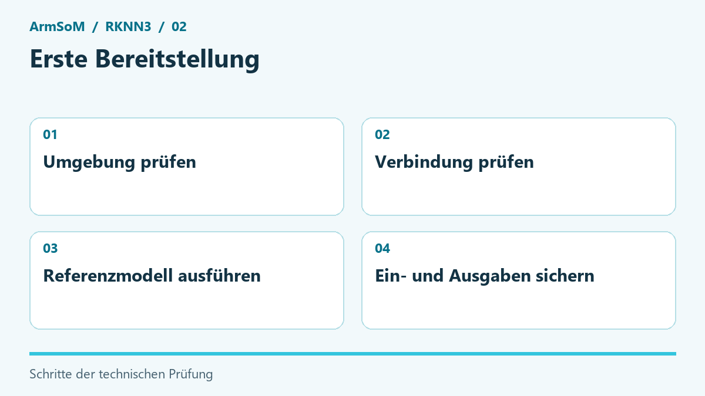

Der erste Einsatz braucht ein konkretes Ziel: eine überprüfbare Ausgabe für eine bekannte Eingabe bei festgelegter Software und Verbindung. Kameras, Container, Dienste und mehrere Modelle sollten erst danach hinzukommen.

> Dieser eigenständige Fachartikel erläutert offizielle Dokumentation und gibt Umsetzungsempfehlungen. Der Ablauf wurde nicht auf ArmSoM-Hardware geprüft. Zielchip, SDK, Runtime, Treiber und Firmware müssen vor der Bereitstellung zusammenpassen.

[](/assets/rknn3-v120/rknn3-v120-first-deployment-de.svg)

*Originale Ablaufgrafik von ArmSoM: Arbeitsschritte, keine Hardware-Messergebnisse. Anklicken öffnet die Vektorfassung.*

## Drei Ausführungsorte erfassen

Dokumentieren Sie Konvertierungsrechner, Anwendungshost und Inferenzchip. Bei einem Koprozessor müssen diese nicht im selben Gerät liegen. „Linux“ oder „Windows“ reicht als Angabe nicht: OS-Version, CPU-Architektur, Python-ABI und Bibliothekspfade gehören dazu.

Die Kurzanleitung unterscheidet RK182X und RK3572 sowie Entwicklungsboard- und PC-Hosts. Ihre Hinweise zum USB-Hostbetrieb unter macOS belegen keine Unterstützung der Boardauswertung im Toolkit. Dessen macOS-Funktionsumfang ist separat im API-Handbuch zu prüfen.

## Eine reproduzierbare Übergabe vorbereiten

| Bereich | Zu sichernder Nachweis |
| --- | --- |
| Gerät | Board, Hardwarestand und Zielchip |
| Software | Imagequelle, Pakete und Modellprüfsummen |
| Verbindung | Anschluss, Kabel und Geräteerkennung |
| Korrektheit | Feste Eingabe und erwartetes Ergebnis |
| Wiederherstellung | Fehlerprotokoll und Vorgehen |

Ein anderer Entwickler sollte den Versuch anhand dieser Angaben wiederholen können. „Gestern funktionierte es“ unterscheidet keinen Kabelwechsel von Änderungen an Image, Modell oder Python.

## Umgebung vor der Installation protokollieren

Diese redaktionellen Befehle zeigen nur Informationen zur ausgewählten Python-Umgebung. Sie installieren nichts und verbinden sich mit keinem Board:

```bash
python -c "import sys, platform; print(sys.executable); print(sys.version); print(platform.platform()); print(platform.machine())"
python -m pip --version
python -m pip check
```

Wählen Sie danach Pakete für Architektur, Python und Release. Ähnliche Paketnamen beweisen keine Austauschbarkeit. Verschiedene Toolchains sollten keine über lange Zeit mit Abhängigkeiten gefüllte Umgebung teilen.

## Schichtweise vorgehen

Prüfen Sie Versorgung und Geräteerkennung, dann Kommunikationsdienste und das passende offizielle Beispiel. Ersetzen Sie dessen Eingabe erst nach erfolgreichem Referenzlauf. Bei Fehlern die betroffene Schicht protokollieren, statt Runtime, Modell und Kabel gleichzeitig zu wechseln.

Speichern Sie beim Kameraanschluss zunächst ein Einzelbild für den Vergleich mit einer Dateieingabe. Beginnen Sie beim Netzwerkdienst mit einer einzelnen Anfrage. So lassen sich Format-, Ausführungs- und Schedulingprobleme trennen.

## Mehr als einen Erfolgsbildschirm sichern

Bewahren Sie Befehle, Arbeitsverzeichnis, Eingaben, Ausgaben und Logs auf. Unterscheiden Sie Erstladen und Folgeläufe; wiederholen Sie den Versuch nach einem Prozessneustart. Erst dann ist Optimierung sinnvoll. Flashen, Geräteinferenz und ArmSoM-Hardwarekompatibilität wurden für diesen Artikel nicht getestet.

## Ein Projekt mit ArmSoM planen

Kommt eine ArmSoM-Platine als Anwendungshost infrage, beginnen Sie mit den Produktinformationen zu [Sige7](https://www.armsom.org/sige7), [Sige5](https://www.armsom.org/sige5) und [CM5](https://www.armsom.org/cm5). Prüfen Sie Schnittstellen, Stromversorgung, Systemabbild und Treiber für die tatsächliche Platinen- und Trägerrevision. Dies sind Hinweise zur Hostauswahl, keine Zusage zur sofortigen Kompatibilität mit RK182X-Modulen. Die integrierten NPUs von RK3588 / RK3576 verwenden den passenden RKNN-Toolkit2-Stack; ein solcher Host macht seine interne NPU nicht RKNN3-kompatibel.

Weitere Informationen zu Schnittstellen und Modulen: [RK182X M.2](/de/articles/rk182x-m2-module-guide/) · [RK182X SO-DIMM](/de/articles/rk182x-sodimm-module-datasheet/) · [RK3572 Datasheet V1.0](/de/articles/rk3572-datasheet-v10/)

## Offizielle Dokumentation und Version

Grundlage ist der feste Stand `141883c8e11b0` des offiziellen Repositorys, geprüft am 2026-11-14. Vollständige Schnittstellen, Parameter und Einschränkungen stehen im Original. Der Artikel ersetzt das Handbuch nicht und gibt die PDF nicht vollständig wieder.

- <a href="https://github.com/airockchip/rknn3-toolkit/blob/141883c8e11b05ef4cca4a69d8a7572c4d855191/doc/EN/01_RKNN3_SDK_QuickStart_V1.2.0.pdf">Offizielle englische PDF (V1.2.0)</a>
- <a href="https://github.com/airockchip/rknn3-toolkit/blob/141883c8e11b05ef4cca4a69d8a7572c4d855191/doc/CN/01_RKNN3_SDK_%E5%BF%AB%E9%80%9F%E5%85%A5%E9%97%A8_V1.2.0.pdf">Offizielle chinesische PDF (V1.2.0)</a>
- [Alle offiziellen Dokumente](https://github.com/airockchip/rknn3-toolkit/tree/main/doc)

## Lesereihenfolge

- [Serienübersicht](/de/articles/rknn3-v120-platform-guide/)
- Nächster Artikel: [RKNN3-Modelle prüfen: Genauigkeit, Latenz und Speicher gemeinsam bewerten](/de/articles/rknn3-v120-accuracy-performance/)
