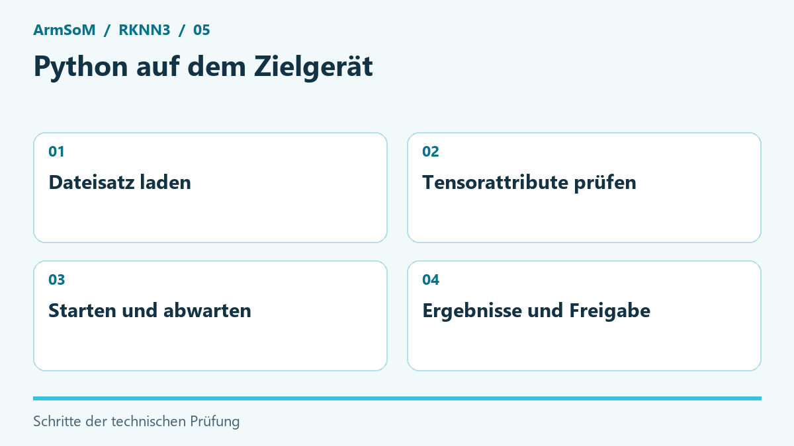

Python verbindet Inferenz gut mit Kameras, Warteschlangen und Prototypen. Eine höhere Abstraktion beseitigt jedoch nicht die Fragen zu Gerätespeicher, asynchronen Aufgaben und Sitzungszustand. Prüfen Sie zuerst Einzelanfragen, danach Parallelität.

> Dieser eigenständige Fachartikel erläutert offizielle Dokumentation und gibt Umsetzungsempfehlungen. Der Ablauf wurde nicht auf ArmSoM-Hardware geprüft. Zielchip, SDK, Runtime, Treiber und Firmware müssen vor der Bereitstellung zusammenpassen.

*Originale Ablaufgrafik von ArmSoM: Arbeitsschritte, keine Hardware-Messergebnisse. Anklicken öffnet die Vektorfassung.*

## Lite führt konvertierte Modelle aus

Das Handbuch V1.2.0 beschreibt `RKNN3Lite` als Python-Schnittstelle für konvertierte Modelle mit passender Runtime. Behandelt werden synchrone und asynchrone Inferenz, Tensorattribute, LLM-Sessions, Callbacks und Speicherlebensdauer. Die Konvertierung gehört zum Toolkit.

Ein importierbarer Konverter auf dem Entwicklungsrechner belegt keine fertige Geräteumgebung. Prüfen Sie Python-Paket, gemeinsame Bibliotheken und Modell-Build getrennt.

## Eingaben an der Anwendungsgrenze prüfen

Kontrollieren Sie Dimensionen, Typ, Layout und Batch-Bedeutung. Ein bedingungsloses Umwandeln aller Eingaben kann Änderungen der Datenquelle verbergen und Fehler bis zur Inferenz verschieben.

| Grenze | Empfohlene Prüfung |
| --- | --- |
| Anwendungseingang | Format, Maße, fehlende Werte und Herkunft |
| Modelleingang | Attribute, Vorverarbeitung und zusammenhängender Speicher |
| Modellausgang | Anzahl, Struktur und ungültige Werte |
| Geschäftsergebnis | Schwellwerte, Koordinaten und Textauswertung |

Eine bekannte korrekte Dateieingabe hilft, Kamera-, Decoder- und Netzwerkverhalten zu isolieren.

## Einreichen bedeutet nicht abschließen

Die Schnittstelle bietet `inference_async`. Eine zurückgekehrte Einreichung ist keine abgeschlossene Berechnung. Beachten Sie den dokumentierten Wartevertrag, bevor Ergebnisse gelesen oder beteiligte Objekte freigegeben werden. Auch Callbacks brauchen eine definierte Lebensdauer.

Kennzeichnen Sie Pufferslots als frei, in Bearbeitung oder lesebereit. Erlauben Sie nur gültige Übergänge. Legen Sie bei voller Warteschlange bewusst Verwerfen, Blockieren oder Ablehnen fest.

## Gespräche eindeutig Sessions zuordnen

Definieren Sie die Bereinigung bei Abbruch, Timeout und Benutzerende. Wechseln Sie testweise zwischen zwei Gesprächen und prüfen Sie, ob Anwendungskontext oder Callback-Objekte verwechselt werden. Speicher- und Sessionwiederverwendung sind getrennte Prüfaufgaben.

## Über den Prototyp hinaus testen

Ergänzen Sie leere Eingaben, falsche Dimensionen, Abbrüche und wiederholte Aufgabenerzeugung. Beobachten Sie Wiederanlauf, Speicherfreigabe und den nächsten Auftrag. Hardwaremessungen liegen hier nicht vor. Ein ArmSoM-Hostprojekt erfordert die Prüfung von Beschleuniger, Image und Runtime.

## Ein Projekt mit ArmSoM planen

Kommt eine ArmSoM-Platine als Anwendungshost infrage, beginnen Sie mit den Produktinformationen zu [Sige7](https://www.armsom.org/sige7), [Sige5](https://www.armsom.org/sige5) und [CM5](https://www.armsom.org/cm5). Prüfen Sie Schnittstellen, Stromversorgung, Systemabbild und Treiber für die tatsächliche Platinen- und Trägerrevision. Dies sind Hinweise zur Hostauswahl, keine Zusage zur sofortigen Kompatibilität mit RK182X-Modulen. Die integrierten NPUs von RK3588 / RK3576 verwenden den passenden RKNN-Toolkit2-Stack; ein solcher Host macht seine interne NPU nicht RKNN3-kompatibel.

Weitere Informationen zu Schnittstellen und Modulen: [RK182X M.2](/de/articles/rk182x-m2-module-guide/) · [RK182X SO-DIMM](/de/articles/rk182x-sodimm-module-datasheet/) · [RK3572 Datasheet V1.0](/de/articles/rk3572-datasheet-v10/)

## Offizielle Dokumentation und Version

Grundlage ist der feste Stand `141883c8e11b0` des offiziellen Repositorys, geprüft am 2026-11-14. Vollständige Schnittstellen, Parameter und Einschränkungen stehen im Original. Der Artikel ersetzt das Handbuch nicht und gibt die PDF nicht vollständig wieder.

- <a href="https://github.com/airockchip/rknn3-toolkit/blob/141883c8e11b05ef4cca4a69d8a7572c4d855191/doc/EN/04_RKNN3_Toolkit_Lite_Python_API_Reference_V1.2.0.pdf">Offizielle englische PDF (V1.2.0)</a>
- <a href="https://github.com/airockchip/rknn3-toolkit/blob/141883c8e11b05ef4cca4a69d8a7572c4d855191/doc/CN/04_RKNN3_Toolkit_Lite_Python_API_%E5%8F%82%E8%80%83_V1.2.0.pdf">Offizielle chinesische PDF (V1.2.0)</a>
- [Alle offiziellen Dokumente](https://github.com/airockchip/rknn3-toolkit/tree/main/doc)

## Lesereihenfolge

- [Serienübersicht](/de/articles/rknn3-v120-platform-guide/)
- Vorheriger Artikel: [RKNN3 Toolkit mit Python: Modellkonvertierung nachvollziehbar gestalten](/de/articles/rknn3-v120-toolkit-python-workflow/)
- Nächster Artikel: [RKNN3 C Runtime: Lebensdauer von Kontext, Modell, Session und Speicher](/de/articles/rknn3-v120-runtime-c-lifecycle/)
