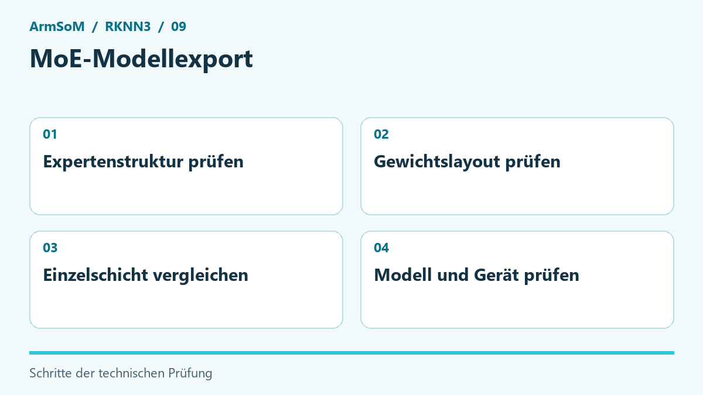

MoE unterscheidet zwischen den pro Berechnung aktiven Experten und der insgesamt gespeicherten Parameterzahl. Beim Edge-Einsatz zählen daher auch Gewichte, Routing, Cache und Ressourcen des vollständigen Modells.

> Dieser eigenständige Fachartikel erläutert offizielle Dokumentation und gibt Umsetzungsempfehlungen. Der Ablauf wurde nicht auf ArmSoM-Hardware geprüft. Zielchip, SDK, Runtime, Treiber und Firmware müssen vor der Bereitstellung zusammenpassen.

*Originale Ablaufgrafik von ArmSoM: Arbeitsschritte, keine Hardware-Messergebnisse. Anklicken öffnet die Vektorfassung.*

## Die Exportgrenze bestimmen

Das Handbuch V1.2.0 stellt geroutete Experten durch `rknn::exUnifiedMoE` dar. Shared Expert und Zusammenführung bleiben außerhalb dieses Knotens. Die aktuelle Batchgrenze ist 1; Matrixgewichte verwenden `[in,out]`.

Prüfen Sie vor einer Transposition die ursprüngliche Gewichtsanordnung. Zweimaliges Transponieren kann eine korrekte Darstellung verfälschen, obwohl Dimensionen plausibel wirken.

## Struktur und Zahlen getrennt prüfen

| Prüfung | Nachweis |
| --- | --- |
| Struktur | Experten, Routing, Ein-/Ausgaben, Zusammenführung |
| Gewichte | Layout, Packung, dtype und Prüfsummen |
| Numerik | Referenzausgaben und Fehler bei gleichen Eingaben |
| Gesamtmodell | Anwendungsausgaben und Qualitätsmetriken |

Strukturprüfung erkennt nicht jeden Zahlenfehler; ein numerischer Test erreicht möglicherweise nicht jeden Zweig. Beide Nachweise sind notwendig.

## Modellfehler auf Schichtebene untersuchen

Eine gespeicherte Schichteingabe hilft oft mehr als nur die letzte generierte Antwort. Klären Sie, ob die Referenz lediglich geroutete Experten oder das vollständige Modul umfasst, und vergleichen Sie dieselben Größen.

Betrachten Sie maximalen Fehler und Position zusätzlich zum Mittelwert. Weichen einzelne Token stark ab, erweitern Sie die Eingabeabdeckung. Ändern Sie Layout, Routing oder Quantisierung jeweils einzeln.

## Nicht unterstützte Optionen eindeutig behandeln

Abschnitt 3.2 bezeichnet `enable_moe_tc` als nicht implementiert beziehungsweise nicht unterstützt, obwohl danach die Aktivierung beschrieben wird. Hier gilt die Funktion als nicht verfügbar; für die erste Bewertung bleibt die Standardeinstellung deaktiviert.

Ein dokumentierter Parametername beweist keine einsatzbereite Funktion. Version, Funktionsstatus und Prüfergebnis gehören zusammen.

## Zur Produktabnahme weitergehen

Nach erfolgreicher Schichtprüfung folgen Speicherbedarf des Gesamtmodells, Startzeit, Dauerinferenz und Wiederanlauf. Prüfen Sie unterschiedliche Eingabegrößen; ein kurzer Prompt belegt nicht jeden Kontext. MoE-Konvertierung oder Hardwaremessungen wurden hier nicht ausgeführt. Modellkapazität und Generierungsrate für ArmSoM-Produkte werden nicht zugesichert.

## Ein Projekt mit ArmSoM planen

Kommt eine ArmSoM-Platine als Anwendungshost infrage, beginnen Sie mit den Produktinformationen zu [Sige7](https://www.armsom.org/sige7), [Sige5](https://www.armsom.org/sige5) und [CM5](https://www.armsom.org/cm5). Prüfen Sie Schnittstellen, Stromversorgung, Systemabbild und Treiber für die tatsächliche Platinen- und Trägerrevision. Dies sind Hinweise zur Hostauswahl, keine Zusage zur sofortigen Kompatibilität mit RK182X-Modulen. Die integrierten NPUs von RK3588 / RK3576 verwenden den passenden RKNN-Toolkit2-Stack; ein solcher Host macht seine interne NPU nicht RKNN3-kompatibel.

Weitere Informationen zu Schnittstellen und Modulen: [RK182X M.2](/de/articles/rk182x-m2-module-guide/) · [RK182X SO-DIMM](/de/articles/rk182x-sodimm-module-datasheet/) · [RK3572 Datasheet V1.0](/de/articles/rk3572-datasheet-v10/)

## Offizielle Dokumentation und Version

Grundlage ist der feste Stand `141883c8e11b0` des offiziellen Repositorys, geprüft am 2026-11-14. Vollständige Schnittstellen, Parameter und Einschränkungen stehen im Original. Der Artikel ersetzt das Handbuch nicht und gibt die PDF nicht vollständig wieder.

- <a href="https://github.com/airockchip/rknn3-toolkit/blob/141883c8e11b05ef4cca4a69d8a7572c4d855191/doc/EN/08_RKNN3_MoE_ONNX_Export_And_Conversion_Guide_V1.2.0.pdf">Offizielle englische PDF (V1.2.0)</a>
- <a href="https://github.com/airockchip/rknn3-toolkit/blob/141883c8e11b05ef4cca4a69d8a7572c4d855191/doc/CN/08_RKNN3_moe%E7%BB%93%E6%9E%84%E5%AF%BC%E5%87%BA%E9%80%82%E9%85%8D%E8%AF%B4%E6%98%8E_V1.2.0.pdf">Offizielle chinesische PDF (V1.2.0)</a>
- [Alle offiziellen Dokumente](https://github.com/airockchip/rknn3-toolkit/tree/main/doc)

## Lesereihenfolge

- [Serienübersicht](/de/articles/rknn3-v120-platform-guide/)
- Vorheriger Artikel: [RKNN3-Operatorprüfung: Warum ein unterstützter Name nicht genügt](/de/articles/rknn3-v120-operator-audit/)
- Nächster Artikel: [RKNN3 MCP: Deployment prüfbar und wiederaufnehmbar organisieren](/de/articles/rknn3-v010-mcp-deployment/)
