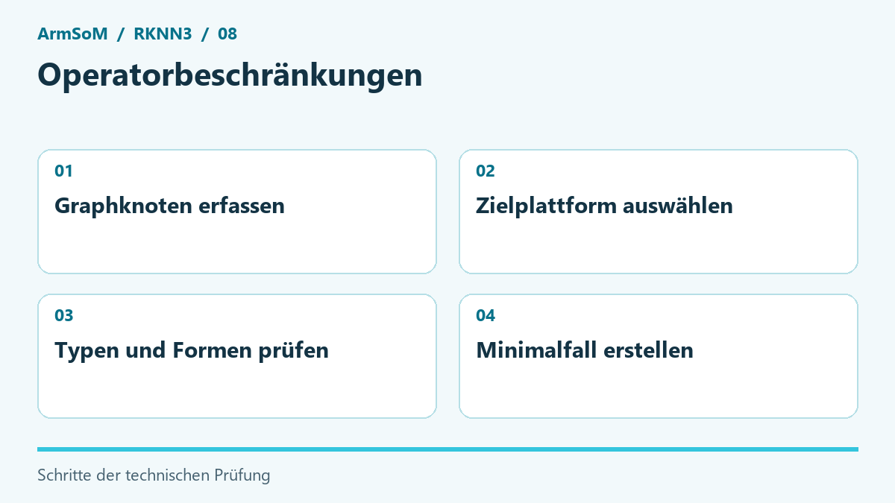

Ein häufiger Fehler lautet: Wenn der Operator im Handbuch steht, muss er in jedem Modell funktionieren. Tatsächlich zählen Zielhardware, Datentypen, Formen, Attributkombinationen und zur Übersetzung bekannte Konstanten.

> Dieser eigenständige Fachartikel erläutert offizielle Dokumentation und gibt Umsetzungsempfehlungen. Der Ablauf wurde nicht auf ArmSoM-Hardware geprüft. Zielchip, SDK, Runtime, Treiber und Firmware müssen vor der Bereitstellung zusammenpassen.

[](/assets/rknn3-v120/rknn3-v120-operator-audit-de.svg)

*Originale Ablaufgrafik von ArmSoM: Arbeitsschritte, keine Hardware-Messergebnisse. Anklicken öffnet die Vektorfassung.*

## Den passenden Plattformabschnitt wählen

Das Handbuch V1.2.0 trennt RK182X und RK3572. Einträge beschreiben Typen, Dimensionen und Parametergrenzen mit Kennzeichnungen wie Subgraph, RegEmit, NRV, NRVReg und Runtime/Simulator. Ein beschriebener Implementierungspfad bedeutet keine identische Ausführung auf allen Zielen.

Notieren Sie den konkreten Eintrag und SDK-Stand statt nur einer Liste unterstützter Namen.

## Zuerst Graphknoten erfassen

Dieses redaktionelle ONNX-Beispiel liest die Struktur ohne externe Gewichtsdaten zu laden. Es entscheidet nicht über RKNN3-Kompatibilität:

```python
from collections import Counter
import onnx

model = onnx.load("model.onnx", load_external_data=False)
counts = Counter((node.domain or "ai.onnx", node.op_type)
                 for node in model.graph.node)
for (domain, op_type), count in sorted(counts.items()):
    print(domain, op_type, count)
```

ONNX muss installiert sein. Die Ausgabe dient als Ausgangspunkt einer Prüfung, nicht als automatischer Kompatibilitätsnachweis.

## Einzelne Knoteninstanzen prüfen

| Punkt | Frage |
| --- | --- |
| Typ | Welche Typen haben Eingaben, Gewichte und Ausgaben? |
| Form | Sind Maße, Batch und dynamische Bereiche bestimmt? |
| Attribute | Ist die konkrete Kombination eingeschränkt? |
| Konstanten | Liegen benötigte Werte beim Übersetzen vor? |
| Nachbarknoten | Verändern Transpose, Broadcasting oder Fusion die Grenzen? |

Gleichnamige Operatoren können unterschiedliche Formen haben. Nur das erste Vorkommen zu prüfen reicht nicht.

## Einen Minimalfall herstellen

Bewahren Sie notwendige Eingaben und Beziehungen um den fehlerhaften Knoten. Prüfen Sie, ob ein kleinerer Graph das Problem reproduziert. Verschwindet es durch Vereinfachung, dokumentieren Sie die entfernten Bedingungen und ergänzen Sie sie schrittweise.

Bei vertraulichen Modellen lassen sich Strukturprobleme zunächst mit synthetischen Daten passender Dimension untersuchen. Genauigkeitsfragen benötigen letztlich echte Eingaben oder eine verlässliche Referenz.

## Modelländerungen erneut abnehmen

Ein ersetzter Operator erfordert Verhaltensvergleich und erneute Konvertierung. Ein erfolgreicher Build kann zusätzliche Kopien, CPU-Arbeit oder Zahlenabweichungen enthalten. Prüfen Sie Korrektheit, Gesamtlaufzeit und Speicher gemeinsam. RKNN3 wurde hier nicht kompiliert; das Inventarskript ersetzt keine offizielle Referenz.

## Ein Projekt mit ArmSoM planen

Kommt eine ArmSoM-Platine als Anwendungshost infrage, beginnen Sie mit den Produktinformationen zu [Sige7](https://www.armsom.org/sige7), [Sige5](https://www.armsom.org/sige5) und [CM5](https://www.armsom.org/cm5). Prüfen Sie Schnittstellen, Stromversorgung, Systemabbild und Treiber für die tatsächliche Platinen- und Trägerrevision. Dies sind Hinweise zur Hostauswahl, keine Zusage zur sofortigen Kompatibilität mit RK182X-Modulen. Die integrierten NPUs von RK3588 / RK3576 verwenden den passenden RKNN-Toolkit2-Stack; ein solcher Host macht seine interne NPU nicht RKNN3-kompatibel.

Weitere Informationen zu Schnittstellen und Modulen: [RK182X M.2](/de/articles/rk182x-m2-module-guide/) · [RK182X SO-DIMM](/de/articles/rk182x-sodimm-module-datasheet/) · [RK3572 Datasheet V1.0](/de/articles/rk3572-datasheet-v10/)

## Offizielle Dokumentation und Version

Grundlage ist der feste Stand `141883c8e11b0` des offiziellen Repositorys, geprüft am 2026-11-14. Vollständige Schnittstellen, Parameter und Einschränkungen stehen im Original. Der Artikel ersetzt das Handbuch nicht und gibt die PDF nicht vollständig wieder.

- <a href="https://github.com/airockchip/rknn3-toolkit/blob/141883c8e11b05ef4cca4a69d8a7572c4d855191/doc/EN/07_RKNN3_Supported_Operators_and_Constraints_Reference_V1.2.0.pdf">Offizielle englische PDF (V1.2.0)</a>
- <a href="https://github.com/airockchip/rknn3-toolkit/blob/141883c8e11b05ef4cca4a69d8a7572c4d855191/doc/CN/07_RKNN3_%E7%AE%97%E5%AD%90%E6%94%AF%E6%8C%81%E4%B8%8E%E7%BA%A6%E6%9D%9F%E5%8F%82%E8%80%83_V1.2.0.pdf">Offizielle chinesische PDF (V1.2.0)</a>
- [Alle offiziellen Dokumente](https://github.com/airockchip/rknn3-toolkit/tree/main/doc)

## Lesereihenfolge

- [Serienübersicht](/de/articles/rknn3-v120-platform-guide/)
- Vorheriger Artikel: [RKLLM3 Server: vom lokalen Modell zur Anwendungsschnittstelle](/de/articles/rknn3-v120-rkllm-server/)
- Nächster Artikel: [MoE nach RKNN3 exportieren: Experten vor dem Gesamtmodell prüfen](/de/articles/rknn3-v120-moe-export/)
