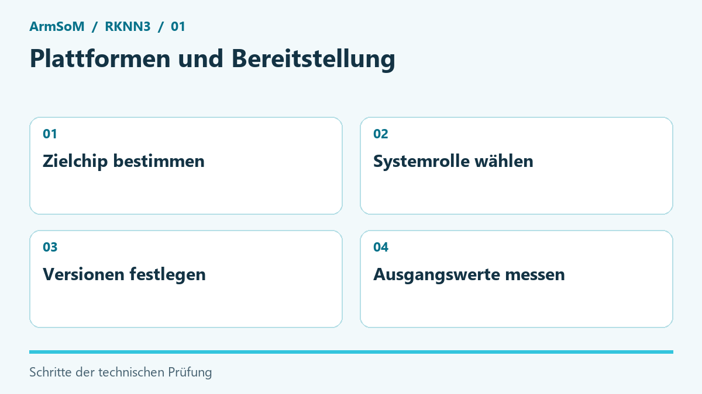

RKNN3 sollte als Teil eines Gesamtsystems bewertet werden: Wo läuft die Anwendung, welcher Chip berechnet die Inferenz, wie gelangen die Daten dorthin und wie lässt sich ein Fehler reproduzieren? Eine neuere SDK-Nummer bedeutet für ein ArmSoM-Projekt nicht automatisch, dass jeder Rockchip-NPU damit arbeitet.

> Dieser eigenständige Fachartikel erläutert offizielle Dokumentation und gibt Umsetzungsempfehlungen. Der Ablauf wurde nicht auf ArmSoM-Hardware geprüft. Zielchip, SDK, Runtime, Treiber und Firmware müssen vor der Bereitstellung zusammenpassen.

*Originale Ablaufgrafik von ArmSoM: Arbeitsschritte, keine Hardware-Messergebnisse. Anklicken öffnet die Vektorfassung.*

## Zwei Systemrollen unterscheiden

Die Versionshinweise beschreiben RK1820/RK1828 als Koprozessoren und den integrierten NPU des RK3572. Die erste Variante benötigt einen Host und einen funktionierenden Kommunikationsweg; die zweite läuft auf der Ziel-SoC. Die integrierten NPUs von RK3588/RK3576 verwenden Toolkit2. Dieselben SoCs als Hosts eines externen RK182X einzusetzen ist ein anderes Systemkonzept.

| Vorhaben | Zuerst klären |
| --- | --- |
| Vorhandenen Board-NPU nutzen | Chip, Softwarestack und Image abstimmen |
| Externen Beschleuniger ergänzen | Verkabelung, Versorgung, Treiber und Transport prüfen |
| RK3572 evaluieren | Konkrete Boardrevision und SDK bestimmen |

## V1.2.0 an Produktanforderungen messen

Die Version umfasst MoE, PagedAttention, den Export separater LoRA-Gewichte und Grammar-Beschränkungen. Das sind Ansatzpunkte zur Bewertung; Messungen von Modell, Speicherbedarf und Antwortzeiten bleiben erforderlich.

Notieren Sie für jede geplante Neuerung das Produktproblem, die benötigten Eingaben, das Abnahmekriterium und den Rückweg. Funktionen ohne klare Anforderung können warten. Weniger gleichzeitige Änderungen vereinfachen die Fehlersuche.

## Einen Versionsnachweis für ArmSoM anlegen

Erfassen Sie Board- und Trägerrevision, Imageherkunft, Kernel, Runtime, Toolkit, Modellprüfsummen und Testdatenversion. Dokumentieren Sie Konvertierungsrechner und Zielgerät getrennt. Beim Hostwechsel oder Image-Rollback lassen sich so Modell-, Bibliotheks- und Hardwareänderungen auseinanderhalten.

Ein erfolgreiches offizielles Beispiel ist ein Ausgangspunkt. Produktreife erfordert zusätzlich typische Eingaben, Fehlerbehandlung, Kühlungsprüfung und Dauerbetrieb.

## Leistungszahlen zur Vorauswahl verwenden

Herstellerwerte helfen bei der Kandidatensuche; die eigene Arbeitslast liefert die Abnahmegrundlage. Halten Sie Eingaben, Vorverarbeitung, Ausgabelänge, Parallelität und Laufdauer konstant. Erfassen Sie auch hohe Latenzperzentile, maximalen Speicherbedarf und Fehlerquote. Ein Spitzenwert zeigt nicht, ob im Dauerbetrieb eine Warteschlange wächst.

## Die Serie schrittweise nutzen

Beginnen Sie mit der ersten Inferenz sowie Genauigkeits- und Leistungsmessungen. Wählen Sie anschließend Toolkit Lite oder C Runtime für Ihre Anwendung. Serving, Operatorprüfung, MoE und MCP folgen bei Bedarf. Bewahren Sie reproduzierbare Eingaben und Ergebnisse jeder Stufe auf.

## Ein Projekt mit ArmSoM planen

Kommt eine ArmSoM-Platine als Anwendungshost infrage, beginnen Sie mit den Produktinformationen zu [Sige7](https://www.armsom.org/sige7), [Sige5](https://www.armsom.org/sige5) und [CM5](https://www.armsom.org/cm5). Prüfen Sie Schnittstellen, Stromversorgung, Systemabbild und Treiber für die tatsächliche Platinen- und Trägerrevision. Dies sind Hinweise zur Hostauswahl, keine Zusage zur sofortigen Kompatibilität mit RK182X-Modulen. Die integrierten NPUs von RK3588 / RK3576 verwenden den passenden RKNN-Toolkit2-Stack; ein solcher Host macht seine interne NPU nicht RKNN3-kompatibel.

Weitere Informationen zu Schnittstellen und Modulen: [RK182X M.2](/de/articles/rk182x-m2-module-guide/) · [RK182X SO-DIMM](/de/articles/rk182x-sodimm-module-datasheet/) · [RK3572 Datasheet V1.0](/de/articles/rk3572-datasheet-v10/)

## Offizielle Dokumentation und Version

Grundlage ist der feste Stand `141883c8e11b0` des offiziellen Repositorys, geprüft am 2026-11-14. Vollständige Schnittstellen, Parameter und Einschränkungen stehen im Original. Der Artikel ersetzt das Handbuch nicht und gibt die PDF nicht vollständig wieder.

- <a href="https://github.com/airockchip/rknn3-toolkit/blob/141883c8e11b05ef4cca4a69d8a7572c4d855191/doc/EN/00_RKNN3_SDK_Release_Notes_V1.2.0.pdf">Offizielle englische PDF (V1.2.0)</a>
- <a href="https://github.com/airockchip/rknn3-toolkit/blob/141883c8e11b05ef4cca4a69d8a7572c4d855191/doc/CN/00_RKNN3_SDK_%E5%8F%91%E5%B8%83%E8%AF%B4%E6%98%8E_V1.2.0.pdf">Offizielle chinesische PDF (V1.2.0)</a>
- [Alle offiziellen Dokumente](https://github.com/airockchip/rknn3-toolkit/tree/main/doc)

## Lesereihenfolge

| # | Thema |
| --- | --- |
| 01 | RKNN3 V1.2.0: RK182X, RK3572 und Integrationswege mit ArmSoM |
| 02 | [RKNN3 erstmals einsetzen: Umgebung prüfen und Inferenz reproduzieren](/de/articles/rknn3-v120-first-deployment/) |
| 03 | [RKNN3-Modelle prüfen: Genauigkeit, Latenz und Speicher gemeinsam bewerten](/de/articles/rknn3-v120-accuracy-performance/) |
| 04 | [RKNN3 Toolkit mit Python: Modellkonvertierung nachvollziehbar gestalten](/de/articles/rknn3-v120-toolkit-python-workflow/) |
| 05 | [RKNN3 Toolkit Lite: Python-Inferenz und asynchrone Ressourcenverwaltung](/de/articles/rknn3-v120-lite-python-inference/) |
| 06 | [RKNN3 C Runtime: Lebensdauer von Kontext, Modell, Session und Speicher](/de/articles/rknn3-v120-runtime-c-lifecycle/) |
| 07 | [RKLLM3 Server: vom lokalen Modell zur Anwendungsschnittstelle](/de/articles/rknn3-v120-rkllm-server/) |
| 08 | [RKNN3-Operatorprüfung: Warum ein unterstützter Name nicht genügt](/de/articles/rknn3-v120-operator-audit/) |
| 09 | [MoE nach RKNN3 exportieren: Experten vor dem Gesamtmodell prüfen](/de/articles/rknn3-v120-moe-export/) |
| 10 | [RKNN3 MCP: Deployment prüfbar und wiederaufnehmbar organisieren](/de/articles/rknn3-v010-mcp-deployment/) |
