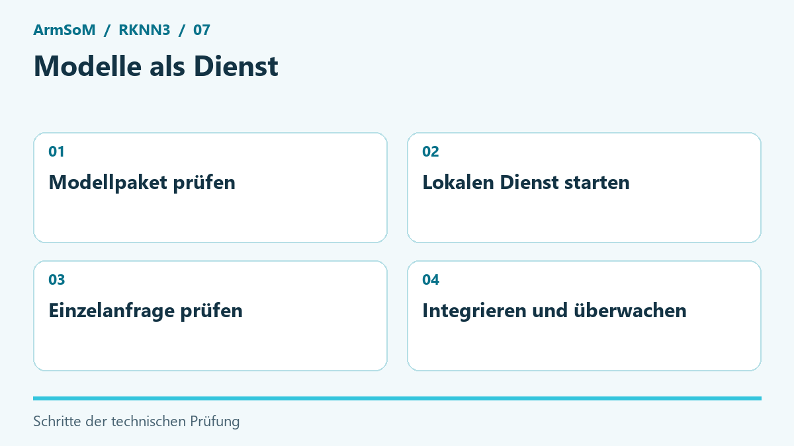

Nach dem lokalen Modelllauf benötigt eine Anwendung häufig eine API. Serving ergänzt Warteschlangen, Gesprächszustand, Abbruch, Timeouts und Zugriffskontrolle. Ein offener Port ist noch kein abgeschlossenes Deployment.

> Dieser eigenständige Fachartikel erläutert offizielle Dokumentation und gibt Umsetzungsempfehlungen. Der Ablauf wurde nicht auf ArmSoM-Hardware geprüft. Zielchip, SDK, Runtime, Treiber und Firmware müssen vor der Bereitstellung zusammenpassen.

[](/assets/rknn3-v120/rknn3-v120-rkllm-server-de.svg)

*Originale Ablaufgrafik von ArmSoM: Arbeitsschritte, keine Hardware-Messergebnisse. Anklicken öffnet die Vektorfassung.*

## Kompatibilität hat einen Umfang

RKLLM3 Server V1.2.0 bietet eine OpenAI-kompatible Chatschnittstelle und dokumentiert `/health`, `/v1/models` sowie `/v1/chat/completions`. Weitere Themen sind Multimodalität, LoRA, Caching, Grammar und mehrere Karten. Konkrete Modelle und Parameter müssen geprüft werden.

Clients sollten sich auf getestete Felder und Abläufe beschränken. Prüfen Sie Streaming, Fehlermeldungen, Stoppbedingungen und Parametervorrang, statt das vollständige Verhalten eines anderen Dienstes vorauszusetzen.

## Mit kleinen Dienstprüfungen beginnen

Läuft der Dienst bereits lokal auf Port 8080, sind diese redaktionellen Abfragen rein lesend:

```bash
curl --fail --max-time 10 http://127.0.0.1:8080/health
curl --fail --max-time 10 http://127.0.0.1:8080/v1/models
```

Verwenden Sie die konfigurierte Adresse und den richtigen Port. Ein gesunder Dienst beweist keine korrekten Antworten. Feste Anfragen müssen anschließend Struktur und Qualität prüfen. Für diesen Artikel wurde kein Inferenzdienst gestartet.

## Vier Ebenen abnehmen

| Ebene | Nachweis |
| --- | --- |
| Modell | Vollständige Dateien und korrekte Ein-/Ausgaben |
| Dienst | Start, Zustand und Fehlerprotokolle |
| Protokoll | Felder, Streaming, Timeouts und Fehler |
| Anwendung | Antwortqualität, Parallelität und Wiederanlauf |

Kennzeichnen Sie ungeprüfte Ebenen, damit die Integration nicht auf ungeklärtem Verhalten aufbaut.

## Multimodale und strukturierte Ausgaben getrennt testen

Erstellen Sie Format-, Größen- und Inhaltstypprüfungen für Bild und Audio. Prüfen Sie bei JSON auch die Bedeutung: Ein gültiges Objekt kann falsche Angaben enthalten. Fordert das Modell einen Werkzeugaufruf an, muss die Anwendung dessen Ausführung kontrollieren.

Beginnen Sie mit einem Modell, einer Anfrage und kurzer Eingabe. Steigern Sie Kontext, Parallelität und Modellkombinationen erst nach stabilem Grundverhalten. Beobachten Sie dabei Wartezeit und Speichermaximum.

## Die ArmSoM-Übergabe definieren

Dokumentieren Sie Bind-Adressen, Authentifizierung, Logs, Neustartverhalten und Modellversionen. Vor externer Freigabe gelten die Netzwerkanforderungen der Anwendung. Dieser Beitrag ist eine Architektur- und Abnahmehilfe, kein Leistungsversprechen für ein ArmSoM-Board.

## Ein Projekt mit ArmSoM planen

Kommt eine ArmSoM-Platine als Anwendungshost infrage, beginnen Sie mit den Produktinformationen zu [Sige7](https://www.armsom.org/sige7), [Sige5](https://www.armsom.org/sige5) und [CM5](https://www.armsom.org/cm5). Prüfen Sie Schnittstellen, Stromversorgung, Systemabbild und Treiber für die tatsächliche Platinen- und Trägerrevision. Dies sind Hinweise zur Hostauswahl, keine Zusage zur sofortigen Kompatibilität mit RK182X-Modulen. Die integrierten NPUs von RK3588 / RK3576 verwenden den passenden RKNN-Toolkit2-Stack; ein solcher Host macht seine interne NPU nicht RKNN3-kompatibel.

Weitere Informationen zu Schnittstellen und Modulen: [RK182X M.2](/de/articles/rk182x-m2-module-guide/) · [RK182X SO-DIMM](/de/articles/rk182x-sodimm-module-datasheet/) · [RK3572 Datasheet V1.0](/de/articles/rk3572-datasheet-v10/)

## Offizielle Dokumentation und Version

Grundlage ist der feste Stand `141883c8e11b0` des offiziellen Repositorys, geprüft am 2026-11-14. Vollständige Schnittstellen, Parameter und Einschränkungen stehen im Original. Der Artikel ersetzt das Handbuch nicht und gibt die PDF nicht vollständig wieder.

- <a href="https://github.com/airockchip/rknn3-toolkit/blob/141883c8e11b05ef4cca4a69d8a7572c4d855191/doc/EN/06_RKLLM3_Server_User_Guide_V1.2.0.pdf">Offizielle englische PDF (V1.2.0)</a>
- <a href="https://github.com/airockchip/rknn3-toolkit/blob/141883c8e11b05ef4cca4a69d8a7572c4d855191/doc/CN/06_RKLLM3_Server_%E4%BD%BF%E7%94%A8%E6%8C%87%E5%8D%97_V1.2.0.pdf">Offizielle chinesische PDF (V1.2.0)</a>
- [Alle offiziellen Dokumente](https://github.com/airockchip/rknn3-toolkit/tree/main/doc)

## Lesereihenfolge

- [Serienübersicht](/de/articles/rknn3-v120-platform-guide/)
- Vorheriger Artikel: [RKNN3 C Runtime: Lebensdauer von Kontext, Modell, Session und Speicher](/de/articles/rknn3-v120-runtime-c-lifecycle/)
- Nächster Artikel: [RKNN3-Operatorprüfung: Warum ein unterstützter Name nicht genügt](/de/articles/rknn3-v120-operator-audit/)
