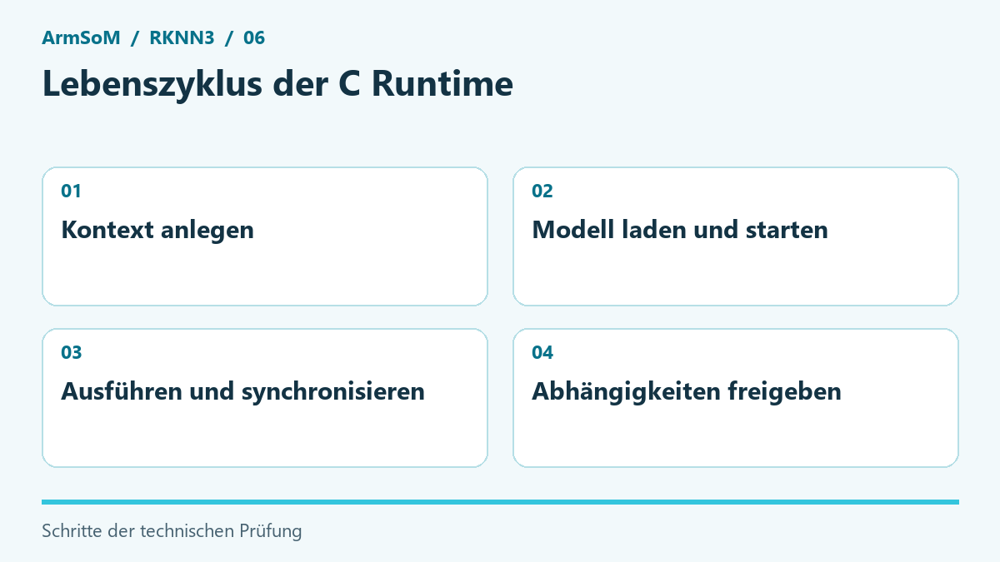

Lang laufende C/C++-Anwendungen benötigen klare Ressourcenverwaltung. Wann ein Objekt freigegeben werden darf, ist ebenso wichtig wie der Inferenzaufruf. Betrachten Sie die Runtime als Menge voneinander abhängiger Ressourcen.

> Dieser eigenständige Fachartikel erläutert offizielle Dokumentation und gibt Umsetzungsempfehlungen. Der Ablauf wurde nicht auf ArmSoM-Hardware geprüft. Zielchip, SDK, Runtime, Treiber und Firmware müssen vor der Bereitstellung zusammenpassen.

*Originale Ablaufgrafik von ArmSoM: Arbeitsschritte, keine Hardware-Messergebnisse. Anklicken öffnet die Vektorfassung.*

## Objekte unterscheiden

Das Handbuch V1.2.0 trennt Kontexterzeugung, Modellladen, Modellinitialisierung und LLM-Sessions. Dazu gehören `rknn3_init`, `rknn3_load_model_from_path`, `rknn3_model_init` und `rknn3_destroy`. Für cachebaren Speicher beschreibt `rknn3_mem_sync` die Synchronisierung.

Dies ist kein kompilierbares Programm. Parameterstrukturen, Plattformgrenzen und Rückgabecodes müssen zu Headern und Bibliothek passen.

## Jeder Ressource einen Besitzer zuweisen

| Ressource | Zu klärende Frage |
| --- | --- |
| Context | Wer erzeugt und zerstört ihn endgültig? |
| Model | Wie werden Dateien, Gewichte und Initialisierungsfehler behandelt? |
| Session | Was gilt bei Ende, Abbruch und Wiederverwendung? |
| Buffer | Wer reserviert, liest, schreibt und gibt frei? |
| Callback | Lebt der referenzierte Zustand bis zum letzten Aufruf? |

Ordnen Sie im Review jeder Erzeugung einen Freigabepfad zu. Erfolg, teilweise Initialisierung und Beenden sind getrennte Fälle.

## Abhängigkeiten in der Bereinigung ausdrücken

Nehmen Sie keine neue Arbeit an, berücksichtigen Sie laufende Aufgaben und geben Sie danach abhängige Ressourcen frei. Ein möglicherweise noch von einem Callback verwendetes Objekt darf nicht zerstört werden. Bei mehreren Threads verhindert ein zuständiger Shutdown-Besitzer doppelte Freigaben.

Ein besitzender C++-Wrapper kann helfen. Sein Destruktorzeitpunkt erfüllt aber nicht automatisch die Abschlussbedingung einer asynchronen Geräteaufgabe. Diese muss explizit modelliert werden.

## Gemeinsamer Speicher braucht Abstimmung

Sichtbarkeit, Layout und Besitz sind unterschiedliche Aspekte. Prüfen Sie bei sporadisch falschen Ergebnissen CPU-Schreiben, Gerätelesen, Ausgabesynchronisierung und CPU-Lesen. Eine feste Pause ersetzt keine korrekte Zustandsverwaltung.

## Fehler diagnostizierbar machen

Protokollieren Sie Phase, Rückgabewert, Modell, Gerät und Anfragekennung. Vollständige Geschäftsdaten sind dafür nicht nötig, ein reproduzierbarer Testfall jedoch schon. Prüfen Sie nach einem Fehler die erneute Initialisierung.

Dieser Beitrag behauptet weder kompilierten oder ausgeführten Gerätecode noch direkte Kompatibilität eines bestimmten ArmSoM-Boards.

## Ein Projekt mit ArmSoM planen

Kommt eine ArmSoM-Platine als Anwendungshost infrage, beginnen Sie mit den Produktinformationen zu [Sige7](https://www.armsom.org/sige7), [Sige5](https://www.armsom.org/sige5) und [CM5](https://www.armsom.org/cm5). Prüfen Sie Schnittstellen, Stromversorgung, Systemabbild und Treiber für die tatsächliche Platinen- und Trägerrevision. Dies sind Hinweise zur Hostauswahl, keine Zusage zur sofortigen Kompatibilität mit RK182X-Modulen. Die integrierten NPUs von RK3588 / RK3576 verwenden den passenden RKNN-Toolkit2-Stack; ein solcher Host macht seine interne NPU nicht RKNN3-kompatibel.

Weitere Informationen zu Schnittstellen und Modulen: [RK182X M.2](/de/articles/rk182x-m2-module-guide/) · [RK182X SO-DIMM](/de/articles/rk182x-sodimm-module-datasheet/) · [RK3572 Datasheet V1.0](/de/articles/rk3572-datasheet-v10/)

## Offizielle Dokumentation und Version

Grundlage ist der feste Stand `141883c8e11b0` des offiziellen Repositorys, geprüft am 2026-11-14. Vollständige Schnittstellen, Parameter und Einschränkungen stehen im Original. Der Artikel ersetzt das Handbuch nicht und gibt die PDF nicht vollständig wieder.

- <a href="https://github.com/airockchip/rknn3-toolkit/blob/141883c8e11b05ef4cca4a69d8a7572c4d855191/doc/EN/05_RKNN3_Runtime_C_API_Reference_V1.2.0.pdf">Offizielle englische PDF (V1.2.0)</a>
- <a href="https://github.com/airockchip/rknn3-toolkit/blob/141883c8e11b05ef4cca4a69d8a7572c4d855191/doc/CN/05_RKNN3_Runtime_C_API_%E5%8F%82%E8%80%83_V1.2.0.pdf">Offizielle chinesische PDF (V1.2.0)</a>
- [Alle offiziellen Dokumente](https://github.com/airockchip/rknn3-toolkit/tree/main/doc)

## Lesereihenfolge

- [Serienübersicht](/de/articles/rknn3-v120-platform-guide/)
- Vorheriger Artikel: [RKNN3 Toolkit Lite: Python-Inferenz und asynchrone Ressourcenverwaltung](/de/articles/rknn3-v120-lite-python-inference/)
- Nächster Artikel: [RKLLM3 Server: vom lokalen Modell zur Anwendungsschnittstelle](/de/articles/rknn3-v120-rkllm-server/)
