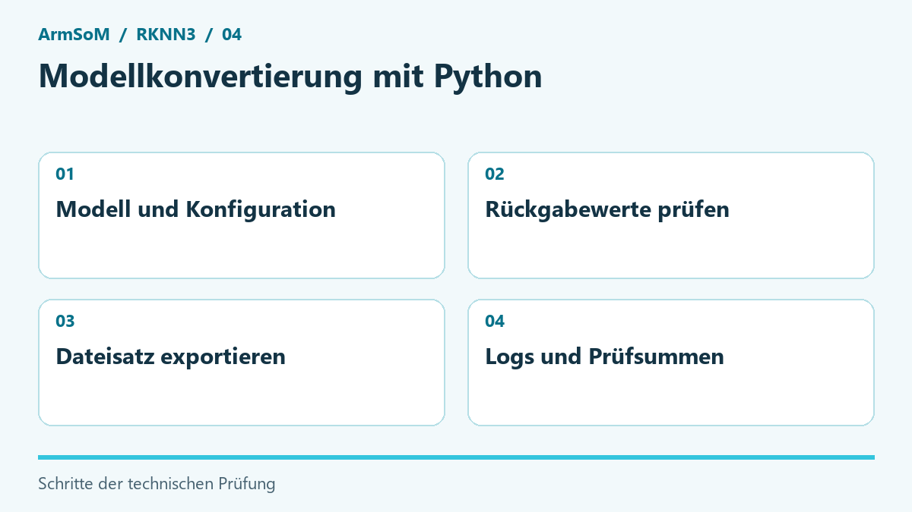

Ein Konvertierungsskript ist Entwicklungswerkzeug und Liefernachweis zugleich. Ein betreutes Projekt muss Eingaben, Einstellungen, Softwarestand und den genauen Fehlerzeitpunkt nachvollziehen können.

> Dieser eigenständige Fachartikel erläutert offizielle Dokumentation und gibt Umsetzungsempfehlungen. Der Ablauf wurde nicht auf ArmSoM-Hardware geprüft. Zielchip, SDK, Runtime, Treiber und Firmware müssen vor der Bereitstellung zusammenpassen.

[](/assets/rknn3-v120/rknn3-v120-toolkit-python-workflow-de.svg)

*Originale Ablaufgrafik von ArmSoM: Arbeitsschritte, keine Hardware-Messergebnisse. Anklicken öffnet die Vektorfassung.*

## Imports nicht aus dem SDK-Namen ableiten

Das Handbuch V1.2.0 importiert die Klasse mit `from rknn.api import RKNN`. Der Konvertierungsweg verwendet `config`, `load_onnx`, `build`, `export_rknn` und `release`. Exportierte `.rknn`-Dateien und zugehörige `.weight`-Dateien gehören zu einem gemeinsamen Build.

Ähnliche Python-Namensräume können eine falsche Umgebung verbergen. Prüfen Sie den tatsächlichen Importpfad vor der Modellkonfiguration.

## Die verwendete Umgebung feststellen

Diese redaktionelle Diagnose liest nur Informationen und konvertiert kein Modell:

```python
import sys
from importlib.util import find_spec

print("python:", sys.executable)
spec = find_spec("rknn")
print("rknn:", None if spec is None else spec.origin)
```

Speichern Sie die Ausgabe mit dem Installationsnachweis. Ein gefundenes Modul beweist weder die richtige Version noch die Ausführbarkeit des Modells.

## Für jede Phase einen Nachweis verlangen

| Phase | Aufzeichnung |
| --- | --- |
| Eingabe | Modellprüfsumme, externe Gewichte, Eingabedefinition |
| Konfiguration | Ziel, Vorverarbeitung, Quantisierung |
| Build | Rückgabestatus, Log und Dauer |
| Export | Zusammengehörige Dateien, Größen, Prüfsummen |
| Prüfung | Feste Eingaben, Ausgaben und Referenzvergleich |

Bei einem Fehler muss die Übergabe stoppen. Eine alte Datei im Zielverzeichnis belegt keinen erfolgreichen neuen Build. Trennen Sie Verzeichnisse nach Buildkennung und übernehmen Sie Dateien erst nach Prüfung in einen Freigabekandidaten.

## Ressourcenfreigabe mitplanen

Legen Sie Besitzer für Objekte und temporäre Dateien fest. Fehlerpfade sollen Ressourcen freigeben und aussagekräftige Logs erhalten. Unterdrücken Sie keine Ausnahmen; das bloße Vorhandensein einer Datei ist kein Erfolgskriterium.

## Einen Integrationssatz übergeben

Für ArmSoM gehören Konfiguration, Anforderungen an die Zielumgebung und feste Testeingaben zum Modellpaket. Dokumentieren Sie Konvertierungserfolg getrennt von der Abnahme auf einer bestimmten ArmSoM-Hardwarerevision. Für diesen Artikel wurde keine SDK-Konvertierung ausgeführt. Vollständige Parameter und Grenzen stehen im versionsgleichen API-Handbuch.

## Ein Projekt mit ArmSoM planen

Kommt eine ArmSoM-Platine als Anwendungshost infrage, beginnen Sie mit den Produktinformationen zu [Sige7](https://www.armsom.org/sige7), [Sige5](https://www.armsom.org/sige5) und [CM5](https://www.armsom.org/cm5). Prüfen Sie Schnittstellen, Stromversorgung, Systemabbild und Treiber für die tatsächliche Platinen- und Trägerrevision. Dies sind Hinweise zur Hostauswahl, keine Zusage zur sofortigen Kompatibilität mit RK182X-Modulen. Die integrierten NPUs von RK3588 / RK3576 verwenden den passenden RKNN-Toolkit2-Stack; ein solcher Host macht seine interne NPU nicht RKNN3-kompatibel.

Weitere Informationen zu Schnittstellen und Modulen: [RK182X M.2](/de/articles/rk182x-m2-module-guide/) · [RK182X SO-DIMM](/de/articles/rk182x-sodimm-module-datasheet/) · [RK3572 Datasheet V1.0](/de/articles/rk3572-datasheet-v10/)

## Offizielle Dokumentation und Version

Grundlage ist der feste Stand `141883c8e11b0` des offiziellen Repositorys, geprüft am 2026-11-14. Vollständige Schnittstellen, Parameter und Einschränkungen stehen im Original. Der Artikel ersetzt das Handbuch nicht und gibt die PDF nicht vollständig wieder.

- <a href="https://github.com/airockchip/rknn3-toolkit/blob/141883c8e11b05ef4cca4a69d8a7572c4d855191/doc/EN/03_RKNN3_Toolkit_Python_API_Reference_V1.2.0.pdf">Offizielle englische PDF (V1.2.0)</a>
- <a href="https://github.com/airockchip/rknn3-toolkit/blob/141883c8e11b05ef4cca4a69d8a7572c4d855191/doc/CN/03_RKNN3_Toolkit_Python_API_%E5%8F%82%E8%80%83_V1.2.0.pdf">Offizielle chinesische PDF (V1.2.0)</a>
- [Alle offiziellen Dokumente](https://github.com/airockchip/rknn3-toolkit/tree/main/doc)

## Lesereihenfolge

- [Serienübersicht](/de/articles/rknn3-v120-platform-guide/)
- Vorheriger Artikel: [RKNN3-Modelle prüfen: Genauigkeit, Latenz und Speicher gemeinsam bewerten](/de/articles/rknn3-v120-accuracy-performance/)
- Nächster Artikel: [RKNN3 Toolkit Lite: Python-Inferenz und asynchrone Ressourcenverwaltung](/de/articles/rknn3-v120-lite-python-inference/)
