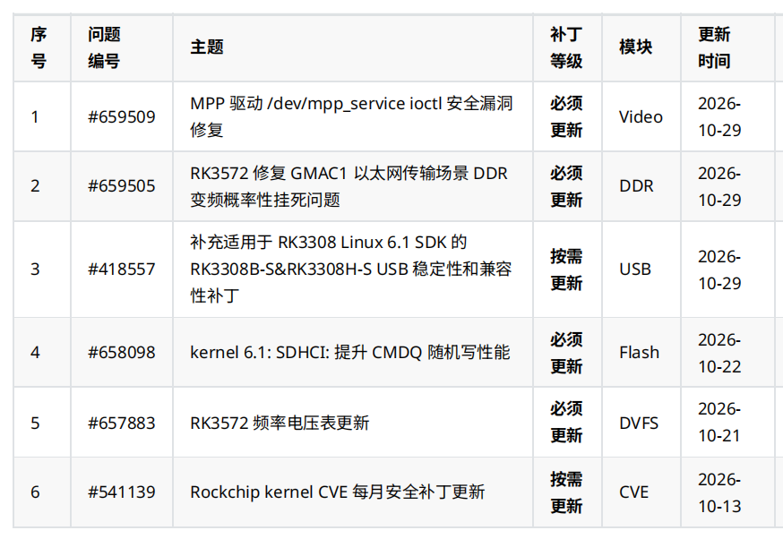

Die vorliegende Rockchip-Patchliste für Oktober 2026 behandelt die Sicherheit des Videotreibers, DDR- und Frequenz-/Spannungseinstellungen des RK3572, USB beim RK3308 sowie Speicher- und Sicherheitsupdates für Linux. Für ArmSoM-Projekte sollten die Einträge zunächst dem konkreten Chip, SDK/BSP und Softwarestand zugeordnet werden.

Dieser Beitrag verbindet die ursprüngliche Liste mit den am **2026-11-06** nach Anmeldung geprüften Beschreibungen, Verläufen und Anhangsverzeichnissen in Rockchip Redmine. **Er ist weder ein vollständiger Monatskatalog noch ein Nachweis, dass alle ArmSoM-Images die Korrekturen enthalten.** Die Tabelle übernimmt die Datumsangaben der Übersicht; Startdaten der Vorgänge, Anhangsdaten und spätere Änderungen werden getrennt erläutert. Testergebnisse stammen ausdrücklich vom Hersteller. Die technischen Empfehlungen wurden für diesen Artikel nicht auf ArmSoM-Hardware validiert.

## 1. Die sechs Einträge

| Kennung | Thema der bereitgestellten Liste | Einstufung der Liste | Modul | Aktualisiert |
| --- | --- | --- | --- | --- |
| [#659509](https://redmine.rock-chips.com/issues/659509) | Sicherheitskorrektur für die ioctl-Schnittstelle `/dev/mpp_service` des MPP-Treibers | Update erforderlich | Video | 2026-10-29 |
| [#659505](https://redmine.rock-chips.com/issues/659505) | RK3572: sporadisches Hängen bei DDR-Frequenzwechseln während GMAC1-Ethernet-Übertragungen beheben | Update erforderlich | DDR | 2026-10-29 |
| [#418557](https://redmine.rock-chips.com/issues/418557) | Anwendbarkeit der USB-Stabilitäts- und Kompatibilitätspatches für RK3308B-S & RK3308H-S auf das RK3308 Linux 6.1 SDK ergänzen | Update nach Bedarf | USB | 2026-10-29 |
| [#658098](https://redmine.rock-chips.com/issues/658098) | kernel 6.1: SDHCI CMDQ verbessert zufällige Schreibzugriffe | Update erforderlich | Flash | 2026-10-22 |
| [#657883](https://redmine.rock-chips.com/issues/657883) | RK3572: Frequenz-/Spannungstabelle aktualisieren | Update erforderlich | DVFS | 2026-10-21 |
| [#541139](https://redmine.rock-chips.com/issues/541139) | Monatliche CVE-Sicherheitspatches für den Rockchip-Kernel | Update nach Bedarf | CVE | 2026-10-13 |

„Erforderlich“ gilt laut Quelle für den **passenden Softwarestand**. Daraus folgt nicht, dass derselbe Patch auf jede Rockchip-Platine gehört. Auch „nach Bedarf“ verlangt eine Prüfung der Anwendbarkeit und Sicherheitsrelevanz.

## 2. MPP: Aus ursprünglich 17 wurden 19 Korrekturen

[#659509](https://redmine.rock-chips.com/issues/659509) betrifft `drivers/video/rockchip/mpp/` in `kernel: develop-6.1`. Genannt werden Lese-/Schreibzugriffe außerhalb zulässiger Grenzen, Use-after-free (UAF)/doppelte Freigabe, beliebige Kernel-Schreibzugriffe und prozessübergreifende Informationslecks über ioctl-Zugriffe auf `/dev/mpp_service`. Ein entfernter Angriffsweg, eine CVE-Nummer oder ein CVSS-Wert werden damit nicht belegt.

Die ursprüngliche Beschreibung nennt 17 Korrekturen. **Am 2026-11-04 kamen zwei hinzu; aktuell sind es 19**: `4e950a32a45f7` korrigiert einen unzulässigen Zugriff in `mpp_check_req()`, `531cdbdcfe94` eine zu strenge Offset-Grenzprüfung in fd translate. Die ursprünglichen 17 allein reichen daher nicht als Vollständigkeitsnachweis. Auch die beiden Ergänzungen dürfen nicht ohne Prüfung der Abhängigkeiten isoliert ausgewählt werden.

Die Änderungen betreffen Eingabegrenzen, Sitzungs-/DMA-Lebenszyklen, Typverwechslungen und procfs-Rechte. Laut Eintrag bleibt normales Userspace-Verhalten unverändert; ungültige Eingaben werden mit `-EINVAL` / `-EOPNOTSUPP` abgewiesen. Rockchip meldet erfolgreiche Jenkins-Builds ohne zusätzliche Warnungen gegenüber dem vorherigen Stand. Das ist ein Build-Nachweis, kein vollständiger ArmSoM-Videotest.

Die SDK-Liste umfasst unter anderem RK3576, RK3588 und RK3566/3568 mit Linux 6.1 und Android. Entscheidend sind Treibercode und BSP, nicht allein die breite Chipliste. RK3572/RK3572S wurden im Verlauf ausdrücklich entfernt. Für CM5/Sige5- und RK3588-Projekte ist das jeweilige BSP zu prüfen; ein Update der MPP-Userspace-Bibliothek belegt keine Kernelkorrektur. Empfohlene Regressionen umfassen Kodieren/Dekodieren, Start/Stopp, Prozessneustarts, Dauerbetrieb und procfs-basierte Diagnosewerkzeuge.

## 3. RK3572: BL31 V1.15 und Spannungstabellen gemeinsam prüfen

[#659505](https://redmine.rock-chips.com/issues/659505) beschreibt einen Konflikt der Zugriffspfade bei GMAC1-Verkehr und DDR-Frequenzwechseln auf RK3572/RK3572S, der zu schwarzem Bildschirm und Stillstand führen kann. Die Korrektur liegt in `rkbin: master` und verlangt **BL31 V1.15 oder neuer**. Change-Id: `I34c7b43db47b2fa8c763154969c2f79c9140adde`. Aufgeführt sind ein V1.15-Patch und `rk3572_bl31_v1.15.elf`. Rockchip meldet normalen Testbetrieb, nennt aber weder Dauer noch Lastmatrix.

[#657883](https://redmine.rock-chips.com/issues/657883) betrifft `kernel: develop-6.12` und `rkbin: master`. Alte Frequenz-/Spannungstabellen bieten bei manchen Chips zu wenig Stabilitätsreserve. Die Anhänge umfassen CPU/GPU/NPU- und DMC-OPPs, Versorgungseinstellungen sowie ISP-devfreq/OPP-Unterstützung und BL31 V1.14. Das Testergebnis lautet „pass“; Verbrauchs- oder Leistungsgewinne sind nicht angegeben.

**Eine Firmware, die den GMAC1-Fix erfüllt, darf nicht wegen des älteren V1.14-Anhangs zurückgestuft werden.** Der BSP-Verantwortliche sollte eine passende Kombination ab V1.15 mit allen erforderlichen Änderungen bestätigen. Kernel, Gerätebaum und Firmware nicht beliebig mischen. Der Anhangscode wurde für diesen Artikel nicht geprüft; Dateinamen belegen weder Spannungswerte noch sämtliche Abhängigkeiten.

Die SDK-Liste enthält RK3572 Linux 6.12 und mehrere Android-SDKs. Für die [RK3572-Plattformplanung von ArmSoM](/de/articles/rockchip-rk3572-armsom-zero-preview/) empfehlen sich längerer GMAC1-Verkehr, Lastwechsel, DDR-Regelung, Kaltstarts und Temperaturtests mit seriellen Protokollen. Ein kurzer Durchsatztest beweist nicht, dass ein sporadischer Stillstand beseitigt ist.

## 4. RK3308 USB: Neues Paket speziell für Linux 6.1

[#418557](https://redmine.rock-chips.com/issues/418557) wird seit 2023 gepflegt und beschreibt USB-Stabilitäts-/Kompatibilitätsprobleme nach längerem Betrieb von RK3308B-S/RK3308H-S. Software prüft den DP/DM-linestate und korrigiert auffällige Pegel für einen erfolgreichen High-Speed-Handshake. Der dokumentierte Test erfolgte auf einem RK3308B-S-EVB, nicht auf dem P2 Pro.

Am **2026-10-29** wurde `RK3308B-S&RK3308H-S_USB_Compatible_Linux6.1_SDK_Patch_V1.0.0_20261013.zip` samt Zuordnung zum RK3308 Linux 6.1 SDK ergänzt. Das Datum 13. Oktober im Dateinamen unterscheidet sich vom Upload am 29. Oktober. Alte Beschreibungs-/Repository-Felder nennen weiter Linux 4.4; der Verlauf behandelt auch Linux 5.10. Daraus folgt keine Austauschbarkeit der Pakete mit 6.1.

Die Monatsübersicht sagt „nach Bedarf“, während das entsprechende Detailfeld leer ist. Die Einstufung der Übersicht bleibt erhalten. Frühere Änderungen betreffen OTG-gadget-Trennereignisse, Hotplug-Initialisierung und HOST-Suspend/Resume; das Paket muss zum SDK passen.

Die [P2-Pro-Dokumentation](https://docs.armsom.org/armsom-p2pro) nennt RK3308B-S. Das macht die Prüfung sinnvoll, sagt aber nichts über den Patchstand jedes Images aus. Empfohlene Tests: Geräteerkennung, wiederholtes Anstecken, Dauertransfer, Suspend/Resume und gadget-Trennmeldungen mit der tatsächlich eingesetzten Peripherie.

## 5. SDHCI und CVEs: Messwerte und Berichtsmonat unterscheiden

[#658098](https://redmine.rock-chips.com/issues/658098) betrifft `rk/kernel: develop-6.1-android14` und `develop-6.1`; Change-Id: `I5f8cfd9d62228e62fd0ad71d7b69698d80b21f80`. Manche eMMC-Geräte melden pro CMDQ-Abfrage nur einen bereiten SLOT. Ein langes Abfrageintervall verschlechtert dann zufällige Schreibzugriffe; die Korrektur verkürzt dieses Intervall.

Rockchip nennt für RK3576 **160 MB/s auf 200 MB/s** bei manchen Multi-Queue-eMMCs und **19 MB/s auf 70 MB/s** ohne Multi-Queue-Unterstützung. Das sind herstellerspezifische Testergebnisse, keine ArmSoM-Messungen oder allgemeine Zusage. Vollständige Testbedingungen fehlen. Die Übersicht datiert auf 2026-10-22, Start- und Anhangsdatum des Vorgangs jedoch auf 2025-09-10. Die Aufnahme im Oktober bedeutet keine erstmalige Entwicklung im Oktober.

[#541139](https://redmine.rock-chips.com/issues/541139) pflegt monatliche CVE-Listen für `kernel: 4.19/5.10/6.1/6.12`. Markdown-Anhänge verknüpfen CVEs, Commits und Patches. **Der zuletzt sichtbare Anhang ist `2026-09.md`, hochgeladen am 2026-10-13; ein `2026-10.md` war nicht sichtbar.** Der Verlaufstext nennt wiederum August. Dieser Widerspruch wird offengelegt, nicht stillschweigend aufgelöst. In der Übersicht heißt das Modul CVE, im Detailfeld Component dagegen System.

Der etwa 575 KB große Anhang wurde hier nicht Eintrag für Eintrag auditiert. Weder gelten automatisch alle CVEs für ArmSoM, noch ist die Liste mit dem MPP-Vorgang gleichzusetzen. Code, Konfiguration, exponierte Funktionen und Backports müssen einzeln geprüft werden. „Nach Bedarf“ erlaubt nicht, anwendbare Sicherheitskorrekturen zu ignorieren.

## 6. Nachvollziehbare Aktualisierung für ArmSoM-Projekte

Board- und Hardwareversion, SoC, Imagename und Prüfsumme, SDK/BSP-Zweig, Kernelversion, Patchquelle und Commit, Testergebnis sowie Rückfallimage dokumentieren. Diese Befehle lesen nur Systeminformationen; **sie beweisen keinen behobenen Sicherheitsfehler**:

```sh
uname -a
cat /etc/os-release
cat /proc/device-tree/model
```

Manche Systeme enthalten weder `/etc/os-release` noch den genannten Geräteknoten; `model` kann ohne abschließenden Zeilenumbruch ausgegeben werden. Gleiche Kernelversionszeichenfolgen können unterschiedliche Backports verbergen. Buildaufzeichnungen und Hinweise des Verantwortlichen bleiben notwendig.

Der Ablauf: Anwendbarkeit klären, passende Patches und Abhängigkeiten beschaffen, auf Testgeräten integrieren, die Anwendung prüfen und anschließend stufenweise mit Rückfallmöglichkeit ausrollen. Bei Anfragen an ArmSoM helfen Softwarebasis und Kennungen, das passende Image oder BSP-Update zu bestimmen. Die Kontaktbuttons dienen der Anfrage und stellen keinen zugesagten Liefertermin für Korrekturen dar.

## Originalliste und Einordnung



Das Originalbild bleibt auf Chinesisch; jede Sprachfassung enthält eine kopierbare Tabelle. Die sechs Links führen zu den geprüften offiziellen Vorgängen; Details und Anhänge können Redmine-Rechte erfordern. Geprüft wurden Beschreibungen, Verlauf und Anhangsnamen, nicht der Quellcode jeder Korrektur. Patches wurden weder ausgeführt noch auf Hardware angewendet oder getestet. Pakete sind über den offiziellen Kanal für das passende SDK zu beziehen und werden hier nicht gehostet.
