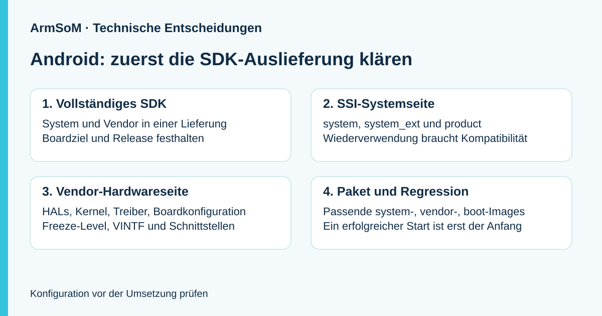

**Wer nach einer Android-Version für einen Rockchip-Chip fragt, sollte zugleich die Auslieferungsform klären: vollständiges SDK oder getrennte System- und Hardwareteile?** Die Android-Version beschreibt weder Quellstruktur und Build-Einstieg noch Vendor-Basis und Updateverfahren.

Dieser Leitfaden unterstützt Android-Projekte mit ArmSoM. Die folgende Tabelle ist eine bereitgestellte Drittanbieteraufnahme, keine ArmSoM-Downloadliste, GMS-Zertifizierungsliste oder aktuelle Herstellerzusage. Für ein Produkt zählen Boarddokumentation, SDK-Releasehinweise und Tests.



## 1. Drei Begriffe auf unterschiedlichen Ebenen

| Begriff | Technische Bedeutung | Keine Zusage für |
| --- | --- | --- |
| Vollständiges SDK | Eine Lieferung enthält System- und Hardware-Buildgrundlagen | Betrieb jedes Boards ohne Anpassung |
| SSI | Shared System Image | Beliebige Kombination von System und Vendor |
| GRF | Google Requirements Freeze, eingefrorene Vendor-Anforderungen | Eine Firmwaredatei als Ersatz aller Treiber |

SSI ermöglicht Systemwiederverwendung auf kompatiblen Geräten. Zwischen system, system_ext, product und vendor/odm bestehen weiterhin Schnittstellen- und Kompatibilitätsgrenzen. [AOSP SSI](https://source.android.com/docs/core/architecture/partitions/shared-system-image)

BSP-Teams prüfen HALs, VINTF, Kernel und Boardressourcen. Anwendungsteams prüfen Frameworkverhalten, Berechtigungen, ABI und API. Getrennte Builds ersetzen keine gemeinsame Regression.

## 2. Die Versionsmatrix als Quellenaufnahme lesen

Die folgenden Bereiche bleiben als Suchhilfe für passende Releasepakete erhalten. Die Quelle stammt vom **2026-11-06**. Nicht alle Zweige wurden hier beschafft und gebaut; die Android-16/17-Kombinationen sind keine verifizierte Supportzusage. Ein Strich bedeutet nicht aufgeführt, nicht technisch unmöglich.

| Chipfamilie | Quelle: Android im vollständigen SDK | Quelle: Android mit SSI + GRF |
| --- | --- | --- |
| RK3572 / RK3572S | 16 | 17 |
| RK3576 | 14, 15 | 16, 17 |
| RK3588 / RK3588S | 12–15 | 16, 17 |
| RK3568 / RK3566 | 11–15 | 16, 17 |
| RK3562 | 13–15 | 16, 17 |
| RK3399 | 6–15 | 16, 17 |
| RK3399PRO | 8, 9 | — |
| RK3326 / RK3326-S | 8–15 | 16, 17 |
| PX30 / PX30-S | 8–15 | 16, 17 |
| RK3368 | 5–11 | — |
| RK3288W | 5–12 | — |
| RK3126C | 8–10 | — |
| RK312X | 5–7 | — |
| PX5 | 6, 8 | — |
| PX3SE | 7 | — |

Ein Bereich belegt nicht jede Unterversion, jedes Board oder jede Peripherie. Eine zweite Tabelle der Vorlage nennt RK3528 außerhalb dieser Chipliste; daraus wird keine zusätzliche Supportzusage abgeleitet. Vor Beschaffung oder Upgrade müssen Manifest, Releasehinweise und Produktimage feststehen.

## 3. Android-16/17-Zweige prüfen

Die Quelle beschreibt Android 16 für RK3572 als vollständiges SDK und mehrere andere Plattformen als SSI mit Android-14-Vendor. Das betrifft die untersuchten Lieferungen und folgt nicht allein aus der Android-Hauptversion. Namen wie `rk3572_a16-*`, `ssi_16_arm64`, `rkbuild` und `build.sh -M / -T` müssen im tatsächlichen SDK geprüft werden.

Die Quelle nennt für Android 17 folgende Vendor-Anforderungen, hier **nur zur Nachvollziehbarkeit**:

| Plattform | Vendor SDK | Mindestrelease laut Quelle | SSI-Release |
| --- | --- | --- | --- |
| RK3572 | Android 16 | RKR5+ | RKR1 / RKR2 |
| RK3588 / RK3576 | Android 14 | RKR9+ | RKR1 / RKR2 |
| RK3568 / RK3566 / RK3562 / RK3399 / RK3326 / PX30 | Android 14 | RKR10+ | RKR2 |

Android-API-Level und Vendor-API-Level sind keine austauschbaren Zahlensysteme. AOSP definiert Vendor-Freeze und API-Kennungen separat. [AOSP API flags](https://source.android.com/docs/core/architecture/api-flags)

## 4. Gerät prüfen und Quellen festhalten

```bash
adb shell getprop ro.build.fingerprint
adb shell getprop ro.vendor.build.fingerprint
adb shell getprop ro.build.version.release
adb shell getprop ro.build.version.sdk
adb shell getprop ro.product.first_api_level
adb shell getprop ro.board.first_api_level
adb shell getprop ro.board.api_level
adb shell getprop ro.vendor.api_level
adb shell getprop ro.board.api_frozen
adb shell uname -a
```

Leere Eigenschaften als nicht verfügbar protokollieren, statt die Android-Systemversion einzusetzen. `ro.build.version.release` benennt das Systemrelease, nicht den Ursprung des Vendor-Builds. Beide Fingerprints, Kernel, Image-Hashes und Boardrevision sichern.

Im Wurzelverzeichnis eines bereits vorhandenen SDKs:

```bash
repo manifest -r -o manifest-pinned.xml
find device/rockchip -name AndroidProducts.mk -o -name BoardConfig.mk
rg -n 'ssi_16_arm64|rk3572_a16|GRF|VINTF|PRODUCT_SHIPPING_API_LEVEL' \
  device/rockchip build.sh
rg -n 'getopts|rkbuild|merge|vendor|system' build.sh
```

`repo manifest` schreibt einen lokalen Versionsnachweis. Die Befehle bauen und flashen nichts. Fehlende Pfade weisen auf einen anderen Branchaufbau hin; zuerst dessen Anleitung finden. Lunch-Ziele und `build.sh`-Optionen anderer SDKs nicht ungeprüft übernehmen.

## 5. Arbeit zwischen System und Hardware aufteilen

| Arbeit | Systemseite | Hardwareseite |
| --- | --- | --- |
| App-Upgrade | Berechtigungen, Hintergrundlimits, Framework-API, WebView | Kamera-, Medien- und Sensor-HAL |
| Neue Trägerplatine | Funktionsschalter und Produktkonfiguration | DTS, Versorgung, Takte, Display, Touch und Netz |
| Image-Zusammenstellung | Partitionen, Signatur, OTA und Rollback | boot/vendor/odm, VINTF und Kernelkompatibilität |
| Wartung | Sicherheitsupdates und App-Abhängigkeiten | BSP-Patches, Firmware, Treiber und Vendor |

SSI reduziert Doppelarbeit nur bei eingehaltenen Kompatibilitätsgrenzen. Der Austausch von `system.img` allein ist kein abgeschlossenes Plattformupgrade. AVB, SELinux oder Schnittstellenprüfungen für einen erfolgreichen Start abzuschalten ist keine Abnahme.

## 6. Abnahme eines ArmSoM-Projekts

Erstellen Sie zunächst eine Anwendungsbasis auf einem funktionierenden Image für CM5/Sige5 oder Sige7/AIM7/LM7. Prüfen Sie dann die neue SDK-Kombination. Neben dem Start gehören Display und Touch, Netzwerk-Wiederverbindung, Kamera, Audio/Video, NPU, Speicher, Suspend/Resume und OTA dazu. Kompatibilitätstests müssen zu den Produktanforderungen passen; bestandene Tests und kommerzielle Zertifizierung sind unterschiedliche Ergebnisse.

Zur Übergabe gehören fixiertes Manifest, Buildoptionen, system/vendor/boot-Zuordnung, Signatur- und Rollbackplan, Ergebnisse und nicht unterstützte Funktionen. So wird Android-Unterstützung zu einer reproduzierbaren Lieferung.

Quellen: die [bereitgestellte SDK/GRF-Übersicht](https://mp.weixin.qq.com/s/_M3UC7uYivdxHesFIhAVTw) und die AOSP-Referenzen oben. Weiterführend: [Android-CA-Pflege](/de/articles/android-ca-trust-store-emudhra-audit/) und [VendorStorage-Integration](/de/articles/rockchip-vendor-storage-android-aidl-guide/).

## Produkte und weiterführende Artikel

Für ein ArmSoM-Projekt kommen [Sige7](https://www.armsom.org/sige7), [AIM7](https://www.armsom.org/aim7) und [LM7](https://www.armsom.org/lm7) mit RK3588 oder [CM5](https://www.armsom.org/cm5) und [Sige5](https://www.armsom.org/sige5) mit RK3576 infrage. Schnittstellen und verfügbare Images stehen in der Dokumentation zu [Sige7](https://docs.armsom.org/armsom-sige7), [CM5](https://docs.armsom.org/armsom-cm5) und [Sige5](https://docs.armsom.org/armsom-sige5). Die Links dienen der Produktauswahl und bestätigen keine Prüfung sämtlicher hier beschriebener SDK-Kombinationen.
