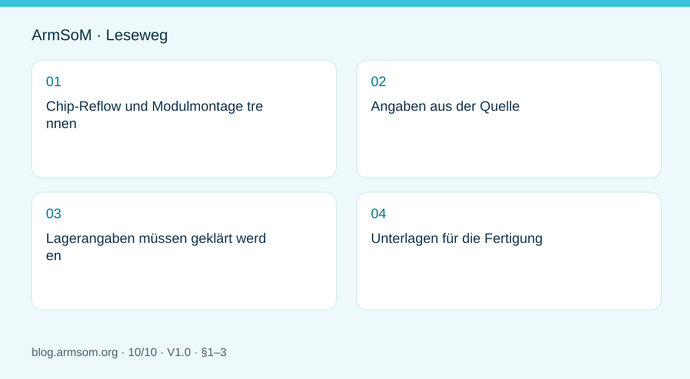
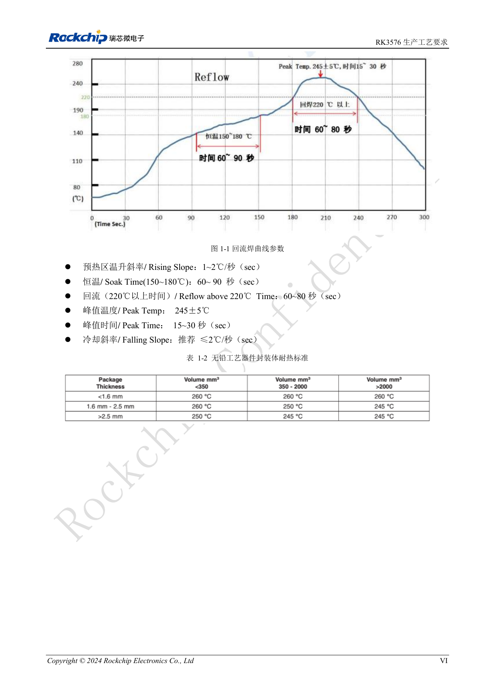
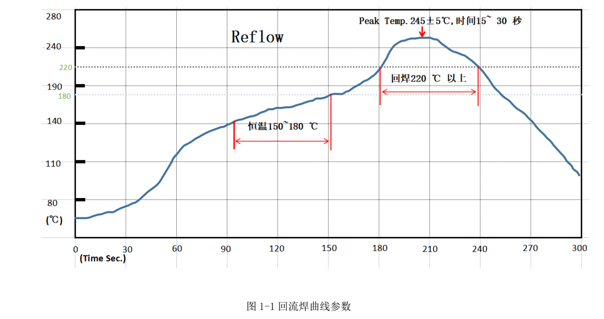
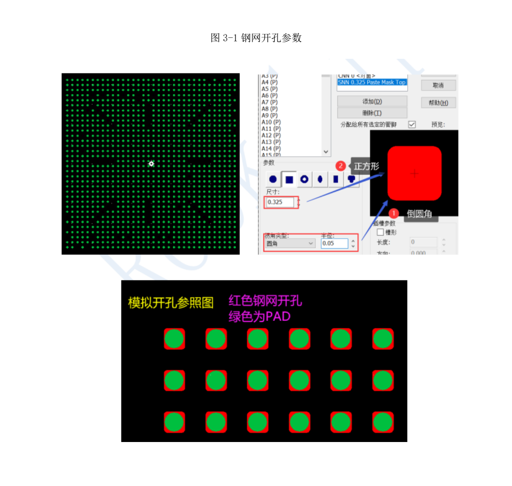

# Vom Rockchip-Prototyp zur Serie: Prozessvorgaben und Prüfunterlagen

## Geltungsbereich und Quellen

Dies ist ein thematischer Engineering-Leitfaden, keine seitenweise Übersetzung des gesamten PDF. Quellenbeispiele sind keine ArmSoM-Messungen. Spannungen, Pins, SDK/BSP und Kernel mit der tatsächlichen Platinenrevision abgleichen.

**Rockchip:** `RK3576_Production_Process_Requirements_V10_20240522_CN.pdf` · V1.0 · §1–3

## Chip-Reflow und Modulmontage trennen

Ein Chipprofil gilt für den jeweiligen Gehäusekontext, nicht automatisch für das erneute Reflow eines ganzen CM5-, CM7s- oder AIM7-Moduls. Stecker, Wärmeleitmaterial und Gehäuse haben eigene Montagevorgaben. Module reduzieren die SoC-Montagearbeit; Träger- und Gerätequalität bleiben eigenständig zu prüfen.

## Angaben aus der Quelle

§1.3 liefert Referenzen, die Prozessverantwortliche mit Platine, Paste und Anlage validieren müssen, kein Rezept ohne Temperaturmessung.

| Parameter | Quellenreferenz |
| --- | --- |
| Paste | SAC305; flux-Anteil 10%–11.5% |
| Aufheizrate | 1–2℃/s |
| Halten bei 150–180℃ | 60–90s |
| Oberhalb 220℃ | 60–80s |
| Spitze | 245±5℃; 15–30s |
| Abkühlrate | Empfohlen ≤2℃/s |

§3.2.2 nennt quadratische Öffnungen mit r=0.05mm, Seitenlänge 0.30–0.32mm und Schablonendicke 0.1mm. Diese Werte gehören zum RK3576-Kontext, nicht zu jedem Gehäuse.

## Lagerangaben müssen geklärt werden

§2.2 nennt MSL 3, ≤30℃/60%RH und empfohlenen Verbrauch innerhalb von 168 Stunden nach Öffnung, daneben aber sechs Stunden vor Reflow. Die MSL-1-Zeile lautet „≤300℃/85%RH“. Bedingungen beziehungsweise Werte bleiben unklar. 300℃ nicht als Lagerempfehlung verwenden und sechs Stunden nicht stillschweigend entfernen. Lieferant, Chargenetikett und anwendbare Prozessvorgaben müssen Klarheit schaffen.

## Unterlagen für die Fertigung

- Versionierte Schaltpläne, BOM, PCB-, Montage- und Testdateien.
- Vollständige Artikelnummern, Revisionen und Ersatzteilregeln.
- Bestätigte Prozessparameter, gemessene Profile und Abweichungsbehandlung.
- Image-Prüfsumme, Programmierung, Seriennummernvergabe und Ergebnisübermittlung.

Versorgungsprüfung, Boot, Schnittstellenfunktion und Dauerlast getrennt behandeln. Freigabekriterien aus der Pilotserie ableiten; eine Vorführung ersetzt keine Fertigungsabnahme. Nach Prozess- oder Bauteiländerungen Bewertung und Wiederholungsprüfung dokumentieren.

## Abbildung aus der Quelle

Chinesisches Original; keine entsprechende englische Abbildung in den Materialien gefunden. Referenzdesign, kein ArmSoM-Platinenschaltplan.

`RK3576_Production_Process_Requirements_V10_20240522_CN.pdf` · PDF p. 7.

## RK3588 ergänzen, Plattformen getrennt halten

Diese Ergänzung verwendet den technischen Teil des achtseitigen `RK3588 Production Process Requirements V1.0_20230215.pdf`. Der RK3576-Leitfaden bleibt erhalten, Werte werden getrennt geführt. Es sind Prozessreferenzen, keine automatische Freigabe für erneutes Reflow kompletter ArmSoM-Module und kein universelles Montagerezept.

| Parameter | Bisherige RK3576-Referenz | Ergänzte RK3588-Referenz |
| --- | --- | --- |
| Legierung / Flussmittelanteil | SAC305; 10%–11.5% | SAC305; 10%–11.5% |
| Anstieg | 1–2℃/s | 1–2℃/s |
| Halten bei 150–180℃ | 60–90s | 60–120s |
| Über 220℃ | 60–80s | 60–90s |
| Spitze | 245±5℃; 15–30s | 245±5℃; 15–30s |
| Abkühlung | Empfohlen ≤2℃/s | Empfohlen ≤2℃/s |
| Schablonendicke | 0.1mm | 0.1–0.12mm |

Haltezeit, Zeit oberhalb des Liquidus und Dicke unterscheiden sich. Die jeweils weitesten Grenzen zu kombinieren ergäbe eine Regel, die keine Quelle für alle Rockchip-Bausteine vorgibt.

*RK3588-Reflowprofil aus der Quelle — Chinesische Originalabbildung; in dieser Auswahl liegt keine entsprechende englische Abbildung vor. `RK3588 Production Process Requirements V1.0_20230215.pdf`, PDF p. 6.*

## Profil an der tatsächlichen Baugruppe prüfen

RK3588 nennt außerdem Pastenkühlung bei 2–10℃ und Erwärmung für 3–4h. Maßgeblich bleiben Chargenspezifikation und freigegebener Prozess. Ofeneinstellungen, Transportgeschwindigkeit, Thermoelementpositionen und gemessene Kurve dokumentieren. Ofensollwerte sind keine Lötstellentemperaturen.

Gehäuse, Kupfer, Platinendicke, Dichte und Wärmekapazität verändern das Erwärmen. Pilotserien müssen Fehler und Reproduzierbarkeit bewerten; Nacharbeit, erneute Ofendurchläufe und Chargen festhalten. Ein Referenzprofil ersetzt keine Prüfung der eigenen PCB.

## Unklare Schablonenangabe erhalten

*Originale RK3588-Schablonenabbildung — Chinesische Originalabbildung; in dieser Auswahl liegt keine entsprechende englische Abbildung vor. `RK3588 Production Process Requirements V1.0_20230215.pdf`, PDF p. 8.*

S. 8 beschreibt eine quadratische Öffnung mit `r=0.05mm`, bezeichnet die Größe danach jedoch als „Durchmesser=0.325~0.35mm“ bei 0.1–0.12mm Dicke. Quadrat und Durchmesser sind mehrdeutig. Hier wird das nicht still als Seitenlänge umgeschrieben. Vor Fertigung mit Lieferant und Schablonenhersteller anhand der formalen Gehäuse-/Prozessdaten klären.

## Feuchtebehandlung und Tempern sind bedingt

S. 7 nennt MSL 3, ≤30℃/60%RH und 168h nach Öffnen, außerdem 6h vor Reflow. Die MSL-1-Zeile lautet `≤300℃/85%RH`. 300℃ ist keine Lagerempfehlung; auch das Verhältnis von 168h und 6h muss geklärt werden.

Dieselbe Seite nennt nach Feuchteeinwirkung `125±5℃ für 8–12h` sowie Trockenlagerung `<20%RH`. Das betrifft den einzelnen Chip, nicht automatisch ein Modul mit Kunststoffsteckern, Batterien, Klebstoffen und anderen Teilen. Verpackungskennzeichnung, Feuchtezustand der Charge und freigegebenen Prozess beachten; Öffnung, Exposition und Tempern protokollieren.

## Module benötigen ebenfalls Rückverfolgbarkeit

AIM7 oder LM7 verändert den Umfang eigener Montage, hebt aber Anforderungen an Stecker, Lötung, Träger und Gesamtsystem nicht auf. Seriennummer mit Hardware/BOM, Firmware-Prüfsumme, Programmierung, Versorgung, DDR/Speicher, Netzwerk/Display und Temperaturtests verknüpfen. Fehler müssen chargenbezogen nachvollziehbar und wiederholbar sein.

Die RK3588-Ergänzung bleibt von den bisherigen RK3576-Werten und offenen Formulierungen getrennt. Für diese Aktualisierung wurde kein Fertigungslinientest durchgeführt.

## Produkte und Entwicklungsunterlagen

- **CM5** — [Produktseite](https://www.armsom.org/cm5) · [Dokumentation](https://docs.armsom.org/armsom-cm5)
- **CM7s** — [Produktseite](https://www.armsom.org/cm7s) · [Dokumentation](https://docs.armsom.org/armsom-cm7s)
- **AIM7** — [Produktseite](https://www.armsom.org/aim7) · [Dokumentation](https://docs.armsom.org/armsom-aim7)
- **LM7** — [Produkt](https://www.armsom.org/lm7) · [Dokumentation](https://docs.armsom.org/armsom-lm7)
- **Sige7** — [Produkt](https://www.armsom.org/sige7) · [Dokumentation](https://docs.armsom.org/armsom-sige7)

## Weitere Beiträge der Reihe

- [RK3576 in Betrieb nehmen: Minimalsystem und erste Einschaltprüfung](/de/articles/rk3576-hardware-bringup/)
- [ArmSoM CM5-Trägerplatine: Checkliste für Versorgung, Boot und Schnittstellen](/de/articles/019-cm5-carrier-production/)
- [RK3576-Hochgeschwindigkeitsschnittstellen: Schaltplan und PCB gemeinsam prüfen](/de/articles/rk3576-high-speed-interface-design/)
- [RK3588S-Hardwaredesign: vom Referenzschaltplan zur CM7s-Trägerplatine](/de/articles/rk3588s-cm7s-carrier-design/)
- [RK3588 für Edge-KI: Versorgung, Kühlung und Erweiterung gemeinsam planen](/de/articles/rk3588-edge-ai-hardware-design/)
- [RK3588-PCB-Prüfung: Lagenaufbau, Impedanz und Leiterführung](/de/articles/rk3588-high-speed-pcb-review/)
- [RK3506-HMI-Hardware: Entwicklung mit CM1 oder Forge1](/de/articles/rk3506-industrial-hmi-hardware/)
- [RK3308-Varianten: Hardwarekompatibilität für P2-Pro-Audioprojekte](/de/articles/rk3308-hardware-variant-compatibility/)
- [RK3588S und RK3588S2: Prüfungen vor einer Hardwareänderung](/de/articles/rk3588s-rk3588s2-hardware-differences/)
