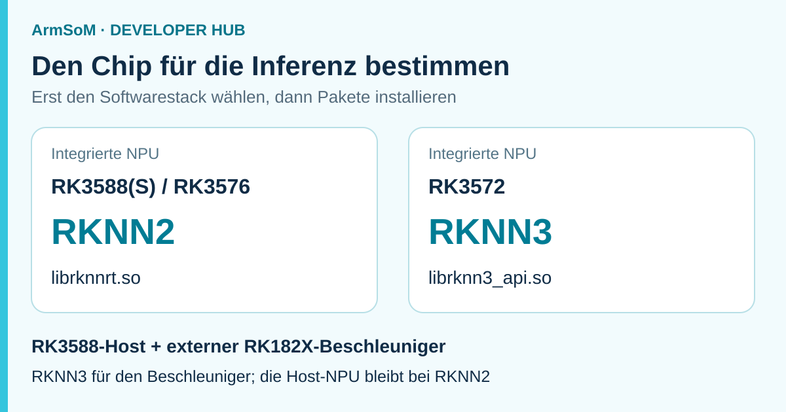
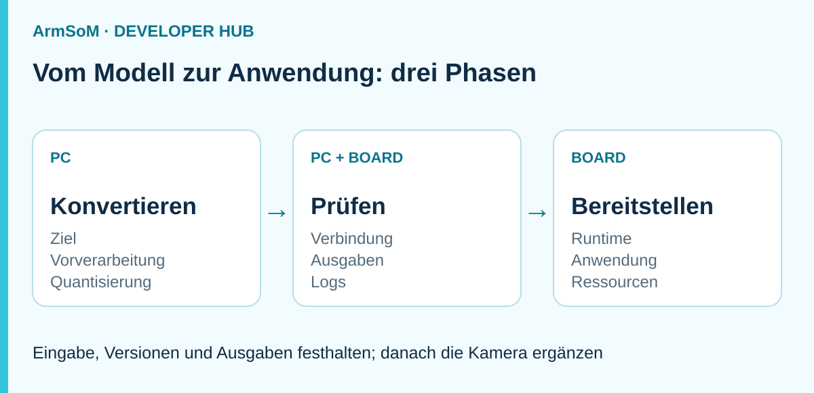

**Entscheidend ist der Chip, der die Inferenz tatsächlich ausführt: RK3588/RK3588S und RK3576 verwenden RKNN-Toolkit2, RK3572 verwendet RKNN3-Toolkit.** Ist ein RK1820/RK1828-Coprozessor an einen RK3588-Host angeschlossen, bedient RKNN3 den externen Beschleuniger. Die integrierte NPU des Hosts bleibt bei RKNN2.

Dieser Leitfaden führt von der Auswahl des Softwarestacks über die Prüfung des Boards und getrennte Python-Umgebungen bis zum Referenzmodell und zur Anwendungsintegration. Versionsbasis sind RKNN-Toolkit2 2.5.0 und RKNN3-Toolkit 1.2.0. Die Host-Befehle setzen Ubuntu x86_64 und Python 3.10 voraus.

> Geltungsbereich: Plattformhinweise für Entwickler von Sige7, AIM7 und LM7 mit RK3588 sowie CM5 und Sige5 mit RK3576. Der RK3572-Teil ist eine Referenz auf Basis des offiziellen SDK. Board-Image, Kernel-Treiber und Runtime müssen gesondert zusammenpassen. Dokumentation und Beispielquellcode wurden geprüft; ein Inferenztest auf ArmSoM-Hardware wurde nicht durchgeführt. Messungen eines anderen Autors werden nicht als ArmSoM-Ergebnisse dargestellt.



## 1. Erst den Softwarestack, dann die Pakete wählen

| Bestandteil | RKNN2-Pfad | RKNN3-Pfad |
| --- | --- | --- |
| Schwerpunkte dieses Artikels | RK3588/RK3588S und RK3576; die offizielle Liste nennt auch RK3566/3568, RK3562, ausgewählte RV-Familien und RK2118 | RK3572; RK1820/RK1828 arbeiten als Coprozessoren |
| Konvertierung auf dem PC | RKNN-Toolkit2 | RKNN3-Toolkit |
| Runtime-Bibliotheken | `librknnrt.so` | `librknn3_api.so`; zum nativen RK3572-Pfad gehört auch `librknn3_api_native.so` |
| Debugging mit verbundenem Board | `rknn_server` | `rknn3-server` für RK3572; `rknn3_transfer_proxy` für die RK182X-Kommunikation |
| Python auf dem Board | RKNN-Toolkit-Lite2 | RKNN3-Toolkit Lite |
| Modelldateien der Beispiele | `.rknn` | `.rknn` und die zugehörige `.weight` |
| Große Sprachmodelle | Separates RKNN-LLM SDK | RKNN3-LLM-Abläufe und `rkllm3-server`; Modell- und Plattformunterstützung weiter prüfen |

Beispiele beider Toolkits können `from rknn.api import RKNN` importieren. **Gleiche Imports oder Dateiendungen belegen keine Kompatibilität der Modelle und Runtime.** Beim Wechsel der Toolkit-Familie oder des Zielchips wird das Ausgangsmodell neu konvertiert. Eine `.rknn`-Datei umzubenennen ist keine Migration. Maßgeblich sind die jeweiligen Veröffentlichungen: [RKNN2](https://github.com/airockchip/rknn-toolkit2/tree/2c723177a94fac65cbc036d722907ddbc91980cf) und [RKNN3](https://github.com/airockchip/rknn3-toolkit/tree/141883c8e11b05ef4cca4a69d8a7572c4d855191).

| ArmSoM-Produkte als Einstieg | Integrierte NPU | Weitere Projektprüfung |
| --- | --- | --- |
| [Sige7](https://www.armsom.org/sige7), [AIM7](https://www.armsom.org/aim7), [LM7](https://www.armsom.org/lm7) | RK3588 → RKNN2 | Board oder Trägerplatine, Versorgung, Kühlung, System-Image und Treiber |
| [CM5](https://www.armsom.org/cm5), [Sige5](https://www.armsom.org/sige5) | RK3576 → RKNN2 | Modul-/Trägerrevision, Kameraeingang, SDK und Bereitstellungsschnittstelle |
| RK3572-Plattform | RKNN3 | Konkretes Entwicklungsboard und BSP; eine Plattformreferenz ist keine Produktvalidierung von ArmSoM |

Produktdaten stehen in der [Sige7-Dokumentation](https://docs.armsom.org/armsom-sige7) und [CM5-Dokumentation](https://docs.armsom.org/armsom-cm5). Enthält ein RK3588-Image `librknn3_api.so`, prüfen Sie, ob die Bibliothek für einen externen RK182X vorgesehen ist. Ihre Existenz ändert nicht den Stack der integrierten NPU.

## 2. Konvertierung, verbundene Prüfung und lokale Ausführung trennen



| Phase | Ausführungsort | Benötigtes Ergebnis |
| --- | --- | --- |
| Konvertierung | PC-Umgebung des passenden Toolkits | Zielplattform, Eingabeformat, Vorverarbeitung, Kalibrierung und exportiertes Modell |
| Prüfung mit Board | PC und Entwicklungsboard | Korrekte Ausgabe auf dem tatsächlichen Ziel; passende Kommunikationskomponenten |
| Eigenständige Bereitstellung | Runtime/C++ oder Lite Python auf dem Board | Die Anwendung verwaltet Modell, Ein-/Ausgaben und Ressourcen selbst |

`rknn_server` ist der RKNN2-Proxy für das Debugging vom PC, nicht die spätere Anwendung. Ein eigenständiges C/C++-Programm nutzt die Runtime direkt. Ein fehlender dauerhaft laufender PC-Debugdienst beweist deshalb keinen Bereitstellungsfehler. Auch bei RKNN3 sind verbundener und lokaler Betrieb zu unterscheiden.

Beginnen Sie mit einem festen Eingabebild. Kamera, Decoder, Netzwerkanfragen und mehrere Threads folgen erst nach der Modellprüfung. So lassen sich Modellfehler von Problemen bei Aufnahme, Farbreihenfolge, Skalierung oder Speicherkopien unterscheiden.

## 3. Zuerst das Android-Board prüfen

Die folgenden Befehle lesen lediglich Informationen aus und laufen auf dem Entwicklungsrechner. Bei einem Linux-Board prüfen Sie die passenden Verzeichnisse `/usr/lib` und `/usr/bin` per SSH; Android-Pfade unter `/vendor` sind nicht universell.

```bash
adb devices
adb shell getprop ro.board.platform
adb shell uname -m
adb shell 'ls -l /vendor/lib64/librknn* /vendor/bin/rknn* /dev/rknpu* /dev/dri/renderD*'
adb shell 'cat /sys/kernel/debug/rknpu/version'
```

Der letzte Befehl kann an einem nicht eingehängten debugfs, Berechtigungen oder einem anderen BSP-Pfad scheitern. Der Geräteknoten muss weder `/dev/rknpu` noch eine bestimmte `renderD`-Nummer verwenden. Bewerten Sie Treiberprotokolle, Firmware-Dokumentation und tatsächliche Knoten gemeinsam. Ein fehlender vermuteter Pfad belegt nicht das Fehlen der NPU.

Erfassen Sie Board-/Trägerrevision, Image-Quelle, Kernel, NPU-Treiber, Runtime und Toolkit. Bevorzugen Sie zusammen ausgelieferte SDK-Komponenten. Bei Versionsmischungen gilt die Kompatibilitätsdokumentation; identische Versionsnummern sind keine allgemeingültige Regel für sämtliche Veröffentlichungen.

## 4. RK3588 / RK3576: RKNN2 als Referenzablauf

### 4.1 Repositories und getrennte Python-Umgebung vorbereiten

Legen Sie die offiziellen Repositories [Toolkit2](https://github.com/airockchip/rknn-toolkit2/tree/2c723177a94fac65cbc036d722907ddbc91980cf) und [Model Zoo](https://github.com/airockchip/rknn_model_zoo/tree/837db8e992815ff8647eadb709f07067f4bc3a71), oder die vollständigen entsprechenden SDK-Verzeichnisse, unter `~/Projects/rknn-toolkit2` und `~/Projects/rknn_model_zoo` ab. Bereits vorhandene SDKs müssen nach Prüfung der Versionsbasis nicht erneut geladen werden. Python 3.10 einschließlich venv-Unterstützung muss installiert sein.

```bash
python3.10 -m venv ~/venvs/armsom-rknn2
source ~/venvs/armsom-rknn2/bin/activate
cd ~/Projects/rknn-toolkit2/rknn-toolkit2
python -m pip install -r packages/x86_64/requirements_cp310.txt
python -m pip install packages/x86_64/rknn_toolkit2-2.5.0-cp310-cp310-manylinux_2_17_x86_64.manylinux2014_x86_64.whl
python -m pip check
python -c "from rknn.api import RKNN; import importlib.metadata as m; print(m.version('rknn-toolkit2'))"
```

Installieren Sie zuerst die Abhängigkeiten dieser Version und danach das passende Wheel. `cp310` ist kein Paket für Python 3.8; ein x86_64-Host-Wheel ist kein aarch64-Paket für das Board. Hier wird venv verwendet, getrennte Conda-Umgebungen sind ebenfalls möglich.

### 4.2 rknn_server nur für den benötigten Debugmodus starten

Prüfen Sie einen vorhandenen Firmware-Dienst, bevor Sie eine zweite Instanz starten. Fehlt er und erlaubt das Entwicklungs-Image NPU-Programme aus der Shell, kopieren Sie die Android-arm64-Binärdatei des SDK in ein temporäres Verzeichnis. Starten Sie sie in einem eigenen Terminal im Vordergrund, damit Fehlermeldungen sichtbar bleiben:

```bash
cd ~/Projects/rknn-toolkit2
adb push rknpu2/runtime/Android/rknn_server/arm64/rknn_server /data/local/tmp/rknn_server
adb shell 'chmod +x /data/local/tmp/rknn_server'
adb shell /data/local/tmp/rknn_server
```

Lassen Sie dieses Terminal geöffnet und führen Sie die PC-Inferenz in einem zweiten aus. Das temporäre Verzeichnis behebt keine fehlenden Bibliotheken, Geräteberechtigungen oder SELinux-Regeln. Untersuchen Sie die betroffene Ebene. Serien-Images sollten Komponenten und Startkonfiguration über den BSP-Build integrieren. Schreibzugriffe auf ein schreibgeschütztes `/vendor` oder deaktivierte Schutzregeln sind keine allgemeinen Installationsschritte.

### 4.3 Das erste Ziel mit YOLOv5 prüfen

Das Beispiel verwendet `yolov5s_relu.onnx` aus dem offiziellen Model Zoo. Prüfen Sie vor der Konvertierung, ob `datasets/COCO/coco_subset_20.txt` und alle darin referenzierten Bilder vorhanden sind. Der kleine Beispieldatensatz dient dem Einstieg; für produktive Modelle werden repräsentative Daten benötigt. [Beispiel und Argumente](https://github.com/airockchip/rknn_model_zoo/blob/837db8e992815ff8647eadb709f07067f4bc3a71/examples/yolov5/README.md)

```bash
source ~/venvs/armsom-rknn2/bin/activate
cd ~/Projects/rknn_model_zoo/examples/yolov5/model
bash download_model.sh
cd ../python
python convert.py ../model/yolov5s_relu.onnx rk3588 i8 ../model/yolov5s_relu.rknn
python yolov5.py --model_path ../model/yolov5s_relu.rknn --target rk3588 --img_save
```

`i8` aktiviert die Quantisierung. `--img_save` eignet sich für einen Host ohne grafische Sitzung, während `--img_show` eine Anzeige benötigt. Für RK3576 auf CM5/Sige5 müssen **Konvertierungsziel und Inferenzziel** geändert werden. Eine eigene Ausgabedatei verhindert Verwechslungen:

```bash
python convert.py ../model/yolov5s_relu.onnx rk3576 i8 ../model/yolov5s_relu_rk3576.rknn
python yolov5.py --model_path ../model/yolov5s_relu_rk3576.rknn --target rk3576 --img_save
```

Zur Prüfung gehören ein fehlerfreies Prozessende, zum Eingang passende Objektklassen, ein überprüfbares Ergebnisbild sowie das erwartete Ziel und die passenden Versionen in den Logs. Dieser Artikel enthält keine ArmSoM-Messwerte zu FPS oder Latenz. Weiterführend: [C/C++-Bereitstellung](/de/articles/rknn-v250-sdk-guide-c-deployment/) und [Lite2 auf dem Board](/de/articles/rknn-v250-sdk-guide-lite-deployment/).

## 5. RK3572: eigene RKNN3-Umgebung und eigenes Modell

### 5.1 Die zweite Python-Umgebung anlegen

Legen Sie [RKNN3 Toolkit](https://github.com/airockchip/rknn3-toolkit/tree/141883c8e11b05ef4cca4a69d8a7572c4d855191) und [RKNN3 Model Zoo](https://github.com/airockchip/rknn3-model-zoo/tree/7f8c7d848448fa14cf16ba359ca98405c8bb94b5) unter `~/Projects/rknn3-toolkit` und `~/Projects/rknn3-model-zoo` ab. Ist derzeit keine venv aktiv, überspringen Sie die erste Zeile `deactivate`.

```bash
deactivate
python3.10 -m venv ~/venvs/armsom-rknn3
source ~/venvs/armsom-rknn3/bin/activate
cd ~/Projects/rknn3-toolkit/rknn3-toolkit
python -m pip install -r packages/requirements_cp310-1.2.0.txt
python -m pip install packages/x86_64/rknn3_toolkit-1.2.0-cp310-cp310-manylinux2014_x86_64.whl
python -m pip check
python -c "from rknn.api import RKNN; import importlib.metadata as m; print(m.version('rknn3-toolkit'))"
```

Die geprüften Python-3.10-Abhängigkeiten verlangen `numpy<=1.26.4` für RKNN2 2.5.0 und `numpy>=2.0` für RKNN3 1.2.0. Beide gehören daher nicht in dieselbe Umgebung. Prüfen Sie nach dem Import Paketname und Version, damit nicht unbemerkt ein anderes `rknn`-Modul geladen wird.

Diese Befehle prüfen die Komponenten des verbundenen Modus auf RK3572 Android; passen Sie die Pfade an das BSP an. Das folgende C++-Demoprogramm läuft lokal und verwendet den PC-Verbindungsdienst nicht als Anwendung:

```bash
adb shell 'ls -l /vendor/lib64/librknn3_api.so /vendor/lib64/librknn3_api_native.so'
adb shell '/vendor/bin/rknn3-server -v'
```

### 5.2 Das RK3572-Modell für YOLOv6 ausdrücklich auswählen

Der offizielle Quickstart 1.2.0 verwendet **`yolov6n.onnx`** für RK3572. Im geprüften Downloadskript ist jedoch die RK182X-optimierte Datei `yolov6n_rknn3.onnx` aktiviert; die Zeile für das Standardmodell ist auskommentiert. Das unveränderte Skript liefert somit nicht automatisch das benötigte RK3572-Beispiel. Der folgende Befehl nutzt die dort angegebene Standardmodell-Adresse:

```bash
source ~/venvs/armsom-rknn3/bin/activate
cd ~/Projects/rknn3-model-zoo/examples/yolov6/model
wget -O yolov6n.onnx https://ftrg.zbox.filez.com/v2/delivery/data/95f00b0fc900458ba134f8b180b3f7a1/examples/yolov6/yolov6n.onnx
cd ../python
python convert.py ../model/yolov6n.onnx rk3572 i8
ls -lh ../model/yolov6n.rknn ../model/yolov6n.weight
```

Prüfen Sie, ob `.rknn` und `.weight` aus derselben Konvertierung entstanden sind. Eine ältere Hilfszeile in `convert.py` nennt nur `rk1820`; der Quickstart 1.2.0 dokumentiert jedoch ausdrücklich `rk3572`, und das Skript übergibt das Argument an `target_platform`. [Offizielle Dokumentation](https://github.com/airockchip/rknn3-toolkit/tree/141883c8e11b05ef4cca4a69d8a7572c4d855191/doc) · [Geprüftes Konvertierungsskript](https://github.com/airockchip/rknn3-model-zoo/blob/7f8c7d848448fa14cf16ba359ca98405c8bb94b5/examples/yolov6/python/convert.py)

### 5.3 Android-arm64-Beispiel bauen und ausführen

Installieren Sie CMake und eine vom SDK unterstützte Android-NDK-Version. Setzen Sie `ANDROID_NDK_PATH` auf das tatsächliche NDK-Verzeichnis. Auf dem Board werden passende Runtime-Bibliotheken, Treiber und Ausführungsrechte benötigt. Das Buildskript erstellt sein eigenes Demo-Installationsverzeichnis neu.

```bash
cd ~/Projects/rknn3-model-zoo
: "${ANDROID_NDK_PATH:?Set ANDROID_NDK_PATH to your Android NDK directory}"
./build-android.sh -t rk3572 -a arm64-v8a -b Release -d yolov6
adb push install/rk3572_android_arm64-v8a/rknn_yolov6_demo /data/local/tmp/
```

Starten Sie das Programm in der Board-Shell und holen Sie anschließend das Ergebnisbild auf den Host:

```bash
adb shell
cd /data/local/tmp/rknn_yolov6_demo
export LD_LIBRARY_PATH=./lib${LD_LIBRARY_PATH:+:$LD_LIBRARY_PATH}
./rknn_yolov6_demo model/yolov6n.rknn model/yolov6n.weight model/bus.jpg 1
exit
adb pull /data/local/tmp/rknn_yolov6_demo/out.png .
```

Das letzte Argument `1` ist die Kernmaske dieses Beispiels und passt zur Konvertierung mit `core_num=1`. Übernehmen Sie keine Mehrkernmaske einer anderen Plattform. Prüfen Sie `out.png`, Klassen, Konfidenz und Koordinaten und bewahren Sie die Logs auf. Offizielle Beispielausgaben oder fremde Laufzeiten sind keine Messungen Ihres Boards.

Unter Linux werden das entsprechende `build-linux.sh`, eine aarch64-Cross-Toolchain und die Linux-Runtime benötigt. Android-ELF-Dateien und -Bibliotheken lassen sich nicht einfach übernehmen. Details zu API und Ressourcenfreigabe stehen im [RKNN3-Runtime-Leitfaden](/de/articles/rknn3-v120-runtime-c-lifecycle/).

## 6. Das Demoprogramm in eine Android-Anwendung integrieren

| Ansatz | Geeignet für | Wesentliche Entwurfsaufgaben |
| --- | --- | --- |
| APK + JNI | Kameraoberfläche und interaktive Erkennung | ABI, Vorverarbeitung, Inferenzthread, Abhängigkeiten, Rechte und Lebenszyklus |
| Systemdienst + IPC | Mehrere Anwendungen mit gemeinsamen Modellen | Schnittstellenvertrag, Prozessidentität, Warteschlangen, Wiederanlauf und BSP-Integration |
| Lokaler HTTP-Dienst | Prototypen, Weboberflächen, mehrere Clientsprachen | Bild-/Ergebnisprotokoll, Limits und Timeouts; standardmäßig nur Loopback binden |

Das offizielle [RKNN2-APK-Beispiel](https://github.com/airockchip/rknn-toolkit2/tree/2c723177a94fac65cbc036d722907ddbc91980cf/rknpu2/examples/rknn_yolov5_android_apk_demo) zeigt die Java/JNI-Trennung. Ein geänderter Bibliotheksname macht daraus keine RKNN3-Implementierung. Das Laden von Vendor-Bibliotheken unterliegt zudem Android-Linker-Namespaces und SELinux; das Kopieren einer `.so` reicht nicht aus. [Linker-Namespaces](https://source.android.com/docs/core/architecture/vndk/linker-namespace) · [SELinux](https://source.android.com/docs/security/features/selinux)

Lokales HTTP ist eine Entscheidung der Anwendungsarchitektur, keine standardmäßige REST-Schnittstelle von `rknn_server`. RKNN3 stellt mit `rkllm3-server` OpenAI-kompatible LLM/VLM-Dienste bereit, aber keinen fertigen YOLO-Erkennungsendpunkt. Wählen Sie die API passend zum Modelltyp.

## 7. Fehler nach Ebenen eingrenzen

| Symptom | Zuerst prüfen |
| --- | --- |
| `No module named 'torch'` | Richtige venv, vollständige Versionsabhängigkeiten und versehentliches `--no-deps` |
| `libcublas.so` oder ähnliche Abhängigkeit fehlt | PyTorch-Paket und Abhängigkeiten; ohne CUDA-Bedarf eine kompatible offizielle CPU-Version prüfen |
| Import funktioniert, Board nicht erreichbar | ADB-Freigabe, Datenkabel/Port, Dienst, Runtime, Geräteberechtigungen und Logs |
| `.rknn` lässt sich nicht laden | Toolkit-Familie, Zielchip, Exportversion und passende RKNN3-`.weight` |
| Falsche Erkennungen | RGB/BGR, Skalierung/Padding, Normalisierung, Tensorlayout, Kalibrierung und Nachverarbeitung |
| Einzelbild funktioniert, Video stockt | Aufnahme, Vorverarbeitung, Inferenz, Nachverarbeitung, Kopien und Anzeige getrennt messen |
| `/vendor` nicht beschreibbar | Partitionsregeln und BSP-Integration; Shell-Tests belegen keine Rechte des Serien-APK |

Beispielsweise lässt sich nur in der RKNN2-Umgebung mit Python 3.10, nach Prüfung des fehlenden CUDA-Bedarfs und der Projektkompatibilität, eine offizielle CPU-Version wie folgt auswählen. Dies ist keine pauschale Neuinstallationsanweisung:

```bash
python -m pip install --force-reinstall torch==2.4.0 --index-url https://download.pytorch.org/whl/cpu
python -m pip check
```

Siehe [offizielle PyTorch-Versionsanleitungen](https://pytorch.org/get-started/previous-versions/). Für Offline-Arbeit werden sämtliche Abhängigkeiten für dieselbe Architektur/Python-Version, Modelle, Kalibrierungsbilder und Repository-Dateien benötigt. Ein einzelnes kopiertes Wheel bildet keine vollständige Umgebung nach.

## 8. Einen reproduzierbaren Projektstart sichern

Bewahren Sie Board-/Trägerdaten, OS-Image, Toolkit-/Runtime-/Dienst-/Treiberversionen, Repository-Commits, Prüfsummen von Modell und Eingang, Vorverarbeitung, Befehle und Ergebnisse auf. Trennen Sie erstes Laden, aufgewärmte Inferenz und die gesamte Verarbeitungskette. Ohne diese Bedingungen sind zwei FPS-Werte meist nicht unmittelbar vergleichbar.

Mögliche Projekteinstiege: [CM5](https://www.armsom.org/cm5), [Sige5](https://www.armsom.org/sige5), [Sige7](https://www.armsom.org/sige7). Weiterführend: [RKNN2 YOLOv5 und Genauigkeitsbewertung](/de/articles/rknn-v250-sdk-quickstart-yolov5/), [RKNN3-Plattformen und Softwarestack](/de/articles/rknn3-v120-platform-guide/).

## Quellen und Prüfungsumfang

Ausgangspunkt war der vom Leser bereitgestellte Screenshot „RK 平台 NPU 开发快速入门：RK3588 与 RK3572“ von RK软件开发-吴工, datiert auf 2026-11-14 ([Originalartikel](https://mp.weixin.qq.com/s/67VJOwm3z00N_u6xIudwdA)). Der Screenshot endet am Anfang von Abschnitt 3.3. Die weiteren Schritte wurden von ArmSoM anhand offizieller Materialien neu aufgebaut; dies ist keine behauptete vollständige Extraktion des Originalartikels.

Am 2026-11-17 geprüfte Stände: RKNN2 `2c723177a94f`, RKNN3 `141883c8e11b0`, RKNN Model Zoo `837db8e99281`, RKNN3 Model Zoo `7f8c7d848448`. Darauf basieren Befehle, Pfade und Abhängigkeiten. Image-Kompatibilität und Hardwarevalidierung müssen im jeweiligen Projekt erfolgen. Beide Diagramme sind redaktionelle ArmSoM-Abbildungen, keine Geräte-Screenshots oder Leistungsnachweise.
