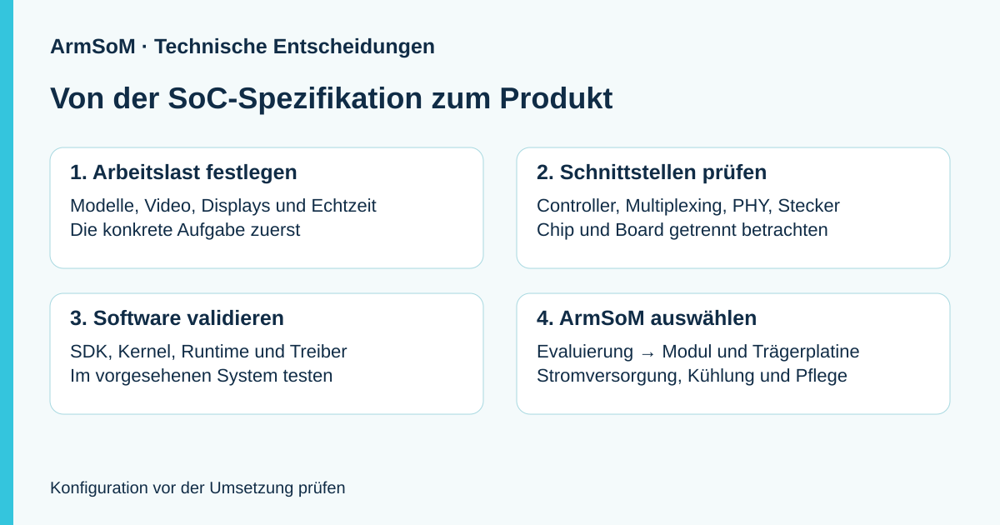

**Wählen Sie eine Rockchip-Plattform anhand der vollständigen Modell-, Video- und Schnittstellenkette aus, danach anhand von CPU-Daten oder TOPS.** RK3588-Plattformen sind Kandidaten für anspruchsvolle Multimedia- und Erweiterungsaufgaben; RK3576 eignet sich zur Evaluierung kompakter Rechen- und Embedded-AI-Lösungen. Beim RK3572 müssen der neuere NPU-Stack und der Stand des konkreten Boards gesondert geprüft werden.

Dieser Artikel verarbeitet den bereitgestellten Vergleich von neun Chips zu einer technischen Auswahlhilfe. Chipdaten sind keine Zusicherung von ArmSoM-Boardfunktionen. Fremde Messungen werden nicht als eigene Tests dargestellt; Fertigung, Leistungsaufnahme, Takt, Verfügbarkeit und Lebenszyklus werden nicht aus Modellnummern abgeleitet.

## 1. Auswahl nach CPU und Beschleunigern eingrenzen

| SoC | CPU | GPU-Familie | Angegebene NPU-Leistung |
| --- | --- | --- | --- |
| RK3588 | 4 × Cortex-A76 + 4 × Cortex-A55 | Mali-G610 | 6 TOPS |
| RK3576 | 4 × Cortex-A72 + 4 × Cortex-A53 | Mali-G52 | 6 TOPS* |
| RK3572 | 2 × Cortex-A73 + 6 × Cortex-A53 | Mali-G310 | 4 TOPS* |
| RK3562 | 4 × Cortex-A53 | Mali-G52 | 1 TOPS |
| RK3568 | 4 × Cortex-A55 | Mali-G52 | 1 TOPS |
| RK3566 | 4 × Cortex-A55 | Mali-G52 | 1 TOPS |
| RK3399 | 2 × Cortex-A72 + 4 × Cortex-A53 | Mali-T860 | — |
| RK3326 | 4 × Cortex-A35 | Mali-G31 | — |
| PX30 | 4 × Cortex-A35 | Mali-G31 | — |

Der Stern bewahrt die Angabe zu Sparse-Berechnungen für RK3576 und RK3572 aus der Vorlage. Das ist keine Rangliste unter identischen Bedingungen. Bei GPUs wird nur die Familie genannt, ohne API-Angaben verschiedener Treiberstände zu vermischen. Ein Strich bedeutet, dass kein separater NPU aufgeführt ist; **AI auf CPU oder GPU ist damit nicht ausgeschlossen**.

Die offiziellen Seiten zu [RK3562](https://www.rock-chips.com/a/en/products/RK35_Series/2024/0626/1983.html) und [RK3572](https://www.rock-chips.com/a/cn/news/rockchip/2026/0518/2168.html) dienen als grundlegende Referenzen. Die Umsetzung hängt zusätzlich von Operatoren, Quantisierungsgenauigkeit, Speicherbedarf und Gesamtlatenz ab.

### Für AI reicht ein TOPS-Vergleich nicht

Legen Sie Eingangsauflösung, Modellversion, Quantisierung, Batchgröße und Bildrate fest. Messen Sie Vorverarbeitung, Inferenz und Nachverarbeitung getrennt. Bei mehreren Kameras kommen Dekodierung, Farbkonvertierung und Speicherkopien hinzu. Eine schnelle Inferenz beweist keine schnelle gesamte Videokette.

Die integrierten NPUs von RK3588 und RK3576 verwenden RKNN2, RK3572 verwendet RKNN3. Ein externer RK182X bildet einen weiteren Bereitstellungsweg. Konverter, Modell und Runtime müssen zueinander passen: [ArmSoM-Einstieg in RKNN2/RKNN3](/de/articles/rockchip-npu-rknn2-rknn3-getting-started/).

## 2. Kandidaten nach Projektanforderungen auswählen

| Projekt | Zu prüfende Kandidaten | Notwendige Nachweise |
| --- | --- | --- |
| Mehrere Bildströme, komplexe Displays, Erweiterungen | RK3588; Sige7, AIM7, LM7 | Codecs, Parallelbetrieb, Datendurchsatz, Kühlung und Layout |
| Intelligente Terminals, Edge-Gateways, kompakte AI | RK3576; CM5, Sige5 | Modellgenauigkeit, herausgeführte Schnittstellen, Android/Linux-Image |
| Kosten und Funktionen einer neueren Plattform | RK3572 | RKNN3, BSP-Reife sowie Board- und Produktionsplanung |
| Gateways, Steuerung und bestehende Designs | RK3568 / RK3566 | Keine identischen Pins und Schnittstellen voraussetzen |
| Einfachere Displays und Embedded-Terminals | RK3562 | Native Displayanschlüsse; für HDMI Brücke und Treiber einkalkulieren |
| Bestehende Geräte modernisieren und pflegen | RK3399 / RK3326 / PX30 | Vorhandene Software, RAM, Sicherheitsupdates und Lieferbarkeit |

Dies ist eine Auswahlreihenfolge und kein Benchmark. Eine Empfehlung zur Bestandspflege ist keine Abkündigung durch den Hersteller. Bei funktionierender Software muss ein neues Design Migration, Zertifizierung und Regressionstests rechtfertigen.

## 3. Multimedia-Maximalwerte in fünf Fragen zerlegen

1. **Codec:** H.264, H.265, VP9 und AV1 haben unterschiedliche Auflösungs-, Bildraten- und Profilgrenzen. Ein Spitzenwert gilt nicht automatisch für alle Formate.
2. **Pixelformat:** Passen Bittiefe, YUV420/422/444, Stride und Pufferlayout zwischen ISP, RGA, MPP und Display zusammen?
3. **Parallelbetrieb:** Reichen Bandbreite und Displayressourcen für alle benötigten Kameras, Encoder und Bildschirme gleichzeitig?
4. **Anschluss:** HDMI/eDP/DP-Kombinationen, MIPI-Lanes, Type-C-Multiplexing und tatsächliche Stecker prüfen.
5. **Zielsystem:** Linux- und Android-Treiber, Benutzerbibliotheken, Kameraabstimmung und Anwendungen getrennt abnehmen.

Die [ArmSoM-Dokumentation zu Videocodecs](https://docs.armsom.org/advanced-manual/rockchip-video-codec) unterstützt die Testplanung. Sie belegt allein keinen bestimmten Parallelbetrieb.

## 4. Speicher und Netzwerk bis zum Board prüfen

Die Adressierungsgrenze des Chips ist keine kaufbare RAM-Konfiguration. Für Inferenz zählen Gewichte, Aktivierungen, Ein- und Ausgaben, Videopuffer und Systemreserve. Bei NAS-Projekten müssen Dauerzugriffe, Netzwerk, Dateisystem und Temperatur zusammen geprüft werden.

| Häufige Abkürzung | Tatsächlich zu klären |
| --- | --- |
| Zwei MACs ergeben zwei Netzwerkports | PHY, Betriebsart, Stecker, Treiber und Boardgeschwindigkeit |
| PCIe-, SATA- und USB-Zahlen addieren sich | Combo-PHY-Belegung, Lanes und gleichzeitige Nutzbarkeit |
| UFS-Unterstützung bedeutet UFS auf dem Board | Pads, Versorgung, Boot-Unterstützung und Stückliste |
| Ein CAN-Controller kann direkt an den Bus | Transceiver, Isolation, Abschluss und Device Tree |
| Ein Modul stellt jede SoC-Schnittstelle bereit | Modulbelegung, Trägerplatine, Pegel und Software |

Für CM5 werden getrennte Schnittstellenlisten von Modul und Trägerplatine benötigt. Bei Sige-Boards beginnt die Prüfung mit Schaltplan und Steckern. Fehlende Daten dürfen nicht aus einem anderen Chip übernommen werden.

## 5. Die Auswahl nachvollziehbar dokumentieren

Die Vorlage nennt folgende Datasheet-Ausgaben. Das sind **Versionsangaben der Quelle**, keine Behauptung, dass sämtliche Ausgaben hier vollständig beschafft und geprüft wurden. Offizielle Kurzbeschreibungen anderer Revisionen dienen dem Abgleich und ersetzen sie nicht stillschweigend.

| Modell | In der Vorlage genannte Ausgabe |
| --- | --- |
| RK3588 | V1.8 · 20240821 |
| RK3576 | V1.3 · 20240826 |
| RK3572 | V1.0 · 20260324 |
| RK3562 | V2.0 · 20241104 |
| RK3568 / RK3568B2 | V2.1 · 20240621 |
| RK3566 | V1.4 · 20240621 |
| RK3399 | V1.8 · 20180529 |
| RK3326 | V1.4 · 20190110 |
| PX30 | V1.2 · 20190110 |

Dokumentieren Sie vollständigen Chipsuffix, Board- und Schaltplanrevision, RAM/Speicher, SDK-Release, Kernel-Commit, NPU-Runtime, Lastfall, Ergebnisse und offene Punkte. RK3568B2 und RK3568 sowie RK3588 und RK3588S müssen unterscheidbar bleiben.

## 6. Vom Kandidaten zum ArmSoM-Prototyp

Prüfen Sie den echten Arbeitsablauf auf einem Entwicklungsboard, bevor Modul und Trägerplatine feststehen. Verwenden Sie eigene Bilddaten, das vorgesehene Display und dauerhafte Speicherlast. Kaltstart, Wiederkehr der Versorgung, Langzeitbetrieb und Updates gehören zur Abnahme.

Das Ergebnis beschreibt erfüllte Anforderungen und verbleibende Lücken statt eines allgemein besten Chips. Quellen: der [bereitgestellte Vergleich](https://mp.weixin.qq.com/s/Li61_e6BUuoQ_YPQWkJuKg), die oben verlinkten Herstellerangaben und die ArmSoM-Dokumentation.

## Produkte und weiterführende Artikel

Für ein ArmSoM-Projekt kommen [Sige7](https://www.armsom.org/sige7), [AIM7](https://www.armsom.org/aim7) und [LM7](https://www.armsom.org/lm7) mit RK3588 oder [CM5](https://www.armsom.org/cm5) und [Sige5](https://www.armsom.org/sige5) mit RK3576 infrage. Schnittstellen und verfügbare Images stehen in der Dokumentation zu [Sige7](https://docs.armsom.org/armsom-sige7), [CM5](https://docs.armsom.org/armsom-cm5) und [Sige5](https://docs.armsom.org/armsom-sige5). Die Links dienen der Produktauswahl und bestätigen keine Prüfung sämtlicher hier beschriebener SDK-Kombinationen.
