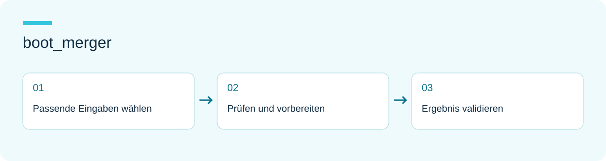





`boot_merger` fasst frühe Boot-Komponenten zu einem Loader zusammen. Die Dateierstellung schreibt noch kein Board. Die Pakete enthalten Programm und Versionshinweise, jedoch kein vollständiges eigenständiges Handbuch.

## Zusammenpassende Eingaben

Ein Loader kann DDR-Initialisierung, USB-Download-Komponente und Boot-Code verbinden. Die offizielle RK3588-Konfiguration in `rkbin` zeigt `[CODE471_OPTION]`, `[CODE472_OPTION]`, `[LOADER_OPTION]`, `[OUTPUT]` sowie unterschiedliche Dateien für `FlashData` und `FlashBoot`. Verwenden Sie die Konfiguration des Board-SDKs; gleiche SoC-Namen allein rechtfertigen keine Mischung von Binärdateien.

## Nachvollziehbarer Ablauf

1. Board-Revision, Speichertyp und Kapazität, SoC und Zielspeicher bestimmen. Den funktionierenden Loader sichern.
2. SDK-Konfiguration und referenzierte Dateien vollständig in ein eigenes Arbeitsverzeichnis kopieren; relative Pfade prüfen.
3. Host-Paket und den vom SDK dokumentierten Aufruf wählen. Linux-Hinweise reichen bis 1.35, macOS trägt 1.3 und Windows 1.32. Die Ausgaben sind nicht synchron.
4. Rückgabestatus, Ausgabepfad, Größe und Hash kontrollieren; Eingabeversionen mit der Konfiguration aufbewahren.
5. Auf einem wiederherstellbaren Entwicklungsboard testen und RAM-Download von IDBlock-Schreibzugriffen unterscheiden.

## Formatänderungen beachten

Die Linux-Historie nennt IDBlock-Ausrichtung, 2K-Interleaving und CRC-Optionen. Solche Änderungen betreffen das Boot-Format. Übernehmen Sie Formatoptionen nicht ungeprüft in einen anderen BSP.

Fehlende Dateien erfordern eine Pfadprüfung. DDR-Fehler trotz erfolgreicher Erstellung erfordern eine Prüfung der Speicherkomponenten. Ein erfolgreicher Packvorgang beweist keine Board-Funktion. Nicht belegte Kommandozeilenoptionen werden hier nicht erfunden; maßgeblich bleibt der konkrete SDK-Ablauf.

## Geltungsbereich und Prüfung

Dieser Ablauf basiert auf der Dokumentation der Sammlung. Prüfen Sie Board, SoC, Trägerplatine, SDK/BSP und Host-Architektur. Flashen, Provisionieren, Registerschreiben und Hardwaretests wurden nicht ausgeführt. Ein verfügbares Paket belegt keine Unterstützung aller ArmSoM-Produkte.

## Download, Versionen und SHA-256

Passendes Archiv laden, Hash prüfen und den vollständigen Ordner entpacken. Linux PinDebug zuerst nach verlinkter Anleitung zusammensetzen; der angegebene Hash gehört zur vollständigen Datei.

| Host / Version | Paket |
|---|---|
| Linux / 1.35 release notes | [boot_merger-linux-directory-snapshot.zip](https://raw.githubusercontent.com/ArmSoM/rockchip-tools/main/downloads/boot-merger/boot_merger-linux-directory-snapshot.zip) |
| macOS / 1.3 | [boot_merger_v1.3_mac.zip](https://raw.githubusercontent.com/ArmSoM/rockchip-tools/main/downloads/boot-merger/boot_merger_v1.3_mac.zip) |
| Windows / 1.32 | [boot_merger_v1.32.zip](https://raw.githubusercontent.com/ArmSoM/rockchip-tools/main/downloads/boot-merger/boot_merger_v1.32.zip) |

**boot_merger-linux-directory-snapshot.zip — SHA-256**

```text
185fb0b12c95317f70a683919f36486153e7219a60c30bd3c9ef0a5019783bbb
```

**boot_merger_v1.3_mac.zip — SHA-256**

```text
c9427f5e6448c610dae2e450ad1e245d03c39fd36756bbb02b78f20a0228f64f
```

**boot_merger_v1.32.zip — SHA-256**

```text
00e12d8683c73c62df0d10102d284407721ab90310d10da23e8e090cdac124f9
```

[GitHub · catalog.json](https://github.com/ArmSoM/rockchip-tools/blob/main/catalog.json) · [SHA256SUMS](https://github.com/ArmSoM/rockchip-tools/blob/main/SHA256SUMS)

## Quellen und Originalabbildungen

- boot_merger Linux revison.log through 1.35; macOS 1.3 and Windows 1.32 package notes
- [https://github.com/rockchip-linux/rkbin/blob/master/RKBOOT/RK3588MINIALL.ini](https://github.com/rockchip-linux/rkbin/blob/master/RKBOOT/RK3588MINIALL.ini)

## Verwandte Arbeitsabläufe

- [rk_ddrbin_tool: Parameter der frühen DDR-Initialisierung ändern](/de/articles/rockchip-tool-ddrbin-tool/)
- [RKDevTool: Download, Loader, Partitionen und update.img](/de/articles/rockchip-tool-rkdevtool/)
- [afptool und rkImageMaker: Rockchip update.img aufbauen und prüfen](/de/articles/rockchip-tool-firmware-pack-tools/)
- [Rockchip-Werkzeug- und Downloadübersicht](/de/articles/rockchip-tools-download-guide/)

## Passende ArmSoM-Boarddokumentation

Board- und Trägeranforderungen zunächst im Produkthandbuch prüfen. Diese Links dienen als Plattformreferenzen und belegen keine Validierung des Archivwerkzeugs auf diesen Produkten.

[ArmSoM Docs](https://docs.armsom.org/) · [Sige7](https://www.armsom.org/sige7) / [Docs](https://docs.armsom.org/armsom-sige7) · [CM5](https://www.armsom.org/cm5) / [Docs](https://docs.armsom.org/armsom-cm5)


