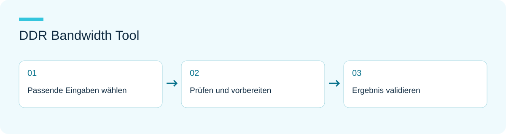





## Vollständiges DDR-Bandbreitenhandbuch V1.4.1

Monitor bezeichnet laut Vorlage das Beobachten und Zählen von DDR-Befehlen. Die Produkttabelle nennt alle Chips/Kernel, der technische Text verlangt jedoch die Prüfung der tatsächlich unterstützten Plattformen in der Werkzeughilfe. Daraus folgt keine universelle ArmSoM-Unterstützung. Es folgen alle sechs Themen: Begriff, Plattformen, Optionen, Voraussetzungen, Ausgabe und FAQ.

### 1–3. Plattformen und Optionen

```text
rk-msch-probe_vx.xx -h

Usage: [-c chip_name -d msecs -f freq -h help]
-c chip_name:
'rk312x' include rk3126,rk3128 and px3se
'rk322x' include rk3128h,rk3228a,rk3228b and rk3229
...
[option] -d msecs for sampling interval
[option] -f freq mean current ddr frequency unit MHz
-h for help
```

`-c` wählt eine erkannte Plattform wie `rk3326`; `-d` das Intervall in Millisekunden, standardmäßig 1000 ms; `-f` die DDR-Frequenz in MHz, falls ihre automatische Ermittlung pro Intervall scheitert; `-h` zeigt Hilfe. Vor der Messung die Frequenz fixieren. Die Vorlage führt `rk3128h` unter `rk322x`; diese Schreibweise bleibt unverändert.

### 4. Voraussetzungen und Frequenzeinheiten

```text
echo userspace > /sys/class/devfreq/dmc/governor
echo 780000000 > /sys/class/devfreq/dmc/userspace/set_freq
```

Der DDR-Governor darf nicht `dmc_ondemand` sein; empfohlen wird `userspace`. Die zweite Zeile ist das 780-MHz-Quellenbeispiel in Hz für sysfs, anders als MHz bei `-f`. Pfad/Frequenz müssen nicht auf jedem Board existieren. Bei folgender Meldung das Intervallergebnis verwerfen. In der Originalmeldung fehlt `/` vor `sys`; als Ausgabe bleibt dies erhalten, für echte Prüfungen den obigen absoluten Pfad nutzen.

```text
Error: The DDR monitor time gets error!!!
Please check the devfreq governor is not 'dmc_ondemand'!!!
For example:
# cat sys/class/devfreq/dmc/governor
# dmc_ondemand
Please switch the devfreq governor to others, such as 'userspace'.
For example:
# echo userspace > /sys/class/devfreq/dmc/governor
Delete the result of this time!
```

### 5. Ausgabebeispiele und sämtliche Zähler

Dies sind Ausgaben der Herstellervorlage, keine ArmSoM-Messungen. Übliche Plattformen zeigen Kanäle einzeln, RK3588 ALL und CH0–CH3.

```text
V1.06_20200629
ddr freq: 928Mhz
CH0:
ddr monitor statistics:
ddr load = 3251.23MB/s(43.76%) [RD:1859.93MB/s(25.03%), WR:1391.30MB/s(18.72%), ACT(access : active): 3.34, srex:0.54%, pdex:1.27%, clkstp:0.00%, lp:1.81%]

ddr freq: 2133Mhz
===========ALL=============CH0===============CH1==============CH2===============CH3========
LOAD:  4.51MB/s(0.03%),  1.23MB/s(0.04%),  1.13MB/s(0.03%),  1.16MB/s(0.04%),  1.00MB/s(0.03%)
RD:    2.57MB/s(0.02%),  0.74MB/s(0.02%),  0.65MB/s(0.02%),  0.67MB/s(0.02%),  0.51MB/s(0.02%)
WR:    1.94MB/s(0.01%),  0.49MB/s(0.02%),  0.48MB/s(0.02%),  0.49MB/s(0.02%),  0.48MB/s(0.01%)
===========================================================================================
```

| Zähler | Bedeutung |
|---|---|
| `ALL` | Alle Kanäle zusammen |
| `CHx` | Kanal x |
| `load / LOAD` | Bandbreite/Last aller Bänke dieses Kanals |
| `RD / WR` | Lese-/Schreibbandbreite und Anteil aller Bänke |
| `PRE` | Precharge-Anteil; mit active gekoppelt und aus dessen Zähler statt eigenem Hardwarezähler übernommen |
| `ACT(access : active)` | Mittlere Lese-/Schreibvorgänge pro active; größer bedeutet zusammenhängenderen Zugriff |
| `srex` | Zeitanteil self-refresh |
| `pdex` | Zeitanteil power down |
| `clkstp` | Zeitanteil clock stop |
| `srpdex` | Zeitanteil self-refresh power down |
| `dsmex` | Zeitanteil Deep Sleep Mode |
| `lp / LOW POWER` | Zeitanteil in Energiesparzuständen einschließlich self-refresh, power down und clock stop |

### 6. Fehlendes /dev/mem

```text
rk3568:/ # rk-msch-probe_vx.xx -c rk356x
open /dev/mem error: No such file or directory
```

Ohne `CONFIG_DEVMEM` kann das Werkzeug keine Register lesen. Methode 1: `CONFIG_DEVMEM=y` in der verwendeten Konfiguration ergänzen (Quellenbeispiel `android-11.config`) und Firmware neu bauen. Methode 2: DEVMEM in `make menuconfig` suchen, aktivieren und den Kernel ohne Überschreiben vorhandener Konfiguration neu bauen. Wegen physischen Speicherzugriffs Berechtigungen und Einsatzbedingungen berücksichtigen.

```text
Symbol: DEVMEM [=y]
Type  : bool
Prompt: /dev/mem virtual device support
Location:
    -> Device Drivers
(1)   -> Character devices
  Defined at drivers/char/Kconfig:10

[*] /dev/mem virtual device support
```

## Geltungsbereich und Prüfung

Dieser Ablauf basiert auf der Dokumentation der Sammlung. Prüfen Sie Board, SoC, Trägerplatine, SDK/BSP und Host-Architektur. Flashen, Provisionieren, Registerschreiben und Hardwaretests wurden nicht ausgeführt. Ein verfügbares Paket belegt keine Unterstützung aller ArmSoM-Produkte.

## GitHub-Werkzeugverzeichnis, Versionen und SHA-256

Das passende GitHub-Verzeichnis öffnen, Host und Version wählen, Dateihash prüfen und vollständig entpacken. Die folgenden Links öffnen Repository-Verzeichnisse.

[Werkzeugverzeichnis auf GitHub öffnen](https://github.com/ArmSoM/rockchip-tools/tree/main/downloads/ddr-bandwidth)

| Plattform / Version | Datei | SHA-256 |
|---|---|---|
| Linux target / manual 1.4.1 | `ddr-bandwidth-linux-directory-snapshot.zip` | `198ec5ad23aedee97518936fb4c2810f3d92c415269fad56788e833811af612d` |

[GitHub · catalog.json](https://github.com/ArmSoM/rockchip-tools/blob/main/catalog.json) · [SHA256SUMS](https://github.com/ArmSoM/rockchip-tools/blob/main/SHA256SUMS)

## Quellen und Originalabbildungen

- Rockchip_Introduction_DDR_Bandwidth_Tool_CN.pdf

## Verwandte Arbeitsabläufe

- [Rockchip DDR-Entwicklerleitfaden: Frequenz, Kapazität, Validierung, Augendiagramme und ECC](/de/articles/037-rockchip-ddr/)
- [DDR_UserTool 1.41: passende DDR-Testkonfigurationen auswählen](/de/articles/rockchip-tool-ddr-user-tool/)
- [Rockchip-Werkzeug- und Downloadübersicht](/de/articles/rockchip-tools-download-guide/)

## Passende ArmSoM-Boarddokumentation

Board- und Trägeranforderungen zunächst im Produkthandbuch prüfen. Diese Links dienen als Plattformreferenzen und belegen keine Validierung des Archivwerkzeugs auf diesen Produkten.

[ArmSoM Docs](https://docs.armsom.org/) · [Sige7](https://www.armsom.org/sige7) / [Docs](https://docs.armsom.org/armsom-sige7) · [CM5](https://www.armsom.org/cm5) / [Docs](https://docs.armsom.org/armsom-cm5)


