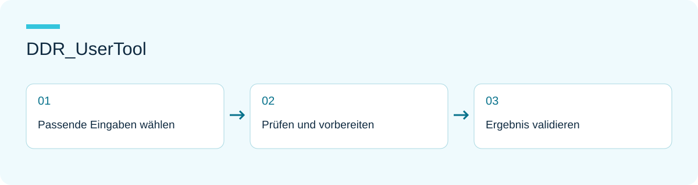



DDR_UserTool unterstützt DDR-Inbetriebnahme und Tests. Das Archiv enthält einen umfangreichen, plattformspezifischen `TestFile`-Baum. Es ist weder der Bandbreiten-Probe noch der Editor für DDR-Initialisierungsdateien.

## Speichertopologie erfassen

Notieren Sie SoC, DDR-Generation, Chiporganisation, Anzahl der Bausteine, Busbreite, Ranks/Chip-Selects und Board-Revision. Konfigurationsnamen bilden solche Kombinationen ab. Gleiche Gesamtkapazität reicht bei anderer Verdrahtung nicht aus.

## Einen kontrollierten Test vorbereiten

1. Originalen DDR-Binary und funktionierenden Loader sichern.
2. Die Konfiguration nach Plattform und tatsächlicher Bestückung wählen und mit Schaltplan sowie SDK-Handbuch abgleichen.
3. Mit einer Kopie arbeiten und Änderungen begründen und dokumentieren.
4. Den Ladeablauf des passenden SDKs auf einem wiederherstellbaren Board verwenden. Aus dem Dateibaum folgt kein universeller Startbefehl.
5. Testauswahl, Frequenz, Temperatur, Dauer und Fehler protokollieren und unter den vorgesehenen Betriebsbedingungen wiederholen.

Löt-/Verdrahtungsprüfung, Frequenz-Stresstest und Bandbreitenmessung prüfen unterschiedliche Eigenschaften. Ein bestandener Test bestätigt weder alle Frequenzen noch jede Fertigungscharge. Scheitert bereits die Initialisierung, prüfen Sie Topologie, Loader und Versorgung, statt mehrere Parameter gleichzeitig zu ändern.

Im Paket wurde kein vollständiges separates PDF gefunden. Dieser Beitrag beschreibt Auswahl und Dokumentation; die verlinkte DDR-Anleitung liefert die übergeordnete Methodik. Eine pauschale ArmSoM-Unterstützung aller Konfigurationen wird nicht behauptet.

## Geltungsbereich und Prüfung

Dieser Ablauf basiert auf der Dokumentation der Sammlung. Prüfen Sie Board, SoC, Trägerplatine, SDK/BSP und Host-Architektur. Flashen, Provisionieren, Registerschreiben und Hardwaretests wurden nicht ausgeführt. Ein verfügbares Paket belegt keine Unterstützung aller ArmSoM-Produkte.

## GitHub-Werkzeugverzeichnis, Versionen und SHA-256

Das passende GitHub-Verzeichnis öffnen, Host und Version wählen, Dateihash prüfen und vollständig entpacken. Die folgenden Links öffnen Repository-Verzeichnisse.

[Werkzeugverzeichnis auf GitHub öffnen](https://github.com/ArmSoM/rockchip-tools/tree/main/downloads/ddr-user-tool)

| Plattform / Version | Datei | SHA-256 |
|---|---|---|
| Windows / 1.41 | `DDR_UserTool_v1.41.7z` | `f53d06ad782e9fa85f5f098572fc20bd82945886936b1df5faf6ebf6ea892416` |

[GitHub · catalog.json](https://github.com/ArmSoM/rockchip-tools/blob/main/catalog.json) · [SHA256SUMS](https://github.com/ArmSoM/rockchip-tools/blob/main/SHA256SUMS)

## Quellen und Originalabbildungen

- DDR_UserTool_v1.41.7z: per-platform TestFile configuration tree; existing Rockchip DDR guide

## Verwandte Arbeitsabläufe

- [Rockchip DDR-Entwicklerleitfaden: Frequenz, Kapazität, Validierung, Augendiagramme und ECC](/de/articles/037-rockchip-ddr/)
- [DDR Bandwidth Tool: Speicherverkehr auf Rockchip auswerten](/de/articles/rockchip-tool-ddr-bandwidth/)
- [rk_ddrbin_tool: Parameter der frühen DDR-Initialisierung ändern](/de/articles/rockchip-tool-ddrbin-tool/)
- [Rockchip-Werkzeug- und Downloadübersicht](/de/articles/rockchip-tools-download-guide/)

## Passende ArmSoM-Boarddokumentation

Board- und Trägeranforderungen zunächst im Produkthandbuch prüfen. Diese Links dienen als Plattformreferenzen und belegen keine Validierung des Archivwerkzeugs auf diesen Produkten.

[ArmSoM Docs](https://docs.armsom.org/) · [Sige7](https://www.armsom.org/sige7) / [Docs](https://docs.armsom.org/armsom-sige7) · [CM5](https://www.armsom.org/cm5) / [Docs](https://docs.armsom.org/armsom-cm5)


