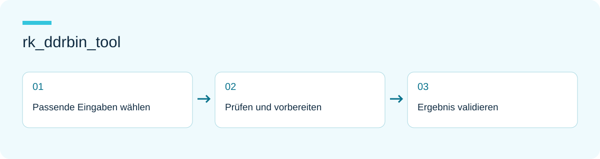





Der DDR-Binary initialisiert den Speicher vor Linux. `rk_ddrbin_tool` verändert unterstützte Parameter eines passenden Binaries. Es ersetzt weder die Analyse der Verdrahtung noch die Auswahl eines kompatiblen Loaders.

## Zwei Versionen prüfen

Werkzeugversion und DDR-Binary-Version sind verschieden. Die Anleitung enthält eine Plattform-/Versionsmatrix. Umbenennen macht einen nicht unterstützten Eintrag nicht kompatibel. Sichern Sie Original und Hash.

## Lesen, ändern, vergleichen

Die Textanleitung enthält diese historischen PX30-Python-Beispiele:

```text
./ddrbin_tool.py px30 ddrbin_param.txt px30_ddr_333MHz_v1.13.bin
./ddrbin_tool.py px30 -g gen_param.txt px30_ddr_333MHz_v1.15.bin
```

Die erste Zeile verwendet `ddrbin_param.txt`, die zweite exportiert mit `-g`. Das bedeutet nicht, dass jedes GUI-Paket `ddrbin_tool.py` enthält oder PX30-Werte für andere SoCs gelten. Verwenden Sie die tatsächlich ausgelieferte Oberfläche. Leere Werte behalten laut Anleitung die Standardwerte.

Wählen Sie Chip und unterstützte Binary-Version exakt. Exportieren Sie vorhandene Werte, soweit unterstützt, und ändern Sie in einer Kopie jeweils einen dokumentierten Parameter. Vor der Aufnahme in den Loader Einstellungen, Größe und Hash vergleichen. Werkzeugversion und Parameterdatei gehören zum Ergebnisarchiv.

## Boot-Kette prüfen

Testen Sie Speicherinitialisierung, Kalt-/Warmstart und DDR-Prüfungen mit der richtigen Bestückung. Ein vom Editor akzeptiertes Ergebnis belegt keine Stabilität oder Timing-Reserve. Bei einem Ausfall vor der seriellen Konsole zunächst den funktionierenden Loader wiederherstellen und die Änderung untersuchen.

## Geltungsbereich und Prüfung

Dieser Ablauf basiert auf der Dokumentation der Sammlung. Prüfen Sie Board, SoC, Trägerplatine, SDK/BSP und Host-Architektur. Flashen, Provisionieren, Registerschreiben und Hardwaretests wurden nicht ausgeführt. Ein verfügbares Paket belegt keine Unterstützung aller ArmSoM-Produkte.

## Download, Versionen und SHA-256

Passendes Archiv laden, Hash prüfen und den vollständigen Ordner entpacken. Linux PinDebug zuerst nach verlinkter Anleitung zusammensetzen; der angegebene Hash gehört zur vollständigen Datei.

| Host / Version | Paket |
|---|---|
| Linux / 1.01 | [rk_ddrbin_tool_V1.01.7z](https://raw.githubusercontent.com/ArmSoM/rockchip-tools/main/downloads/ddrbin-tool/rk_ddrbin_tool_V1.01.7z) |
| Windows / 1.07.2 | [rk_ddrBin_tool_V1.07.2.zip](https://raw.githubusercontent.com/ArmSoM/rockchip-tools/main/downloads/ddrbin-tool/rk_ddrBin_tool_V1.07.2.zip) |

**rk_ddrbin_tool_V1.01.7z — SHA-256**

```text
db87698a90f620dcea6ab166af7d330dfb6f36e9b2cc9ec02dd000bf474b2212
```

**rk_ddrBin_tool_V1.07.2.zip — SHA-256**

```text
618bd996e570cb2f94b2c714e53776c3edc6bad3211e6c377be3cfd45bc48bc1
```

[GitHub · catalog.json](https://github.com/ArmSoM/rockchip-tools/blob/main/catalog.json) · [SHA256SUMS](https://github.com/ArmSoM/rockchip-tools/blob/main/SHA256SUMS)

## Quellen und Originalabbildungen

- rk_ddrbin_tool 1.01 / 1.07.2 packages; ddrbin_tool_user_guide.txt; parameter/version matrix

## Verwandte Arbeitsabläufe

- [Rockchip DDR-Entwicklerleitfaden: Frequenz, Kapazität, Validierung, Augendiagramme und ECC](/de/articles/037-rockchip-ddr/)
- [boot_merger: DDR-Komponenten und Loader richtig zusammenstellen](/de/articles/rockchip-tool-boot-merger/)
- [DDR_UserTool 1.41: passende DDR-Testkonfigurationen auswählen](/de/articles/rockchip-tool-ddr-user-tool/)
- [Rockchip-Werkzeug- und Downloadübersicht](/de/articles/rockchip-tools-download-guide/)

## Passende ArmSoM-Boarddokumentation

Board- und Trägeranforderungen zunächst im Produkthandbuch prüfen. Diese Links dienen als Plattformreferenzen und belegen keine Validierung des Archivwerkzeugs auf diesen Produkten.

[ArmSoM Docs](https://docs.armsom.org/) · [Sige7](https://www.armsom.org/sige7) / [Docs](https://docs.armsom.org/armsom-sige7) · [CM5](https://www.armsom.org/cm5) / [Docs](https://docs.armsom.org/armsom-cm5)


