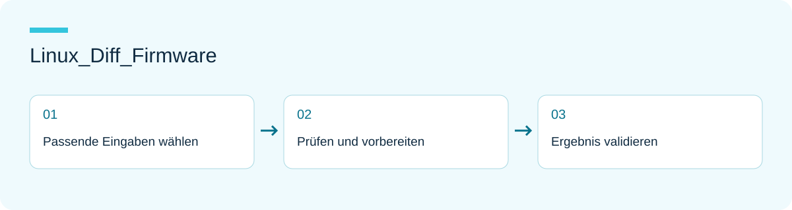





Ein differenzielles Update beschreibt den Übergang von einer bestimmten alten zu einer bestimmten neuen Firmware. Die Übertragungsmenge kann sinken; eine feste Einsparquote lässt sich daraus nicht ableiten.

## Ausgangsversion festhalten

Bewahren Sie unveränderte `old.img`, `new.img` und deren Hashes auf. Das Gerät muss die erwartete Ausgangsversion verwenden. Produkt, Speicherlayout und Aktualisierungsmechanismus müssen zusammenpassen.

## Vorbereitung und Aufruf

Das Skript prüft `bsdiff`, `rkImageMaker`, `afptool` und `md5sum`, erkennt Squashfs/ext4 und legt OLD/NEW/DIFF-Verzeichnisse bei sich an. Verwenden Sie Kopien und ausreichend Platz für beide entpackten Abbilder samt Ergebnis.

```text
./mk-diff-ota.sh old.img new.img diff.img
```

Die Reihenfolge lautet alt, neu, Ausgabe. Prüfen Sie die Chipzuordnung des Skripts. A/B-Unterstützung ist dort als TODO markiert; A/B-Partitionsnamen allein belegen daher keine Kompatibilität.

## Abnahme

Testen Sie zunächst beide vollständigen Abbilder einzeln. Prüfen Sie anschließend das Delta von der exakt vorgesehenen Ausgangsversion sowie OS-Version, Dateien und Dienste. Falsche Ausgangsstände und unterbrochene Updates sind gemäß Wiederherstellungskonzept zu testen. Halten Sie ein vollständiges Recovery-Abbild bereit.

Ein nicht unterstütztes Dateisystem erfordert einen passenden Ablauf, keine Umbenennung. Fehlende Werkzeuge müssen für den Host bereitgestellt werden. Baseline-Fehler verlangen korrektes Versionsmanagement. Sichern Sie Protokoll und Rückgabestatus; ein erzeugtes Delta ist noch kein erfolgreich geprüftes Geräteupdate.

## Geltungsbereich und Prüfung

Dieser Ablauf basiert auf der Dokumentation der Sammlung. Prüfen Sie Board, SoC, Trägerplatine, SDK/BSP und Host-Architektur. Flashen, Provisionieren, Registerschreiben und Hardwaretests wurden nicht ausgeführt. Ein verfügbares Paket belegt keine Unterstützung aller ArmSoM-Produkte.

## Download, Versionen und SHA-256

Passendes Archiv laden, Hash prüfen und den vollständigen Ordner entpacken. Linux PinDebug zuerst nach verlinkter Anleitung zusammensetzen; der angegebene Hash gehört zur vollständigen Datei.

| Host / Version | Paket |
|---|---|
| Linux / directory snapshot | [linux-diff-firmware-directory-snapshot.zip](https://raw.githubusercontent.com/ArmSoM/rockchip-tools/main/downloads/diff-firmware/linux-diff-firmware-directory-snapshot.zip) |

**linux-diff-firmware-directory-snapshot.zip — SHA-256**

```text
e13711865267ea4ee1f71c048d356bc5dff2de0f24e3d1b71dcd4cfb159b45b9
```

[GitHub · catalog.json](https://github.com/ArmSoM/rockchip-tools/blob/main/catalog.json) · [SHA256SUMS](https://github.com/ArmSoM/rockchip-tools/blob/main/SHA256SUMS)

## Quellen und Originalabbildungen

- Linux_Diff_Firmware/mk-diff-ota.sh and bundled packaging utilities

## Verwandte Arbeitsabläufe

- [afptool und rkImageMaker: Rockchip update.img aufbauen und prüfen](/de/articles/rockchip-tool-firmware-pack-tools/)
- [Rockchip-Produktionsfirmware: USB, SD, Programmiergeräte und Fehlersuche](/de/articles/147-rockchip-firmware-production/)
- [Rockchip-Werkzeug- und Downloadübersicht](/de/articles/rockchip-tools-download-guide/)

## Passende ArmSoM-Boarddokumentation

Board- und Trägeranforderungen zunächst im Produkthandbuch prüfen. Diese Links dienen als Plattformreferenzen und belegen keine Validierung des Archivwerkzeugs auf diesen Produkten.

[ArmSoM Docs](https://docs.armsom.org/) · [Sige7](https://www.armsom.org/sige7) / [Docs](https://docs.armsom.org/armsom-sige7) · [CM5](https://www.armsom.org/cm5) / [Docs](https://docs.armsom.org/armsom-cm5)


