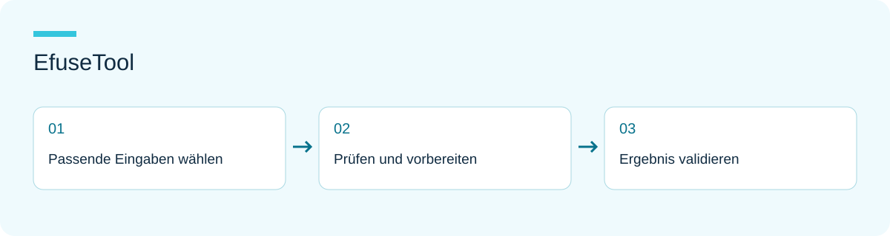





EfuseTool betrifft Sicherheitsdaten wie öffentliche Schlüsselhashes. eFuse-/OTP-Zustände können irreversibel sein; das Werkzeug gehört in einen boardspezifischen Fertigungsablauf, nicht in einen gewöhnlichen Recovery-Prozess.

## Belegte Paketinformationen

Version 1.42 nennt 356X-Unterstützung; frühere Einträge korrigieren Hash-Probleme bei RK3288/RK3399 und RK3229P. Das belegt keine Unterstützung aller neueren SoCs. Ein vollständiges PDF fehlt. Sprachressourcen nennen Firmware, Geräte-IDs, Status sowie Fehler beim Schreiben, Lesen und Vergleichen von Schlüsselhashes.

## Station vorbereiten

Prüfen Sie freigegebene Firmware und Schlüsselidentität. Dokumentieren Sie Loader-, Firmware- und Werkzeugversion, USB-Topologie und Board-Revision. Ordnen Sie physische Ports den angezeigten IDs zu, wie die interne Hilfe verlangt. Validieren Sie zunächst ein definiertes Entwicklungsmuster.

Trennen Sie Signieren, Prüfen und Provisionieren als eigene Fertigungsschritte. Übernehmen Sie keine Adressen oder Schlüssellängen anderer Chips. “firmware is unsigned” und “creating publickey hash failed” verlangen korrekte Eingaben, keine Umgehung.

## Ergebnis je Gerät

Protokollieren Sie Gerätekennung, erwarteten Fingerabdruck, Status und anschließenden Boot-/Recovery-Test. Nach einem Timeout zuerst den aktuellen Zustand feststellen, bevor wiederholt wird. Oberflächentexte ersetzen keinen validierten Board-Ablauf. Für diesen Artikel wurden keine Fuses programmiert.

## Geltungsbereich und Prüfung

Dieser Ablauf basiert auf der Dokumentation der Sammlung. Prüfen Sie Board, SoC, Trägerplatine, SDK/BSP und Host-Architektur. Flashen, Provisionieren, Registerschreiben und Hardwaretests wurden nicht ausgeführt. Ein verfügbares Paket belegt keine Unterstützung aller ArmSoM-Produkte.

## Download, Versionen und SHA-256

Passendes Archiv laden, Hash prüfen und den vollständigen Ordner entpacken. Linux PinDebug zuerst nach verlinkter Anleitung zusammensetzen; der angegebene Hash gehört zur vollständigen Datei.

| Host / Version | Paket |
|---|---|
| Windows / 1.42 | [EfuseTool_v1.42.zip](https://raw.githubusercontent.com/ArmSoM/rockchip-tools/main/downloads/efuse-tool/EfuseTool_v1.42.zip) |

**EfuseTool_v1.42.zip — SHA-256**

```text
abb81d072ad6a7cec31d7a7c5a3f72d9bfe57544ee4d8715e4c031b4bd780fc9
```

[GitHub · catalog.json](https://github.com/ArmSoM/rockchip-tools/blob/main/catalog.json) · [SHA256SUMS](https://github.com/ArmSoM/rockchip-tools/blob/main/SHA256SUMS)

## Quellen und Originalabbildungen

- EfuseTool_v1.42.zip: revision.txt and Language/English.ini

## Verwandte Arbeitsabläufe

- [rk_sign_tool und sign_tool: Rockchip-Firmware signieren und prüfen](/de/articles/rockchip-tool-rk-sign-tool/)
- [SecureBootTool 1.85: eine historische Secure-Boot-Werkzeugkette einordnen](/de/articles/rockchip-tool-secureboot-tool/)
- [Vollständiger Rockchip-Secure-Boot-Leitfaden: Signierung, eFuse, OTP und Prüfung](/de/articles/105-rockchip-secure-boot/)
- [Rockchip-Werkzeug- und Downloadübersicht](/de/articles/rockchip-tools-download-guide/)

## Passende ArmSoM-Boarddokumentation

Board- und Trägeranforderungen zunächst im Produkthandbuch prüfen. Diese Links dienen als Plattformreferenzen und belegen keine Validierung des Archivwerkzeugs auf diesen Produkten.

[ArmSoM Docs](https://docs.armsom.org/) · [Sige7](https://www.armsom.org/sige7) / [Docs](https://docs.armsom.org/armsom-sige7) · [CM5](https://www.armsom.org/cm5) / [Docs](https://docs.armsom.org/armsom-cm5)


