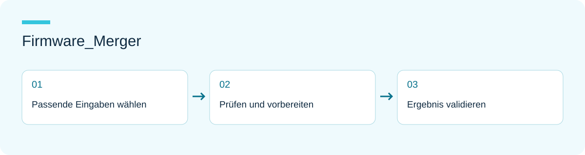





Firmware_Merger erzeugt ein Abbild anhand von `setting.ini`. Das ist für Fertigungsabläufe mit festgelegtem Speicherlayout nützlich. Wählen Sie zuerst das Format und danach das Schreibwerkzeug.

## Drei Formate unterscheiden

Ein leeres `Gpt_Enable` bedeutet Flat RK für RK miniloader, `0` Flat GPT für U-Boot SPL und `1` Compact GPT. Diese Zuordnung ist unverändert aus dem Handbuch übernommen. Compact GPT benötigt ein Produktionswerkzeug und darf nicht wie ein flaches Abbild mit `wl` geschrieben werden. `Backup_Partition_Enable=1` aktiviert einen Reserveheader; leer ist der dokumentierte Standard, auch bei unbekannter Flash-Größe.

## Layout beschreiben

IDBlock muss die erste Partition sein. Das Originalbeispiel lautet:

```text
Name=IDBlock
Type=0x2
PartOffset=0x40
PartSize=0x400
Flag=
File=Image/FlashData.bin,Image/FlashBoot.bin
```

Laut Handbuch muss diese Partition kleiner als 2M sein. Interpretieren Sie hexadezimale Offsets erst nach Prüfung der Formateinheit als Bytewerte. Bei weiteren Partitionen schreibt ein leeres `Flag` die Datei mit Auffüllung; `0x2` füllt ohne Datei, `0x1` überspringt und `0x4` erweitert die letzte Partition auf den restlichen Speicher. `Type_Guid` verweist auf einen Schlüssel in `[PARTITION_TYPE_GUID]`.

## Erstellen und prüfen

Kopieren Sie die passende Konfiguration und prüfen Sie Bildpfade, Partitionsgrenzen und Kapazität. Der README-Aufruf ist:

```text
./firmware_merger -P setting.ini ./
```

Er erzeugt eine Datei; Flashen ist ein eigener Schritt. Prüfen Sie Größe, Hash und Layout mit den SDK-Werkzeugen. Vor dem Gerätetest muss das Schreibwerkzeug das Format unterstützen.

Fehlende Dateien, überlappende Partitionen oder eine Verwechslung von Compact und Flat löst kein anderes USB-Kabel. Archivieren Sie Konfiguration und Eingabedateien gemeinsam. Das Beispiel ist keine validierte ArmSoM-Partitionstabelle.

## Geltungsbereich und Prüfung

Dieser Ablauf basiert auf der Dokumentation der Sammlung. Prüfen Sie Board, SoC, Trägerplatine, SDK/BSP und Host-Architektur. Flashen, Provisionieren, Registerschreiben und Hardwaretests wurden nicht ausgeführt. Ein verfügbares Paket belegt keine Unterstützung aller ArmSoM-Produkte.

## Download, Versionen und SHA-256

Passendes Archiv laden, Hash prüfen und den vollständigen Ordner entpacken. Linux PinDebug zuerst nach verlinkter Anleitung zusammensetzen; der angegebene Hash gehört zur vollständigen Datei.

| Host / Version | Paket |
|---|---|
| Linux / directory snapshot | [firmware-merger-linux-directory-snapshot.zip](https://raw.githubusercontent.com/ArmSoM/rockchip-tools/main/downloads/firmware-merger/firmware-merger-linux-directory-snapshot.zip) |

**firmware-merger-linux-directory-snapshot.zip — SHA-256**

```text
798ce66df5ee1f22cd96f811bf9140e5e9f4f0f3977a4ef37acd54554d6992ea
```

[GitHub · catalog.json](https://github.com/ArmSoM/rockchip-tools/blob/main/catalog.json) · [SHA256SUMS](https://github.com/ArmSoM/rockchip-tools/blob/main/SHA256SUMS)

## Quellen und Originalabbildungen

- Firmware_Merger/Readme.txt; user_manual.txt; setting examples

## Verwandte Arbeitsabläufe

- [afptool und rkImageMaker: Rockchip update.img aufbauen und prüfen](/de/articles/rockchip-tool-firmware-pack-tools/)
- [programmer_image_tool: Abbilder für eMMC-, SPI-NOR- und NAND-Programmer](/de/articles/rockchip-tool-programmer-image-tool/)
- [Rockchip-Werkzeug- und Downloadübersicht](/de/articles/rockchip-tools-download-guide/)

## Passende ArmSoM-Boarddokumentation

Board- und Trägeranforderungen zunächst im Produkthandbuch prüfen. Diese Links dienen als Plattformreferenzen und belegen keine Validierung des Archivwerkzeugs auf diesen Produkten.

[ArmSoM Docs](https://docs.armsom.org/) · [Sige7](https://www.armsom.org/sige7) / [Docs](https://docs.armsom.org/armsom-sige7) · [CM5](https://www.armsom.org/cm5) / [Docs](https://docs.armsom.org/armsom-cm5)


