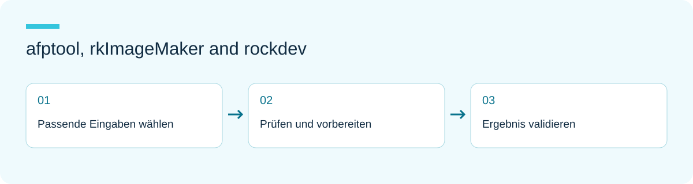





In rockdev bündelt `afptool` die Dateien aus `package-file`; `rkImageMaker` kombiniert diesen Inhalt mit Loader und Chipinformationen. Ein Firmware-Container ist kein direkt schreibbares Rohabbild des Datenträgers.

## Eingabebaum vorbereiten

Legen Sie passende Partitionsabbilder und Loader in `Image/`. Stellen Sie `Image/parameter` oder `Image/parameter.txt` bereit und prüfen Sie `package-file` im Hauptverzeichnis. Alle Pfade müssen existieren und zur Partitionierung derselben Board-Version passen.

## RK3588-Beispiel

Das mitgelieferte Skript nutzt zwei Schritte:

```text
./afptool -pack ./ Image/update.img
./rkImageMaker -RK3588 Image/MiniLoaderAll.bin Image/update.img update.img -os_type:androidos
```

Auch `-os_type:androidos` ist originalgetreu enthalten. Dies ist kein allgemeines Linux-Rezept. `Image/update.img` ist das Zwischenpaket, `update.img` im Hauptverzeichnis der fertige Container. Starten Sie aus dem erwarteten rockdev-Verzeichnis; für andere SoCs oder Systeme gilt das jeweilige SDK-Skript.

## Ergebnis rückwärts prüfen

Laut README extrahiert `unpack.sh` nach `output`. Ein eigenes Arbeitsverzeichnis verhindert die Verwechslung alter und neuer Ergebnisse. Vergleichen Sie Loader, Partitionsnamen, Dateilängen und Dateiliste mit den Eingaben und dokumentieren Sie den SHA-256-Wert.

Fehlende parameter/package-file werden im Skript geprüft. Nicht vorhandene Pfade und übergroße Abbilder müssen vor dem Flashen korrigiert werden. Ein falsches Chipkennzeichen kann erst am Gerät auffallen; prüfen Sie es deshalb vorher.

Linux-Verzeichnissnapshot, macOS rockdev 2.1 und datiertes Windows-Paket bleiben getrennt, denn Optionen können abweichen. Erfolgreiches Verpacken ersetzt keine Tests von Start, Speicher, Wiederherstellung und Update.

## Geltungsbereich und Prüfung

Dieser Ablauf basiert auf der Dokumentation der Sammlung. Prüfen Sie Board, SoC, Trägerplatine, SDK/BSP und Host-Architektur. Flashen, Provisionieren, Registerschreiben und Hardwaretests wurden nicht ausgeführt. Ein verfügbares Paket belegt keine Unterstützung aller ArmSoM-Produkte.

## GitHub-Werkzeugverzeichnis, Versionen und SHA-256

Das passende GitHub-Verzeichnis öffnen, Host und Version wählen, Dateihash prüfen und vollständig entpacken. Die folgenden Links öffnen Repository-Verzeichnisse.

[Werkzeugverzeichnis auf GitHub öffnen](https://github.com/ArmSoM/rockchip-tools/tree/main/downloads/firmware-pack-tools)

| Plattform / Version | Datei | SHA-256 |
|---|---|---|
| Linux / directory snapshot | `rockdev-linux-directory-snapshot.zip` | `06049f3eb612de5d1a3866bffe4b1d8d7dabaef4fd38b07decd79380f5af5a36` |
| macOS / 2.1 | `rockdev_v2.1_mac.zip` | `af29d720edba7a0f082f984d57adf5a09b81a8df6deebf7f158aeedabd4018e7` |
| Windows / 20230109 | `RKImageMaker_20230109.zip` | `887863bb2563ba0ab9c77b846a26f47fe7774f95152d66253c4de910419591cd` |

[GitHub · catalog.json](https://github.com/ArmSoM/rockchip-tools/blob/main/catalog.json) · [SHA256SUMS](https://github.com/ArmSoM/rockchip-tools/blob/main/SHA256SUMS)

## Quellen und Originalabbildungen

- Linux_Pack_Firmware/rockdev/readme.txt; rk3588-mkupdate.sh; unpack.sh
- rockdev_v2.1_mac.zip; RKImageMaker_20230109.zip

## Verwandte Arbeitsabläufe

- [Firmware_Merger: Flat RK, Flat GPT und Compact GPT erstellen](/de/articles/rockchip-tool-firmware-merger/)
- [upgrade_tool: Rockchip-Firmware per Kommandozeile schreiben](/de/articles/rockchip-tool-upgrade-tool/)
- [Rockchip-Produktionsfirmware: USB, SD, Programmiergeräte und Fehlersuche](/de/articles/147-rockchip-firmware-production/)
- [Rockchip-Werkzeug- und Downloadübersicht](/de/articles/rockchip-tools-download-guide/)

## Passende ArmSoM-Boarddokumentation

Board- und Trägeranforderungen zunächst im Produkthandbuch prüfen. Diese Links dienen als Plattformreferenzen und belegen keine Validierung des Archivwerkzeugs auf diesen Produkten.

[ArmSoM Docs](https://docs.armsom.org/) · [Sige7](https://www.armsom.org/sige7) / [Docs](https://docs.armsom.org/armsom-sige7) · [CM5](https://www.armsom.org/cm5) / [Docs](https://docs.armsom.org/armsom-cm5)


