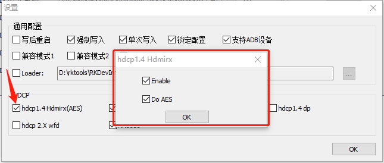




HDCP Key Writer schreibt autorisiertes Material im Rockchip-Format `.skf`. Der Download liefert weder HDCP-Schlüssel noch eine Lizenz. Das Programm trägt 1.0.5, das PDF V1.0.1.

## Schlüssel getrennt verwalten

Lizenzierte Schlüssel bleiben in der kontrollierten Produktionsumgebung. Das bereinigte Paket enthält keine historischen Logs oder gespeicherte Konfiguration. Erstellen Sie die eigene Station und Schlüsselzuordnung ohne Veröffentlichung der Inhalte.

Das Handbuch bündelt einzelne autorisierte Dateien so:

```text
HdcpKeyPack.exe --pack --in .\hdcpkeys --out .\hdcp.skf
```

Eine vorhandene Zieldatei wird überschrieben. Prüfen Sie Eingabeordner, Ausgabename und Anzahl. Erfolgreiches Verpacken belegt weder Lizenzstatus noch Geräteprogrammierung.

## Schreiboptionen verstehen

Single verlangt je Gerät einen manuellen Start; ohne Auswahl beschreibt die Quelle Schreiben beim Verbinden. Neustart wird getrennt gesteuert. ADB-Unterstützung ruft zuerst `adb reboot loader` auf. Force Write wird wegen entfallenem HDCP-Readback verlangt und ist keine allgemeine Empfehlung zum Überschreiben von Identitäten.

RK3588 besitzt eigene Controller-/Verschlüsselungseinstellungen sowie AES-Optionen je Schlüssel. Kompatibilitätsmodi betreffen ältere Plattformen. Verwenden Sie den passenden BSP und testen Sie ein autorisiertes Muster vor Automatisierung.

Dokumentieren Sie Schlüsselzuteilung, Gerät und Ergebnis und prüfen Sie den vorgesehenen Inhaltsschutzpfad. Verpackte Schlüsselanzahl beweist keine HDCP-Interoperabilität. Bei unklarem Ergebnis zuerst den Bestand abgleichen. Es wurden keine Schlüssel bereitgestellt oder geschrieben.

## Geltungsbereich und Prüfung

Dieser Ablauf basiert auf der Dokumentation der Sammlung. Prüfen Sie Board, SoC, Trägerplatine, SDK/BSP und Host-Architektur. Flashen, Provisionieren, Registerschreiben und Hardwaretests wurden nicht ausgeführt. Ein verfügbares Paket belegt keine Unterstützung aller ArmSoM-Produkte.

## Download, Versionen und SHA-256

Passendes Archiv laden, Hash prüfen und den vollständigen Ordner entpacken. Linux PinDebug zuerst nach verlinkter Anleitung zusammensetzen; der angegebene Hash gehört zur vollständigen Datei.

| Host / Version | Paket |
|---|---|
| Windows / 1.0.5 | [Rockchip_HdcpKey_Writer_V1.0.5-clean.zip](https://raw.githubusercontent.com/ArmSoM/rockchip-tools/main/downloads/hdcp-key-writer/Rockchip_HdcpKey_Writer_V1.0.5-clean.zip) |

**Rockchip_HdcpKey_Writer_V1.0.5-clean.zip — SHA-256**

```text
39291cd73a8b979de8e70c0109cffecd40f72e26788951a72296449de67c6e3b
```

[GitHub · catalog.json](https://github.com/ArmSoM/rockchip-tools/blob/main/catalog.json) · [SHA256SUMS](https://github.com/ArmSoM/rockchip-tools/blob/main/SHA256SUMS)

## Quellen und Originalabbildungen

- Rockchip_User_Guide_HDCP_Key_Flash.pdf V1.0.1; HDCP Key Writer 1.0.5 package
- [Original-PDF: Rockchip_User_Guide_HDCP_Key_Flash.pdf](https://raw.githubusercontent.com/ArmSoM/rockchip-tools/main/manuals/e1ef88b767b1.pdf)

Abbildungen stammen aus den angegebenen PDFs. Existiert nur eine chinesische Vorlage, bleiben deren Oberflächentexte erhalten; Bildunterschriften sind übersetzt. Es sind historische Beispiele, keine ArmSoM-Testergebnisse.



Rockchip_User_Guide_HDCP_Key_Flash.pdf · p. 3

## Verwandte Arbeitsabläufe

- [RKDevInfoWriteTool: Seriennummern und MAC-Adressen kontrolliert schreiben](/de/articles/rockchip-tool-devinfo-write/)
- [RK3588-HDCP-Entwicklerhandbuch: Schlüssel, Firmware, HDMI-/DP-Konfiguration und Fehlersuche](/de/articles/046-rockchip-rk3588-hdcp/)
- [Rockchip-Werkzeug- und Downloadübersicht](/de/articles/rockchip-tools-download-guide/)

## Passende ArmSoM-Boarddokumentation

Board- und Trägeranforderungen zunächst im Produkthandbuch prüfen. Diese Links dienen als Plattformreferenzen und belegen keine Validierung des Archivwerkzeugs auf diesen Produkten.

[ArmSoM Docs](https://docs.armsom.org/) · [Sige7](https://www.armsom.org/sige7) / [Docs](https://docs.armsom.org/armsom-sige7) · [CM5](https://www.armsom.org/cm5) / [Docs](https://docs.armsom.org/armsom-cm5)


