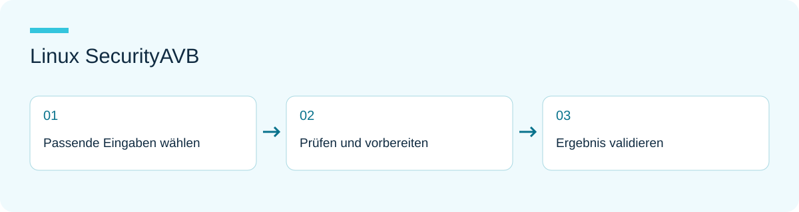





## Vollständige technische Anleitung Linux AVB V2.2.5

AVB führt den hardwaregeschützten Vertrauensanker über U-Boot zu nachfolgenden Partitionen wie boot und recovery weiter und prüft nicht vertrauenswürdigen oder beschädigten Code. Es gelten die Plattform- und Layoutangaben des Handbuchs V2.2.5 von 2020, ohne Annahmen neuerer SDKs.

| Chip | Security storage | Kernel | U-Boot | RKBin |
|---|---|---|---|---|
| RK3308 | OTP | ALL | d3a731e | e00dab6 |
| RK3326 | OTP | 4.4 | d3a731e | 20af526 |
| PX30 | OTP | 4.4 | d3a731e | 20af526 |
| RK3328 | OTP | 4.4 | d3a731e | 158ccc6 |
| RK3399 | eFuse | 4.4 | d3a731e | 158ccc6 |
| RK3288 | eFuse | 4.4 | d3a731e | c021945 |
| RK1808 | eFuse | 4.4 | d3a731e | 890556f |

### 1. Voraussetzungen

Entsperrte Geräte prüfen boot.img und melden Fehler, starten aber weiter; gesperrte Geräte stoppen bei ungültigen Abbildern. Komprimierte Kernel-Abbilder werden hier nicht unterstützt. eFuse-Chips benötigen Base SecureBoot.

### 2. Trust und U-Boot

Secure-Unterstützung in trust.img aktivieren. In der von U-Boot make.sh gewählten `rkbin/RKTRUST/RK3308TRUST.ini` BL32 SEC von 0 auf 1 setzen. TOS-Formate wie RK3288TOS.ini aktivieren secure standardmäßig.

```diff
diff --git a/RKTRUST/RK3308TRUST.ini b/RKTRUST/RK3308TRUST.ini
index 0b2839d..51ec627 100644
--- a/RKTRUST/RK3308TRUST.ini
+++ b/RKTRUST/RK3308TRUST.ini
@@ -8,7 +8,7 @@ SEC=1
 PATH=bin/rk33/rk3308_bl31_v2.21.elf
 ADDR=0x00010000
 [BL32_OPTION]
-SEC=0
+SEC=1
 PATH=bin/rk33/rk3308_bl32_v1.12.bin
 ADDR=0x00200000
 [BL33_OPTION]
```

Die Quellenliste darf nicht ungeprüft vollständig aktiviert werden. OPTEE V1 gilt für rk3288/rk3328/rk3399, V2 für rk3308/rk3326/px30/rk1808; sie schließen einander aus. CRYPTO_V1 gilt für eFuse-Chips wie rk3399/rk3288, V2 für rk1808. `CONFIG_ANDROID_AB` ist optional. Ohne RPMB die security-Partition aktivieren. Fastboot-Adresse und -Größe sind anpassbare Beispiele.

```text
# OPTEE support
CONFIG_OPTEE_CLIENT=y
CONFIG_OPTEE_V1=y
CONFIG_OPTEE_V2=y
# CRYPTO support
CONFIG_DM_CRYPTO=y
CONFIG_ROCKCHIP_CRYPTO_V1=y
CONFIG_ROCKCHIP_CRYPTO_V2=y
# AVB support
CONFIG_AVB_LIBAVB=y
CONFIG_AVB_LIBAVB_AB=y
CONFIG_AVB_LIBAVB_ATX=y
CONFIG_AVB_LIBAVB_USER=y
CONFIG_RK_AVB_LIBAVB_USER=y
CONFIG_AVB_VBMETA_PUBLIC_KEY_VALIDATE=y
CONFIG_ANDROID_AVB=y
CONFIG_ANDROID_AB=y
CONFIG_OPTEE_ALWAYS_USE_SECURITY_PARTITION=y
CONFIG_ROCKCHIP_PRELOADER_PUB_KEY=y
CONFIG_RK_AVB_LIBAVB_ENABLE_ATH_UNLOCK=y
# fastboot support
CONFIG_FASTBOOT=y
CONFIG_FASTBOOT_BUF_ADDR=0x2000000
CONFIG_FASTBOOT_BUF_SIZE=0x08000000
CONFIG_FASTBOOT_FLASH=y
CONFIG_FASTBOOT_FLASH_MMC_DEV=0
```

`CONFIG_ROCKCHIP_PRELOADER_PUB_KEY` und DM_CRYPTO gelten für eFuse. Für älteres U-Boot ohne ATH_UNLOCK zeigt die Vorlage folgenden Patch zu `46a8a26905fc68e6683b93c97adae0dd9a4e37ba`, damit `rk_auth_unlock()` aufgerufen wird. Diesen historischen Patch mit dem tatsächlichen Quellbaum vergleichen. Der zweite entfernt skip_initramfs bei A/B mit Ramdisk; laut Quelle war eine Übernahme in master wegen Android-Konflikts nicht möglich.

```diff
diff --git a/drivers/usb/gadget/f_fastboot.c b/drivers/usb/gadget/f_fastboot.c
index 99d62a6..fec465e 100755
--- a/drivers/usb/gadget/f_fastboot.c
+++ b/drivers/usb/gadget/f_fastboot.c
@@ -1370,7 +1370,7 @@ static void cb_oem(struct usb_ep *ep, struct usb_request *req)
                         fastboot_tx_write_str("FAILThe vboot is disable!");
                 } else {
                         lock_state = 1;
-#ifdef CONFIG_RK_AVB_LIBAVB_ENABLE_ATH_UNLOCK
+#if 1
                         if (rk_auth_unlock((void *)CONFIG_FASTBOOT_BUF_ADDR,
                                            &out_is_trusted)) {
                                 printf("rk_auth_unlock ops error!\n");

diff --git a/common/android_bootloader.c b/common/android_bootloader.c
index 230bf0e..e5c81e6 100644
--- a/common/android_bootloader.c
+++ b/common/android_bootloader.c
@@ -1061,9 +1061,6 @@ int android_bootloader_boot_flow(struct blk_desc *dev_desc,
                  * "skip_initramfs" to the cmdline to make it ignore the
                  * recovery initramfs in the boot partition.
                  */
-#ifdef CONFIG_ANDROID_AB
-               mode_cmdline = "skip_initramfs";
-#endif
                 break;
         case ANDROID_BOOT_MODE_RECOVERY:
                 /* In recovery mode we still boot the kernel from "boot" but
```

Mit `./make.sh xxx` uboot.img, trust.img und loader.bin erzeugen; `xxx` steht für die Zielplattform.

### 3. Parameter und Quellenabweichungen

Erforderlich sind vbmeta mit 1M und system. Buildroot rootfs in system umbenennen, einschließlich uuid-Partitionsname. Ohne eMMC-RPMB speichert security verschlüsselte AVB-Daten; der Text nennt 4M. Erhalten bleiben security `0x00002000` (4 MiB bei 512-Byte-Sektoren) und vbmeta `0x00000800` (1 MiB). Die A/B-userdata-Adresse steht als `0x0065f00` und passt nicht zum vorherigen Ende; sie wird nicht stillschweigend korrigiert. Tatsächliches Layout vor Nutzung prüfen.

```text
# AVB parameter:
0x00002000@0x00004000(uboot),0x00002000@0x00006000(trust),0x00002000@0x00008000(misc),0x00010000@0x0000a000(boot),0x00010000@0x0001a000(recovery),0x00010000@0x0002a000(backup),0x00020000@0x0003a000(oem),0x00300000@0x0005a000(system),0x00000800@0x0035a000(vbmeta),0x00002000@0x0035a800(security),-@0x0035c800(userdata:grow)
uuid:system=614e0000-0000-4b53-8000-1d28000054a9

# AVB and A/B parameter:
0x00002000@0x00004000(uboot),0x00002000@0x00006000(trust),0x00004000@0x00008000(misc),0x00010000@0x0000c000(boot_a),0x00010000@0x0001c000(boot_b),0x00010000@0x0002c000(backup),0x00020000@0x0003c000(oem),0x00300000@0x0005c000(system_a),0x00300000@0x0035c000(system_b),0x00000800@0x0065c000(vbmeta_a),0x00000800@0x0065c800(vbmeta_b),0x00002000@0x0065d000(security),-@0x0065f00(userdata:grow)
```

### 4. Vier AVB-Schlüsselrollen

PRK ist der Wurzelschlüssel: bei eFuse prüft der Base-SecureBoot-Schlüssel die zugehörigen Informationen, bei OTP der gespeicherte PRK-Hash. PIK ist der Zwischen-, PSK der Firmware-Signier- und PUK der Entsperrschlüssel. Die Vorlage enthält Testschlüssel; im verteilten Paket sind sie entfernt. Produktionsschlüssel schützen. `-n` löscht avb_keys vor Neuerzeugung; Product ID umfasst 16 Bytes. Winkelklammern sind Platzhalter, keine wörtlichen Shell-Eingaben.

```text
./avb_user_tool.sh -n <Product ID>
./avb_user_tool.sh -f < /Path/to/PrivateKey.pem >
```

Nur eFuse benötigt den zweiten Befehl für permanent_attributes_cer.bin mit dem Base-SecureBoot-PrivateKey.pem. Er erzeugt `.setting` und wählt eFuse; bei Gerätewechsel `efuse`/`otp` ausdrücklich prüfen. Ohne gesicherte Dateien können Entsperren und spätere Updates unmöglich werden.

### 5. Signieren, packen und Flash-Konfiguration

```text
./avb_user_tool.sh -s -b < /path/to/boot.img > -r < /path/to/recovery.img >
```

Ohne recovery `-r` weglassen. Signierte Abbilder und vbmeta.img landen in `out`. AVB-konfiguriertes uboot/trust/loader, avb_keys und out über den Firmware-Ablauf packen. Bei zusätzlichem Base SecureBoot update.img mit `exclude_boot_sign = True` signieren. In RKDevTool vbmeta und gegebenenfalls security ergänzen, Adressen leeren und parameter neu laden. U-Boot initialisiert security ohne Download-Abbild. Der Anfangszustand unlock beweist keine Zurückweisung ungültiger Abbilder.

### 6. Sperren, Entsperren und Prüflog

Fastboot über Starttaste, `reboot fastboot` im System oder `fastboot usb 0` in U-Boot erreichen. CONFIG_BOOTDELAY schafft Zeit für Ctrl-C zur Konsole. Die Vorlage bietet eine gespeicherte sudo-Passwortoption; deren Speicherung vorher prüfen. Wurzelinformationen zuerst mit `-d`, danach `-l`/`-u` programmieren und neu starten. Passwort/Pfade sind Platzhalter.

```text
./avb_user_tool.sh --su_pswd < /user/password >
./avb_user_tool.sh -d
./avb_user_tool.sh -l
./avb_user_tool.sh -u

ANDROID: reboot reason: "(none)"
Could not find security partition
read_is_device_unlocked() ops returned that device is LOCKED
```

Die letzten drei Zeilen sind das Verity-Quellenbeispiel und melden weiterhin eine fehlende security-Partition. Eine einzelne LOCKED-Zeile beweist keine vollständige Prüfung. RPMB/security-Konfiguration und Starttest mit ungültiger Signatur gemeinsam bewerten. Hier wurden diese Vorgänge nicht ausgeführt.

## Geltungsbereich und Prüfung

Dieser Ablauf basiert auf der Dokumentation der Sammlung. Prüfen Sie Board, SoC, Trägerplatine, SDK/BSP und Host-Architektur. Flashen, Provisionieren, Registerschreiben und Hardwaretests wurden nicht ausgeführt. Ein verfügbares Paket belegt keine Unterstützung aller ArmSoM-Produkte.

## GitHub-Werkzeugverzeichnis, Versionen und SHA-256

Das passende GitHub-Verzeichnis öffnen, Host und Version wählen, Dateihash prüfen und vollständig entpacken. Die folgenden Links öffnen Repository-Verzeichnisse.

[Werkzeugverzeichnis auf GitHub öffnen](https://github.com/ArmSoM/rockchip-tools/tree/main/downloads/linux-avb)

| Plattform / Version | Datei | SHA-256 |
|---|---|---|
| Linux / manual 2.2.5 | `linux-security-avb-without-keys.zip` | `fc7eae22caeadd51d85723b65451c70e88475a2c9ba7e7f5394ca1314688d17d` |

[GitHub · catalog.json](https://github.com/ArmSoM/rockchip-tools/blob/main/catalog.json) · [SHA256SUMS](https://github.com/ArmSoM/rockchip-tools/blob/main/SHA256SUMS)

## Quellen und Originalabbildungen

- Rockchip_User_Manual_Linux_AVB_EN.pdf

## Verwandte Arbeitsabläufe

- [Entwicklerleitfaden für Rockchip Linux Secure Boot](/de/articles/203-rockchip-linux-secure-boot/)
- [Rockchip U-Boot Nextdev: Boot, Treiber, SPL/TPL, FIT und Sicherheitsprüfung](/de/articles/157-rockchip-uboot-nextdev/)
- [rk_sign_tool und sign_tool: Rockchip-Firmware signieren und prüfen](/de/articles/rockchip-tool-rk-sign-tool/)
- [Rockchip-Werkzeug- und Downloadübersicht](/de/articles/rockchip-tools-download-guide/)

## Passende ArmSoM-Boarddokumentation

Board- und Trägeranforderungen zunächst im Produkthandbuch prüfen. Diese Links dienen als Plattformreferenzen und belegen keine Validierung des Archivwerkzeugs auf diesen Produkten.

[ArmSoM Docs](https://docs.armsom.org/) · [Sige7](https://www.armsom.org/sige7) / [Docs](https://docs.armsom.org/armsom-sige7) · [CM5](https://www.armsom.org/cm5) / [Docs](https://docs.armsom.org/armsom-cm5)


