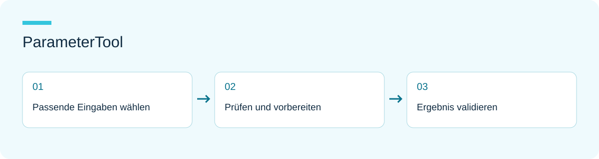



Partitionsparameter verbinden Firmware-Inhalte mit Speicheradressen. Das Paket enthält `parameter_tool.exe`, Konfiguration und ein verschachteltes boot_merger-ZIP, jedoch kein separates PDF. Dieser Ablauf beschreibt deshalb Datenprüfung statt unbelegter Schaltflächen.

## Funktionierendes Layout als Ausgangspunkt

Arbeiten Sie mit einer Kopie der parameter-Datei des Board-SDKs. Erfassen Sie Kapazität, Reihenfolge, Namen, Offsets, Größen und eine eventuell wachsende letzte Partition. Prüfen Sie vor Hex-Umrechnungen die Einheit: Hexadezimalwerte sind nicht automatisch Byteadressen.

Vergleichen Sie endgültige Abbilder einschließlich Metadaten mit reservierten Größen. Prüfen Sie Folgepartition und Gesamtkapazität. Namen müssen mit `package-file`, RKDevTool-Zeilen und Boot-Argumenten übereinstimmen. A/B verlangt passende Slot-Namen und Update-Logik, nicht nur doppelte Einträge.

## Gespeichertes Ergebnis prüfen

Vergleichen Sie Original und Änderung, bauen und entpacken Sie die Firmware erneut. Importieren Sie parameter zur Kontrolle der Download-Zeilen in RKDevTool, ohne sofort zu schreiben. Das endgültige Layout benötigt einen Test auf einem wiederherstellbaren Gerät mit Backup.

Der eingebettete boot_merger ist eine weitere Kopie, kein zusätzliches Werkzeugthema. Sein älteres Format belegt keine Eignung für neue SoCs. Eine universelle ArmSoM-Partitionstabelle lässt sich daraus nicht ableiten.

## Geltungsbereich und Prüfung

Dieser Ablauf basiert auf der Dokumentation der Sammlung. Prüfen Sie Board, SoC, Trägerplatine, SDK/BSP und Host-Architektur. Flashen, Provisionieren, Registerschreiben und Hardwaretests wurden nicht ausgeführt. Ein verfügbares Paket belegt keine Unterstützung aller ArmSoM-Produkte.

## GitHub-Werkzeugverzeichnis, Versionen und SHA-256

Das passende GitHub-Verzeichnis öffnen, Host und Version wählen, Dateihash prüfen und vollständig entpacken. Die folgenden Links öffnen Repository-Verzeichnisse.

[Werkzeugverzeichnis auf GitHub öffnen](https://github.com/ArmSoM/rockchip-tools/tree/main/downloads/parameter-tool)

| Plattform / Version | Datei | SHA-256 |
|---|---|---|
| Windows / 1.2 | `ParameterTool_v1.2.zip` | `46e4cda5ca71bd12444fc75c517753fe0f3fda9db1ce3917d1a5a3f48e92a6f2` |

[GitHub · catalog.json](https://github.com/ArmSoM/rockchip-tools/blob/main/catalog.json) · [SHA256SUMS](https://github.com/ArmSoM/rockchip-tools/blob/main/SHA256SUMS)

## Quellen und Originalabbildungen

- ParameterTool_v1.2.zip: parameter_tool.exe, config.json, nested boot_merger_v1.32_win.zip; existing storage guide

## Verwandte Arbeitsabläufe

- [Rockchip-Speicherleitfaden: Flash, Startablauf, Partitionen, Programmierung und Vendor Storage](/de/articles/099-rockchip-storage-application/)
- [RKDevTool: Download, Loader, Partitionen und update.img](/de/articles/rockchip-tool-rkdevtool/)
- [afptool und rkImageMaker: Rockchip update.img aufbauen und prüfen](/de/articles/rockchip-tool-firmware-pack-tools/)
- [Rockchip-Werkzeug- und Downloadübersicht](/de/articles/rockchip-tools-download-guide/)

## Passende ArmSoM-Boarddokumentation

Board- und Trägeranforderungen zunächst im Produkthandbuch prüfen. Diese Links dienen als Plattformreferenzen und belegen keine Validierung des Archivwerkzeugs auf diesen Produkten.

[ArmSoM Docs](https://docs.armsom.org/) · [Sige7](https://www.armsom.org/sige7) / [Docs](https://docs.armsom.org/armsom-sige7) · [CM5](https://www.armsom.org/cm5) / [Docs](https://docs.armsom.org/armsom-cm5)


