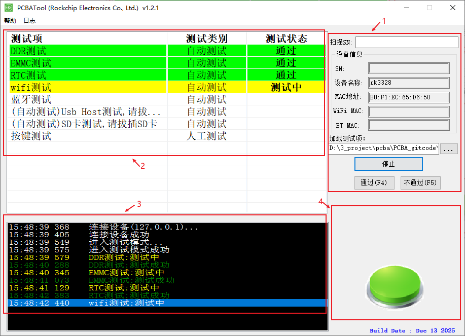




RKPCBATool kombiniert eine Windows-Anwendung mit Testprogrammen auf Linux. Speicher, Funk, Audio und Tasten benötigen entsprechende BSP-Unterstützung. Der Ablauf unterscheidet sich vom älteren Android-PCBA-Werkzeug.

## Installation und Verbindung

Verwenden Sie das vollständige Paket und einen englisch benannten Pfad; das Handbuch warnt vor ADB-Problemen mit anderen Pfaden. Starten Sie PCBA-fähige Firmware und verbinden Sie ADB. Grün bedeutet erkanntes Gerät, Orange nicht verfügbar. Eine Verbindung ist noch kein bestandener Funktionstest.

## JSON-Prüfplan

Laden Sie mit **F2** oder **...** die Konfiguration. `test_item` identifiziert den Test, `test_bin_name` das Zielprogramm und `test_type` die automatische/manuelle Bewertung. Dieses syntaktisch gültige ArmSoM-Beispiel nutzt dokumentierte Felder und deaktiviert MES; es ist kein qualifizierter Fertigungsplan:

```json
{
  "meta": {"version": "1.0", "needreboot": false},
  "test_groups": [{
    "test_item": "key_test",
    "test_bin_name": "echo_key_test",
    "name": "Key Test",
    "test_type": "manual",
    "enable": 1,
    "is_loop_test": false,
    "is_first": false,
    "is_last": false,
    "is_check_sn": false
  }],
  "mes_config": {"use_mes": false}
}
```

Der Programmname muss auf dem Ziel existieren. Passen Sie Tests an Bestückung und Prüfmittel an. Das Original-JSON enthält Formatfehler und beispielhafte MES-Adressen, die nicht in eine reale Station gehören.

## Durchführung

Automatische Tests und der erste manuelle Test beginnen gemeinsam. Manuelle Tests laufen nach Pass/Fail weiter. Audio braucht Hörkriterien, Tasten die tatsächlichen Board-Namen. Ein erfolgreicher Wi-Fi-Scan ist kein Durchsatztest. Deaktivierte und unzutreffende Prüfungen getrennt erfassen.

`needreboot` steuert Neustarts; das A/B-rootfs-Beispiel ist produktspezifisch. Erweiterungen benötigen passende Host-Konfiguration, Zielprogramm und Protokoll. Chinesisch V1.2.0 entfernt einen alten Camera-Abschnitt, Englisch behält ihn trotz Versionshinweis; diese Angaben gelten als historisch.

Archivieren Sie Plan-Hash, Versionen, Firmware, Prüfmittel und Geräteergebnisse. Tool 1.2.1 und Handbuch V1.2.0 sind getrennte Versionsstände. Es wurden keine Produktionstests ausgeführt.

## Geltungsbereich und Prüfung

Dieser Ablauf basiert auf der Dokumentation der Sammlung. Prüfen Sie Board, SoC, Trägerplatine, SDK/BSP und Host-Architektur. Flashen, Provisionieren, Registerschreiben und Hardwaretests wurden nicht ausgeführt. Ein verfügbares Paket belegt keine Unterstützung aller ArmSoM-Produkte.

## Download, Versionen und SHA-256

Passendes Archiv laden, Hash prüfen und den vollständigen Ordner entpacken. Linux PinDebug zuerst nach verlinkter Anleitung zusammensetzen; der angegebene Hash gehört zur vollständigen Datei.

| Host / Version | Paket |
|---|---|
| Windows host + Linux target / 1.2.1 | [RKPCBATool_v1.2.1_20251226.zip](https://raw.githubusercontent.com/ArmSoM/rockchip-tools/main/downloads/pcba-tool/RKPCBATool_v1.2.1_20251226.zip) |

**RKPCBATool_v1.2.1_20251226.zip — SHA-256**

```text
ec3747fa2360e8e1793920882d7ec51a4aa1087a4cfab5d3c218f677999440bc
```

[GitHub · catalog.json](https://github.com/ArmSoM/rockchip-tools/blob/main/catalog.json) · [SHA256SUMS](https://github.com/ArmSoM/rockchip-tools/blob/main/SHA256SUMS)

## Quellen und Originalabbildungen

- RKPCBATool 1.2.1 package; Rockchip_Developer_Guide_Linux_PCBA_CN/EN V1.2.0 (2025-12-13)
- [Original-PDF: Rockchip_Developer_Guide_Linux_PCBA_CN.pdf](https://raw.githubusercontent.com/ArmSoM/rockchip-tools/main/manuals/31be89bdda4b.pdf)
- [Original-PDF: Rockchip_Developer_Guide_Linux_PCBA_EN.pdf](https://raw.githubusercontent.com/ArmSoM/rockchip-tools/main/manuals/6cb5fb2c60e8.pdf)

Abbildungen stammen aus den angegebenen PDFs. Existiert nur eine chinesische Vorlage, bleiben deren Oberflächentexte erhalten; Bildunterschriften sind übersetzt. Es sind historische Beispiele, keine ArmSoM-Testergebnisse.



Rockchip_Developer_Guide_Linux_PCBA_EN.pdf · p. 7

## Verwandte Arbeitsabläufe

- [Entwicklerhandbuch für Rockchip Linux PCBA-Tests](/de/articles/197-rockchip-linux-pcba/)
- [Rockchip PCBA-Testtool: Entwicklerhandbuch](/de/articles/252-rockchip-pcba-test-tool/)
- [RKDevInfoWriteTool: Seriennummern und MAC-Adressen kontrolliert schreiben](/de/articles/rockchip-tool-devinfo-write/)
- [Rockchip-Werkzeug- und Downloadübersicht](/de/articles/rockchip-tools-download-guide/)

## Passende ArmSoM-Boarddokumentation

Board- und Trägeranforderungen zunächst im Produkthandbuch prüfen. Diese Links dienen als Plattformreferenzen und belegen keine Validierung des Archivwerkzeugs auf diesen Produkten.

[ArmSoM Docs](https://docs.armsom.org/) · [Sige7](https://www.armsom.org/sige7) / [Docs](https://docs.armsom.org/armsom-sige7) · [CM5](https://www.armsom.org/cm5) / [Docs](https://docs.armsom.org/armsom-cm5)


