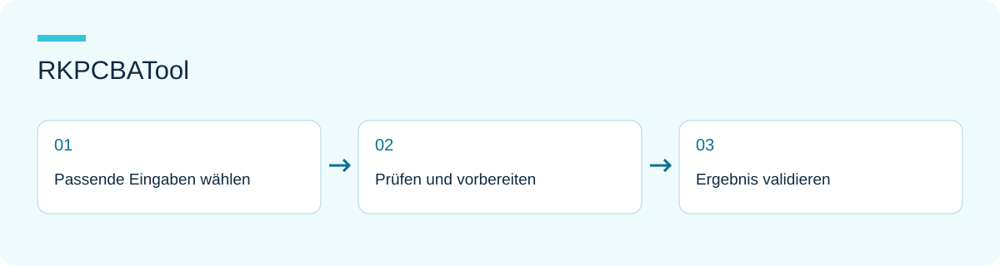



## Das PCBA-Handbuch ist als viersprachiger Artikel verfügbar

Das Paket enthält 37 chinesische und 43 englische Seiten RK-KF-YF-301 V1.2.0, dieselben Hauptquellen wie unser Linux-PCBA-Entwicklerhandbuch. Wir verwenden dessen vollständigen bearbeitbaren Fachtext weiter, statt die 80 Quellseiten als zweiten Artikel zu duplizieren. Die Links öffnen Artikeltext, keine PDF-Downloads.

Das vollständige Handbuch umfasst Installation/ADB-Pfade, JSON-Testpunkte, automatische/manuelle Bewertung, Neustartoptionen, Weiterentwicklung und Verpackung, Architektur, alle neun Protokolltabellen, Gerätecode und rootfs/recovery-Builds, PCBA mit Display sowie Installations-, ADB-forward-, Windows-10- und upload-file-fail-Fehler.

[Vollständiges Linux-PCBA-Entwicklerhandbuch lesen](/de/articles/197-rockchip-linux-pcba/)

- 1. PCBA-Testwerkzeug
- 2. PCBA-Softwareentwurf
- 3. Testcodearchitektur
- 4. PCBA mit Bildschirm
- 5. Anhang

### Paket- und Handbuchversion getrennt prüfen

Paket V1.2.1, Handbuch V1.2.0 und V1.7 in der Produkttabelle sind verschiedene Angaben. Chinesisch entfernt den alten Kameraknopf-Abschnitt, Englisch behält ihn; der vollständige Artikel kennzeichnet ihn historisch und trennt den neuen automatischen Kameratest. RK3358, TPYE/TYPE, CMD/RES und Pfadunterschiede bleiben nachvollziehbare Quellenabweichungen statt vermuteter Korrekturen.

## Geltungsbereich und Prüfung

Dieser Ablauf basiert auf der Dokumentation der Sammlung. Prüfen Sie Board, SoC, Trägerplatine, SDK/BSP und Host-Architektur. Flashen, Provisionieren, Registerschreiben und Hardwaretests wurden nicht ausgeführt. Ein verfügbares Paket belegt keine Unterstützung aller ArmSoM-Produkte.

## GitHub-Werkzeugverzeichnis, Versionen und SHA-256

Das passende GitHub-Verzeichnis öffnen, Host und Version wählen, Dateihash prüfen und vollständig entpacken. Die folgenden Links öffnen Repository-Verzeichnisse.

[Werkzeugverzeichnis auf GitHub öffnen](https://github.com/ArmSoM/rockchip-tools/tree/main/downloads/pcba-tool)

| Plattform / Version | Datei | SHA-256 |
|---|---|---|
| Windows host + Linux target / 1.2.1 | `RKPCBATool_v1.2.1_20251226.zip` | `ec3747fa2360e8e1793920882d7ec51a4aa1087a4cfab5d3c218f677999440bc` |

[GitHub · catalog.json](https://github.com/ArmSoM/rockchip-tools/blob/main/catalog.json) · [SHA256SUMS](https://github.com/ArmSoM/rockchip-tools/blob/main/SHA256SUMS)

## Quellen und Originalabbildungen

- Rockchip_Developer_Guide_Linux_PCBA_CN.pdf
- Rockchip_Developer_Guide_Linux_PCBA_EN.pdf

## Verwandte Arbeitsabläufe

- [Entwicklerhandbuch für Rockchip Linux PCBA-Tests](/de/articles/197-rockchip-linux-pcba/)
- [Rockchip PCBA-Testtool: Entwicklerhandbuch](/de/articles/252-rockchip-pcba-test-tool/)
- [RKDevInfoWriteTool: Seriennummern und MAC-Adressen kontrolliert schreiben](/de/articles/rockchip-tool-devinfo-write/)
- [Rockchip-Werkzeug- und Downloadübersicht](/de/articles/rockchip-tools-download-guide/)

## Passende ArmSoM-Boarddokumentation

Board- und Trägeranforderungen zunächst im Produkthandbuch prüfen. Diese Links dienen als Plattformreferenzen und belegen keine Validierung des Archivwerkzeugs auf diesen Produkten.

[ArmSoM Docs](https://docs.armsom.org/) · [Sige7](https://www.armsom.org/sige7) / [Docs](https://docs.armsom.org/armsom-sige7) · [CM5](https://www.armsom.org/cm5) / [Docs](https://docs.armsom.org/armsom-cm5)


