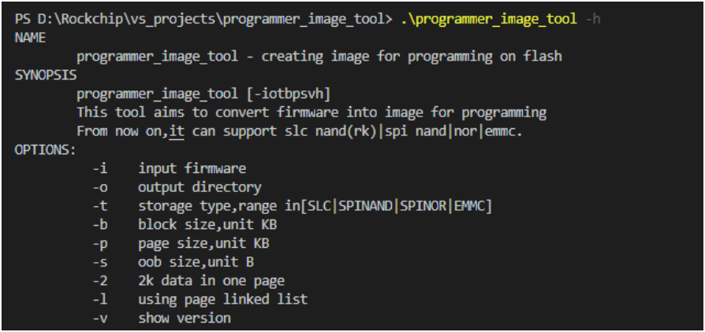
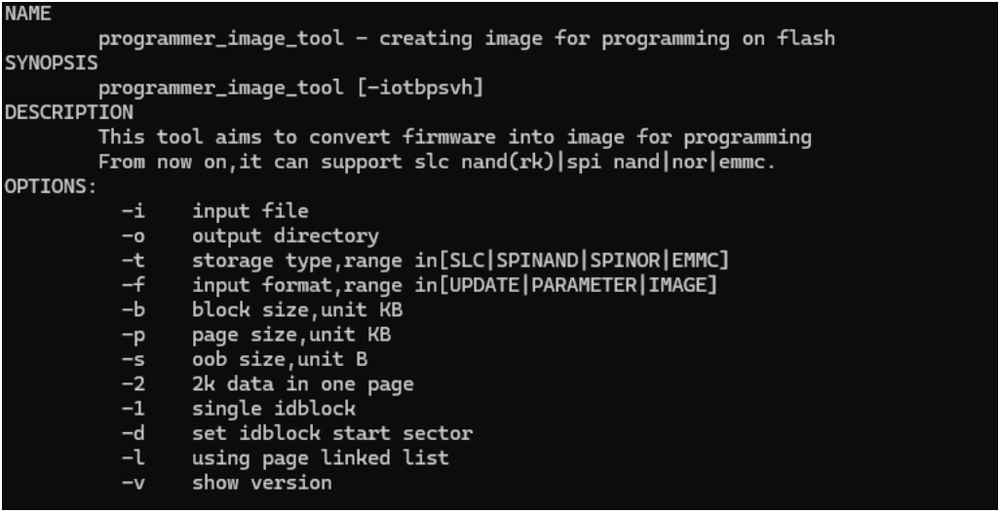




## programmer_image_tool: sämtliche Beispiele beider Handbücher

Die beiden `user_manual.pdf` gehören zu Linux 1.26 und Windows 1.28 und enthalten dieselben vier Befehle. Im Linux-Abschnitt usage description steht ein defekter lokaler Bildverweis; die Windows-Fassung enthält einen Hilfescreenshot, der unten neben allen Textbeispielen erhalten bleibt. Die Ausgabe sind Programmiergeräte-Abbilder; das Board wird dadurch nicht beschrieben.

### 1. eMMC

```text
./programmer_image_tool -i update.img -t emmc
```

Erzeugt `out_image.bin` im Programmverzeichnis.

### 2. SPI NOR

```text
./programmer_image_tool -i update.img -t spinor
```

Erzeugt ebenfalls `out_image.bin`, jedoch für SPI NOR; nicht mit der eMMC-Ausgabe austauschen.

### 3. SPI NAND: 256-KB-Block, 4-KB-Seite

```text
./programmer_image_tool -i update.img -b 256 -p 4 -t spinand -o out
```

Erzeugt nach Partitionen benannte Abbilder in `out`. Die Quelle schreibt den Platzhalter `partiiton_name.img`; gemeint ist der Partitionsname, kein vorgeschriebener Tippfehler.

### 4. SLC NAND: 256-KB-Block, 4-KB-Seite, 256-B-OOB

```text
./programmer_image_tool -i update.img -b 256 -p 4 -s 256 -t slc -2 -o rockdev
```

Erzeugt Partitionsabbilder in `rockdev`. Die Quellenüberschrift nennt zusätzlich `2k_page`, der Befehl jedoch `-p 4` und `-2`. Beides bleibt erhalten; die Hilfe unten bestätigt für `-2` 2k Daten je Seite, keine Änderung ihrer physischen Größe.

## Vollständige Optionen aus dem Hilfescreenshot

Der Windows-Screenshot bestätigt: `-2` bedeutet 2k Daten in einer Seite, nicht die Änderung von `-p 4` zu einer physischen 2-KB-Seite. Die kopierbare Übertragung folgt. SYNOPSIS nennt weniger Optionen als OPTIONS; diese Quellenabweichung bleibt erhalten.

<figure style="margin:1.6rem 0">
<a href="/assets/rockchip-tools/manuals/454e7646c90d/p01-f01.png" target="_blank" rel="noopener" aria-label="Bild in voller Größe öffnen"></a>
<figcaption style="margin-top:.6rem;font-size:.9em;line-height:1.55"><strong>Abbildung 1: Befehlshilfe für programmer_image_tool</strong></figcaption>
</figure>

```text
NAME
    programmer_image_tool - creating image for programming on flash
SYNOPSIS
    programmer_image_tool [-iotbpsvh]
DESCRIPTION
    This tool aims to convert firmware into image for programming
    From now on,it can support slc nand(rk)|spi nand|nor|emmc.
OPTIONS:
    -i    input file
    -o    output directory
    -t    storage type,range in[SLC|SPINAND|SPINOR|EMMC]
    -f    input format,range in[UPDATE|PARAMETER|IMAGE]
    -b    block size,unit KB
    -p    page size,unit KB
    -s    oob size,unit B
    -2    2k data in one page
    -1    single idblock
    -d    set idblock start sector
    -l    using page linked list
    -v    show version
```

<figure style="margin:1.6rem 0">
<a href="/assets/rockchip-tools/manuals/47ce51e919d3/p01-f01.png" target="_blank" rel="noopener" aria-label="Bild in voller Größe öffnen"></a>
<figcaption style="margin-top:.6rem;font-size:.9em;line-height:1.55"><strong>Abbildung 2: Optionen für Eingabeformat und idblock</strong></figcaption>
</figure>

## Geltungsbereich und Prüfung

Dieser Ablauf basiert auf der Dokumentation der Sammlung. Prüfen Sie Board, SoC, Trägerplatine, SDK/BSP und Host-Architektur. Flashen, Provisionieren, Registerschreiben und Hardwaretests wurden nicht ausgeführt. Ein verfügbares Paket belegt keine Unterstützung aller ArmSoM-Produkte.

## GitHub-Werkzeugverzeichnis, Versionen und SHA-256

Das passende GitHub-Verzeichnis öffnen, Host und Version wählen, Dateihash prüfen und vollständig entpacken. Die folgenden Links öffnen Repository-Verzeichnisse.

[Werkzeugverzeichnis auf GitHub öffnen](https://github.com/ArmSoM/rockchip-tools/tree/main/downloads/programmer-image-tool)

| Plattform / Version | Datei | SHA-256 |
|---|---|---|
| Linux / 1.26 | `programmer_image_tool_v1.26_linux.tar.gz` | `ea38df34e97cd697aa53d09af06fa1ff2b0847fe2c9699c49d1890509cc5c0d0` |
| Windows / 1.28 | `programmer_image_tool_v1.28.zip` | `696d07d8232a637ef59b724d0c0522e500fc9f26571c2633d96271ffce48e56f` |

[GitHub · catalog.json](https://github.com/ArmSoM/rockchip-tools/blob/main/catalog.json) · [SHA256SUMS](https://github.com/ArmSoM/rockchip-tools/blob/main/SHA256SUMS)

## Quellen und Originalabbildungen

- user_manual.pdf
- user_manual.pdf

## Verwandte Arbeitsabläufe

- [Firmware_Merger: Flat RK, Flat GPT und Compact GPT erstellen](/de/articles/rockchip-tool-firmware-merger/)
- [afptool und rkImageMaker: Rockchip update.img aufbauen und prüfen](/de/articles/rockchip-tool-firmware-pack-tools/)
- [Rockchip-Speicherleitfaden: Flash, Startablauf, Partitionen, Programmierung und Vendor Storage](/de/articles/099-rockchip-storage-application/)
- [Rockchip-Werkzeug- und Downloadübersicht](/de/articles/rockchip-tools-download-guide/)

## Passende ArmSoM-Boarddokumentation

Board- und Trägeranforderungen zunächst im Produkthandbuch prüfen. Diese Links dienen als Plattformreferenzen und belegen keine Validierung des Archivwerkzeugs auf diesen Produkten.

[ArmSoM Docs](https://docs.armsom.org/) · [Sige7](https://www.armsom.org/sige7) / [Docs](https://docs.armsom.org/armsom-sige7) · [CM5](https://www.armsom.org/cm5) / [Docs](https://docs.armsom.org/armsom-cm5)


