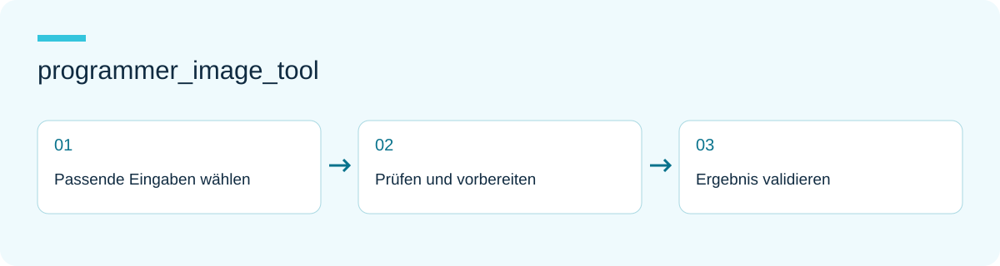





`programmer_image_tool` wandelt Firmware-Container in Dateien für Fertigungsprogrammer um. Es arbeitet auf dem Host und flasht kein Board direkt. Ausgabeformat und Parameter hängen vom Speichertyp ab.

## eMMC und SPI NOR

Die Originalbeispiele lauten:

```text
./programmer_image_tool -i update.img -t emmc
```

```text
./programmer_image_tool -i update.img -t spinor
```

Das Handbuch nennt dafür `out_image.bin`. Prüfen Sie, ob der Programmer dieses Rohformat erwartet und die Firmware zum Produkt passt.

## SPI NAND

```text
./programmer_image_tool -i update.img -b 256 -p 4 -t spinand -o out
```

`-b 256` bedeutet 256 KB Blockgröße, `-p 4` 4 KB Seitengröße. Das sind Geometriewerte, keine Leistungsoptionen. Die Ausgabe erfolgt in ein Verzeichnis und ist nicht beliebig mit einer eMMC-Datei austauschbar.

## SLC NAND

```text
./programmer_image_tool -i update.img -b 256 -p 4 -s 256 -t slc -2 -o rockdev
```

`-s 256` steht für 256 Byte spare/OOB. Die Originaloption `-2` bleibt erhalten; ihre vollständige Bedeutung fehlt im kurzen Handbuch. Klären Sie diese vor Fertigung mit passender Werkzeug-/Programmer-Dokumentation.

Dokumentieren Sie Firmware-Hash, Version, Flash-Baustein, Block-/Seiten-/OOB-Geometrie und Ausgaben. Bad-Block-, ECC-/OOB- und Boot-Platzierung müssen zum Programmer passen. Prüfen Sie ein Muster mit Rücklesen, soweit möglich, und Kaltstart.

Linux 1.26 und Windows 1.28 sind getrennte Pakete. Die Linux-Anleitung enthält einen defekten lokalen Bildverweis; das fehlende Bild wird nicht als wiederhergestellt ausgegeben. Zahlen sind Quellenbeispiele, keine validierten ArmSoM-Geometrien.

## Geltungsbereich und Prüfung

Dieser Ablauf basiert auf der Dokumentation der Sammlung. Prüfen Sie Board, SoC, Trägerplatine, SDK/BSP und Host-Architektur. Flashen, Provisionieren, Registerschreiben und Hardwaretests wurden nicht ausgeführt. Ein verfügbares Paket belegt keine Unterstützung aller ArmSoM-Produkte.

## Download, Versionen und SHA-256

Passendes Archiv laden, Hash prüfen und den vollständigen Ordner entpacken. Linux PinDebug zuerst nach verlinkter Anleitung zusammensetzen; der angegebene Hash gehört zur vollständigen Datei.

| Host / Version | Paket |
|---|---|
| Linux / 1.26 | [programmer_image_tool_v1.26_linux.tar.gz](https://raw.githubusercontent.com/ArmSoM/rockchip-tools/main/downloads/programmer-image-tool/programmer_image_tool_v1.26_linux.tar.gz) |
| Windows / 1.28 | [programmer_image_tool_v1.28.zip](https://raw.githubusercontent.com/ArmSoM/rockchip-tools/main/downloads/programmer-image-tool/programmer_image_tool_v1.28.zip) |

**programmer_image_tool_v1.26_linux.tar.gz — SHA-256**

```text
ea38df34e97cd697aa53d09af06fa1ff2b0847fe2c9699c49d1890509cc5c0d0
```

**programmer_image_tool_v1.28.zip — SHA-256**

```text
696d07d8232a637ef59b724d0c0522e500fc9f26571c2633d96271ffce48e56f
```

[GitHub · catalog.json](https://github.com/ArmSoM/rockchip-tools/blob/main/catalog.json) · [SHA256SUMS](https://github.com/ArmSoM/rockchip-tools/blob/main/SHA256SUMS)

## Quellen und Originalabbildungen

- programmer_image_tool 1.26 Linux / 1.28 Windows; both bundled usage PDFs
- [Original-PDF: user_manual.pdf](https://raw.githubusercontent.com/ArmSoM/rockchip-tools/main/manuals/454e7646c90d.pdf)
- [Original-PDF: user_manual.pdf](https://raw.githubusercontent.com/ArmSoM/rockchip-tools/main/manuals/47ce51e919d3.pdf)

## Verwandte Arbeitsabläufe

- [Firmware_Merger: Flat RK, Flat GPT und Compact GPT erstellen](/de/articles/rockchip-tool-firmware-merger/)
- [afptool und rkImageMaker: Rockchip update.img aufbauen und prüfen](/de/articles/rockchip-tool-firmware-pack-tools/)
- [Rockchip-Speicherleitfaden: Flash, Startablauf, Partitionen, Programmierung und Vendor Storage](/de/articles/099-rockchip-storage-application/)
- [Rockchip-Werkzeug- und Downloadübersicht](/de/articles/rockchip-tools-download-guide/)

## Passende ArmSoM-Boarddokumentation

Board- und Trägeranforderungen zunächst im Produkthandbuch prüfen. Diese Links dienen als Plattformreferenzen und belegen keine Validierung des Archivwerkzeugs auf diesen Produkten.

[ArmSoM Docs](https://docs.armsom.org/) · [Sige7](https://www.armsom.org/sige7) / [Docs](https://docs.armsom.org/armsom-sige7) · [CM5](https://www.armsom.org/cm5) / [Docs](https://docs.armsom.org/armsom-cm5)


