

## RKDevTool-Handbuch: Partitionen, Firmware und erweiterte Vorgänge

Verbunden werden die chinesischen/englischen Handbücher V1.2 von 2018 und das chinesische V1.0 von 2021 für Werkzeug 2.88. Die Nummerierung ist nicht chronologisch: V1.2 ist nicht neuer. Das Paket selbst ist ein Stand mit Release Notes 3.37. Chinesische Abbildungen stammen aus der chinesischen, die übrigen aus der englischen Vorlage; nur 2021 ergänzte Ansichten behalten chinesische Beschriftungen. Alle technischen Funktionen beider Fassungen folgen.

### 1. Konfiguration anlegen, importieren und exportieren

Im Downloadbereich per Rechtsklick eine `ParameterFile` importieren, um Partitionseinträge anzulegen. Unnötige Einträge löschen, Abbilder und Zielspeicher zuweisen (bei nur einem optional). Als `ConfigFile` zur Wiederverwendung exportieren. Vorgaben müssen nicht zum Projekt passen. `DEFAULT_IMAGE_CONFIG` in `Config.ini` legt die Startdatei fest; V1.2 beschreibt auch das Ersetzen von `config.cfg`. Nach Änderungen neu starten.

### 2. Boot laden oder Loader programmieren

Boot-Download in Maskrom führt die DDR-Initialisierung des Loaders aus und lädt usbplug in DDR, ohne den Speicher zu beschreiben. Loader in der ersten Zeile doppelt anklicken, `LoaderToDDR` wählen, markieren und ausführen. Für dauerhaftes Schreiben `Loader` wählen: IDBlock wird erzeugt und in Maskrom/Loader geschrieben. Bei Boot-Fehlern DDR-Lötstellen, SoC, Loader-Zuordnung und USB prüfen, vor Wiederholung neu starten. Für dauerhafte Schreibvorgänge zusätzlich Flash-Unterstützung, Lötstellen und Chip-Flag prüfen.

### 3. Partitionsabbilder und Gerätetabelle

In Loader/Maskrom verbinden, bei Maskrom Loader markieren. Über parameter Adressen/Größen laden, Abbilder und Speicher zuweisen, Partitionen markieren und ausführen. Nulladressen nicht als korrekt voraussetzen. Device partition table in V1.2 liest und lädt die vorhandene Gerätetabelle. Fehlende/belegte Dateien, zu große Abbilder und USB-Fehler getrennt beheben.

### 4. Gerätemodi und Geräteauswahl

Bei Erkennung als ADB, MSC, MTP oder UVC über Switch zu Rockusb wechseln. Loader lässt sich über Enter Maskrom umschalten. Bei mehreren Geräten zuerst das gewünschte im Auswahlfeld wählen.

### 5. Vollständiges update.img-Update

update.img auswählen, in Maskrom/Loader verbinden und Upgrade anklicken. V1.2 akzeptiert hier auch Loader-Dateien. Dateizugriff, Format/Beschädigung, Hash, Packer-Version, Partitionsgröße, Chip-Flag und Kommunikation prüfen. Sporadische Fehler auf Kabel-, reproduzierbare auf Geräteseite untersuchen.

### 6. Schreiben nach Adresse erzwingen

Force write by address aktivieren, Datei und Adresse festlegen, Eintrag markieren und ausführen. Das umgeht die normale Partitionsadressierung; tatsächliches Layout prüfen und keine falschen/zu großen Abbilder damit erzwingen.

### 7. Speicher löschen

Das Handbuch 2021 verlangt Maskrom und erfolgreichen Boot-Download vor dem Löschen. Sektorweises Löschen nennt nur eMMC, vollständiges `emmc|nor|nand`. Laut 2018 werden alle Blöcke einschließlich Systemblöcken vor der Firmware gelöscht. Das kann wiederholten Update-Fehlern vorausgehen, vernichtet aber Daten. Neuere SPI-Unterstützung der Kommandozeile nicht auf diese alte Oberfläche übertragen.

### 8. Chip-Informationen lesen

Chip information lesen; `Image Chip Flag` muss dem beim Packen von Loader/Firmware verwendeten Flag entsprechen. Bei Abweichung die richtigen Chipdateien vorbereiten.

### 9. Mehrere Speichertypen

In Maskrom Boot laden und Speicherliste lesen: Häkchen bedeutet aktuell, Kreuz nicht unterstützt, Kreis unterstützt. Einen Kreis-Eintrag wählen und Speicher umschalten.

### 10. Firmware entpacken

Entpackt wird nach `output`: `boot.bin` ist der enthaltene Loader, `firmware.img` die interne afptool-Firmware und `Android` deren entpackter Inhalt. Quelldateinamen bleiben erhalten.

### 11. GPT und Fähigkeiten

V1.2 akzeptiert parameter oder `partition_table.img` für GPT. Die parameter-Datei braucht `TYPE:GPT`; die letzte Partition verwendet `grow` für den Restplatz. `Read Capability` muss aktiviertes `DirectLBA` zeigen, sonst wird GPT nicht unterstützt.

### 12. Seriennummer löschen und Fehler prüfen

V1.2 löscht von der Unified-Library-Anwendung geschriebene Seriennummern. Bei fehlenden Download-Einträgen den Abbildpfad prüfen. Bei Downloadfehlern Treiber/Werkzeug aktualisieren, geschirmtes Kabel und hinteren PC-Port nutzen sowie Flash-Lötstellen, Defekte und Unterstützung prüfen. Verifikationsfehler erfordern Partitionsgrößen-, Flash-Mapping- und DDR-Stabilitätsprüfung; Löschen vor erneutem Versuch vernichtet Daten. Auf nichtchinesischen Systemen englischen Pfad verwenden, unter Windows 7/Vista als Administrator starten und nach Config.ini-Änderungen neu starten.

### Zusätzliche V1.2-Sprachunterschiede

Die englische Löschanleitung wählt zuerst update.img/loader.bin über Firmware, verbindet Maskrom/Loader und klickt EraseFlash; Chinesisch 2021 verlangt Maskrom und vorherigen Boot-Download. Nach konkreter Version vorgehen. Clear sn nennt englisch SN/MAC in IDBlock sector3, chinesisch die Seriennummer der Unified-Library-Anwendung. Englisch empfiehlt Werkzeug/Loader-Updates, chinesisch Rockusb/Werkzeug; beides prüfen. Englisch verlangt ein Administratorkonto allgemein, chinesisch nennt Win7/Vista ausdrücklich.

## Geltungsbereich und Prüfung

Dieser Ablauf basiert auf der Dokumentation der Sammlung. Prüfen Sie Board, SoC, Trägerplatine, SDK/BSP und Host-Architektur. Flashen, Provisionieren, Registerschreiben und Hardwaretests wurden nicht ausgeführt. Ein verfügbares Paket belegt keine Unterstützung aller ArmSoM-Produkte.

## GitHub-Werkzeugverzeichnis, Versionen und SHA-256

Das passende GitHub-Verzeichnis öffnen, Host und Version wählen, Dateihash prüfen und vollständig entpacken. Die folgenden Links öffnen Repository-Verzeichnisse.

[Werkzeugverzeichnis auf GitHub öffnen](https://github.com/ArmSoM/rockchip-tools/tree/main/downloads/rkdevtool)

| Plattform / Version | Datei | SHA-256 |
|---|---|---|
| Windows / 3.37 release notes | `RKDevTool-windows-directory-snapshot.zip` | `d453bd22c00141f12ef39469629d478aa61304763bdb2977288d6f019a74f20c` |

[GitHub · catalog.json](https://github.com/ArmSoM/rockchip-tools/blob/main/catalog.json) · [SHA256SUMS](https://github.com/ArmSoM/rockchip-tools/blob/main/SHA256SUMS)

## Quellen und Originalabbildungen

- RKDevTool_manual_v1.2_cn.pdf
- RKDevTool_manual_v1.2_en.pdf
- 开发工具使用说明_v1.0.pdf

### Originaloberflächen und Diagramme des Handbuchs

Oberflächen behalten ihre Quellsprache. Englische Originale werden verwendet, soweit vorhanden; zusätzliche Ansichten ohne englische Vorlage bleiben chinesisch. Werte sind Handbuchbeispiele, keine aktuellen Boardmessungen.

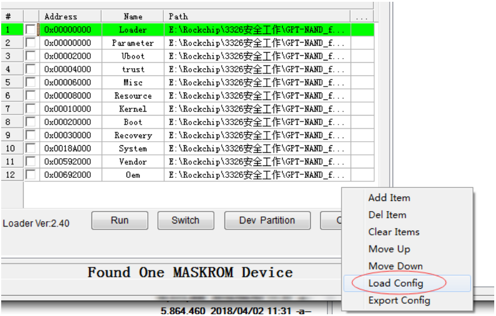

RKDevTool_manual_v1.2_en.pdf · p. 4

RKDevTool_manual_v1.2_en.pdf · p. 5

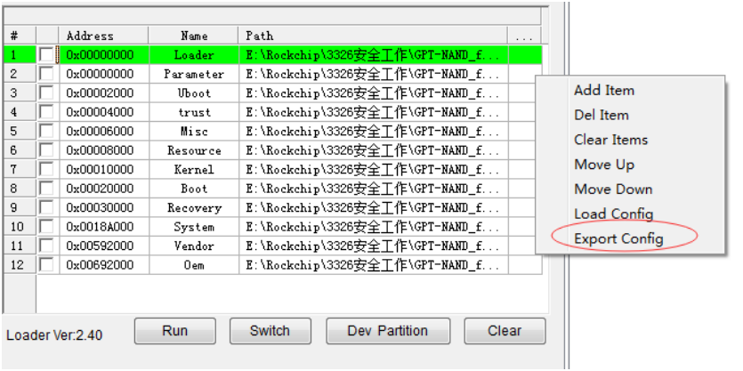

RKDevTool_manual_v1.2_en.pdf · p. 5

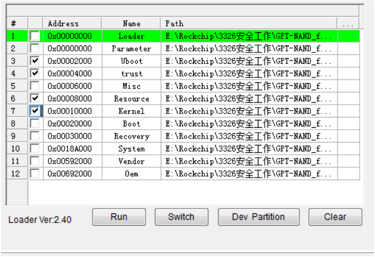

RKDevTool_manual_v1.2_en.pdf · p. 6

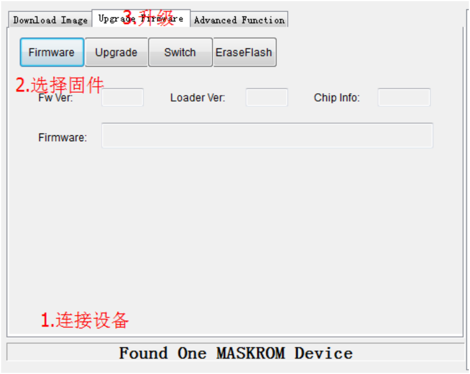

RKDevTool_manual_v1.2_en.pdf · p. 7

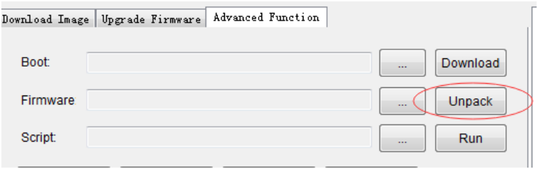

RKDevTool_manual_v1.2_en.pdf · p. 8

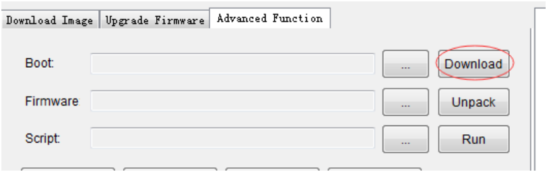

RKDevTool_manual_v1.2_en.pdf · p. 8

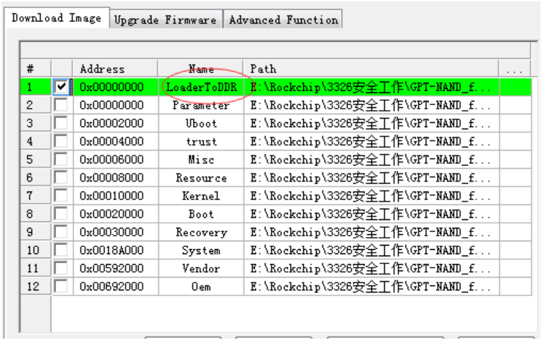

RKDevTool_manual_v1.2_en.pdf · p. 8

RKDevTool_manual_v1.2_en.pdf · p. 9

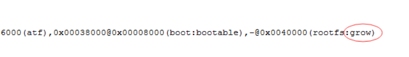

RKDevTool_manual_v1.2_en.pdf · p. 9

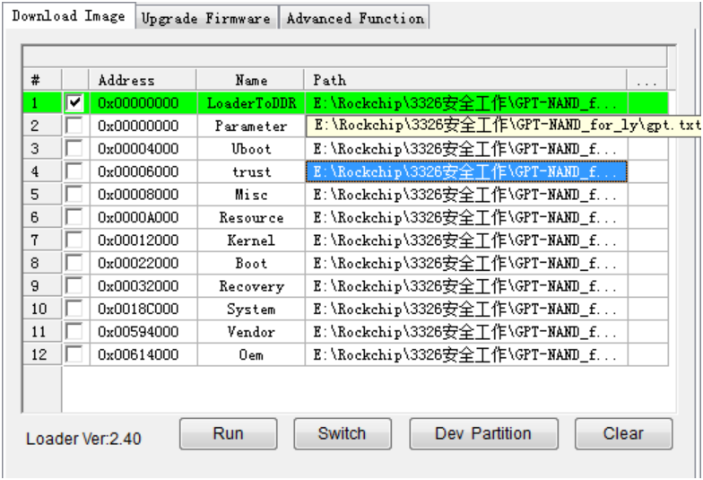

RKDevTool_manual_v1.2_en.pdf · p. 9

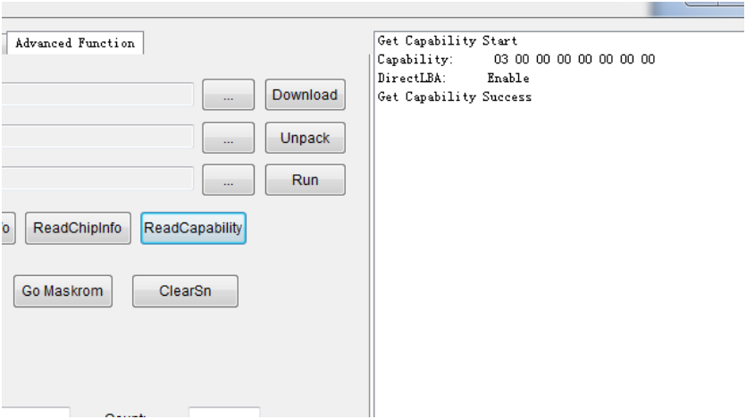

RKDevTool_manual_v1.2_en.pdf · p. 10

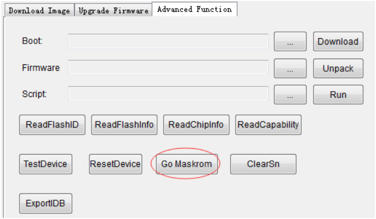

RKDevTool_manual_v1.2_en.pdf · p. 10

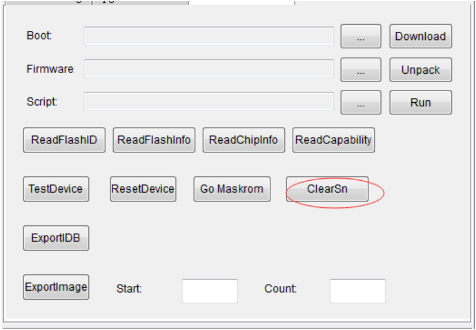

RKDevTool_manual_v1.2_en.pdf · p. 11

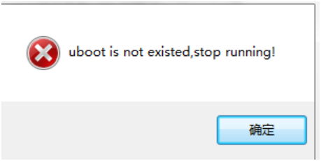

RKDevTool_manual_v1.2_en.pdf · p. 11

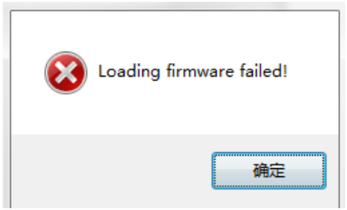

RKDevTool_manual_v1.2_en.pdf · p. 12

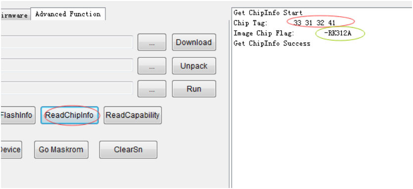

RKDevTool_manual_v1.2_en.pdf · p. 12

RKDevTool_manual_v1.2_en.pdf · p. 12

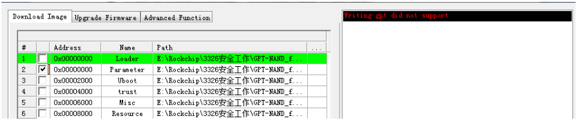

RKDevTool_manual_v1.2_en.pdf · p. 13

开发工具使用说明_v1.0.pdf · p. 2

开发工具使用说明_v1.0.pdf · p. 2

开发工具使用说明_v1.0.pdf · p. 3

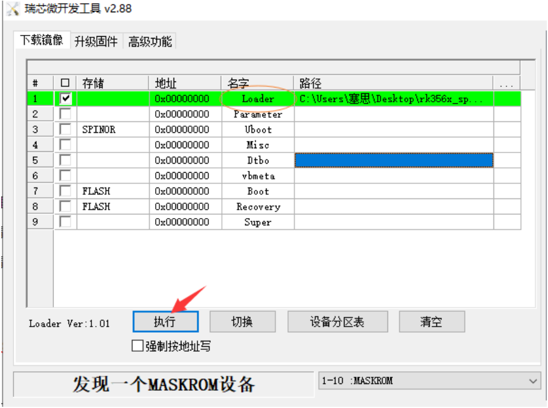

开发工具使用说明_v1.0.pdf · p. 4

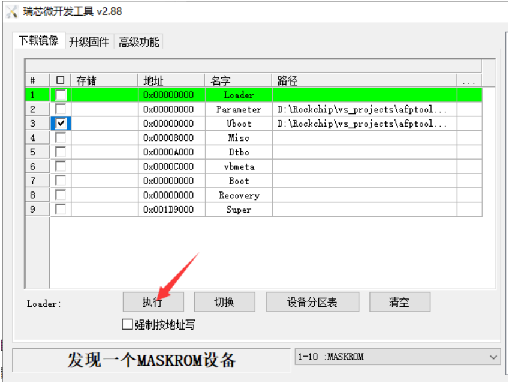

开发工具使用说明_v1.0.pdf · p. 5

开发工具使用说明_v1.0.pdf · p. 5

开发工具使用说明_v1.0.pdf · p. 6

开发工具使用说明_v1.0.pdf · p. 7

开发工具使用说明_v1.0.pdf · p. 8

开发工具使用说明_v1.0.pdf · p. 9

开发工具使用说明_v1.0.pdf · p. 9

开发工具使用说明_v1.0.pdf · p. 10

开发工具使用说明_v1.0.pdf · p. 11

开发工具使用说明_v1.0.pdf · p. 11

## Verwandte Arbeitsabläufe

- [Rockchip-Speicherleitfaden: Flash, Startablauf, Partitionen, Programmierung und Vendor Storage](/de/articles/099-rockchip-storage-application/)
- [DriverAssitant 5.13: Rockusb- und ADB-Treiber unter Windows](/de/articles/rockchip-tool-driver-assistant/)
- [upgrade_tool: Rockchip-Firmware per Kommandozeile schreiben](/de/articles/rockchip-tool-upgrade-tool/)
- [Rockchip-Werkzeug- und Downloadübersicht](/de/articles/rockchip-tools-download-guide/)

## Passende ArmSoM-Boarddokumentation

Board- und Trägeranforderungen zunächst im Produkthandbuch prüfen. Diese Links dienen als Plattformreferenzen und belegen keine Validierung des Archivwerkzeugs auf diesen Produkten.

[ArmSoM Docs](https://docs.armsom.org/) · [Sige7](https://www.armsom.org/sige7) / [Docs](https://docs.armsom.org/armsom-sige7) · [CM5](https://www.armsom.org/cm5) / [Docs](https://docs.armsom.org/armsom-cm5)


