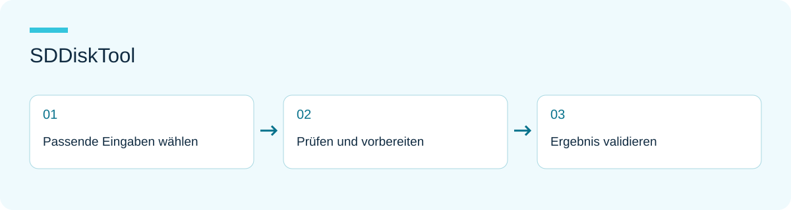



SDDiskTool erstellt unterschiedliche Rockchip-Medien: Upgrade Firmware, PCBA Test und SD Boot. Das entspricht nicht dem allgemeinen Schreiben beliebiger Linux-Datenträgerabbilder.

## Zielverhalten bestimmen

SD Boot bereitet ein unterstütztes Startmedium vor. Eine Update-Karte kann den Boardspeicher beschreiben; PCBA-Medien gehören zum Testablauf. Klären Sie vor dem Einsetzen, was der Bootloader ausführt. Kartenerstellung und Board-Update sind getrennte Schritte.

## Vorgehen

1. Eine löschbare Karte anhand von Kapazität und Gerätekennung bestimmen, nicht nur am Laufwerksbuchstaben.
2. Wechseldatenträger, Funktionsmodus und passende Firmware auswählen.
3. Benötigte SDK-Dateien bereitstellen; fehlende `SDBoot.bin` und `sd_boot_config.config` haben eigene Fehlermeldungen.
4. Vor Create das Ziel erneut prüfen: Die Bestätigung weist auf Datenverlust hin.
5. Nach Erfolg sicher auswerfen und Board-Bootreihenfolge sowie Einschaltablauf beachten.

## Fehler und Abnahme

Fehlendes Medium, Sperr-/Unmount-Probleme, fehlende Firmware und Formatierungsfehler sind verschiedene Stufen. Schließen Sie Programme, die das Volume verwenden. Restore löscht ebenfalls Karteninhalte und stellt keine alten Board-Daten wieder her.

1.78 korrigiert einen Adresszugriffsfehler bei Backup-GPT; ältere Änderungen betreffen wachsende Partitionen und große Abbilder. Das bestätigt keine pauschale Kompatibilität. Prüfen Sie tatsächlichen Start oder Update und halten Sie einen Recovery-Weg bereit.

## Geltungsbereich und Prüfung

Dieser Ablauf basiert auf der Dokumentation der Sammlung. Prüfen Sie Board, SoC, Trägerplatine, SDK/BSP und Host-Architektur. Flashen, Provisionieren, Registerschreiben und Hardwaretests wurden nicht ausgeführt. Ein verfügbares Paket belegt keine Unterstützung aller ArmSoM-Produkte.

## GitHub-Werkzeugverzeichnis, Versionen und SHA-256

Das passende GitHub-Verzeichnis öffnen, Host und Version wählen, Dateihash prüfen und vollständig entpacken. Die folgenden Links öffnen Repository-Verzeichnisse.

[Werkzeugverzeichnis auf GitHub öffnen](https://github.com/ArmSoM/rockchip-tools/tree/main/downloads/sd-disk-tool)

| Plattform / Version | Datei | SHA-256 |
|---|---|---|
| Windows / 1.78 | `SDDiskTool_v1.78.zip` | `4b4a8349c102b2b791ce2ae6f179c94aa81962e788df7232b603e9bb76549d08` |

[GitHub · catalog.json](https://github.com/ArmSoM/rockchip-tools/blob/main/catalog.json) · [SHA256SUMS](https://github.com/ArmSoM/rockchip-tools/blob/main/SHA256SUMS)

## Quellen und Originalabbildungen

- SDDiskTool_v1.78.zip: English.ini and revision.txt; Rockchip SD-card boot guide

## Verwandte Arbeitsabläufe

- [Rockchip-SD-Boot: Upgrade-, Boot- und Reparaturkarten sowie BCB](/de/articles/087-rockchip-sd-card-boot/)
- [RKDevTool: Download, Loader, Partitionen und update.img](/de/articles/rockchip-tool-rkdevtool/)
- [Rockchip-Werkzeug- und Downloadübersicht](/de/articles/rockchip-tools-download-guide/)

## Passende ArmSoM-Boarddokumentation

Board- und Trägeranforderungen zunächst im Produkthandbuch prüfen. Diese Links dienen als Plattformreferenzen und belegen keine Validierung des Archivwerkzeugs auf diesen Produkten.

[ArmSoM Docs](https://docs.armsom.org/) · [Sige7](https://www.armsom.org/sige7) / [Docs](https://docs.armsom.org/armsom-sige7) · [CM5](https://www.armsom.org/cm5) / [Docs](https://docs.armsom.org/armsom-cm5)


