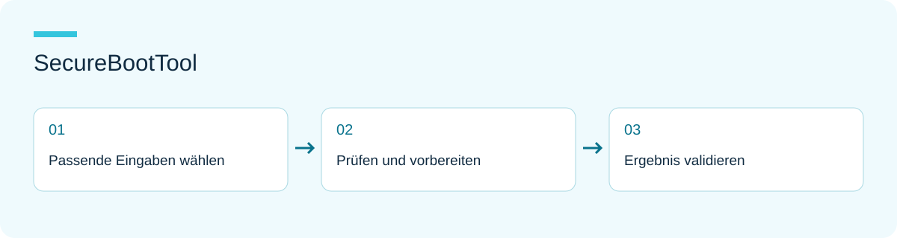





SecureBootTool gehört zu einer älteren Rockchip-Sicherheitslösung. Die Anwendungsschrift behandelt Signierung, eFuse, Updates und Tests, ist aber keine fertige Lösung für alle heutigen ArmSoM-Boards.

## Plattformgrenzen

V1.2 von 2016 nennt RK3126, RK3128, RK3228, RK3288 und RK3368 sowie innerhalb dieses Ansatzes miniloader 2.19 und U-Boot 2.17 oder neuer. Diese Angaben gelten nicht pauschal als Mindestversion moderner SDKs. Auch ein Linux-Quellordner beweist nicht die Host-Architektur des Programms.

## Vier getrennte Schritte

1. SoC-Vertrauenskette, Schlüsselaufbewahrung, Update- und Recovery-Richtlinie festlegen.
2. Freigegebene Schlüssel vorbereiten und alle erforderlichen Boot-Dateien passend signieren.
3. Signaturen, Start und Update bei noch verfügbarem Recovery testen.
4. Erst nach dem produktspezifischen Verfahren Schlüsselhashes oder einmalige Zustände festschreiben.

Dokumentieren Sie Board-Revision, SDK, ROM-/Loader-Schema, Schlüsselkennung, Datei-Hashes, Provisionierungszustand und Recovery-Ergebnis. Geheimschlüssel separat aufbewahren. Eine Erfolgsmeldung der Oberfläche belegt keine vollständige Authentisierung aller Boot-Stufen.

Für aktuelle Linux-Plattformen gelten neuere Dokumentation und konkreter BSP. Vermischen Sie alte GUI-Abläufe nicht mit neuen OTP-Belegungen oder Zertifikatsformaten. Dies ist eine Einordnung des Archivwerkzeugs, keine universelle Fuse-Anleitung.

## Geltungsbereich und Prüfung

Dieser Ablauf basiert auf der Dokumentation der Sammlung. Prüfen Sie Board, SoC, Trägerplatine, SDK/BSP und Host-Architektur. Flashen, Provisionieren, Registerschreiben und Hardwaretests wurden nicht ausgeführt. Ein verfügbares Paket belegt keine Unterstützung aller ArmSoM-Produkte.

## Download, Versionen und SHA-256

Passendes Archiv laden, Hash prüfen und den vollständigen Ordner entpacken. Linux PinDebug zuerst nach verlinkter Anleitung zusammensetzen; der angegebene Hash gehört zur vollständigen Datei.

| Host / Version | Paket |
|---|---|
| Host to verify / 1.85 | [SecureBootTool_v1.85_foruser.zip](https://raw.githubusercontent.com/ArmSoM/rockchip-tools/main/downloads/secureboot-tool/SecureBootTool_v1.85_foruser.zip) |

**SecureBootTool_v1.85_foruser.zip — SHA-256**

```text
d241ccc7503a3202c68a036f51cdd7f5d2db2a7594eb749ec19e2ffb2c67681a
```

[GitHub · catalog.json](https://github.com/ArmSoM/rockchip-tools/blob/main/catalog.json) · [SHA256SUMS](https://github.com/ArmSoM/rockchip-tools/blob/main/SHA256SUMS)

## Quellen und Originalabbildungen

- SecureBootTool_v1.85_foruser.zip; Rockchip Secure Boot Application Note V1.2 (2016)
- [Original-PDF: Rockchip Secure Boot Application Note_v1.2_20160202.pdf](https://raw.githubusercontent.com/ArmSoM/rockchip-tools/main/manuals/094883c784c1.pdf)

## Verwandte Arbeitsabläufe

- [Vollständiger Rockchip-Secure-Boot-Leitfaden: Signierung, eFuse, OTP und Prüfung](/de/articles/105-rockchip-secure-boot/)
- [Entwicklerleitfaden für Rockchip Linux Secure Boot](/de/articles/203-rockchip-linux-secure-boot/)
- [rk_sign_tool und sign_tool: Rockchip-Firmware signieren und prüfen](/de/articles/rockchip-tool-rk-sign-tool/)
- [EfuseTool 1.42: eine nachvollziehbare Provisionierungsstation vorbereiten](/de/articles/rockchip-tool-efuse-tool/)
- [Rockchip-Werkzeug- und Downloadübersicht](/de/articles/rockchip-tools-download-guide/)

## Passende ArmSoM-Boarddokumentation

Board- und Trägeranforderungen zunächst im Produkthandbuch prüfen. Diese Links dienen als Plattformreferenzen und belegen keine Validierung des Archivwerkzeugs auf diesen Produkten.

[ArmSoM Docs](https://docs.armsom.org/) · [Sige7](https://www.armsom.org/sige7) / [Docs](https://docs.armsom.org/armsom-sige7) · [CM5](https://www.armsom.org/cm5) / [Docs](https://docs.armsom.org/armsom-cm5)


