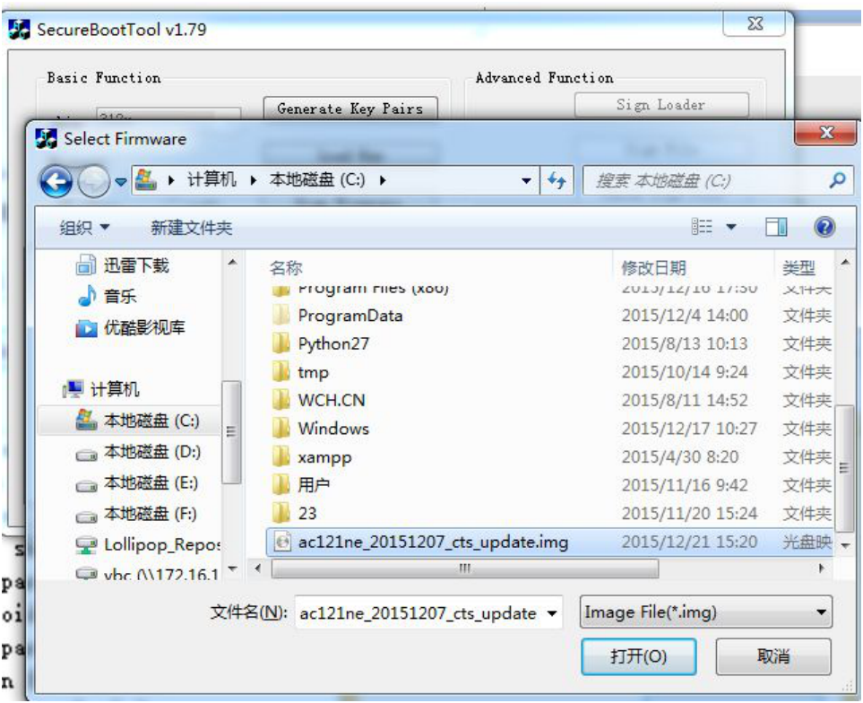
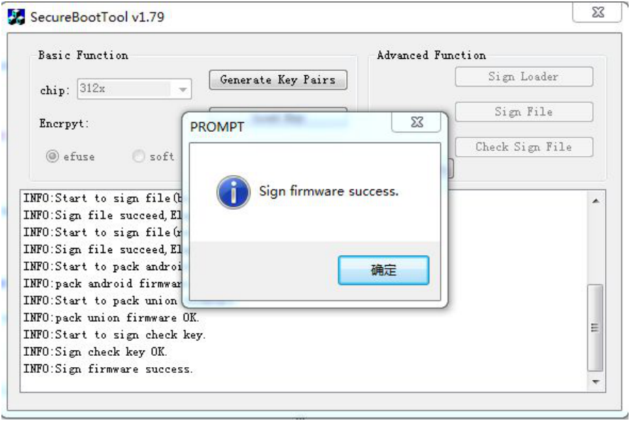
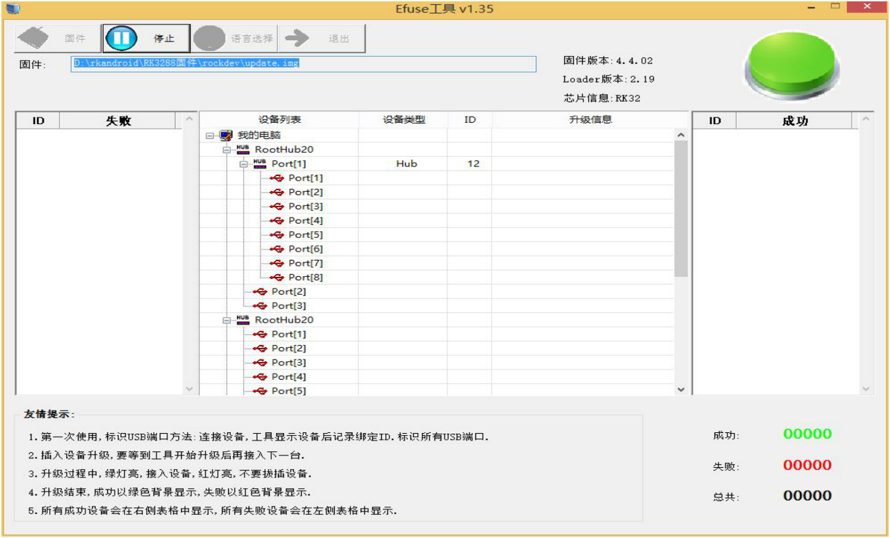




## Historische Secure-Boot-Anwendungshinweise V1.2

Das Handbuch von 2016 nennt RK3126, RK3128, RK3228, RK3288 und RK3368; es ist keine allgemeine RK35xx-Konfiguration. Funktionen: Secure Boot ROM, SHA256/SHA160, RSA2048/RSA1024, OTP-Prüfung öffentlicher RSA-Schlüssel und Secure-Boot-Rockusb-Updates. Mindestversionen: Miniloader 2.19, U-Boot 2.17, EfuseTool 1.35, SecureBootTool 1.75 und RKBatchTool 1.8.

### 1. Vertrauenskette und Signierkonfiguration

Die Originalgrafik unten zeigt Prüfungen von ROM und Boot-Stufen. Im Windows-Werkzeug Chip wählen, für Vorgänger von 3188 others, dann eFuse- oder Softwaremodus. Die Quelle nennt eFuse-Unterstützung für 3128, 3288, 3228 und 3368, nicht für andere ältere Chips. Die GUI-Bezeichnung encryption darf nicht mit Vertraulichkeit durch Signaturprüfung verwechselt werden.

3188 und ältere verwenden loaderex=false und 1024-Bit-Schlüssel. Für 3128/3288/3228/3368 folgende Konfiguration mit den genannten Mindestversionen nutzen. Zulässig sind nur 1024 und 2048.

```ini
[Options]
Loaderex=true
Key=2048
```

### 2. RSA-Schlüssel erzeugen, sichern und laden

Die Quelle verlangt ein Schlüsselpaar pro Produktmodell, das für spätere Firmware weiterverwendet und zusätzlich gesichert wird. Erzeugen, bestätigen, speichern und von dort laden. OpenSSL-`.pem`-RSA2048 wird unterstützt. Schlüsselverlust kann signierte Updates und Wiederherstellung verhindern. Die Screenshots zeigen den Ablauf, kein Produktions-Schlüsselmanagement.

### 3. Firmware vorbereiten und signieren

boot.img und recovery.img müssen beide den Kernel enthalten. Der Terminal-Screenshot zeigt folgendes RK3288-Android-4.4-Beispiel; NAND-Firmware benötigt außerdem miniloader und uboot.img. Gesicherten RSA-Schlüssel laden, Firmware wählen und signieren, Erfolg festhalten. Die doppelte Abschnittsnummer 3.5 der Vorlage ist hier nach Ablauf geordnet.

```text
./mkimage.sh ota
TARGET_PRODUCT=rk3288
TARGET_HARDWARE=rk30board
system filesystem is ext4
make ota images...
create boot.img with kernel... done.
create recovery.img with kernel... done.
create misc.img.... done.
```

### 4. eFuse programmieren

eFuse-Werkzeug öffnen, signierte Produktionsfirmware wählen und Start drücken. Ein leeres Gerät startet per USB in `maskromrockusb`, worauf die automatische Programmierung beginnt; mehrere Geräte werden unterstützt. RK312X benötigt eine Vorrichtung mit separater eFuse-Versorgung, RK3288 besitzt softwaregesteuerte Versorgung. Vor einer Serie ein Gerät programmieren, vollständige signierte Firmware aufspielen und alle Funktionen prüfen. eFuse ist irreversible Provisionierung, kein unbedenklicher Versuch an einem normalen Board.

### 5. Aktualisieren und prüfen

Signierte Firmware mit passendem Produktionstool aktualisieren. Ohne eFuse-Programmierung wird dieser Secure Boot laut Vorlage nicht aktiviert. Beim Negativtest mit unsignierter Firmware soll der Start scheitern, das Gerät in `maskromrockusb` bleiben und nach Loader-Update einen Werkzeugfehler zeigen. Die folgenden Screenshots sind Quellenbelege, keine ArmSoM-Tests.

### 6. Häufige Fehler

Bei eFuse-Fehlern Versorgung und bereits erfolgte Programmierung prüfen. Nicht durch wiederholtes Schreiben testen; Schlüssel, Firmware-Version, Zielchip und Ablaufprotokoll sichern und mit der Chipdokumentation abgleichen.

## Geltungsbereich und Prüfung

Dieser Ablauf basiert auf der Dokumentation der Sammlung. Prüfen Sie Board, SoC, Trägerplatine, SDK/BSP und Host-Architektur. Flashen, Provisionieren, Registerschreiben und Hardwaretests wurden nicht ausgeführt. Ein verfügbares Paket belegt keine Unterstützung aller ArmSoM-Produkte.

## GitHub-Werkzeugverzeichnis, Versionen und SHA-256

Das passende GitHub-Verzeichnis öffnen, Host und Version wählen, Dateihash prüfen und vollständig entpacken. Die folgenden Links öffnen Repository-Verzeichnisse.

[Werkzeugverzeichnis auf GitHub öffnen](https://github.com/ArmSoM/rockchip-tools/tree/main/downloads/secureboot-tool)

| Plattform / Version | Datei | SHA-256 |
|---|---|---|
| Host to verify / 1.85 | `SecureBootTool_v1.85_foruser.zip` | `d241ccc7503a3202c68a036f51cdd7f5d2db2a7594eb749ec19e2ffb2c67681a` |

[GitHub · catalog.json](https://github.com/ArmSoM/rockchip-tools/blob/main/catalog.json) · [SHA256SUMS](https://github.com/ArmSoM/rockchip-tools/blob/main/SHA256SUMS)

## Quellen und Originalabbildungen

- Rockchip Secure Boot Application Note_v1.2_20160202.pdf

### Originaloberflächen und Diagramme des Handbuchs

Oberflächen behalten ihre Quellsprache. Englische Originale werden verwendet, soweit vorhanden; zusätzliche Ansichten ohne englische Vorlage bleiben chinesisch. Werte sind Handbuchbeispiele, keine aktuellen Boardmessungen.


Rockchip Secure Boot Application Note_v1.2_20160202.pdf · p. 5


Rockchip Secure Boot Application Note_v1.2_20160202.pdf · p. 6


Rockchip Secure Boot Application Note_v1.2_20160202.pdf · p. 7


Rockchip Secure Boot Application Note_v1.2_20160202.pdf · p. 7


Rockchip Secure Boot Application Note_v1.2_20160202.pdf · p. 7


Rockchip Secure Boot Application Note_v1.2_20160202.pdf · p. 9


Rockchip Secure Boot Application Note_v1.2_20160202.pdf · p. 10


Rockchip Secure Boot Application Note_v1.2_20160202.pdf · p. 11


Rockchip Secure Boot Application Note_v1.2_20160202.pdf · p. 12



Rockchip Secure Boot Application Note_v1.2_20160202.pdf · p. 13



Rockchip Secure Boot Application Note_v1.2_20160202.pdf · p. 14


Rockchip Secure Boot Application Note_v1.2_20160202.pdf · p. 15


Rockchip Secure Boot Application Note_v1.2_20160202.pdf · p. 16



Rockchip Secure Boot Application Note_v1.2_20160202.pdf · p. 17


Rockchip Secure Boot Application Note_v1.2_20160202.pdf · p. 18


Rockchip Secure Boot Application Note_v1.2_20160202.pdf · p. 20


Rockchip Secure Boot Application Note_v1.2_20160202.pdf · p. 21


Rockchip Secure Boot Application Note_v1.2_20160202.pdf · p. 22

## Verwandte Arbeitsabläufe

- [Vollständiger Rockchip-Secure-Boot-Leitfaden: Signierung, eFuse, OTP und Prüfung](/de/articles/105-rockchip-secure-boot/)
- [Entwicklerleitfaden für Rockchip Linux Secure Boot](/de/articles/203-rockchip-linux-secure-boot/)
- [rk_sign_tool und sign_tool: Rockchip-Firmware signieren und prüfen](/de/articles/rockchip-tool-rk-sign-tool/)
- [EfuseTool 1.42: eine nachvollziehbare Provisionierungsstation vorbereiten](/de/articles/rockchip-tool-efuse-tool/)
- [Rockchip-Werkzeug- und Downloadübersicht](/de/articles/rockchip-tools-download-guide/)

## Passende ArmSoM-Boarddokumentation

Board- und Trägeranforderungen zunächst im Produkthandbuch prüfen. Diese Links dienen als Plattformreferenzen und belegen keine Validierung des Archivwerkzeugs auf diesen Produkten.

[ArmSoM Docs](https://docs.armsom.org/) · [Sige7](https://www.armsom.org/sige7) / [Docs](https://docs.armsom.org/armsom-sige7) · [CM5](https://www.armsom.org/cm5) / [Docs](https://docs.armsom.org/armsom-cm5)


