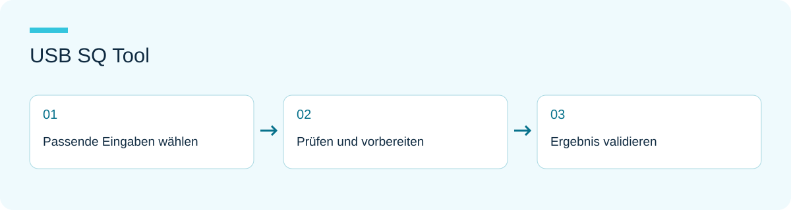
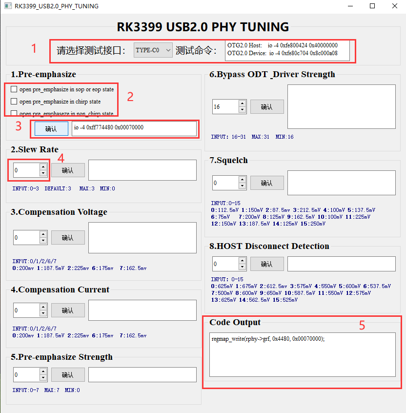



**Download vorläufig ausgesetzt.** Windows Defender meldete `Trojan:Win32/Pomal!rfn` für USB SQ 1.5 und isolierte die Datei; eine Ausführung wurde nicht registriert. Die Herstellerprüfung steht aus. Schutz nicht deaktivieren und keinen historischen Git-Download ausführen. [Status](https://github.com/ArmSoM/rockchip-tools/blob/main/SECURITY-REVIEW.md). Anleitung und PDF bleiben Referenzen; der Hash identifiziert das zurückgehaltene Paket.



USB SQ Tool erzeugt Prüfkommandos, Registerwerte und PHY-Treiberbeispiele. Es hilft bei signalbedingten Enumerations- und Verbindungsproblemen, ersetzt aber keine guten Kabel oder saubere Leiterplattenführung.

## Erst messen

Prüfen Sie Kabel, Impedanz, Steckverbinder, Versorgung und Port. Erfassen Sie mit geeigneter Messtechnik ein Augendiagramm und dokumentieren Sie Fehlerbedingungen sowie ursprüngliche PHY-Werte.

## Plattformseite verwenden

1. Unterstützten SoC und Port exakt wählen; USB2.0- und USB3.1-Listen unterscheiden sich.
2. Die vorgegebene Reihenfolge beachten und jeweils einen Parameter ändern.
3. Angeforderte ursprüngliche Registerwerte vom Board lesen. Beim RK3568-Beispiel fehlen High-Word-Write-Enable-Bits, weshalb unveränderte Bits erhalten bleiben müssen.
4. Auswahl bestätigen, I/O-Kommando und Code Output gegen den BSP prüfen.
5. Erneut messen und nur wirksame Änderungen ohne Regression übernehmen.

Pre-emphasis, Augenhöhe, Slew Rate und ODT betreffen den Sender; Squelch betrifft Empfängerschwellen. Host Disconnect und B-session-valid prüfen unterschiedliche Erkennungspfade. Größere Werte sind nicht grundsätzlich besser. Registeradressen anderer SoCs dürfen nicht übernommen werden.

Der erzeugte Code ist eine Treiberreferenz, kein universeller Patch. Nach dem Kernel-Build Start, Hot-Plug, Geschwindigkeiten und reale Geräte erneut prüfen.

Dieses Paket enthält Werkzeug 1.5 und Handbuch V1.4.0. Der vorhandene ausführliche Blog-Beitrag verwendet V1.8.0 mit zusätzlichen Plattformen. Diese Grenzen bleiben getrennt; der Download ist kein Konformitätsnachweis.

## Geltungsbereich und Prüfung

Dieser Ablauf basiert auf der Dokumentation der Sammlung. Prüfen Sie Board, SoC, Trägerplatine, SDK/BSP und Host-Architektur. Flashen, Provisionieren, Registerschreiben und Hardwaretests wurden nicht ausgeführt. Ein verfügbares Paket belegt keine Unterstützung aller ArmSoM-Produkte.

## Download, Versionen und SHA-256

Passendes Archiv laden, Hash prüfen und den vollständigen Ordner entpacken. Linux PinDebug zuerst nach verlinkter Anleitung zusammensetzen; der angegebene Hash gehört zur vollständigen Datei.

| Host / Version | Paket |
|---|---|
| Windows / 1.5 | [Download ausgesetzt — Status](https://github.com/ArmSoM/rockchip-tools/blob/main/SECURITY-REVIEW.md) |

**Rockchip_USB_SQ_Tool_V1.5.7z — SHA-256**

```text
9b2ca5e6773bcb88e2bd73c57044ca16c1f2e16d81b1f010569724cb66550b37
```

[GitHub · catalog.json](https://github.com/ArmSoM/rockchip-tools/blob/main/catalog.json) · [SHA256SUMS](https://github.com/ArmSoM/rockchip-tools/blob/main/SHA256SUMS)

## Quellen und Originalabbildungen

- Rockchip_Introduction_USB_SQ_Tool_CN_V1.4.0.pdf, bundled in tool 1.5; existing article based on V1.8.0 is separate
- [Original-PDF: Rockchip_Introduction_USB_SQ_Tool_CN_V1.4.0.pdf](https://raw.githubusercontent.com/ArmSoM/rockchip-tools/main/manuals/0ec9ef065fdc.pdf)

Abbildungen stammen aus den angegebenen PDFs. Existiert nur eine chinesische Vorlage, bleiben deren Oberflächentexte erhalten; Bildunterschriften sind übersetzt. Es sind historische Beispiele, keine ArmSoM-Testergebnisse.



Rockchip_Introduction_USB_SQ_Tool_CN_V1.4.0.pdf · p. 5

## Verwandte Arbeitsabläufe

- [Rockchip USB SQ Tool: USB2.0-/USB3.1-PHY-Abstimmung und Codeintegration](/de/articles/165-rockchip-usb-sq-tool/)
- [PinDebug: IOMUX, GPIO und Spannungsdomänen auf Rockchip prüfen](/de/articles/rockchip-tool-pin-debug/)
- [Rockchip-Werkzeug- und Downloadübersicht](/de/articles/rockchip-tools-download-guide/)

## Passende ArmSoM-Boarddokumentation

Board- und Trägeranforderungen zunächst im Produkthandbuch prüfen. Diese Links dienen als Plattformreferenzen und belegen keine Validierung des Archivwerkzeugs auf diesen Produkten.

[ArmSoM Docs](https://docs.armsom.org/) · [Sige7](https://www.armsom.org/sige7) / [Docs](https://docs.armsom.org/armsom-sige7) · [CM5](https://www.armsom.org/cm5) / [Docs](https://docs.armsom.org/armsom-cm5)


