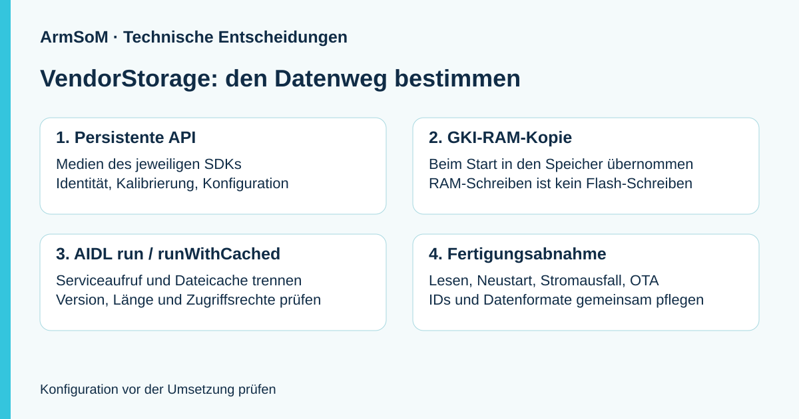

**VendorStorage eignet sich für kleine Identitäts-, Kalibrier- und Fertigungsdatensätze. Ein erfolgreicher API-Aufruf beweist jedoch nicht zwingend Persistenz.** Zuerst müssen echter Medienzugriff, GKI-RAM-Kopie und Dateicache eines Android-Dienstes unterschieden werden.

Dieser ArmSoM-Leitfaden verarbeitet das bereitgestellte Android-16-AIDL-V2-Beispiel. Die passende neue SDK-Implementierung wurde hier nicht beschafft und kompiliert. Die Namen sind deshalb mit dem Zielbranch abzugleichen. Ältere APIs beschreibt der vorhandene Artikel [Vendor Storage V1.3](/de/articles/100-rockchip-vendor-storage-v13/).



## 1. Den richtigen Datenweg wählen

| Umgebung | Typischer Einstieg | Zuerst klären |
| --- | --- | --- |
| U-Boot | `vendor_storage_read()` / `vendor_storage_write()` | Initialisierung, Bootmedium und Branchlayout |
| Kernel ohne GKI | `rk_vendor_read()` / `rk_vendor_write()` | Registriertes Backend und Fehler |
| GKI-RAM-Modul | `ram_vendor_storage` | Startkopie oder tatsächlich persistente Schreibzugriffe |
| Linux-Userspace | `/dev/vendor_storage`, ioctl | Kernel-ABI, Größenlimits und Rechte |
| Android-AIDL-Dienst | `IVendorStorage`, `libvendor_storage` | Version, VINTF, Medien und SELinux |
| AIDL-Dateicache | `runWithCached()` | Pfad und Lebenszyklus, getrennt vom NVM |

Die [Rockchip-Implementierung develop-6.1](https://github.com/rockchip-linux/kernel/blob/develop-6.1/drivers/soc/rockchip/sdmmc_vendor_storage.c) dokumentiert einen älteren Kernelpfad, aber keinen Nachweis für Existenz oder identische Medienunterstützung eines Android-16-AIDL-Dienstes.

## 2. Struktur und IDs sind kein Dateisystem

Üblich sind Header, Eintragsindex und Nutzdaten. Version, Integritätsinformationen und redundante Kopien dienen der Auswahl gültiger Inhalte. Größe, Slots, Offsets und Kapazität hängen von Medium und SDK ab. Ein eMMC-Layout darf nicht auf UFS, SPI NOR oder NAND übertragen werden. Vermeintlich freie Sektoren nicht direkt überschreiben.

Die Vorlage nennt **156–256** als Kundenbereich ihres SDKs. Frühere Dokumente definieren Bereiche teilweise anders. Prüfen Sie Header und Herstellervereinbarung und führen Sie anschließend ein eigenes ID-Verzeichnis.

| Daten | Entwurfsregel |
| --- | --- |
| Seriennummern, MACs, Kalibrierung | Zugewiesene IDs verwenden und Werksdaten erhalten |
| Eigene Konfiguration | Formatversion, Länge, Byte-Reihenfolge und Integrität definieren |
| Zeichenketten | Abschlusszeichen festlegen und Rückgabelänge beachten |
| Binärdaten | Nicht mit `strlen()` messen oder als Text ausgeben |
| Schlüssel und DRM | Passendes Sicherheitskonzept nutzen; VendorStorage garantiert keine Geheimhaltung |

Planen Sie Formatmigration. Alte Firmware muss neue Datensätze ablehnen oder sicher lesen können, statt sie mit einer veralteten Strukturgröße auszuwerten.

## 3. Vier Ebenen der Android-Integration prüfen

Quellcode, Interfaceversion, Paketierung und Gerätezugriff prüfen:

```bash
export SDK_ROOT=/path/to/android-sdk
rg -n 'BOARD_VENDOR_STORAGE_SERVICE|IVendorStorage|runWithCached' \
  "$SDK_ROOT/vendor/rockchip" "$SDK_ROOT/device/rockchip"
rg -n 'vendorstorage-V2-ndk|libvendor_storage|AidlVendorStorageClient' \
  "$SDK_ROOT/vendor/rockchip"
adb shell ls -l /vendor/bin/hw/rockchip.aidl.vendorstorage-service
adb shell service check rockchip.aidl.vendorstorage.IVendorStorage/default
adb shell ls -l /dev/vendor_storage
```

Das sind Suchen und lesende Abfragen. Ein fehlender Dienst kann an Paketierung, VINTF, Instanznamen oder einem anderen Datenpfad liegen und bedeutet nicht automatisch beschädigten Speicher. Die Vorlage verwendet:

| Komponente | Beispielname | Aufgabe |
| --- | --- | --- |
| Dienst | `rockchip.aidl.vendorstorage-service` | Binder-Anfragen |
| Instanz | `rockchip.aidl.vendorstorage.IVendorStorage/default` | Erkennung und VINTF |
| Backendbibliothek | `libvendor_storage` | Medienzugriff |
| NDK-Schnittstelle | `rockchip.aidl.vendorstorage-V2-ndk` | Passende eingefrorene AIDL-Version |
| Beispielclient | `AidlVendorStorageClient` | Entwicklungsprüfung |

Der Schalter aus dem Beispiel wirkt nur, wenn ihn die Buildregeln tatsächlich auswerten:

```makefile
BOARD_VENDOR_STORAGE_SERVICE := true
```

Init, Kompatibilitätsmatrizen, SEPolicy und Bibliotheken mitprüfen. `disabled` und `oneshot` können normales Lazy-HAL-Verhalten sein. Ein nicht dauerhaft sichtbarer Prozess muss nicht permanent gestartet werden. Konkurrierende Implementierungen derselben Instanz vermeiden.

## 4. Binder-Erfolg ist nicht der gesamte Rückgabewert

Die bereitgestellte Schnittstelle lautet:

```aidl
VendorStorageResponse run(in VendorStorageRequest request);
VendorStorageResponse runWithCached(in VendorStorageRequest request, String cachePath);
```

Anfragen enthalten `id`, `cmd`, `buf` und `buf_size`. Das Beispiel beginnt mit `CMD_INIT` und nutzt eigene Antwortsemantik. Prüfen Sie:

1. Deklaration und Erreichbarkeit des Dienstes mit begrenztem Warten und Fehlerbehandlung.
2. Erfolg der Binder-Transaktion, nicht nur einen vorhandenen Proxy.
3. Nichtnegatives `buf_size` innerhalb von Vektorgröße und Zielpuffer.
4. Vollständigkeit von `CMD_READ`; kurze Antworten ausdrücklich behandeln.
5. Erfolgsformat von `CMD_WRITE` und `CMD_INIT` im Zielrelease. Das Beispiel verwendet ein Nullbyte, andere Versionen müssen geprüft werden.

`registerCallback()` ersetzt keine synchrone Antwort. Generierte Schnittstelle, Dienst und Client müssen zusammenpassen; eine einzelne `.so` zwischen Releases zu kopieren genügt nicht.

## 5. Eine zugewiesene Kunden-ID testen

Das folgende Beispiel liest nur. Zuerst die Hilfe ansehen; **ID 156 nur lesen, wenn sie im Projekt als unkritischer Testdatensatz zugewiesen ist**. Die Syntax des eigenen Branches hat Vorrang.

```bash
adb shell AidlVendorStorageClient
adb shell AidlVendorStorageClient r156
```

Schreibtests gehören auf ein separates Testgerät mit zugewiesener ID und unterstützter API. Alten Wert sichern, kurzen versionierten Datensatz schreiben, byteweise zurücklesen, nach Neustart sowie vollständiger Stromtrennung erneut lesen und Original wiederherstellen. Rückgabecodes und Längen dokumentieren. Werks-MAC, Seriennummern, Kalibrierung und Sicherheitsfelder sind keine Testflächen.

| Symptom | Zuerst untersuchen |
| --- | --- |
| Jetzt lesbar, nach Neustart verloren | RAM-Backend oder temporärer Cache |
| Neustart überstanden, Stromtrennung nicht | Persistenter Pfad, Schreibabschluss, Medium |
| Abgeschnittene Daten | Clientpuffer, Eintragskapazität und Längensemantik |
| Shell funktioniert, App nicht | Dienstsuche, Domänen und SELinux-Protokolle |
| Änderung nach OTA | Layout, Migration, Überschreiben des Fertigungsbereichs |

## 6. Cache, Rechte und U-Boot-Übergabe

Eine `runWithCached()`-Datei erhält durch `/data` keine garantierte Lebensdauer von Fertigungsdaten. Werksreset, userdata-Löschung, App-Neuinstallation und OTA getrennt definieren. Der Dienst muss Cachepfade einschränken und darf keinen beliebigen Zugriff auf Systemdateien eröffnen.

Nur notwendige Rechte an die Geschäftsdomäne vergeben, keinen pauschalen Schreibzugriff für Shell oder alle Apps. Bei gemeinsamen Feldern mit U-Boot sind Layout, IDs und Initialisierung beider Seiten abzugleichen:

```bash
rg -n 'vendor_storage_init|vendor_storage_read|vendor_storage_write' u-boot
rg -n 'rk_vendor_read|rk_vendor_write|ram_vendor_storage' kernel*
```

Zur Übergabe gehören ID-Verzeichnis, Formatversionen, Medien, Dienstversion, Rechtekonzept und Stromausfall-/OTA-Ergebnisse. Nicht geladene Abbildungen wurden durch eine eigene Ablaufgrafik ersetzt; fehlende Quellen oder Parameter wurden nicht erfunden. [Vorlage](https://mp.weixin.qq.com/s/hv_oSAa7SZSpjwOI16nBQw)

## Produkte und weiterführende Artikel

Für ein ArmSoM-Projekt kommen [Sige7](https://www.armsom.org/sige7), [AIM7](https://www.armsom.org/aim7) und [LM7](https://www.armsom.org/lm7) mit RK3588 oder [CM5](https://www.armsom.org/cm5) und [Sige5](https://www.armsom.org/sige5) mit RK3576 infrage. Schnittstellen und verfügbare Images stehen in der Dokumentation zu [Sige7](https://docs.armsom.org/armsom-sige7), [CM5](https://docs.armsom.org/armsom-cm5) und [Sige5](https://docs.armsom.org/armsom-sige5). Die Links dienen der Produktauswahl und bestätigen keine Prüfung sämtlicher hier beschriebener SDK-Kombinationen.
