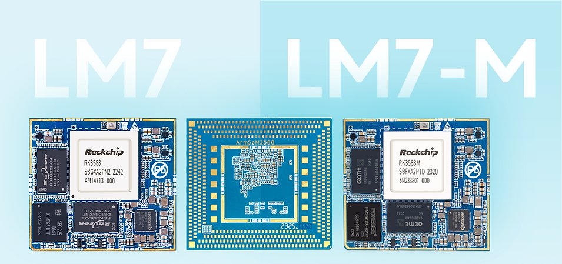

Sige7 und LM7 nutzen RK3588 für unterschiedliche Entwicklungswege. Sige7 ist ein SBC mit fertigen Anschlüssen; LM7 ein LGA-Modul für eine eigene Basisplatine. Die Unterscheidung ist nicht einfach eine Leistungsklasse.

## Zuerst die Bauform wählen

| Bedarf | Ausgangspunkt | Hauptaufgabe |
|---|---|---|
| Netzwerk, Anzeige und SSD schnell verbinden | Sige7 | Image, Peripherie, Anwendung prüfen |
| Eigene Mechanik und Anschlüsse | LM7 mit passendem Entwicklungskit | Basisplatine, Bestückung, Systemdesign |
| Steckbares Modul | AIM7 mit passendem Träger | Stecker, Pinout, Träger prüfen |

Sige7 dokumentiert zweimal 2.5GbE und einen PCIe-3.0-x4-M.2-Steckplatz. LM7 ist ein 506-poliges LGA-Modul mit 45×50mm Fläche. Schnittstellendaten sind keine garantierten Anwendungsdurchsätze.

## 1. Lokaler Speicher und Gerätedaten

SSD und Netzwerk für Dateidienste, Archivierung oder Edge-Cache nutzen. Protokoll, Dateigröße, parallele Clients und Dauerschreiben testen: Linkrate ist nicht Kopiergeschwindigkeit. Mehrere Laufwerke benötigen zusätzliche Prüfung von Controllern, Versorgung und Kühlung; ein M.2-Steckplatz allein ergibt kein NAS.

## 2. Ereignisanalyse mehrerer Kameras

Video aufnehmen oder empfangen, bedarfsgerecht Frames auswählen, vorverarbeiten und inferieren, Ereignisse zur Prüfung speichern. Kameras, Decoder, Speicher, NPU und Datenträger begrenzen gemeinsam die Streamzahl. Mit einem Stream beginnen, dann Parallelität erhöhen und verlorene Frames sowie Temperatur erfassen.

## 3. Ausstellungsterminals und Signage

Video, Weboberfläche und lokale Inhaltsverwaltung kombinieren. Display, Touch, Formate und Autostart prüfen, anschließend Updates und Wiederanlauf nach Stromausfall ergänzen. HDMI-Eingang im Chip bedeutet keinen zugänglichen Capture-Anschluss auf jedem Board; Ein- und Ausgänge getrennt prüfen.

## 4. Assistenz für industrielle Bildprüfung

Unter kontrollierter Beleuchtung Klassifikation, Zählung oder Sichtprüfung evaluieren. Ergebnisse an Bediener oder Geschäftssystem übergeben. Fehlalarme, übersehene Fehler, Gesamtlatenz und schwierige Muster gehören zur Abnahme. Das ist eine Entwicklungsrichtung, keine Sicherheits- oder Prüfzertifizierung.

## 5. Übergeordnete Roboterberechnung

Wahrnehmung, Karten und Planung auf RK3588 mit einem eigenen Bewegungscontroller verbinden. Motorregelung und Schutzfunktionen benötigen geeignete Steuerungen; normales Linux garantiert keine harte Echtzeit. Batterie, Jitter, Kühlung und Kamerasynchronisation prüfen.

## 6. Eigene kommerzielle Terminals

Nach erfolgreicher Anwendungserprobung eine LM7-Basisplatine für Gehäuse, Spezialanschlüsse und Prüfpunkte entwerfen. Einschaltfolge, Routing, Fertigung, Löten/Nacharbeit und Programmierung einplanen. LM7 verlangt laut Dokumentation 4V±5% Modulversorgung. Sige7s Boardversorgung darf nicht direkt übernommen werden.

## Vom Prototyp zur Produktion

Hardwarestand, Image, Kernel, Modell und Runtime festlegen. Recovery, Seriennummern, Logs und Updates vorsehen. Das finale Gehäuse bei realer Last und vorgesehener Umgebung qualifizieren. Kosten-, Verbrauchs- und Lebensdauervorteile werden ohne Messung nicht behauptet; Temperaturbereiche sind produktspezifisch.

## Artikelserie und Produkte

- [RK3588 erklärt: acht CPU-Kerne, 6-TOPS-NPU und schnelle Erweiterung](/de/articles/rk3588-chip-guide/)
- [AIM7 als Jetson-Nano/Orin-Alternative: Hardwareprüfung und RKNN-Migration](/de/articles/aim7-jetson-nano-orin-alternative/)
- [RK3588 Datasheet V1.4: Download, Blockdiagramm, Gehäuse und Elektrik](/de/articles/rk3588-datasheet-v14/)
- [ArmSoM AIM7](https://docs.armsom.org/armsom-aim7) · [Sige7](https://docs.armsom.org/armsom-sige7) · [LM7](https://docs.armsom.org/armsom-lm7)

## Quellen

- [Rockchip RK3588](https://www.rock-chips.com/a/en/products/RK35_Series/2022/0926/1660.html)
- [ArmSoM AIM7](https://docs.armsom.org/armsom-aim7)
- [ArmSoM Sige7](https://docs.armsom.org/armsom-sige7)
- [ArmSoM LM7](https://docs.armsom.org/armsom-lm7)
- [NVIDIA Jetson modules](https://developer.nvidia.com/embedded/jetson-modules)
- [RKNN-Toolkit2](https://github.com/airockchip/rknn-toolkit2)
