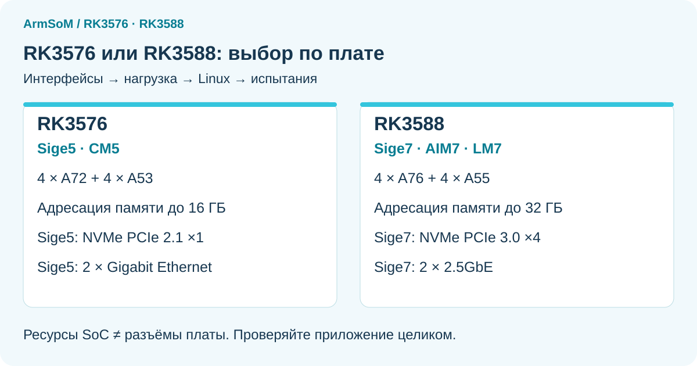
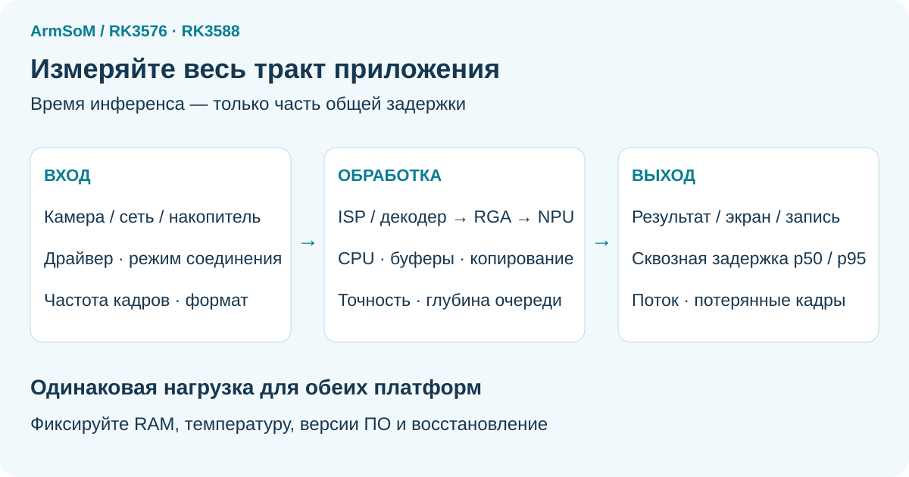

**Оценивайте RK3576, если интерфейсы Sige5 или CM5, объём памяти в пределах 16 ГБ и фактическая нагрузка соответствуют требованиям проекта. RK3588 стоит рассматривать, когда нужны более широкая подсистема памяти, NVMe PCIe 3.0 ×4 и два порта 2.5GbE на Sige7 либо больший запас ресурсов CPU/GPU для параллельных задач.** Для обеих платформ заявлены 6 TOPS, но эта цифра сама по себе не определяет скорость вашего приложения.

В руководстве сопоставлены характеристики процессоров, платы ArmSoM, программное обеспечение Linux и порядок приёмочных испытаний. Документация проверена 18 ноября 2026 года. Рекомендации по применению являются инженерным анализом, а не результатами сравнительных измерений ArmSoM. Доступные режимы зависят от ревизии платы, платы-носителя и BSP.



## 1. Чем отличаются RK3576 и RK3588?

| Параметр | RK3576 | RK3588 | Что проверить в проекте |
|---|---|---|---|
| CPU | 4× Cortex-A72 + 4× Cortex-A53 | 4× Cortex-A76 + 4× Cortex-A55 | Время CPU для логики приложения, предобработки, баз данных и контейнеров |
| GPU | Mali-G52 MC3 | Mali-G610 MC4 | Драйвер, композитор, поддерживаемые API и реальная графическая нагрузка |
| NPU | Два ядра; заявлены 6 TOPS INT8 с условием разреженности | Три ядра; заявлены 6 TOPS | Преобразование модели, операторы, точность, распределение по ядрам и задержка |
| Интерфейс памяти | 2×16 бит; LPDDR4/4X/5; адресация до 16 ГБ | 4×16 бит; LPDDR4/4X/5; адресация до 32 ГБ | Фактически установленная память и пиковое потребление приложения |
| PCIe | Ресурсы PCIe 2.1, часть интерфейсов мультиплексирована | PCIe 3.0 и дополнительные ресурсы PCIe | Выведенные линии, разводка, общие PHY и согласованная скорость |
| Мультимедиа | ISP, RGA, аппаратные кодеки и несколько интерфейсов дисплея | ISP, RGA, аппаратные кодеки, несколько дисплеев и HDMI RX | Ограничения конкретного кодека, драйверы сенсоров и одновременные режимы |
| ПО NPU | RKNN-Toolkit2 / RKNPU2 | RKNN-Toolkit2 / RKNPU2 | Совместимые средства преобразования, библиотека исполнения и драйвер ядра |

Характеристики SoC основаны на [спецификации RK3576](https://www.rock-chips.com/a/en/products/RK35_Series/2024/1212/2033.html), [спецификации RK3588](https://www.rock-chips.com/a/en/products/RK35_Series/2022/0926/1660.html) и документах, разобранных в материалах по [RK3576](/ru/articles/rk3576-datasheet-v10/) и [RK3588](/ru/articles/rk3588-datasheet-v14/). Это возможности микросхем, а не перечень разъёмов каждой платы.

У RK3588 шире шина памяти, но из этого не следует двукратная производительность приложения. На полезную пропускную способность влияют тип и частота DRAM, кэш, копирование данных и конкуренция между блоками. Названия ядер CPU также не задают постоянный коэффициент ускорения или разницу в энергопотреблении.

Для видео отдельно рассматривайте **декодирование, кодирование и вывод на дисплей**. Например, подробная спецификация RK3588 задаёт разные пределы для H.265 и AV1: обозначение «8K» не относится ко всем кодекам. В раннем полном datasheet RK3576 и более позднем Brief видеорежимы также представлены по-разному. Зафиксируйте кодек, профиль, разрядность, разрешение и частоту кадров, затем проверьте их на выбранном образе ОС. Нельзя собирать безусловную характеристику из максимальных цифр разных документов.

## 2. Sige5 и Sige7: сравнение доступных разъёмов

При создании прототипа на одноплатном компьютере разводка платы зачастую важнее полной блок-схемы SoC. В руководствах [Sige5](https://docs.armsom.org/armsom-sige5) и [Sige7](https://docs.armsom.org/armsom-sige7) указаны следующие различия:

| Параметр платы | ArmSoM Sige5 | ArmSoM Sige7 |
|---|---|---|
| Процессор | RK3576 | RK3588 |
| Конфигурации RAM в документации | 8/16 ГБ, 32-битная LPDDR4X | 8/16/32 ГБ, 64-битная LPDDR4/4X |
| Разъём NVMe | M.2 Key M, PCIe 2.1 ×1 | M.2 Key M, PCIe 3.0 ×4 |
| Проводная сеть | 2× Gigabit Ethernet | 2× 2.5 Gigabit Ethernet |
| Разъёмы камер | 2× четырёхлинейный MIPI CSI | 2× четырёхлинейный MIPI CSI |
| Интерфейсы дисплеев | HDMI, USB-C DisplayPort и MIPI DSI | HDMI, USB-C DisplayPort и MIPI DSI |
| Габариты платы | 92 × 62 мм | 92 × 62 мм |

SSD с поддержкой PCIe 3.0 ×4 может согласовать более медленное и узкое соединение с другим хостом. Его заявленная скорость на настольном ПК не переносится на линию ×1 у Sige5. Оба руководства указывают NVMe для этого разъёма M.2: внешнее сходство не делает накопитель M.2 SATA совместимым.

Для работы портов Sige7 в режиме 2.5GbE соответствующий режим должны поддерживать коммутатор, кабель и другая сторона соединения. Два порта не образуют автоматически одно соединение двойной скорости. Аналогично, два разъёма CSI не подтверждают совместимость камеры: проверьте драйвер сенсора, линии, питание, тактирование, дерево устройств и настройку ISP.

Одинаковая длина и ширина плат помогают при предварительной оценке корпуса, но не гарантируют одинаковые зазоры, расположение разъёмов или электрическую совместимость выводов. Перед повторным использованием корпуса проверьте механические чертежи.

## 3. Переход от отладочной платы к CM5, AIM7 или LM7

Одноплатный компьютер уже содержит разъёмы и значительную часть периферийной обвязки. Вычислительный модуль переносит часть интеграции на вашу плату-носитель.

| Продукт | Платформа и исполнение | Исходная задача |
|---|---|---|
| [CM5](https://www.armsom.org/cm5) | RK3576; модуль 55 × 40 мм | Компактная плата-носитель для терминала, шлюза или системы зрения |
| [AIM7](https://www.armsom.org/aim7) | RK3588; модуль SO-DIMM, 260 контактов | Съёмный вычислительный модуль на проверенной плате-носителе |
| [LM7](https://www.armsom.org/lm7) | RK3588; модуль LGA 45 × 50 мм | Впаиваемый модуль в серийном изделии |

[Документация CM5](https://docs.armsom.org/armsom-cm5) различает конфигурации V1.3 с LPDDR5 и V2.0 с LPDDR4X. Поддержка LPDDR5 процессором RK3576 не означает, что этот тип памяти установлен на любой Sige5 или CM5. Проверьте заказанную комплектацию и ревизию.

Для [AIM7](https://docs.armsom.org/armsom-aim7) необходимо сверить распиновку и проверенную конфигурацию носителя. Совпадение формата модуля не гарантирует совместимость со всеми платами Jetson или программами CUDA. При выборе [LM7](https://docs.armsom.org/armsom-lm7) учитывайте монтаж, целостность сигналов на носителе, последовательность питания и ремонт. Переход с SBC на модуль требует повторной проверки дерева устройств и периферии.

## 4. Выбор по полной нагрузке приложения

### Машинное зрение и промышленный контроль

Видеотракт включает захват, обработку ISP или декодирование, масштабирование и преобразование цвета, инференс и постобработку. Начните с Sige5, если её интерфейсы камер и бюджет памяти подходят для прототипа. Рассматривайте Sige7, когда ограничивающими факторами становятся параллельные службы, буферы кадров или обработка на CPU/GPU. Ни один выбор сам по себе не гарантирует определённое число потоков с ИИ.

Измеряйте время от поступления кадра до готового результата, включая очереди и перенос данных. Быстрый вызов NPU не спасает от задержек, если основное время занимает масштабирование на CPU или копирование кадров. В [RKNN-Toolkit2](https://github.com/airockchip/rknn-toolkit2) перечислены обе платформы, но модель нужно преобразовать и проверить для выбранной цели.

### NAS, регистрация данных и сетевые шлюзы

Sige5 подходит для оценки проекта, которому достаточно двух гигабитных портов и однолинейного NVMe. Sige7 предоставляет более подходящий набор интерфейсов, если нужны два порта 2.5GbE и более широкое соединение NVMe. Это различия интерфейсов, а не измеренные скорости передачи файлов.

Включите в испытания шифрование, файловую систему, мелкие файлы, температуру SSD и восстановление после потери питания. Наличие SATA в SoC не превращает разъём платы, рассчитанный только на NVMe, в SATA-разъём.

### HMI, киоски и информационные терминалы

Для устройства с заданной конфигурацией экранов сначала проверьте тайминги панели, сенсорный ввод, композитор и аппаратную обработку видео. RK3588 стоит оценивать, если реальная графическая нагрузка или одновременная работа дисплеев требуют большего запаса ресурсов. Число дисплейных блоков SoC не доказывает доступность конкретной комбинации экранов: интерфейсы могут делить ресурсы, а BSP должен поддерживать выбранный режим.

### Контейнеры и периферийные вычислительные службы

Для шлюза с базой данных, брокером сообщений и инференсом учитывайте память ОС, модели, кадров, файлового кэша и пиковых очередей. Изделия на RK3588 с 32 ГБ полезно рассмотреть, если измеренный рабочий набор превышает 16 ГБ. Контейнеры не устраняют зависимость от оборудования: доступ к GPU, NPU и мультимедиа по-прежнему требует подходящего ядра хоста, прав на устройства и совместимых библиотек.

## 5. Выберите образ Linux до фиксации аппаратной части

«Linux загружается» и «все ускорители работают в моём приложении» — разные этапы приёмки. Начните с образа для конкретной платы, указанного в [руководстве ArmSoM](https://docs.armsom.org/getting-started), и зафиксируйте версии ядра и пакетов.

| Программный слой | Что проверить перед выбором |
|---|---|
| Загрузчик, ядро и дерево устройств | Ревизия платы, регуляторы питания, мультиплексирование выводов и включённые устройства |
| Графика и дисплей | Драйвер ядра, Mesa или библиотеки поставщика, композитор и версии API |
| Видео и обработка изображений | Библиотеки MPP/RGA и фактическое использование ускорения приложением |
| NPU | Цель преобразования, библиотека RKNN, совместимость драйвера и точность модели |
| Сопровождение изделия | Обновления, исправления безопасности, восстановление и ответственное сопровождение базовой версии |

[Rockchip MPP](https://github.com/rockchip-linux/mpp) предоставляет компоненты обработки мультимедиа. Установка FFmpeg или GStreamer не доказывает, что конкретная сборка использует их. Проверяйте журналы приложения и загрузку CPU на репрезентативных файлах. Образ с BSP поставщика и дистрибутив, ориентированный на upstream, могут поддерживать разные наборы функций на одной плате.

При преобразовании через RKNN-Toolkit2 выбирайте `target_platform="rk3576"` или `target_platform="rk3588"` и сохраняйте отдельные результаты преобразования. Нельзя считать, что модель, маска ядер NPU, загрузочный образ или дерево устройств переносятся без изменений. Сохраняйте модель, калибровочные данные и версии SDK/библиотеки исполнения в описании развёртывания.

## 6. Проверка прототипа Linux реальными командами

Следующие команды читают сведения о системе, не прошивают накопители и не меняют частоты. Это примеры для оболочки Linux, не команды Android ADB. Состав утилит зависит от образа. Отсутствие команды или ограниченные права не означают отсутствия оборудования.

### Плата, операционная система и память

```bash
uname -a
cat /etc/os-release
for f in /proc/device-tree/model /proc/device-tree/compatible; do
  if [ -r "$f" ]; then
    printf '\n%s\n' "$f"
    tr '\000' '\n' < "$f"
  fi
done
command -v lscpu >/dev/null 2>&1 && lscpu
free -h
lsblk -o NAME,SIZE,TYPE,FSTYPE,MOUNTPOINT
```

`MemTotal` и `free` показывают память, доступную Linux: из-за резервируемых областей она может быть меньше физического объёма RAM. `lsblk` описывает накопители, а не измеряет их скорость. Помимо вывода команд запишите аппаратную ревизию с маркировки платы.

### PCIe, USB и сетевые соединения

```bash
command -v lspci >/dev/null 2>&1 && lspci -nn
command -v lsusb >/dev/null 2>&1 && lsusb -t
for d in /sys/bus/pci/devices/*; do
  [ -d "$d" ] || continue
  printf '\n%s\n' "${d##*/}"
  for f in current_link_speed current_link_width; do
    [ -r "$d/$f" ] && { printf '%s: ' "$f"; cat "$d/$f"; }
  done
done
if command -v ethtool >/dev/null 2>&1; then
  for d in /sys/class/net/*; do
    name=${d##*/}
    [ "$name" = lo ] && continue
    printf '\n%s\n' "$name"
    ethtool "$name"
  done
fi
```

Параметры PCIe отражают текущее состояние соединения, а не результат измерения пропускной способности. До сравнения приложений устраните неожиданно малое число линий, пониженную скорость PCIe, переход USB на 2.0 или согласование Ethernet на 100 Мбит/с. В Debian/Ubuntu соответствующие утилиты обычно входят в `pciutils`, `usbutils` и `ethtool`.

### Камеры и дисплейные устройства

```bash
command -v v4l2-ctl >/dev/null 2>&1 && v4l2-ctl --list-devices
if command -v media-ctl >/dev/null 2>&1; then
  for d in /dev/media*; do
    [ -e "$d" ] || continue
    media-ctl -d "$d" -p
  done
fi
for d in /sys/class/drm/card*-*; do
  [ -r "$d/status" ] || continue
  printf '\n%s\n' "${d##*/}"
  cat "$d/status"
  [ -r "$d/modes" ] && cat "$d/modes"
done
```

Наличие `/dev/video*` не доказывает, что найденная нода — камера: такие устройства могут относиться и к кодекам. Определите сенсор и граф мультимедиа, затем запустите захват примером, поддерживаемым на плате. Режим HDMI в списке DRM не доказывает, что весь тракт рендеринга или воспроизведения способен его поддерживать непрерывно. `v4l2-ctl` и `media-ctl` обычно входят в `v4l-utils`.

### Температура и частота под нагрузкой

```bash
for d in /sys/class/thermal/thermal_zone*; do
  [ -r "$d/temp" ] || continue
  printf '%s ' "${d##*/}"
  [ -r "$d/type" ] && tr '\n' ' ' < "$d/type"
  cat "$d/temp"
done
for d in /sys/devices/system/cpu/cpufreq/policy*; do
  [ -d "$d" ] || continue
  printf '\n%s\n' "${d##*/}"
  for f in scaling_governor scaling_cur_freq scaling_max_freq; do
    [ -r "$d/$f" ] && { printf '%s: ' "$f"; cat "$d/$f"; }
  done
done
```

Температуры thermal zone обычно выражены в тысячных долях градуса Цельсия, а показанные частоты cpufreq — в кГц. Названия зон и доступность файлов зависят от BSP. Это моментальные показания, а не измерение электрической мощности или доказательство троттлинга. Повторяйте наблюдения при одинаковой нагрузке и сопоставляйте частоту с температурой и задержкой.

## 7. Приёмочные испытания, влияющие на выбор



Используйте одинаковые входные данные, настройки модели и конфигурацию служб на обеих платформах. Допускайте необходимые платформенные драйверы и преобразование модели под цель, но фиксируйте различия. Например, «два видеопотока 1080p и запись событий» — определение теста, а не утверждение, что какая-либо плата уже его прошла.

| Область приёмки | Что записывать | Типичная проблема |
|---|---|---|
| Функции | Все обязательные устройства и одновременные режимы | Разъём есть, но драйвер или общий ресурс недоступен |
| Производительность приложения | Устойчивая пропускная способность, p50/p95 задержки, глубина очередей | Предобработка на CPU или копирование занимают больше времени, чем NPU |
| Память и накопитель | Пиковая память, swap, характер записи, свободное место | Рабочий набор или всплески записи превышают бюджет |
| Длительная работа | Продолжительность, окружающие условия, корпус, температуры | После прогрева тепловые или энергетические ограничения меняют результат |
| Восстановление и обновление | Перезагрузка, переподключение периферии и откат | Успешный лабораторный запуск не воспроизводится после обновления |

Определите критерии прохождения до начала испытаний. Сравнивайте стоимость системы с учётом охлаждения, накопителя, блока питания и разработки носителя. Из названия процессора не следует универсальный вывод «RK3576 всегда потребляет меньше».

## 8. Частые вопросы при выборе

### Одинаковые 6 TOPS означают одинаковую скорость ИИ?

Нет. Заявленное значение RK3576 включает условие разреженности; поддержка модели и операторов, передача данных и планирование также влияют на результат. Сравнивайте точность и сквозную задержку одной модели на целевом ПО.

### Можно использовать образ Sige5 на Sige7?

Используйте образ для соответствующей платы. Исходный код приложения или переносимые контейнеры могут подойти, но загрузочные компоненты, дерево устройств и библиотеки ускорителей нужно проверить отдельно.

### Можно считать RK3588S эквивалентом RK3588 в этой статье?

Нет. Набор периферийных ресурсов RK3588S отличается. Указанные здесь PCIe и сетевые возможности Sige7 не относятся автоматически к CM7S или Sige7S. Для этих продуктов изучите отдельное [руководство RK3588S](/ru/articles/rk3588s-chip-guide/).

### С какого продукта ArmSoM начать?

Начните с [Sige5](https://www.armsom.org/sige5) или [Sige7](https://www.armsom.org/sige7) для проверки периферии и ПО. Переходите к CM5, AIM7 или LM7 после уточнения требований к носителю, размерам и производству. На каждом этапе сопоставляйте таблицу требований с руководством конкретной платы.

## 9. Руководства для дальнейшей реализации

- [Архитектура RK3576 и планирование применения](/ru/articles/rk3576-chip-guide/)
- [Архитектура RK3588 и планирование применения](/ru/articles/rk3588-chip-guide/)
- [RKNN2 и RKNN3: выбор программного стека NPU](/ru/articles/rockchip-npu-rknn2-rknn3-getting-started/)
- [Руководство по разработке с Rockchip MPP](/ru/articles/089-rockchip-mpp/)
- [Проекты Armbian на Sige5 и Sige7](/ru/articles/sige5-sige7-armbian-projects/)
