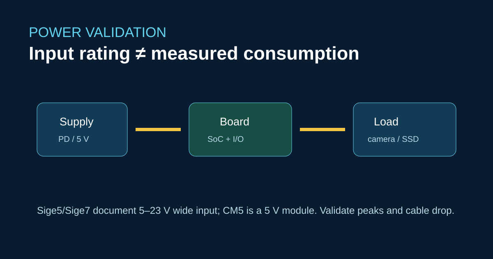

# Расчёт питания для систем на ArmSoM Sige5 и Sige7



ArmSoM указывает для Sige5 и Sige7 диапазон входного напряжения 5–23 V, а модуль CM5 использует шину 5 V. Номинальные параметры описывают допустимое питание платы, но не пиковый ток SSD, камеры, USB-устройства или вентилятора.

## Измеряйте всю систему

Используйте включённый в цепь измеритель или осциллограф у разъёма платы. Проверьте холодный запуск, нагрузку CPU и NPU, вывод изображения, сетевой трафик и хранилище одновременно. Регистрируйте напряжение на плате, а не только у адаптера.

```bash
for z in /sys/class/thermal/thermal_zone*/temp; do
  printf '%s ' "$z"; cat "$z"; done
cat /sys/devices/system/cpu/cpufreq/policy*/scaling_cur_freq
```

Выбирайте источник питания с запасом на сопротивление кабеля и переходные нагрузки. Согласование PD, работающее на стенде, может нарушиться с длинным кабелем или при одновременном запуске вентилятора корпуса.

## Границы переноса

Предположения о питании Raspberry Pi HAT и требования к цилиндрическому разъёму Jetson Nano нельзя автоматически применять к разъёмам ArmSoM. Заново определите распиновку, профиль PD, тепловой контакт и воздушный поток корпуса.

## Источники

- [Спецификации и документация Sige5](https://docs.armsom.org/armsom-sige5)
- [Спецификации и документация Sige7](https://docs.armsom.org/armsom-sige7)
- [Руководство по запуску и питанию семейства Sige](https://docs.armsom.org/sige-family-started)

## Проверки перед публикацией

- [ ] Укажите источник питания, кабель, периферийную нагрузку и условия среды.
- [ ] Проверьте худший случай совмещённой нагрузки.
- [ ] Не представляйте диапазон входного напряжения как измеренное потребление.
